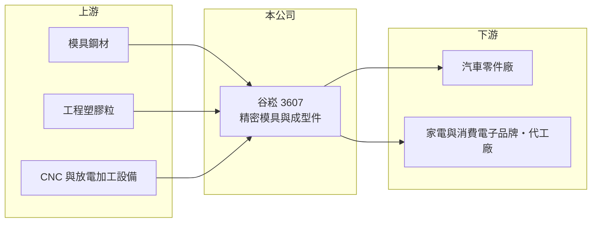

# 3607 谷崧

> 上市｜[[產業索引-電子零組件業|電子零組件業]]｜上市（櫃）日期 2009/10/28

# 第一章：企業模式與商業藍圖

> [!info] 撰寫說明
> 精簡版，由 Claude 依公開資料整理，架構比照 [[2330台積電]]，資料截至 2026-10-08。來源：證交所開放資料（基本資料、2026 年第二季財報、營益分析、股利）、Goodinfo 經營績效頁、nStock 公司簡介。產品應用、客戶與廠區依產業常識整理，公開資料有限。#待校對

谷崧精密是以精密模具為核心的製造廠，業務從模具開發延伸到[[塑膠射出]]成型與零件組裝。模具是製造業的「母機」，每一款新產品都需要新的模具，因此谷崧的訂單與客戶的新產品開發節奏高度相關。

- **核心業務：** 谷崧成立於 1989 年，2009 年在證交所上市。登記業務包括各種[[模具]]與金屬零件製造、塑膠成型製品與零件，以及電子電機零件的開發製造。市場一般將其歸類為汽車零件（如車燈）、家電與消費電子機構件的模具與成型廠（待校對）。
- **營收結構：** 產品別與應用別營收比重未查得。模具廠的營收通常分為「模具開發費」與「量產零件」兩部分：前者毛利較高但不連續，後者金額較穩定但毛利較低（推估）。
- **營運據點：** 生產據點未查得，業界多數台系模具廠在中國華南、華東設廠，近年再往東南亞布局（待校對）。富果研究有 2025 年 12 月法說會紀錄，可作為後續校對產品結構的來源。
- **長期方向：** 模具業的長期機會在汽車電動化與輕量化帶來的新模具需求，以及供應鏈移出中國時的新廠開模需求。谷崧能否從消費電子轉向汽車等驗證期長、黏著度高的市場，是長期轉型的關鍵。

# 第二章：護城河深度與競爭優勢

模具廠的競爭力來自設計與加工經驗、交期，以及和客戶一起開發新產品的能力，但這個產業也高度分散、價格競爭激烈。

- **競爭優勢：** 精密模具需要長年累積的設計經驗與加工設備，新進者很難在短時間內達到同樣的精度與交期。客戶一旦在某家模具廠開模，後續量產與修模多半延續給同一家，形成一定的黏著度。
- **主要對手：** 台灣與中國有大量中小型模具與射出廠；汽車零件領域的台灣同業包括車燈廠 [[6605帝寶]] 等自有模具能力的業者，以及中國的大型模具集團。由於產業分散，谷崧的規模優勢有限。
- **觀察重點：** 2020 至 2022 年毛利率接近零、營業利益率為 -12% 至 -15%，之後毛利率回到 8% 至 10%，但營業利益仍為負。觀察重點是毛利率能否持續回升到 15% 以上，讓本業轉為穩定獲利。

# 第三章：財務體質與盈利規模

資料日期：2026-10-08，表格是撰寫當時的快照；最新月營收、毛利率、累計 EPS 由自動排程寫在本筆記的屬性欄位（月營收、毛利率、累計EPS 等）。#待校對

谷崧近六年本業都是虧損，靠業外收益才讓近兩年 EPS 轉正，財務重點在於本業何時轉盈。

| 年度 | 營收（億元） | [[毛利率]] | [[營業利益率]] | EPS（元） | [[ROE]] |
|---|---|---|---|---|---|
| 2020 | 33.2 | 0.33% | -13.8% | -3.32 | -14.2% |
| 2021 | 38.4 | 0.23% | -12.1% | -2.22 | -11.5% |
| 2022 | 28.6 | -0.16% | -15.4% | -2.23 | -11.8% |
| 2023 | 26.4 | 8.66% | -5.18% | -0.36 | -2.08% |
| 2024 | 31.4 | 9.46% | -2.03% | 0.17 | 1.16% |
| 2025 | 27.8 | 10.3% | -2.88% | 0.02 | 0.12% |
| 2026 上半年 | 14.3 | 13.79% | -0.50% | 0.07 | 未查得 |

- **營收規模：** 2020 至 2025 年營收年複合成長率約 -3.5%（推算），營收在 26 億至 38 億元之間波動，沒有明顯成長。
- **獲利：** 2021 至 2025 年平均 ROE 約 -4.8%（推算）。2024 至 2025 年營業虧損但 EPS 為正，代表有[[業外收入]]（利息、投資或處分利益等，原因未查得）支撐，這類收益持續性較低。
- **財務特色：** 2026 年第二季總資產 31.3 億元、負債 14.0 億元（幾乎都是流動負債）、權益 17.2 億元，每股淨值 14.15 元。2025 年度未以盈餘配發現金股利。

**[[ROIC]] 與 [[WACC]]：** 開放資料未拆出有息負債，以負債總額 40% 估約 5.6 億元（推算假設）。2025 年營業虧損約 0.8 億元，除以權益 17.2 億元加有息負債 5.6 億元，ROIC 約 -3.5%；2026 年上半年接近損益兩平，ROIC 約 -0.6%（推算）。WACC 以 CAPM 推估：無風險利率 1.75%、市場風險溢酬 6%、β 取 1.0（同業常見值），股權成本 7.75%；稅後負債成本 2%，股權占比約 75%，WACC 約 6.3%（推算）。ROIC 長期為負，表示本業尚未創造價值；虧損幅度逐年縮小是正面訊號，但距離超過資金成本仍有很大距離。

# 第四章：總體風險與地緣政治

谷崧的風險在於本業長期虧損、產業高度分散，以及客戶新產品週期的不確定。

- **產業週期：** 模具訂單取決於客戶推出新產品的頻率，消費電子與汽車景氣下滑時，客戶會延後開模，模具廠營收立即受到影響。量產零件則跟著終端銷售量起伏。
- **營運風險：** 模具製造需要大量工時與設備，產能利用率不足時固定成本難以分攤，這是 2020 至 2022 年毛利率接近零的主因之一（推估）。若客戶集中在少數產業，單一客戶轉單影響很大。
- **其他風險：** 生產若集中在中國，會受到工資上升、關稅與客戶要求移轉產地的影響；塑膠粒與鋼材價格、匯率變動也會影響成本。

# 專有名詞解析

## 金融

- **[[業外收入]]**：本業營運以外的收入，例如利息、投資收益、處分資產利益，持續性通常低於本業獲利。

## 產業

- **[[模具]]**：讓塑膠或金屬成形的精密工具，一款新產品通常需要一套新模具，模具品質決定零件的精度與良率。
- **[[塑膠射出]]**：把加熱融化的塑膠注入模具、冷卻成形的製程，用於生產機殼與精密零件，模具品質決定良率與外觀。

# 核心供應鏈

- 上游：模具鋼材、工程塑膠粒、CNC 與放電加工設備。
- 下游／客戶：汽車零件、家電與消費電子品牌及代工廠（推估）；具名客戶未查得。
- 同業：國內外中小型模具與射出成型廠；有自有模具能力的車燈廠 [[6605帝寶]]。

## 最新新聞
<!-- news:start -->
<!-- news:end -->

## 相關連結
- [公開資訊觀測站](https://mopsov.twse.com.tw/mops/web/t05st03?step=1&firstin=1&co_id=3607)
- [Goodinfo](https://goodinfo.tw/tw/StockDetail.asp?STOCK_ID=3607)
- [Yahoo 股市](https://tw.stock.yahoo.com/quote/3607)
- [鉅亨網新聞](https://www.cnyes.com/twstock/3607/news)
