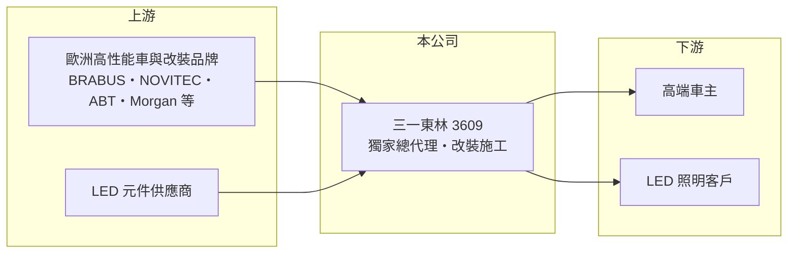

# 3609 三一東林

> 上櫃｜[[產業索引-電子零組件業|電子零組件業]]｜上市（櫃）日期 2011/01/11

# 第一章：企業模式與商業藍圖

> [!info] 撰寫說明
> 精簡版，由 Claude 依公開資料整理，架構比照 [[2330台積電]]，資料截至 2026-10-08。來源：櫃買中心開放資料（基本資料、2026 年第二季財報）、Goodinfo 經營績效頁、聯合新聞網 2025 年 11 月財報報導（業務內容與處分總部利益）。公開資料有限，各事業營收比重未查得。#待校對

三一東林在證券分類上屬於電子零組件業，但現在的主要業務已是高端汽車代理與改裝精品，LED 照明只剩部分業務。對長期研究者而言，它是一家「從 LED 轉型為精品汽車通路」的公司，評估方式應比照代理商而非零組件廠。

- **核心業務：** 公司成立於 2002 年，2011 年在櫃買中心掛牌，早期以 LED 照明為主（待校對）。依 2025 年報導，公司擔任 BRABUS、9FF、HOF、NOVITEC、ABT、Morgan 等國際高性能與豪華車品牌的台灣獨家總經銷，並代理德國、英國的外觀、動力、內裝與燈具改裝套件。LED 事業部則已進行調整縮編。
- **營收結構：** 各事業營收比重未查得。2025 年前三季營收約 3.8 億元，年增約 27%，成長來自高端車銷售與改裝精品需求（聯合新聞網 2025 年 11 月）。
- **營運據點：** 總部原在台中，2025 年第三季處分台中總部大樓，處分利益約 3.97 億元入帳。處分後營業費用下降，資產結構也由持有不動產轉為較輕的營運模式。
- **長期方向：** 公司以「高感度科技品味生態系」為策略，計畫把業務從車輛美學延伸到居家與個人風格領域，整合燈光、家居與 AI 相關生活產品。這個方向目前還沒有具體時程或營收目標，屬於仍在形成中的轉型。

# 第二章：護城河深度與競爭優勢

[[品牌代理]]業的護城河主要來自代理權本身，以及服務高端客群的能力。

- **競爭優勢：** 頂級改裝品牌在台灣通常只授權一家總代理，取得獨家代理權後，在當地市場就沒有同品牌的直接競爭者。高端車主重視服務、改裝施工品質與售後維修，長期經營的代理商較容易累積口碑與回頭客。
- **主要對手：** 國內豪華車與改裝市場的競爭者包括原廠總代理體系（如汎德、[[2207和泰車]] 等主流品牌代理商）與其他改裝精品進口商。三一東林代理的多為小眾高性能品牌，與主流品牌代理商的客群重疊有限。
- **觀察重點：** 代理商模式的關鍵是代理權的穩定與存貨控制。高端車單價高、銷量少，一兩台車的成交就會讓營收大幅波動；觀察重點是本業能否在沒有處分利益的情況下，營業利益轉正。

# 第三章：財務體質與盈利規模

資料日期：2026-10-08，表格是撰寫當時的快照；最新月營收、毛利率、累計 EPS 由自動排程寫在本筆記的屬性欄位（月營收、毛利率、累計EPS 等）。#待校對

三一東林本業連續多年虧損，2025 年因處分總部大樓才出現大額獲利，看財報時必須把一次性利益分開。

| 年度 | 營收（億元） | [[毛利率]] | [[營業利益率]] | EPS（元） | [[ROE]] |
|---|---|---|---|---|---|
| 2020 | 4.64 | 33.5% | -4.43% | -0.19 | -1.2% |
| 2021 | 8.12 | 23.9% | 1.11% | 0.01 | 0.03% |
| 2022 | 8.02 | 19.1% | -10.9% | -2.76 | -18.0% |
| 2023 | 6.26 | 10.8% | -29.8% | -5.73 | -44.4% |
| 2024 | 3.90 | 23.2% | -38.6% | -4.71 | -52.2% |
| 2025 | 6.65 | 11.1% | -21.2% | 6.42 | 61.4% |
| 2026 上半年 | 1.80 | 26.6% | -38.1% | -1.88 | 未查得 |

- **營收規模：** 營收在 4 億至 8 億元之間大幅波動，沒有穩定成長趨勢。代理高單價車款的特性，使年度營收容易受少數交易影響。
- **獲利：** 2025 年 EPS 6.42 元、ROE 61.4%，主要來自處分總部約 3.97 億元的一次性利益，本業營業利益率仍為 -21.2%。若扣除這筆利益，2022 至 2025 年本業每年都是虧損，平均 ROE 不具參考意義。
- **財務特色：** 2026 年第二季總資產 10.2 億元、負債 5.7 億元、權益 4.47 億元，每股淨值 11.68 元。2025 年 11 月董事會通過庫藏股計畫，預計買回 250 萬股，上限 1.775 億元，用於員工激勵。

**[[ROIC]] 與 [[WACC]]：** 開放資料未拆出有息負債，以負債總額 50% 估約 2.9 億元（推算假設，代理商的負債可能包含購車融資）。2025 年營業虧損約 1.41 億元，除以權益 4.47 億元加有息負債 2.9 億元，ROIC 約 -19%（推算，不含處分利益）。WACC 以 CAPM 推估：無風險利率 1.75%、市場風險溢酬 6%、β 取 1.0（同業常見值），股權成本 7.75%；稅後負債成本 2%，股權占比約 61%，WACC 約 5.5%（推算）。本業 ROIC 遠低於 WACC，公司目前靠處分資產維持帳面獲利，尚未證明新事業能創造價值。

# 第四章：總體風險與地緣政治

三一東林的風險集中在代理權、高端消費景氣與轉型執行。

- **產業週期：** 高端汽車與改裝精品屬於奢侈性消費，受股市財富效應與景氣影響很大。景氣轉弱時，富裕客群也會延後購買，營收可能急速下滑。
- **營運風險：** 代理權可能被原廠收回或改授權他人，這是品牌代理商最大的結構性風險。高單價車輛的存貨若賣不掉，需要負擔資金成本與跌價損失。
- **其他風險：** 代理品牌多為歐洲廠，歐元匯率變動直接影響進貨成本；進口車關稅、貨物稅與排放法規變動也會影響售價。處分總部後已沒有大型資產可再處分，未來若本業持續虧損，權益會再度下降。

# 專有名詞解析

## 金融

- **[[業外收入]]**：本業營運以外的收入，例如利息、投資收益、處分資產利益，持續性通常低於本業獲利。
- **[[庫藏股]]**：公司買回自家已發行的股票，可用於轉讓員工、維護股價或註銷，買回期間會動用公司現金。

## 產業

- **[[品牌代理]]**：取得國外品牌在特定市場的進口與銷售權，負責法規、通路、行銷的商業模式，風險在於代理權可被收回。

# 核心供應鏈

- 上游：BRABUS、9FF、HOF、NOVITEC、ABT、Morgan 等歐洲高性能與豪華車品牌，以及 LED 元件供應商。
- 下游／客戶：國內高端汽車車主與改裝需求客戶、LED 照明客戶。
- 同業：國內汽車代理商如 [[2207和泰車]]、汎德，以及其他改裝精品進口商。

## 最新新聞
<!-- news:start（自動產生，請勿手動編輯此範圍） -->
- 2026-10-14 🏛️ 重訊 17:11｜更正115年09月份背書保證資訊揭露明細表(CHUAN WEI)｜[觀測站](https://mops.twse.com.tw/mops/#/web/t05st01)

完整紀錄：[[3609三一東林 新聞]]
<!-- news:end -->

## 相關連結
- [公開資訊觀測站](https://mopsov.twse.com.tw/mops/web/t05st03?step=1&firstin=1&co_id=3609)
- [Goodinfo](https://goodinfo.tw/tw/StockDetail.asp?STOCK_ID=3609)
- [Yahoo 股市](https://tw.stock.yahoo.com/quote/3609)
- [鉅亨網新聞](https://www.cnyes.com/twstock/3609/news)
