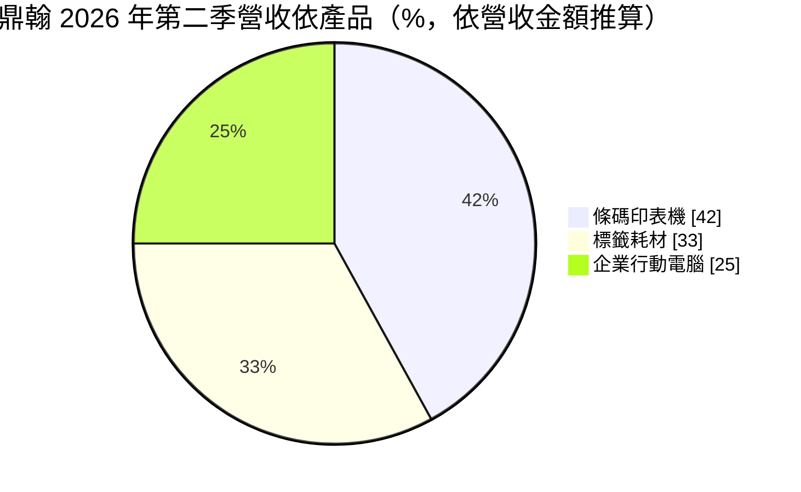
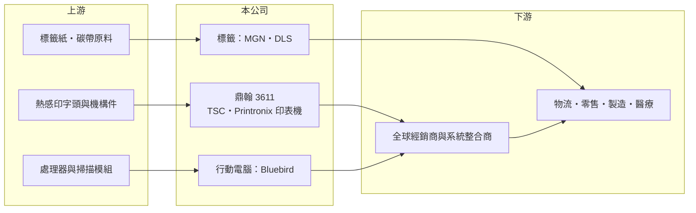

# 3611 鼎翰

> 上櫃｜[[產業索引-電腦及週邊設備業|電腦及週邊設備業]]｜上市（櫃）日期 2008/11/26

# 第一章：企業模式與商業藍圖

> [!info] 撰寫說明
> 精簡版，由 Claude 依公開資料整理，架構比照 [[2330台積電]]，資料截至 2026-10-08。來源：櫃買中心開放資料（基本資料、2026 年第二季資產負債與綜合損益、2026 年 8 月營收）、Goodinfo 經營績效頁、優分析 2026 年 9 月 17 日第二季營運報導。Printronix 併購年份與工廠位置依整理性知識撰寫。#待校對

鼎翰是台灣最大的 [[條碼印表機]] 品牌廠之一，透過一連串併購，從賣印表機延伸到標籤耗材與 [[企業行動電腦]]，目標是成為完整的 [[AIDC]]（自動識別與資料擷取）方案商。

- **核心業務：** 鼎翰成立於 2007 年，2008 年在櫃買中心掛牌，以 TSC 品牌銷售桌上型與工業型條碼印表機，並擁有美國 Printronix 品牌的工業與行列印表機（併購年份約 2018 年，待校對）。條碼印表機用於物流、零售、製造與醫療，負責印出出貨標籤、價格標籤與追蹤碼，是供應鏈數位化的基礎設備。
- **營收結構：** 依 2026 年第二季資料，印表機營收 13.19 億元、標籤 10.46 億元、企業行動電腦 7.78 億元，概略比重為 42%、33%、25%。標籤業務來自歐洲 MGN 與美國 DLS 等併購的標籤廠，屬於客戶持續消耗的耗材，營收穩定度高於設備。
- **併購與據點：** 2024 年 11 月併購韓國 Bluebird，取得企業行動電腦（手持式掃描與資料終端）產品線，這也是 2025 年營收由 88 億元跳升到 115 億元的主因。公司在美國、歐洲設有倉儲，並在中國設立研發中心；印表機主要生產基地在中國大陸（待校對）。
- **長期方向：** 鼎翰把印表機、標籤耗材與行動電腦整合為完整 AIDC 方案，讓客戶一次購足。下一階段成長點包括 [[RFID]]、歐盟數位產品護照（2027 年起由電池開始實施）與 GS1 Digital Link，零售業預計在 2027 年底前後由一維條碼轉向二維條碼，將帶動標籤與印表機的換機需求。

# 第二章：護城河深度與競爭優勢

鼎翰的護城河是自有品牌、全球通路與「設備加耗材」的商業模式，併購讓它在全球條碼印表機市場取得前段班的位置。

- **競爭優勢：** 條碼印表機售出後，客戶要持續購買標籤與碳帶，鼎翰透過併購標籤廠把這部分耗材收入留在集團內，形成類似「刮鬍刀與刀片」的經常性收入。全球經銷商網路與 Printronix、TSC 雙品牌，讓它能同時覆蓋中低階與高階工業市場。毛利率長期穩定在 31% 至 36%，反映品牌與產品組合的定價能力。
- **主要對手：** 全球條碼印表機與行動電腦龍頭為美國 Zebra，另有 Honeywell、日本 SATO、東芝泰格（Toshiba Tec）等。台灣同業有 [[6160欣技]]、[[3652精聯]]（行動電腦與掃描器），以及中國大陸的低價印表機品牌。與 Zebra 相比，鼎翰的規模與軟體生態仍小，但價格與產品彈性較佳。
- **觀察重點：** 第一是 Bluebird 能否把行動電腦打進大型專案，並降低併購後增加的費用率。第二是 RFID 與二維條碼轉換能否帶動新一輪換機。第三是營業利益率能否從 10% 左右回到過去 14% 至 16% 的水準。

# 第三章：財務體質與盈利規模

資料日期：2026-10-08，表格是撰寫當時的快照；最新月營收、毛利率、累計 EPS 由自動排程寫在本筆記的屬性欄位（月營收、毛利率、累計EPS 等）。#待校對

鼎翰的財務特色是毛利率穩定、長期維持兩成上下的 ROE，近年因併購擴大規模，但費用增加讓營業利益率由 15% 以上降到 10% 左右。

| 年度 | 營收（億元） | [[毛利率]] | [[營業利益率]] | EPS（元） | [[ROE]] |
|---|---|---|---|---|---|
| 2020 | 56.8 | 35.6% | 16.1% | 16.84 | 21.3% |
| 2021 | 68.5 | 33.2% | 15.3% | 18.47 | 20.5% |
| 2022 | 79.7 | 33.2% | 15.8% | 22.71 | 21.8% |
| 2023 | 83.5 | 33.6% | 14.3% | 19.76 | 18.2% |
| 2024 | 88.0 | 31.1% | 10.4% | 14.19 | 12.7% |
| 2025 | 115 | 32.3% | 9.87% | 19.63 | 17.8% |
| 2026 上半年 | 59.1 | 32.5% | 9.3% | 9.67 | 半年，不年化 |

（2020 至 2025 年取自 Goodinfo；2026 上半年依櫃買中心第二季綜合損益計算。）

- **營收規模：** 2020 至 2025 年營收由 56.8 億元成長到 115 億元，年複合成長率約 15.2%，其中相當部分來自併購。2026 年 1 至 8 月累計營收 80.4 億元、年增約 5%，第二季單季 31.44 億元創新高。
- **獲利：** 近五年平均 ROE 約 18.2%。毛利率十年來大致維持在三成以上，代表核心業務定價能力穩定；營業利益率下滑主要是併購後研發、業務人力與海外倉儲費用增加，2026 年上半年營業費用年增約 0.98 億元。
- **財務結構：** 2026 年第二季底總資產 140.8 億元、負債 77.0 億元，負債比約 55%，其中非流動負債 33.5 億元，推測包含併購相關的長期借款（待校對）。權益 63.8 億元，股本僅 4.76 億元，每股淨值高達 134 元，反映多年累積的保留盈餘 40.2 億元。逐年股利本次未查得。
- **[[ROIC]] 與 [[WACC]]：** 2025 年營業利益約 115 億 × 9.87% ≈ 11.4 億元，稅後約 9.1 億元；以權益 63.8 億元加非流動負債 33.5 億元作為投入資本概估，ROIC 約 9.3%，若只以權益計算約 14%（推算，有息負債實際金額未查得）。WACC 以 CAPM 推估：無風險利率 1.75%、市場風險溢酬 6%、β 取設備品牌同業常見值 0.9，股權成本約 7.15%；負債成本假設 2.5%（稅後 2%）、負債約占三成五，WACC 約 5.5% 至 6%（推算）。ROIC 高於 WACC 約 3 至 4 個百分點，代表併購後仍在創造價值，但利差已較 2020 至 2022 年縮小，併購綜效能否發揮是關鍵。

# 第四章：總體風險與地緣政治

鼎翰的風險主要來自併購整合、企業資本支出週期，以及與國際大廠的競爭。

- **產業週期：** 條碼印表機與行動電腦屬於企業設備，需求跟著物流、零售與製造業的投資起伏。電商與物流業擴張時需求強，景氣轉弱時企業會延後換機，但標籤耗材仍會持續消耗，能部分緩衝波動。
- **營運風險：** 連續併購帶來整合風險，包括文化差異、產品線重疊與費用上升。Bluebird 的行動電腦業務以大型專案為主，訂單遞延會造成季度營收波動，2026 年第二季行動電腦營收就因高基期與訂單遞延年減約一成。
- **其他風險：** 營收以美元、歐元計價，新台幣升值會壓縮獲利；美國關稅與生產基地集中於中國大陸（待校對）的問題，可能迫使公司調整產地。併購帶來的商譽也有減損風險。

# 專有名詞解析

## 應用

- **[[RFID]]**：無線射頻辨識，以無線電波讀取標籤晶片中的資料，不需對準即可一次讀取多個標籤。

## 產業

- **[[條碼印表機]]**：專門列印條碼與標籤的印表機，常用熱感或熱轉印技術，用於物流、零售與製造業。
- **[[AIDC]]**：自動識別與資料擷取，包含條碼、RFID、掃描器與行動電腦等，讓物品資訊自動進入電腦系統。
- **[[企業行動電腦]]**：內建條碼掃描器的手持式強固電腦，供倉儲、物流、零售與醫療人員即時記錄資料。

# 核心供應鏈

- 上游：熱感印字頭與機構件、標籤紙與碳帶原料、處理器與掃描模組供應商（未查得具名廠商）。
- 下游／客戶：全球經銷商與系統整合商，最終用戶為物流、零售、製造與醫療業（未具名）。
- 同業：Zebra、Honeywell、SATO、東芝泰格、[[6160欣技]]、[[3652精聯]]。

## 最新新聞
<!-- news:start -->
<!-- news:end -->

## 相關連結
- [公開資訊觀測站](https://mopsov.twse.com.tw/mops/web/t05st03?step=1&firstin=1&co_id=3611)
- [Goodinfo](https://goodinfo.tw/tw/StockDetail.asp?STOCK_ID=3611)
- [Yahoo 股市](https://tw.stock.yahoo.com/quote/3611)
- [鉅亨網新聞](https://www.cnyes.com/twstock/3611/news)
