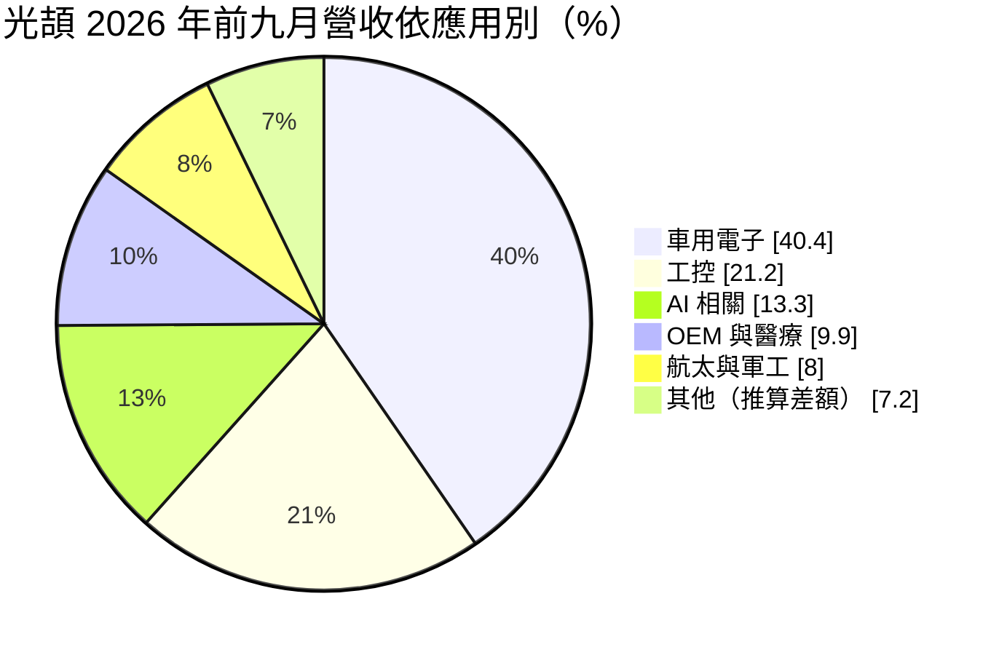
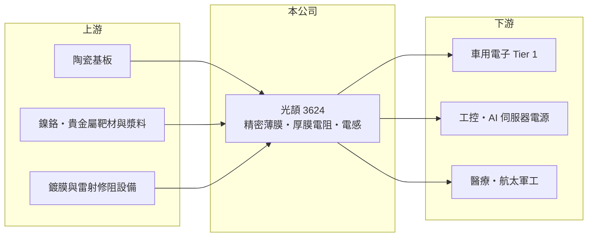

# 3624 光頡

> 上櫃｜[[產業索引-電子零組件業|電子零組件業]]｜上市（櫃）日期 2011/03/16

# 第一章：企業模式與商業藍圖

> [!info] 撰寫說明
> 精簡版，由 Claude 依公開資料整理，架構比照 [[2330台積電]]，資料截至 2026-10-08。來源：櫃買中心開放資料（基本資料、2026 年第二季財報、月營收備註）、Goodinfo 經營績效頁、富果研究光頡 2026 年 10 月 7 日法說會紀錄（產品與應用比重、擴產計畫、對手）。#待校對

光頡科技是台灣少數專注於精密[[薄膜電阻]]的[[被動元件]]廠。它不和大廠拼量產規格品，而是做精度高、溫度穩定、規格特殊的電阻，應用集中在車用、工控、醫療與航太，這讓它的毛利率明顯高於一般電阻廠。

- **核心業務：** 光頡成立於 1997 年，2011 年在櫃買中心掛牌。主要產品是精密（薄膜）電阻、厚膜[[晶片電阻]]與高頻電感，另有少量代理電容。薄膜、厚膜與合金三大製程平台合計超過營收 95%。
- **營收結構：** 依 2026 年 10 月法說會，產品別為精密薄膜電阻 57%、厚膜電阻 36%、高頻電感 5%、其他約 2%。2026 年前九月應用別為車用電子 40.4%、工控 21.2%、AI 相關 13.3%、OEM 與醫療 9.9%、航太與軍工 8%。

- **營運據點：** 生產基地在台灣新竹、高雄與中國無錫（法說會稱共四座工廠）。台灣與中國兩地生產，讓公司能同時服務中國本地與海外客戶。
- **長期方向：** 公司規劃薄膜電阻擴產：第一階段預計 2027 年第一季月產能增加 1 億顆，第二階段可能在 2027 年中至 2028 年第一季再增加 2 億顆。車用電子化、AI 伺服器電源與醫療設備對高精度電阻的需求，是光頡的長期成長來源。

# 第二章：護城河深度與競爭優勢

精密電阻的護城河來自製程know-how、品質認證與客製化能力，光頡選擇避開大廠主戰場，專攻利基。

- **競爭優勢：** 薄膜電阻需要真空鍍膜、雷射修阻等精密製程，精度與溫度係數的控制門檻高。車用、醫療與航太客戶的認證流程長，一旦導入就很少更換，這是光頡毛利率能維持在 25% 至 34% 的原因。公司也強調垂直整合與客製化，能快速提供特殊規格。
- **主要對手：** 法說會點名的主要對手是美國 Vishay 與日本 KOA，兩者是全球精密電阻的領導廠。台灣的 [[2327國巨]]、[[2478大毅]] 以厚膜晶片電阻為主，在一般規格品上與光頡的厚膜產品競爭。
- **觀察重點：** 2026 年法說會提到訂單出貨比約 1.5、平均交期約 25 週，代表需求大於產能。觀察重點是擴產完成後毛利率能否維持，以及 AI 與醫療等新應用的占比能否持續提升。

# 第三章：財務體質與盈利規模

資料日期：2026-10-08，表格是撰寫當時的快照；最新月營收、毛利率、累計 EPS 由自動排程寫在本筆記的屬性欄位（月營收、毛利率、累計EPS 等）。#待校對

光頡的獲利在 2021 至 2022 年被動元件景氣高峰時最好，之後回落，2026 年再度隨車用與 AI 需求回升。

| 年度 | 營收（億元） | [[毛利率]] | [[營業利益率]] | EPS（元） | [[ROE]] |
|---|---|---|---|---|---|
| 2020 | 21.3 | 24.2% | 9.48% | 1.44 | 6.67% |
| 2021 | 31.1 | 32.5% | 19.7% | 4.04 | 17.1% |
| 2022 | 31.6 | 34.1% | 20.2% | 4.99 | 18.5% |
| 2023 | 25.5 | 27.7% | 12.1% | 2.23 | 7.91% |
| 2024 | 25.8 | 25.9% | 9.54% | 2.06 | 7.30% |
| 2025 | 26.8 | 25.3% | 9.71% | 1.86 | 6.43% |
| 2026 上半年 | 16.2 | 30.9% | 16.1% | 1.86 | 未查得 |

- **營收規模：** 2020 至 2025 年營收年複合成長率約 4.7%（推算）。2026 年上半年營收年增約 22.5%，前八月營收 23.4 億元、EPS 2.94 元（法說會）。
- **獲利：** 2021 至 2025 年平均 ROE 約 11.4%（推算）。毛利率由 2025 年的 25.3% 回升到 2026 年上半年的 30.9%，營業利益率同步由 9.7% 升到 16.1%，顯示產能滿載時的[[營業槓桿]]。
- **財務特色：** 2026 年第二季總資產 45.5 億元、負債 9.5 億元、權益 36.0 億元，負債比約 21%，非流動負債只有約 0.3 億元，財務結構保守。現金股利約 1.1 元，以 2025 年 EPS 1.86 元計配發率約 59%（推算）。

**[[ROIC]] 與 [[WACC]]：** 開放資料未拆出有息負債，以約 3 億元估算（推算假設，負債多為流動負債）。2025 年營業利益約 2.6 億元，稅後約 2.1 億元，除以權益 36.0 億元加有息負債 3 億元，ROIC 約 5.3%；2026 年上半年年化約 10.7%，2022 年高峰期約 15% 至 16%（推算）。WACC 以 CAPM 推估：無風險利率 1.75%、市場風險溢酬 6%、β 取 1.1（被動元件同業常見值），股權成本約 8.35%；稅後負債成本 2%，股權占比約 92%，WACC 約 7.8%（推算）。光頡在景氣高峰時 ROIC 明顯高於 WACC，低谷時則低於 WACC，長期是否創造價值取決於擴產後能否維持 15% 以上的營業利益率。

# 第四章：總體風險與地緣政治

光頡的風險主要來自被動元件週期、擴產的時機，以及車用市場的景氣。

- **產業週期：** 被動元件是週期性很強的產業，2021 至 2022 年的高峰後經歷兩年庫存調整，光頡的營業利益率從 20% 降到 9.5%。下游車用與工控若再進入去庫存，擴產後的產能利用率會面臨壓力。
- **營運風險：** 擴產若碰上需求轉弱，新增折舊會壓低毛利率。車用占比約四成，汽車銷量與電動車滲透速度會直接影響訂單。
- **其他風險：** 無錫廠面臨美中貿易與關稅風險；貴金屬與鎳等原料價格波動會影響成本，法說會表示鎳價下跌目前對售價無重大影響。營收以外幣計價為主，匯率變動也會影響獲利。

# 專有名詞解析

## 應用

- **[[車用電子]]**：汽車上的電子控制與感測系統，零件需通過車規驗證，驗證期長、轉換成本高。

## 金融

- **[[營業槓桿]]**：固定成本占比高的公司，營收增加時利潤增幅大於營收增幅，反之亦然。

## 產業

- **[[被動元件]]**：不需外加電源即可運作的電子元件，主要是電容、電阻與電感，負責儲能、濾波與限流。
- **[[薄膜電阻]]**：以真空鍍膜在基板上形成極薄電阻層，再以雷射修整阻值，精度與溫度穩定性高於厚膜電阻，用於車用、醫療與量測設備。
- **[[晶片電阻]]**：表面黏著用的小型電阻，以厚膜或薄膜製程製造，是電子產品用量最大的電阻。

# 核心供應鏈

- 上游：陶瓷基板、鎳鉻合金與貴金屬靶材及漿料、鍍膜與雷射修阻設備。
- 下游／客戶：車用電子、工控、AI 伺服器電源、醫療（法說會提及 Omron、邁瑞）與航太軍工客戶。
- 同業：Vishay、KOA、[[2327國巨]]、[[2478大毅]]。

## 最新新聞
<!-- news:start（自動產生，請勿手動編輯此範圍） -->
- 2026-10-13 🏛️ 重訊 14:38｜本公司有價證券近期股價異常，故公告相關 訊息以利投資人區別瞭解。｜[觀測站](https://mops.twse.com.tw/mops/#/web/t05st01)
- 2026-10-06 📰 媒體 18:50｜營收速報 - 光頡(3624)9月營收3.80億元年增率高達67.43％｜[鉅亨網](https://news.cnyes.com/news/id/6622880)
- 2026-10-06 🏛️ 重訊 15:34｜本公司受邀參加中國信託證券舉辦法說會｜[觀測站](https://mops.twse.com.tw/mops/#/web/t05st01)

完整紀錄：[[3624光頡 新聞]]
<!-- news:end -->

## 相關連結
- [公開資訊觀測站](https://mopsov.twse.com.tw/mops/web/t05st03?step=1&firstin=1&co_id=3624)
- [Goodinfo](https://goodinfo.tw/tw/StockDetail.asp?STOCK_ID=3624)
- [Yahoo 股市](https://tw.stock.yahoo.com/quote/3624)
- [鉅亨網新聞](https://www.cnyes.com/twstock/3624/news)
