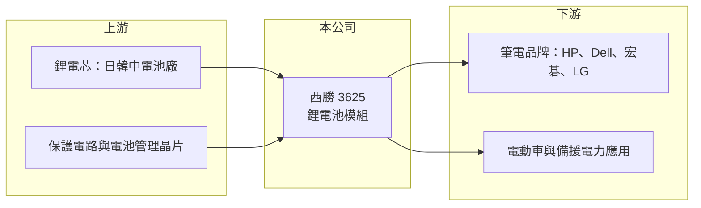

# 3625 西勝

> 上櫃｜[[產業索引-電腦及週邊設備業|電腦及週邊設備業]]｜上市（櫃）日期 2009/10/28

# 第一章：企業模式與商業藍圖

> [!info] 撰寫說明
> 精簡版，由 Claude 依公開資料整理，架構比照 [[2330台積電]]，資料截至 2026-10-08。來源：櫃買中心開放資料（基本資料、2026 年第二季資產負債與綜合損益、2026 年 8 月營收）、Goodinfo 經營績效頁、CMoney 2025 年 2 月個股摘要。公開資料有限，產品比重、工廠位置與轉型進度未查得。#待校對

西勝是生產 [[鋰電池模組]] 的小型公司，過去以筆電電池為主，近年營收大幅萎縮並連年虧損，正嘗試轉向電動車與備援電力等綠能應用。

- **核心業務：** 西勝成立於 1996 年，2009 年在櫃買中心掛牌，主要把鋰電芯加上保護電路與外殼，組裝成筆電等電子產品使用的電池模組。依 CMoney 2025 年 2 月的摘要，客戶包括 LG、HP、Dell 與宏碁（[[2353宏碁]]）等品牌。電池模組廠的角色是在電芯廠與系統品牌之間提供設計與組裝，附加價值主要在電池管理電路與安全設計。
- **營收結構：** 公司未公開產品比重。營收由 2020 年的 22.2 億元降到 2025 年的 4.02 億元，代表過去主力的筆電電池訂單大量流失。2026 年 1 至 8 月累計營收 3.1 億元、年增約 9%，規模仍小。
- **營運據點：** 公司登記為電腦及週邊設備業，總部在台灣，生產基地本次未查得（待校對）。
- **長期方向：** 公司表示要從消費性筆電業務轉向綠能產品，主要是電動車相關應用與 [[儲能系統]] 等備援電力。這些市場需要較高的安全認證與更大的資本投入，以西勝目前的營收與資本規模，轉型能否成功仍有很大不確定性。

# 第二章：護城河深度與競爭優勢

西勝的護城河非常薄，筆電電池模組市場已由大型廠商主導，綠能電池則仍在起步階段。

- **競爭優勢：** 電池模組需要通過品牌客戶的安全與品質驗證，西勝過去曾供應國際筆電品牌，代表具備基本的設計與認證能力。不過從營收連年下滑來看，這些客戶關係並未形成足夠的轉換成本，訂單已大幅轉移到規模更大的競爭者。
- **主要對手：** 筆電電池模組由 [[6121新普]]、[[3211順達]] 主導，兩者規模遠大於西勝；伺服器與儲能電池模組則有 [[6781AES-KY]]、[[5309系統電]] 等。中國大陸電池廠在價格與電芯取得上也具優勢。
- **觀察重點：** 第一是營收能否止跌回升並穩定在一定規模，否則固定費用無法攤提。第二是毛利率能否提高到 20% 以上，代表轉型產品具附加價值。第三是減資、增資等資本動作後，公司是否有足夠資金支撐轉型。

# 第三章：財務體質與盈利規模

資料日期：2026-10-08，表格是撰寫當時的快照；最新月營收、毛利率、累計 EPS 由自動排程寫在本筆記的屬性欄位（月營收、毛利率、累計EPS 等）。#待校對

西勝的財務特色是營收五年內縮小八成、毛利率只有一成左右、每年虧損，股東權益已被大幅侵蝕。

| 年度 | 營收（億元） | [[毛利率]] | [[營業利益率]] | EPS（元） | [[ROE]] |
|---|---|---|---|---|---|
| 2020 | 22.2 | 8.47% | -4.95% | -2.11 | -14.8% |
| 2021 | 21.8 | 11.1% | -3.63% | -1.92 | -16.1% |
| 2022 | 14.7 | 11.9% | -9.29% | -4.68 | -48.3% |
| 2023 | 11.5 | 11.7% | -10.6% | -1.05 | -13.7% |
| 2024 | 4.95 | 9.43% | -36.2% | -1.39 | -22.7% |
| 2025 | 4.02 | 11.5% | -40.3% | -0.60 | -11.3% |
| 2026 上半年 | 2.22 | 14.2% | -34.6% | -0.42 | 半年，不年化 |

（2020 至 2025 年取自 Goodinfo；2026 上半年依櫃買中心第二季綜合損益計算。）

- **營收規模：** 2020 至 2025 年營收由 22.2 億元降到 4.02 億元，年複合成長率約 -29%。營收縮小後，營業費用無法同步下降，營業利益率由 -5% 惡化到 -40%。
- **獲利：** 六年來每年虧損，近五年平均 ROE 約 -22.4%。2025 年與 2026 年上半年的稅後虧損小於營業損失，代表有業外收益（2026 年上半年 0.30 億元）部分抵銷，但本業仍持續虧損。
- **財務結構：** 2026 年第二季底總資產 16.2 億元、負債 11.0 億元，負債比約 68%；流動資產 4.4 億元低於流動負債 6.4 億元，短期償債壓力偏高。保留盈餘為 -5.8 億元的 [[累積虧損]]，權益 5.2 億元，每股淨值 4.72 元，已低於面額。基本資料的實收資本額 5.81 億元，約為第二季報表股本 11.42 億元的一半，推測第二季後辦理過減資（待校對）。近年未發放股利（推估）。
- **[[ROIC]] 與 [[WACC]]：** 2025 年營業損失約 4.02 億 × -40.3% ≈ -1.6 億元，以權益 5.2 億元加非流動負債 4.6 億元作為投入資本概估，ROIC 約 -16%（推算，有息負債實際金額未查得）。WACC 以 CAPM 推估：無風險利率 1.75%、市場風險溢酬 6%，因虧損與高負債 β 假設 1.3，股權成本約 9.55%；負債成本假設 3%（稅後 2.4%）、負債約占一半，WACC 約 6% 至 7%（推算，高負債使加權數字偏低，實際風險更高）。ROIC 長期為負且遠低於 WACC，代表公司持續消耗股東資本，轉型成果出現前不具價值創造能力。

# 第四章：總體風險與地緣政治

西勝的主要風險是營運規模過小、持續虧損，以及轉型所需資金與技術門檻。

- **產業週期：** 筆電電池需求跟著 PC 出貨起伏，但西勝的問題更多是市占流失而非週期。電動車與儲能電池市場成長快，但價格競爭激烈，且受電芯與鋰價大幅波動影響。
- **營運風險：** 營收規模太小，固定費用占比高，只要營收再下滑就會擴大虧損。新產品要取得車用或儲能的安全認證，需要時間與資金，進度落後會讓轉型拖延。
- **財務風險：** 流動比率低於 1、每股淨值低於面額，若虧損持續，可能需要再度減資或增資，對既有股東造成稀釋，也可能影響銀行授信。
- **其他風險：** 鋰電池涉及火災等安全責任，一旦發生產品事故，對小型公司的衝擊很大。電芯多由日韓中大廠供應，取得與議價都處於弱勢。

# 專有名詞解析

## 金融

- **[[累積虧損]]**：公司歷年虧損累積超過盈餘後，在資產負債表保留盈餘欄出現的負數。

## 產業

- **[[鋰電池模組]]**：把多顆鋰電芯加上保護電路、電池管理系統與外殼組成的電池包，供筆電、工具機或伺服器使用。
- **[[儲能系統]]**：以電池儲存電力、在停電或用電尖峰時釋放的設備，用於電網、工廠與資料中心備援。

# 核心供應鏈

- 上游：日韓中鋰電芯廠、保護電路與電池管理晶片供應商（未查得具名廠商）。
- 下游／客戶：HP、Dell、[[2353宏碁]]、LG 等筆電品牌（依 2025 年資料），以及電動車與備援電力應用客戶（未具名）。
- 同業：[[6121新普]]、[[3211順達]]、[[6781AES-KY]]、[[5309系統電]]。

## 最新新聞
<!-- news:start -->
<!-- news:end -->

## 相關連結
- [公開資訊觀測站](https://mopsov.twse.com.tw/mops/web/t05st03?step=1&firstin=1&co_id=3625)
- [Goodinfo](https://goodinfo.tw/tw/StockDetail.asp?STOCK_ID=3625)
- [Yahoo 股市](https://tw.stock.yahoo.com/quote/3625)
- [鉅亨網新聞](https://www.cnyes.com/twstock/3625/news)
