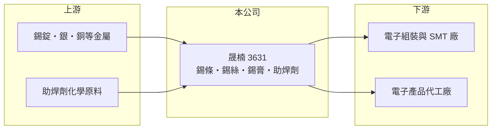

# 3631 晟楠

> 上櫃｜[[產業索引-電子零組件業|電子零組件業]]｜上市（櫃）日期 2010/12/20

# 第一章：企業模式與商業藍圖

> [!info] 撰寫說明
> 精簡版，由 Claude 依公開資料整理，架構比照 [[2330台積電]]，資料截至 2026-10-08。來源：櫃買中心開放資料（基本資料、2026 年第二季財報、月營收備註）、Goodinfo 經營績效頁、MoneyLink 個股基本資料（產品項目、股本變動）。公開資料有限，營收比重、廠區與資產內容未查得。#待校對

晟楠科技是一家銲錫材料廠，產品是電子組裝焊接用的錫條、錫絲、錫膏與助焊劑。它的特殊之處在於營收極小、但資產規模相對很大，本業長年虧損，研究重點應放在資產內容與公司未來的經營方向。

- **核心業務：** 晟楠成立於 1984 年，2010 年在櫃買中心掛牌，登記地址在桃園龜山。主要產品為有鉛與無鉛[[銲錫]]條、錫絲、錫珠、[[錫膏]]及助焊劑，用於電子產品組裝時把零件焊接到電路板上。
- **營收結構：** 產品別營收比重未查得。營收從 2020 年的 2.64 億元一路降到 2025 年的約 0.29 億元，2026 年上半年約 0.18 億元。2026 年 8 月月營收備註指出，營收年增主要是錫價上漲五成以上，而非出貨量增加。
- **營運據點：** 廠區未查得。2021 年曾辦理現金增資，實收資本額約 8.18 億元；資產總額約 25 億元，遠大於營收規模，資產內容（例如不動產、轉投資）在這次資料中未揭露。
- **長期方向：** 以目前的營收規模，銲錫本業已難以支撐公司營運。合併報表中有約 2.6 億元的非控制權益，代表有持股未達百分之百的子公司，公司未來是否轉型或活化資產，需要從年報與重大訊息追蹤。

# 第二章：護城河深度與競爭優勢

銲錫材料是成熟的大宗化學材料，競爭力主要來自規模、配方品質與客戶認證，小廠很難取得優勢。

- **競爭優勢：** 從財務數字看，晟楠近年毛利率在 2% 至 30% 之間劇烈變動、營業利益率長期為負，難以辨認出明確的護城河。小型銲錫廠的可能利基在於特殊合金配方或特定客戶的小量訂單，但目前規模不足以發揮。
- **主要對手：** 台灣銲錫材料的主要同業是 [[3305昇貿]]，國際上則有日本千住金屬、美國 Alpha（MacDermid）等大廠，以及大量中國廠商。這些對手在原料採購、研發與客戶覆蓋上都遠大於晟楠。
- **觀察重點：** 銲錫的售價與錫價連動，錫價上漲會推高營收，但不代表利潤增加。觀察重點是公司能否在本業之外提出明確的經營方向，以及資產的使用效率能否改善。

# 第三章：財務體質與盈利規模

資料日期：2026-10-08，表格是撰寫當時的快照；最新月營收、毛利率、累計 EPS 由自動排程寫在本筆記的屬性欄位（月營收、毛利率、累計EPS 等）。#待校對

晟楠連續六年虧損，但因權益基礎大，ROE 的負值不大；真正的問題是營收萎縮到幾乎不具規模。

| 年度 | 營收（億元） | [[毛利率]] | [[營業利益率]] | EPS（元） | [[ROE]] |
|---|---|---|---|---|---|
| 2020 | 2.64 | 8.41% | -11.7% | -0.13 | -0.67% |
| 2021 | 1.93 | 8.57% | -24.0% | -0.16 | -1.04% |
| 2022 | 1.24 | 2.33% | -58.4% | -0.58 | -3.21% |
| 2023 | 0.65 | 5.12% | -118% | -0.60 | -3.84% |
| 2024 | 0.76 | 29.7% | -95.0% | -0.56 | -3.78% |
| 2025 | 0.29 | 27.7% | -347% | -0.70 | -5.12% |
| 2026 上半年 | 0.18 | 16.7% | -294% | -0.35 | 未查得 |

- **營收規模：** 2020 至 2025 年營收年複合成長率約 -36%（推算），本業幾乎停滯。
- **獲利：** 2020 至 2025 年每年 EPS 都為負，平均 ROE 約 -3%（推算）。營業虧損每年約 0.6 億至 1 億元，主要是固定的營業費用無法被營收支撐。
- **財務特色：** 2026 年第二季總資產 25.0 億元、負債 10.4 億元（其中非流動負債 6.9 億元）、權益 14.6 億元，歸屬母公司權益 12.0 億元，每股淨值 14.62 元。持續虧損下未配發股利。

**[[ROIC]] 與 [[WACC]]：** 開放資料未拆出有息負債，以非流動負債為主估約 6 億元（推算假設）。2025 年營業虧損約 1.0 億元，除以權益 14.6 億元加有息負債 6 億元，ROIC 約 -4.9%（推算）。WACC 以 CAPM 推估：無風險利率 1.75%、市場風險溢酬 6%、β 取 1.0（同業常見值），股權成本 7.75%；稅後負債成本 2%，股權占比約 71%，WACC 約 6.1%（推算）。ROIC 為負且低於 WACC，表示公司持有的大量資產並未產生營業報酬，資產活化或轉型是價值能否改善的關鍵。

# 第四章：總體風險與地緣政治

晟楠的風險在於本業規模過小、資產用途不明，以及長期虧損對權益的侵蝕。

- **產業週期：** 銲錫需求跟隨電子產品組裝量起伏，但對晟楠而言，更大的問題是營收已縮小到景氣好壞影響不大的程度。錫價週期會讓營收數字大幅波動，卻不一定改善利潤。
- **營運風險：** 營收無法支撐費用，若沒有新的事業來源，虧損會持續侵蝕權益。資產規模遠大於營收，資產的實際價值與使用狀況需要從年報確認。
- **其他風險：** 錫是國際大宗商品，價格受印尼、緬甸等產地供給與政策影響；無鉛化與環保法規變化也會改變產品配方與成本。小型股流動性低，股價容易受少數交易影響。

# 專有名詞解析

## 金融

- **[[非控制權益]]**：子公司中不屬於母公司的股東權益，表示母公司對該子公司的持股未達百分之百。

## 產業

- **[[銲錫]]**：錫與銀、銅、鉛等金屬組成的低熔點合金，用來把電子零件焊接到電路板上，售價隨錫價變動。
- **[[錫膏]]**：錫粉與助焊劑混合成的膏狀材料，以鋼板印刷在電路板上，經回焊爐加熱後固定表面黏著零件。

# 核心供應鏈

- 上游：錫錠、銀、銅等金屬，以及助焊劑化學原料。
- 下游／客戶：電子組裝、SMT 表面黏著與電子產品代工廠；具名客戶未查得。
- 同業：[[3305昇貿]]、千住金屬、Alpha（MacDermid）。

## 最新新聞
<!-- news:start（自動產生，請勿手動編輯此範圍） -->
- 2026-10-07 🏛️ 重訊 21:43｜子公司晟裕科技(股)公司取得桃園市函准 甲級廢棄物處理機構同意試運轉計畫內容進行測試｜[觀測站](https://mops.twse.com.tw/mops/#/web/t05st01)

完整紀錄：[[3631晟楠 新聞]]
<!-- news:end -->

## 相關連結
- [公開資訊觀測站](https://mopsov.twse.com.tw/mops/web/t05st03?step=1&firstin=1&co_id=3631)
- [Goodinfo](https://goodinfo.tw/tw/StockDetail.asp?STOCK_ID=3631)
- [Yahoo 股市](https://tw.stock.yahoo.com/quote/3631)
- [鉅亨網新聞](https://www.cnyes.com/twstock/3631/news)
