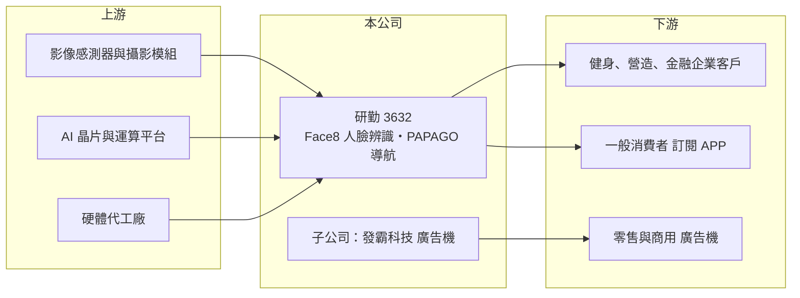

# 3632 研勤

> 上櫃｜[[產業索引-通信網路業|通信網路業]]｜上市（櫃）日期 2011/01/11

# 第一章：企業模式與商業藍圖

> [!info] 撰寫說明
> 精簡版，由 Claude 依公開資料整理，架構比照 [[2330台積電]] 的四章研究，資料截至 2026-10-08。來源：櫃買中心開放資料（基本資料、2026 年第二季資產負債與損益）、Goodinfo 台灣股市資訊網年度經營績效（2020 至 2025 年）、富果研究 2025 年 12 月法說會整理。公司未揭露各業務營收比重，公開資料有限。櫃買中心基本資料的實收資本額（2.2 億元）與資產負債表股本（約 4.09 億元）不一致，本文以資產負債表為準。#待校對

本章拆解研勤科技（股票代號：3632，以下簡稱研勤）的商業模式：它以 PAPAGO 導航軟體與行車記錄器起家，在原本的硬體市場萎縮後，轉向 AI 人臉辨識與訂閱服務，同時經營廣告機與精釀啤酒餐飲，是一家規模很小、業務多角化的公司。

- **核心業務：** 研勤成立於 2001 年，2011 年上櫃。早期以 PAPAGO 導航軟體與行車記錄器聞名，但隨著手機導航普及，這類產品的市場快速縮小。目前公司把 AI [[人臉辨識]]（Face8 品牌）列為發展核心，提供辨識引擎與門禁、考勤、身分驗證等應用方案；導航業務改推訂閱制的導航 APP，中國的行車記錄器則改為品牌授權，未來聚焦電子式後視鏡。
- **營收結構：** 公司未揭露各業務比重。依法說會整理，業務包括軟硬體整合（導航與行車記錄器，毛利率約 46%）、人臉辨識（約 69%）、廣告機（持股 70% 的發霸科技，約 49%）與精釀啤酒餐飲（約 50%，台灣與香港各有 2 家直營店）。人臉辨識的客戶涵蓋健身業（會員進出管理）、營造業（工地人員管理）與金融業（銀行轉帳的二次身分驗證）。
- **營運據點：** 以台灣為主，餐飲另有香港直營店；中國業務已改為授權模式。公司計畫把人臉辨識的台灣經驗推廣到新加坡、馬來西亞與泰國。
- **長期方向：** 管理層希望以[[訂閱制]]與維運服務費建立穩定的[[經常性收入]]，讓人臉辨識成為主要獲利來源，並推出人臉名片等新應用。這個方向能降低對一次性硬體銷售的依賴，但訂閱用戶需要時間累積，短期內難以填補導航軟體收入的下滑。

# 第二章：護城河深度與競爭優勢

研勤的護城河很淺：導航與行車記錄器的品牌價值隨市場萎縮而下降，人臉辨識則是競爭者眾多的新市場。

- **競爭優勢：** 第一是 PAPAGO 品牌在台灣消費者中的知名度，有助於推廣訂閱 APP 與電子後視鏡。第二是人臉辨識已有健身、營造與金融等實際落地案例，對其他客戶有示範效果；一旦門禁與考勤系統導入，客戶較少更換，具有一定的[[轉換成本]]。第三是軟體毛利率高，規模放大後獲利彈性大。
- **主要對手：** 行車記錄器與導航領域有 [[3706神達]]（Mio 品牌）、Garmin 與眾多中國品牌；人臉辨識與門禁考勤領域有國內外眾多 AI 影像公司與系統整合商，包括 [[5203訊連]] 等。研勤在每個領域的規模都不大。
- **觀察重點：** 一是人臉辨識與訂閱服務的營收能否持續成長並覆蓋費用；二是餐飲與廣告機這類與本業關聯較低的事業，是否分散經營資源；三是能否如管理層目標在 2026 年轉虧為盈。

# 第三章：財務體質與盈利規模

資料日期：2026-10-08，表格是撰寫當時的快照；最新月營收、毛利率、累計 EPS 由自動排程寫在本筆記的屬性欄位（月營收、毛利率、累計EPS 等）。#待校對

研勤的財務數字呈現一家營收萎縮、但毛利率因轉向軟體而提升的小型公司。

| 年度 | 營收（億元） | [[毛利率]] | [[營業利益率]] | EPS（元） | [[ROE]] |
|---|---|---|---|---|---|
| 2020 | 4.08 | 26.7% | -34.3% | -5.00 | -67.6% |
| 2021 | 3.51 | 26.8% | -43.3% | -0.71 | -21.7% |
| 2022 | 3.79 | 49.1% | -1.26% | 0.07 | -5.59% |
| 2023 | 3.93 | 58.5% | 1.72% | 0.11 | 4.12% |
| 2024 | 3.72 | 57.8% | -4.86% | -0.29 | -7.73% |
| 2025 | 2.65 | 55.2% | -4.73% | -0.38 | -10.4% |
| 2026 上半年 | 1.43 | 56.89% | -1.63% | -0.11 | 未查得 |

註：2020 至 2025 年取自 Goodinfo，2026 年上半年取自櫃買中心開放資料推算。2022 年 EPS 為正但 ROE 為負，推估與非控制權益或股本變動有關，待校對。

- **營收規模：** 營收從 2020 年的 4.08 億元降到 2025 年的 2.65 億元，2025 年前三季營收較前一年同期減少約三成，主因是高毛利的導航軟體收入減少。營收規模太小，是研勤難以穩定獲利的根本原因。
- **獲利：** 毛利率從 2020 至 2021 年的約 27% 跳升到 2022 年以後的 50% 至 58%，反映產品組合從硬體轉向軟體與服務，並處分或縮減低毛利業務。但營業費用仍高，除 2023 年小賺外，營業利益率多為負值。2024 年有政府科專補助、2025 年沒有，也是虧損擴大的原因之一。
- **財務特色：** 2021 至 2025 年平均 ROE 約 -8.3%（推算），近年未配發股利。2026 年第二季母公司股東權益約 1.16 億元、每股淨值 2.83 元，遠低於面額，總負債約 2.16 億元已高於股東權益，財務緩衝相當薄。

## [[ROIC]] 與 [[WACC]]

**ROIC 推算：** 2025 年營業虧損約 0.13 億元（2.65 億元 × -4.73%），虧損年度不計稅負。投入資本以 2026 年第二季股東權益約 1.27 億元（含非控制權益）近似（有息負債未查得），ROIC 約 -10%（推算）。

**WACC 推算：** 台灣 10 年期公債約 1.75%、市場風險溢酬約 6%、β 取小型軟體與電子股的 1.1（假設），股東要求報酬率約 8.35%，WACC 約 8%（推算）。

**解讀：** ROIC 為負、低於約 8% 的 WACC，代表研勤目前仍在消耗股東資本。好處是毛利率已提升到 55% 以上，只要營收回升到約 3.5 億至 4 億元並控制費用，營業利益就有機會轉正（推估），這是判斷轉型成敗的門檻。

# 第四章：總體風險與地緣政治

本章說明研勤長期面對的技術替代、轉型與財務風險。

- **產業週期：** 車用導航與行車記錄器受手機與車廠原廠配備取代，屬於長期衰退的市場；人臉辨識需求則與企業數位化、門禁與考勤升級相關，成長性較佳但競爭激烈。廣告機業務與台灣內需景氣連動性高。
- **營運風險：** 業務橫跨軟體、硬體、廣告機與餐飲，規模都小，管理資源分散；淨值偏低，持續虧損可能需要增資或減資彌補虧損。新的訂閱服務需要時間累積用戶，短期營收貢獻有限。
- **其他風險：** 人臉辨識涉及個人資料保護法規，各國對生物特徵資料的規範日趨嚴格；拓展東南亞市場需要在地夥伴與認證，執行難度高。

# 專有名詞解析

## 應用

- **[[人臉辨識]]**：以影像分析比對臉部特徵來確認身分的技術，用於門禁、考勤與金融身分驗證。

## 金融

- **[[經常性收入]]**：每期都會重複發生、可預期的收入，例如訂閱費與維運服務費，穩定度高於一次性銷售。

## 產業

- **[[訂閱制]]**：客戶按月或按年付費使用產品或服務的商業模式，可帶來穩定可預測的收入。
- **[[轉換成本]]**：客戶更換供應商時要付出的時間、金錢與風險，轉換成本越高，供應商的客戶黏著度越高。

# 核心供應鏈

- 上游：影像感測器與攝影模組、AI 運算平台、硬體代工廠。
- 下游／客戶：健身工廠、營造業者（根基、麗明、三井營造）、玉山銀行等企業客戶，以及導航訂閱用戶與廣告機商用客戶。
- 同業：[[3706神達]]、Garmin、[[5203訊連]]，以及其他 AI 影像辨識與門禁系統業者。

## 最新新聞
<!-- news:start -->
<!-- news:end -->

## 相關連結
- [公開資訊觀測站](https://mopsov.twse.com.tw/mops/web/t05st03?step=1&firstin=1&co_id=3632)
- [Goodinfo](https://goodinfo.tw/tw/StockDetail.asp?STOCK_ID=3632)
- [Yahoo 股市](https://tw.stock.yahoo.com/quote/3632)
- [鉅亨網新聞](https://www.cnyes.com/twstock/3632/news)
