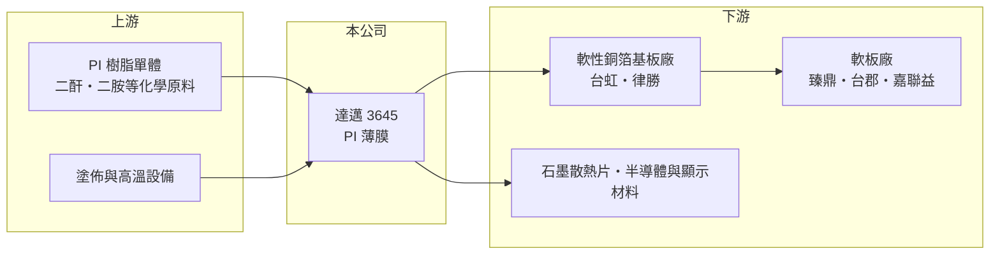

# 3645 達邁

> 上市｜[[產業索引-電子零組件業|電子零組件業]]｜上市（櫃）日期 2011/10/05

# 第一章：企業模式與商業藍圖

> [!info] 撰寫說明
> 精簡版，由 Claude 依公開資料整理，架構比照 [[2330台積電]]，資料截至 2026-10-08。來源：證交所開放資料（基本資料、2026 年第二季財報、營益分析、股利）、Goodinfo 經營績效頁、nStock 公司簡介；產品應用、廠區與國際對手依產業常識與優分析新聞標題整理，未逐條核對。#待校對

達邁科技是台灣主要的[[PI 膜]]（聚醯亞胺薄膜）製造商。PI 膜耐高溫、絕緣、可彎折，是[[軟板]]、散熱石墨片與半導體製程材料的基礎原料。這個產業全球只有少數廠商能量產，屬於技術門檻高、產能擴充慢的特用材料。

- **核心業務：** 達邁成立於 2000 年，2011 年在證交所上市。登記業務為電子零組件與材料的製造銷售，實際產品是各種厚度與功能的 PI 膜，包括軟板基材用的黃色與黑色 PI、燒製人工石墨散熱片用的 PI，以及半導體與顯示相關的特殊 PI（待校對）。
- **營收結構：** 產品別與應用別營收比重未查得。依產業結構推估，軟板基材與散熱石墨用途是主要營收來源，半導體材料與透明 PI 等新應用的占比仍小但成長較快（推估）。
- **營運據點：** 生產基地在台灣苗栗（待校對）。PI 膜產線需要大型連續塗佈與高溫亞胺化設備，擴產一條線通常需要一至兩年，因此產能本身就是競爭資源。
- **長期方向：** 達邁的長期方向是從消費電子軟板材料，往半導體製程材料、摺疊螢幕與穿戴裝置等高單價特殊 PI 延伸（優分析報導標題）。特殊 PI 毛利較高，若占比提升，可以降低公司對手機與筆電景氣的依賴。

# 第二章：護城河深度與競爭優勢

PI 膜的護城河來自配方與製程know-how、客戶認證，以及全球寡占的產業結構。

- **競爭優勢：** PI 膜的品質取決於樹脂配方、塗佈均勻度與熱處理控制，良率需要多年經驗累積，新進者很難在短期內追上。下游軟板與材料廠更換 PI 供應商需要重新認證，形成轉換成本；達邁身為台灣在地供應商，交期與技術服務也比海外大廠更貼近客戶。
- **主要對手：** 全球 PI 膜主要供應商包括韓國 PI Advanced Materials、日本 Kaneka、東麗杜邦（Kapton）與宇部興產（待校對）。國內下游的軟性銅箔基板廠如 [[8039台虹]]、[[3354律勝]] 是客戶也是部分領域的競爭者，中國廠商近年也積極擴產。
- **觀察重點：** 毛利率從 2023 年低點 15.2% 回升到 2026 年上半年的 37.8%，接近 2020 年的高峰，反映產能利用率提升與產品組合改善。觀察重點是半導體與特殊 PI 能否持續拉高占比，讓毛利率在景氣下行時不再大幅回落。

# 第三章：財務體質與盈利規模

資料日期：2026-10-08，表格是撰寫當時的快照；最新月營收、毛利率、累計 EPS 由自動排程寫在本筆記的屬性欄位（月營收、毛利率、累計EPS 等）。#待校對

達邁的獲利有明顯的材料業週期性：產能利用率高時毛利率可超過三成，低谷時則接近損益兩平。

| 年度 | 營收（億元） | [[毛利率]] | [[營業利益率]] | EPS（元） | [[ROE]] |
|---|---|---|---|---|---|
| 2020 | 20.1 | 37.6% | 20.7% | 2.76 | 13.4% |
| 2021 | 23.9 | 32.0% | 16.3% | 2.32 | 10.4% |
| 2022 | 18.9 | 25.5% | 7.28% | 1.13 | 4.59% |
| 2023 | 15.9 | 15.2% | -7.92% | -1.06 | -5.24% |
| 2024 | 22.5 | 27.8% | 9.38% | 1.79 | 7.70% |
| 2025 | 23.7 | 26.9% | 10.9% | 1.54 | 6.26% |
| 2026 上半年 | 12.4 | 37.77% | 21.26% | 1.52 | 未查得 |

- **營收規模：** 2020 至 2025 年營收年複合成長率約 3.4%（推算），營收在 16 億至 24 億元之間，規模成長有限，主要受產能與下游景氣限制。
- **獲利：** 2021 至 2025 年平均 ROE 約 4.7%（推算），受 2023 年虧損拖累。2026 年上半年營業利益率回到 21%，是[[營業槓桿]]的典型表現：固定成本高的材料廠，產能利用率回升時利潤成長遠快於營收。
- **財務特色：** 2026 年第二季總資產 52.5 億元、負債 19.0 億元、權益 33.6 億元，負債比約 36%，每股淨值 24.46 元。2025 年度配發現金股利 1.2 元，以 EPS 1.54 元計配發率約 78%（推算）。

**[[ROIC]] 與 [[WACC]]：** 開放資料未拆出有息負債，以約 8 億元估算（推算假設，含非流動負債 6.6 億元中的長期借款）。2025 年營業利益約 2.6 億元，稅後約 2.1 億元，除以權益 33.6 億元加有息負債 8 億元，ROIC 約 5.0%；2026 年上半年年化約 10%，2020 年高峰時約 10% 至 12%（推算）。WACC 以 CAPM 推估：無風險利率 1.75%、市場風險溢酬 6%、β 取 1.2（材料與電子零組件同業常見值），股權成本約 8.95%；稅後負債成本 2%，股權占比約 81%，WACC 約 7.6%（推算）。達邁在景氣高峰時 ROIC 高於 WACC，低谷時則明顯低於，長期能否創造價值取決於特殊 PI 能否拉高整個週期的平均報酬。

# 第四章：總體風險與地緣政治

達邁的風險集中在消費電子週期、產能擴充時機，以及中國同業的擴產。

- **產業週期：** 軟板與散熱石墨需求跟著手機、筆電出貨起伏，2022 至 2023 年下游去庫存時，達邁營收由 23.9 億元降到 15.9 億元並出現虧損，顯示[[長鞭效應]]對上游材料廠的衝擊。新應用占比仍小，短期內難以完全抵銷這個週期。
- **營運風險：** 新產線投資金額大、建置期長，若完工時碰上需求下滑，折舊會壓低毛利率。半導體與特殊 PI 需要通過客戶長期驗證，進度可能比預期慢。
- **其他風險：** 中國廠商在政策扶植下積極擴充 PI 膜產能，可能壓低一般規格品的價格。PI 樹脂的化學原料受油價影響，生產耗電量也大，電價上漲會增加成本；外銷比重高時匯率也是變數。

# 專有名詞解析

## 金融

- **[[營業槓桿]]**：固定成本占比高的公司，營收增加時利潤增幅大於營收增幅，反之亦然。
- **[[長鞭效應]]**：終端需求的小幅變動，沿供應鏈往上游傳遞時被逐級放大，造成上游庫存與訂單劇烈波動。

## 產業

- **[[PI 膜]]**：聚醯亞胺薄膜，耐高溫、絕緣、可彎折的高分子薄膜，是軟板基材、散熱石墨片與半導體製程的關鍵材料。
- **[[軟板]]**：軟性印刷電路板（FPC），可彎折的電路板，用於手機、筆電、車用面板與光通訊模組的內部連接。
- **[[人工石墨散熱片]]**：以 PI 膜高溫燒製而成的石墨片，導熱性佳，貼在手機與筆電內部幫助散熱。

# 核心供應鏈

- 上游：二酐、二胺等 PI 樹脂化學原料，以及塗佈與高溫亞胺化設備。
- 下游／客戶：軟性銅箔基板廠 [[8039台虹]]、[[3354律勝]]，軟板廠 [[4958臻鼎-KY]]、[[6269台郡]]、[[6153嘉聯益]]，以及石墨散熱片、半導體與顯示材料業者（推估，具名客戶未查得）。
- 同業：PI Advanced Materials、Kaneka、東麗杜邦、宇部興產（待校對）。

## 最新新聞
<!-- news:start -->
<!-- news:end -->

## 相關連結
- [公開資訊觀測站](https://mopsov.twse.com.tw/mops/web/t05st03?step=1&firstin=1&co_id=3645)
- [Goodinfo](https://goodinfo.tw/tw/StockDetail.asp?STOCK_ID=3645)
- [Yahoo 股市](https://tw.stock.yahoo.com/quote/3645)
- [鉅亨網新聞](https://www.cnyes.com/twstock/3645/news)
