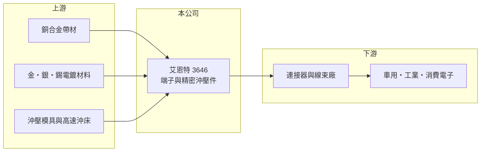

# 3646 艾恩特

> 上櫃｜[[產業索引-電子零組件業|電子零組件業]]｜上市（櫃）日期 2012/03/27

# 第一章：企業模式與商業藍圖

> [!info] 撰寫說明
> 精簡版，由 Claude 依公開資料整理，架構比照 [[2330台積電]]，資料截至 2026-10-08。來源：櫃買中心開放資料（基本資料、2026 年第二季財報、月營收備註）、Goodinfo 經營績效頁、nStock 公司簡介。公開資料有限，產品以端子類精密零件為主的描述依產業分類整理，營收比重、廠區與客戶未查得。#待校對

艾恩特精密是一家規模不大的電子零組件廠，市場一般將它歸類為[[端子]]與精密[[沖壓]]零件供應商（待校對）。端子是連接器內部負責導電的金屬零件，看起來很小，但精度與鍍層品質直接決定連接器的可靠度。

- **核心業務：** 艾恩特成立於 1999 年，2012 年在櫃買中心掛牌，登記業務為電子零組件製造與批發。依產業分類，主要產品為連接器端子與精密沖壓件，應用於車用、工業與消費電子（待校對）。
- **營收結構：** 產品別營收比重未查得。2026 年 8 月月營收備註指出，營收年增約 51%，主因是部分產品漲價生效，以及車用與工業用訂單增加，顯示車用與工業已是重要的應用市場。
- **營運據點：** 生產據點未查得（待校對）。端子沖壓與電鍍需要模具、高速沖床與電鍍線，多數同業在台灣與中國設廠。
- **長期方向：** 汽車電動化讓每台車的連接器與端子用量大幅增加，車用端子也要求更高的耐溫與耐振動能力。艾恩特若能把車用與工業比重持續拉高，就能從消費電子的價格競爭中轉向驗證期長、價格較穩的市場。

# 第二章：護城河深度與競爭優勢

端子廠的競爭力來自模具開發、沖壓精度與電鍍品質，以及車規等客戶認證。

- **競爭優勢：** 精密端子需要自行開發連續沖壓模具，並控制鍍金、鍍錫的厚度與均勻度，這些製程經驗是小廠能存活的基礎。車用與工業客戶認證週期長，通過後的訂單較穩定，也較能接受原料上漲時的調價，這在 2026 年的漲價生效中可以看到。
- **主要對手：** 國內車用端子與連接器的同業包括 [[6279胡連]]、[[3023信邦]]，國際上則有 TE、Molex、日系的矢崎與住友電裝等大廠。端子也常由連接器廠自行生產，例如 [[3605宏致]] 就併購了沖壓廠整合上游。
- **觀察重點：** 毛利率長期在 28% 至 35% 之間，代表產品有一定技術附加價值；但營業利益率從 2021 年的 12.8% 降到 2025 年的 3.9%，規模縮小使費用負擔加重。觀察重點是漲價與車用訂單能否讓營收回到 8 億元以上的規模。

# 第三章：財務體質與盈利規模

資料日期：2026-10-08，表格是撰寫當時的快照；最新月營收、毛利率、累計 EPS 由自動排程寫在本筆記的屬性欄位（月營收、毛利率、累計EPS 等）。#待校對

艾恩特的毛利率穩定，但營收規模小、費用相對固定，獲利對營收增減非常敏感。

| 年度 | 營收（億元） | [[毛利率]] | [[營業利益率]] | EPS（元） | [[ROE]] |
|---|---|---|---|---|---|
| 2020 | 5.84 | 34.8% | 10.2% | 1.16 | 9.70% |
| 2021 | 8.57 | 30.9% | 12.8% | 2.17 | 17.3% |
| 2022 | 8.30 | 30.1% | 9.87% | 2.28 | 16.8% |
| 2023 | 7.98 | 29.1% | 6.16% | 1.35 | 9.71% |
| 2024 | 8.08 | 29.2% | 7.38% | 1.39 | 10.0% |
| 2025 | 6.68 | 28.0% | 3.90% | 0.56 | 4.18% |
| 2026 上半年 | 3.83 | 24.3% | 0.93% | -0.43 | 未查得 |

- **營收規模：** 2020 至 2025 年營收年複合成長率約 2.7%（推算），2021 至 2024 年維持在 8 億元左右，2025 年明顯下滑。
- **獲利：** 2021 至 2025 年平均 ROE 約 11.6%（推算），在小型零組件廠中屬中上。2026 年上半年營業利益僅略高於零、稅後轉為虧損，顯示業外損失（可能為匯兌或利息）壓過本業（推估）。
- **財務特色：** 2026 年第二季總資產 10.5 億元、負債 5.7 億元（幾乎都是流動負債）、權益 4.82 億元，負債比約 54%，每股淨值 12.28 元。最近一次現金股利為每股 0.9 元。

**[[ROIC]] 與 [[WACC]]：** 開放資料未拆出有息負債，以約 3 億元估算（推算假設）。2025 年營業利益約 0.26 億元，稅後約 0.21 億元，除以權益 4.82 億元加有息負債 3 億元，ROIC 約 2.7%；2021 至 2022 年營業利益約 0.8 億至 1.1 億元時，ROIC 約 9% 至 11%（推算）。WACC 以 CAPM 推估：無風險利率 1.75%、市場風險溢酬 6%、β 取 1.0（同業常見值），股權成本 7.75%；稅後負債成本 2%，股權占比約 62%，WACC 約 5.6%（推算）。過去營收在 8 億元以上時 ROIC 高於 WACC，近兩年則低於，代表規模是這家公司創造價值的關鍵門檻。

# 第四章：總體風險與地緣政治

艾恩特的風險在於規模小、原料價格波動，以及終端市場的景氣。

- **產業週期：** 消費電子與工業設備的庫存週期會透過[[長鞭效應]]影響端子訂單，2025 年營收下滑兩成即為反映。車用市場雖較穩定，但汽車銷量與電動車推進速度仍有景氣循環。
- **營運風險：** 規模小代表費用占營收比例高，營收一下滑就容易虧損。客戶若集中在少數連接器廠，單一客戶轉單或自製端子會造成明顯衝擊。
- **其他風險：** 銅合金與金、銀等電鍍用貴金屬是主要成本，價格大漲時若無法及時轉嫁，毛利率就會下降；電鍍製程也受環保法規約束。匯率變動與美中關稅則影響外銷競爭力。

# 專有名詞解析

## 金融

- **[[長鞭效應]]**：終端需求的小幅變動，沿供應鏈往上游傳遞時被逐級放大，造成上游庫存與訂單劇烈波動。

## 產業

- **[[端子]]**：連接器內部負責導電的金屬零件，以銅合金沖壓成形後電鍍，精度與鍍層品質決定接觸的穩定性。
- **[[沖壓]]**：以模具與沖床把金屬板材壓成特定形狀的加工方式，適合大量生產金屬零件。
- **[[連接器]]**：讓電子零件、模組或設備之間可插拔連接的元件，負責傳遞電力或訊號。

# 核心供應鏈

- 上游：銅合金帶材、金銀錫等電鍍材料、沖壓模具與高速沖床。
- 下游／客戶：連接器與線束廠，終端應用為車用、工業與消費電子（推估）；具名客戶未查得。
- 同業：[[6279胡連]]、[[3023信邦]]、TE、Molex。

## 最新新聞
<!-- news:start -->
<!-- news:end -->

## 相關連結
- [公開資訊觀測站](https://mopsov.twse.com.tw/mops/web/t05st03?step=1&firstin=1&co_id=3646)
- [Goodinfo](https://goodinfo.tw/tw/StockDetail.asp?STOCK_ID=3646)
- [Yahoo 股市](https://tw.stock.yahoo.com/quote/3646)
- [鉅亨網新聞](https://www.cnyes.com/twstock/3646/news)
