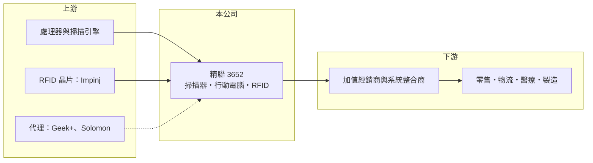

# 3652 精聯

> 上市｜[[產業索引-電腦及週邊設備業|電腦及週邊設備業]]｜上市（櫃）日期 2022/09/21

# 第一章：企業模式與商業藍圖

> [!info] 撰寫說明
> 精簡版，由 Claude 依公開資料整理，架構比照 [[2330台積電]]，資料截至 2026-10-08。來源：證交所開放資料（基本資料、2026 年第二季資產負債與綜合損益、股利、2026 年 8 月營收）、Goodinfo 經營績效頁、精聯 2026 年 5 月 25 日法說會簡報。產品與地區營收比重、工廠位置未揭露。#待校對

精聯是台灣最大的 [[AIDC]] 設備品牌商，以 Unitech 品牌銷售條碼掃描器、[[企業行動電腦]] 與 [[RFID]] 讀取設備，毛利率穩定在三成以上，但營業利益率偏低，屬於「品牌穩、獲利薄」的利基公司。

- **核心業務：** 精聯的品牌源自 1979 年，2008 年自 [[2414精技]] 分割獨立，2009 年在櫃買中心掛牌，2022 年轉上市。產品包括手持與口袋型條碼掃描器、強固型手持電腦、穿戴式與強固平板、RFID 固定式與手持式讀取器、天線與標籤，並提供 Android 企業工具與開發套件。依 2025 年 VDC 報告，精聯為全球第 8 大 AIDC 供應商。
- **營收結構：** 簡報未揭露產品與地區比重。應用涵蓋零售、物流運輸、倉儲、製造、醫療、政府、餐旅與外勤服務；客戶案例包括醫院、農會超市、大型電商與數家半導體及記憶體廠。銷售以加值經銷商、系統整合商與經銷商為主，全球有超過 1,200 家經銷與策略夥伴。
- **營運據點：** 總部在新北市新店，員工約 425 人，在日本、美洲、荷蘭與中國（廣州、廈門、上海）設有子公司，全球 14 個辦公室。工廠位置未揭露。
- **長期方向：** 2026 年的成長策略有四項：代理 Geek+ 倉儲機器人推動智慧自動化、以新款 RFID 讀取器擴大 RFID 市場、代理 Solomon [[電子貨架標籤]]，以及推出 Windows on ARM 強固平板與 iPhone 夾套掃描器以擴大平台。這些策略的方向是從單賣硬體轉為提供倉儲與零售的整體方案。

# 第二章：護城河深度與競爭優勢

精聯的護城河是品牌、經銷通路與產品廣度，但面對國際大廠時規模差距明顯，獲利率長期偏低。

- **競爭優勢：** AIDC 設備需與客戶的倉儲、零售系統整合，經銷商與系統整合商熟悉某品牌的開發工具後，傾向持續採用，這是精聯經營四十多年通路的價值。產品線從掃描器、行動電腦到 RFID 都有，讓經銷商可以一站採購。毛利率長期穩定在 32% 至 35%，反映品牌在中小型專案上具備定價力。
- **主要對手：** 國際龍頭為美國 Zebra 與 Honeywell，另有 Datalogic、日本電裝（Denso Wave）、韓國 Bluebird（已被 [[3611鼎翰]] 併購）等；台灣同業有 [[6160欣技]]、[[3611鼎翰]]。精聯的規模遠小於 Zebra，主要在中型專案與亞洲市場競爭。
- **觀察重點：** 第一是營業利益率能否由 4% 至 5% 提高到 8% 以上，代表規模經濟是否出現。第二是 RFID 與電子貨架標籤能否成為新的成長來源。第三是代理產品（倉儲機器人、電子貨架標籤）是否拉低整體毛利率。

# 第三章：財務體質與盈利規模

資料日期：2026-10-08，表格是撰寫當時的快照；最新月營收、毛利率、累計 EPS 由自動排程寫在本筆記的屬性欄位（月營收、毛利率、累計EPS 等）。#待校對

精聯的財務特色是毛利率高度穩定、負債低、配息率高，但營收成長緩慢、營業利益率偏薄，ROE 長期只有 2% 至 5%。

| 年度 | 營收（億元） | [[毛利率]] | [[營業利益率]] | EPS（元） | [[ROE]] |
|---|---|---|---|---|---|
| 2020 | 20.0 | 32.1% | 0.95% | 0.36 | 1.55% |
| 2021 | 23.6 | 31.9% | 3.57% | 1.03 | 3.64% |
| 2022 | 23.5 | 32.5% | 4.30% | 1.22 | 5.13% |
| 2023 | 22.4 | 32.4% | 1.28% | 0.54 | 2.25% |
| 2024 | 24.4 | 32.1% | 2.65% | 1.25 | 5.10% |
| 2025 | 24.5 | 34.2% | 4.49% | 1.34 | 5.28% |
| 2026 上半年 | 13.8 | 34.6% | 6.9% | 1.12 | 半年，不年化 |

（2020 至 2025 年取自 Goodinfo；2026 上半年依證交所第二季綜合損益計算。）

- **營收規模：** 2020 至 2025 年營收由 20.0 億元成長到 24.5 億元，年複合成長率約 4.1%。2026 年 1 至 8 月累計營收 18.9 億元、年增約 18%，成長較過去加快。
- **獲利：** 近五年平均 ROE 約 4.3%。毛利率穩定，但營業費用率接近三成，營業利益率最高只有 4% 至 5%；2026 年上半年營業利益率提高到 6.9%，EPS 1.12 元已接近 2025 年全年，顯示營收成長開始帶來經營槓桿。
- **財務結構：** 2026 年第二季底總資產 27.4 億元、負債僅 8.1 億元，負債比約 30%，流動資產 22.4 億元遠高於流動負債 7.3 億元，財務非常保守。權益 19.4 億元，每股淨值 25.73 元。2025 年度現金股利約 1.20 元，配息率約 89%。
- **[[ROIC]] 與 [[WACC]]：** 2025 年營業利益約 24.5 億 × 4.49% ≈ 1.1 億元，稅後約 0.88 億元，以權益 19.4 億元作為投入資本（有息負債很少），ROIC 約 4.5%（推算）。WACC 以 CAPM 推估：無風險利率 1.75%、市場風險溢酬 6%、β 取設備品牌同業常見值 0.9，股權成本約 7.15%，因負債很低，WACC 約 7%（推算）。ROIC 長期低於 WACC，代表品牌與通路雖穩定，但規模不足以創造超額報酬；2026 年若營業利益率維持 7% 左右，ROIC 可接近或超過 WACC。

# 第四章：總體風險與地緣政治

精聯的風險主要是規模劣勢、企業設備投資週期，以及產品轉型時的毛利稀釋。

- **產業週期：** AIDC 設備需求跟著零售、物流與製造業的資本支出起伏，企業在景氣轉弱時會延後換機；2023 年營收與營業利益率下滑即屬此類。不過條碼與 RFID 是供應鏈數位化的基礎，長期需求方向向上。
- **營運風險：** 國際大廠在大型專案、軟體生態與全球服務上占優，精聯不易取得最大型客戶。代理倉儲機器人與電子貨架標籤屬於較低毛利的代理業務，比重提高時可能拉低整體毛利率。
- **其他風險：** 處理器、記憶體與掃描模組的成本變動，新台幣匯率，以及中國市場的價格競爭，都會影響獲利。

# 專有名詞解析

## 應用

- **[[RFID]]**：無線射頻辨識，以無線電波讀取標籤晶片中的資料，不需對準即可一次讀取多個標籤。
- **[[電子貨架標籤]]**：以電子紙顯示商品價格的貨架標籤，可由系統無線更新，取代人工更換紙本價卡。

## 產業

- **[[AIDC]]**：自動識別與資料擷取，包含條碼、RFID、掃描器與行動電腦等，讓物品資訊自動進入電腦系統。
- **[[企業行動電腦]]**：內建條碼掃描器的手持式強固電腦，供倉儲、物流、零售與醫療人員即時記錄資料。

# 核心供應鏈

- 上游：處理器與掃描引擎供應商、RFID 晶片商 Impinj；代理產品來源 Geek+（倉儲機器人）、Solomon（電子貨架標籤）。
- 下游／客戶：全球 1,200 多家經銷商與系統整合商，最終用戶為零售、物流、醫療、製造與半導體廠。
- 同業：Zebra、Honeywell、Datalogic、[[3611鼎翰]]、[[6160欣技]]；分割前母公司 [[2414精技]]。

## 最新新聞
<!-- news:start -->
<!-- news:end -->

## 相關連結
- [公開資訊觀測站](https://mopsov.twse.com.tw/mops/web/t05st03?step=1&firstin=1&co_id=3652)
- [Goodinfo](https://goodinfo.tw/tw/StockDetail.asp?STOCK_ID=3652)
- [Yahoo 股市](https://tw.stock.yahoo.com/quote/3652)
- [鉅亨網新聞](https://www.cnyes.com/twstock/3652/news)
