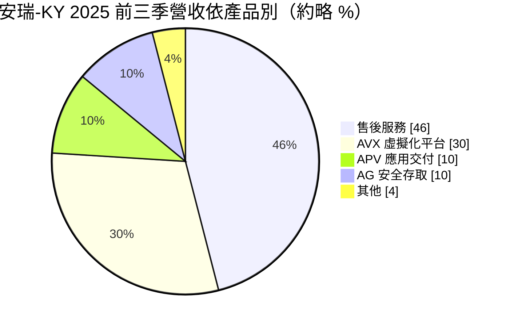
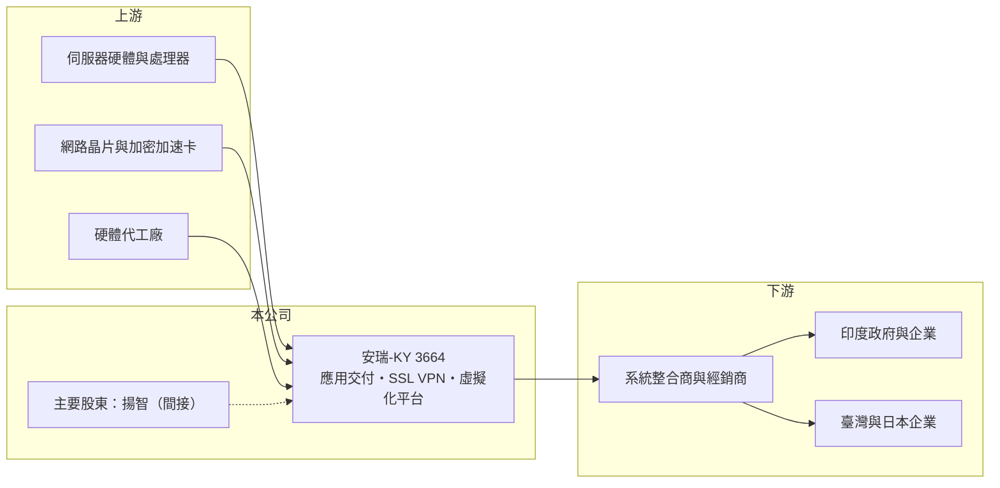

# 3664 安瑞-KY

> 上櫃｜[[產業索引-通信網路業|通信網路業]]｜上市（櫃）日期 2010/06/24

# 第一章：企業模式與商業藍圖

> [!info] 撰寫說明
> 精簡版，由 Claude 依公開資料整理，架構比照 [[2330台積電]] 的四章研究，資料截至 2026-10-08。來源：櫃買中心開放資料（基本資料、2026 年第二季資產負債與損益）、Goodinfo 台灣股市資訊網年度經營績效（2020 至 2025 年）、富果研究 2025 年 12 月法說會整理；公司源自美國 Array Networks 的背景依記憶整理，已標「待校對」。#待校對

本章拆解安瑞科技（股票代號：3664，以下簡稱安瑞-KY）的商業模式：它是一家銷售網路應用交付與資安設備的公司，收入來自硬體、軟體授權與售後維運，但近年因印度市場的應收帳款問題與費用壓力，陷入大幅虧損。

- **核心業務：** 安瑞-KY 為境外註冊的 [[KY股]]，控股公司成立於 2008 年，2010 年在櫃買中心上櫃，營運主體源自美國的 Array Networks（待校對）。產品包括 APV 系列[[應用交付控制器]]（負責把網路流量分配到多台伺服器、加速並保護應用程式）、AG 系列 [[SSL VPN]] 安全存取閘道（讓遠端員工安全連回公司網路），以及 AVX 系列網路功能虛擬化平台（在同一台硬體上執行多個虛擬化的網路與資安功能）。
- **營收結構：** 依法說會整理，2025 年前三季售後服務（Support）約占 46%，AVX 系列約 30%，APV 與 AG 系列各約 10%。地區上，印度是最大市場，約占 57%，臺灣為第二大市場，日本約 10% 至 11%，北美已降到約 2%。售後服務比重高，是這類設備商的特徵，也是較穩定的收入來源。

- **營運據點：** 公司未揭露完整據點；依營收分布，主要市場在印度、臺灣與日本，印度有工程師團隊負責裝機與驗收。印度客戶多為政府與大型企業標案，從出貨到驗收請款的週期長。
- **長期方向：** 2025 年 7 月，IC 設計公司 [[3041揚智]] 透過收購至偉科技間接取得約 34.75% 股權；同年 2 月，大宇資以每股 21.5 元認購約 5,160 萬元私募股票。股權結構改變後，公司可望借助揚智資源拓展資安市場。短期重點則是應收帳款回收：把收款成效納入業務獎金，並提升印度裝機效率、縮短請款週期。

# 第二章：護城河深度與競爭優勢

安瑞-KY 有一定的技術門檻，但在全球應用交付與資安市場屬於小型業者，護城河主要來自既有客戶的維運合約。

- **競爭優勢：** 第一是裝機基礎與維運合約：應用交付與 VPN 設備一旦部署在客戶機房，後續的軟體更新、授權續約與技術支援會持續多年，形成[[經常性收入]]。第二是在印度政府與企業市場耕耘多年，有在地工程與標案經驗。第三是毛利率極高（約 60% 至 90%），因為主要價值在軟體，硬體成本比重低。
- **主要對手：** 國際大廠包括 F5、Citrix（NetScaler）、A10 Networks、Fortinet、Palo Alto Networks 與 [[CSCO思科]]，這些公司的規模與品牌都遠大於安瑞-KY；台灣資安同業有 [[6690安碁資訊]]、[[7765中華資安]]、[[6865偉康科技]] 等，但多以服務與代理為主，業務型態不同。
- **觀察重點：** 一是印度應收帳款的回收進度與現金流能否轉正；二是揚智入股後的策略整合，例如是否開發新產品或打進新市場；三是售後服務收入能否維持，因為這是公司最穩定的價值來源。

# 第三章：財務體質與盈利規模

資料日期：2026-10-08，表格是撰寫當時的快照；最新月營收、毛利率、累計 EPS 由自動排程寫在本筆記的屬性欄位（月營收、毛利率、累計EPS 等）。#待校對

安瑞-KY 的財務數字呈現「毛利率很高、但多數年度虧損」的矛盾：問題不在產品毛利，而在費用、呆帳與營收規模。

| 年度 | 營收（億元） | [[毛利率]] | [[營業利益率]] | EPS（元） | [[ROE]] |
|---|---|---|---|---|---|
| 2020 | 5.07 | 72.7% | -14.9% | -2.10 | -17.9% |
| 2021 | 4.33 | 74.4% | -24.7% | -1.94 | -21.0% |
| 2022 | 4.65 | 64.2% | -39.1% | -3.65 | -55.5% |
| 2023 | 6.18 | 67.6% | 0.56% | -0.52 | -10.2% |
| 2024 | 7.10 | 67.7% | -0.95% | 未查得 | 未查得 |
| 2025 | 5.38 | 61.6% | -59.9% | -6.02 | -172% |
| 2026 上半年 | 1.29 | 91.97% | -77.1% | -1.85 | 未查得 |

註：2020 至 2025 年取自 Goodinfo（2024 年 EPS 與 ROE 頁面顯示為 0，視為未查得），2026 年上半年取自櫃買中心開放資料推算。

- **營收規模：** 營收在 4.3 億至 7.1 億元之間，2023 至 2024 年因印度標案成長而回升，2025 年回落到 5.38 億元，2026 年上半年只有 1.29 億元，營收下滑明顯。
- **獲利：** 毛利率長期在 60% 以上，但營業利益率只有 2023 年小幅為正。2025 年營業虧損約占營收六成，法說會指出主因之一是依會計準則對印度應收帳款提列較高的[[備抵呆帳]]，使營業費用較前一年增加約 1 億元。這類損失反映的是收款風險，而不是產品沒有利潤。
- **財務特色：** 連年虧損使股東權益大幅縮水：2026 年第二季股東權益只剩約 0.99 億元、每股淨值 1.31 元，總負債約 5.17 億元，是股東權益的五倍以上。2025 年 ROE 為 -172%，就是因為分母（股東權益）已經非常小。近年未配發股利，2025 年營業現金流為淨流出。

## [[ROIC]] 與 [[WACC]]

**ROIC 推算：** 2025 年營業虧損約 3.22 億元（5.38 億元 × -59.9%），虧損年度不計稅負。若以 2026 年第二季股東權益約 0.99 億元近似投入資本，ROIC 會低於 -300%，數字失真；改以股東權益加上流動與非流動負債中可能的有息部分（有息負債未查得），合理推估 ROIC 遠低於 -50%（推算）。重點不在精確數字，而是投入資本正被虧損快速消耗。

**WACC 推算：** 台灣 10 年期公債約 1.75%、市場風險溢酬約 6%、β 取小型資安股的 1.2（假設），股東要求報酬率約 9%；加上財務風險，WACC 推估約 9% 以上（推算）。

**解讀：** ROIC 深度為負、遠低於 WACC，代表安瑞-KY 目前處於嚴重的價值毀損狀態。高毛利顯示產品本身有價值，但若應收帳款無法回收、費用無法下降，股東權益可能進一步減少，需要依賴新股東（揚智、大宇資）的資金支持。

# 第四章：總體風險與地緣政治

本章說明安瑞-KY 長期面對的財務、市場集中與競爭風險。

- **產業週期：** 應用交付與資安設備的需求長期成長，但產業正從實體設備轉向雲端與軟體訂閱，國際大廠以雲端服務搶占市場，小型硬體設備商的空間被壓縮。印度政府與企業標案則受預算週期影響，訂單與請款時間不穩定。
- **營運風險：** 營收超過一半來自印度，且應收帳款回收困難，已造成大額呆帳提列與現金流出；淨值偏低，若再出現大額虧損，可能需要增資或面臨財務壓力。北美營收萎縮到約 2%，代表在最大的資安市場缺乏競爭力。
- **其他風險：** KY 公司的資訊揭露與治理需要投資人特別留意；匯率（印度盧比、美元）波動影響帳面營收與應收帳款價值；股權結構改變後，經營方向可能調整。

# 專有名詞解析

## 應用

- **[[應用交付控制器]]**：部署在資料中心前端的設備，負責流量分配、加速與保護應用程式，又稱 ADC。
- **[[SSL VPN]]**：以加密連線讓遠端使用者透過瀏覽器或用戶端安全存取公司內部網路的技術。

## 金融

- **[[KY股]]**：在台灣上市櫃、但註冊於開曼群島等境外地區的公司，適用的公司法與揭露規範與本國公司不同。
- **[[經常性收入]]**：每期都會重複發生、可預期的收入，例如訂閱費與維運服務費，穩定度高於一次性銷售。
- **[[備抵呆帳]]**：企業預估應收帳款可能收不回來的金額，提列時計入費用，會直接降低當期獲利。

# 核心供應鏈

- 上游：伺服器硬體與處理器（[[INTC英特爾]]、[[AMD超微]] 等 x86 平台）、網路晶片與加密加速卡、硬體代工廠。
- 下游／客戶：印度政府與大型企業、臺灣與日本企業，多經由系統整合商與經銷商銷售，公司未揭露具名客戶。
- 同業：F5、Citrix、A10 Networks、Fortinet、[[CSCO思科]]；台灣資安業者 [[6690安碁資訊]]、[[7765中華資安]]、[[6865偉康科技]]；主要股東 [[3041揚智]]。

## 最新新聞
<!-- news:start -->
<!-- news:end -->

## 相關連結
- [公開資訊觀測站](https://mopsov.twse.com.tw/mops/web/t05st03?step=1&firstin=1&co_id=3664)
- [Goodinfo](https://goodinfo.tw/tw/StockDetail.asp?STOCK_ID=3664)
- [Yahoo 股市](https://tw.stock.yahoo.com/quote/3664)
- [鉅亨網新聞](https://www.cnyes.com/twstock/3664/news)
