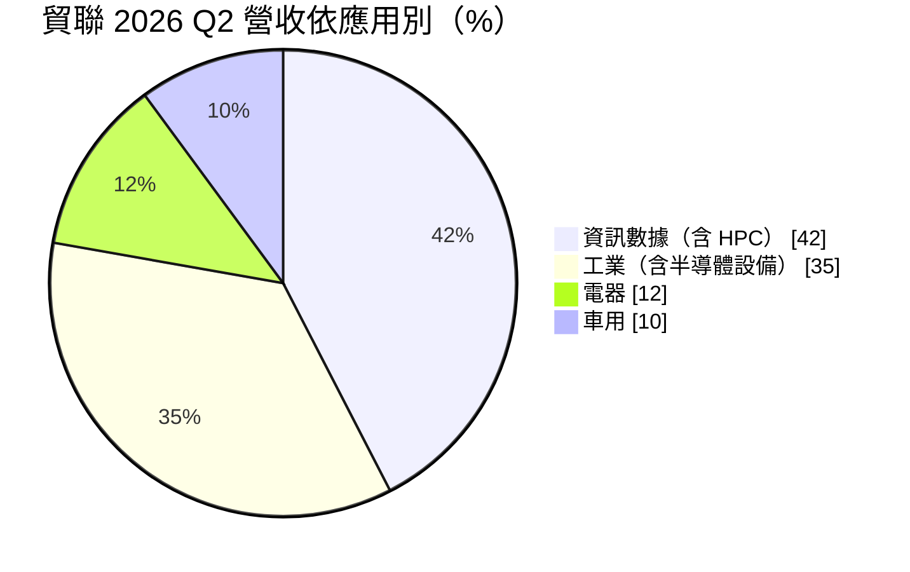
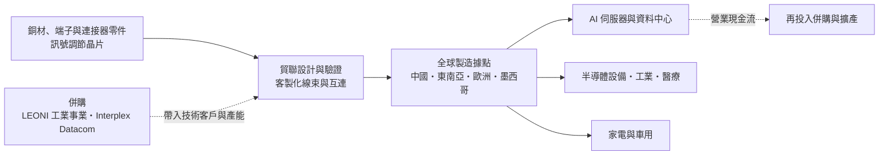
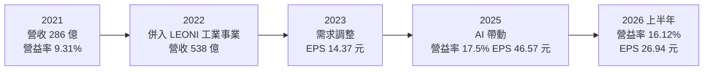
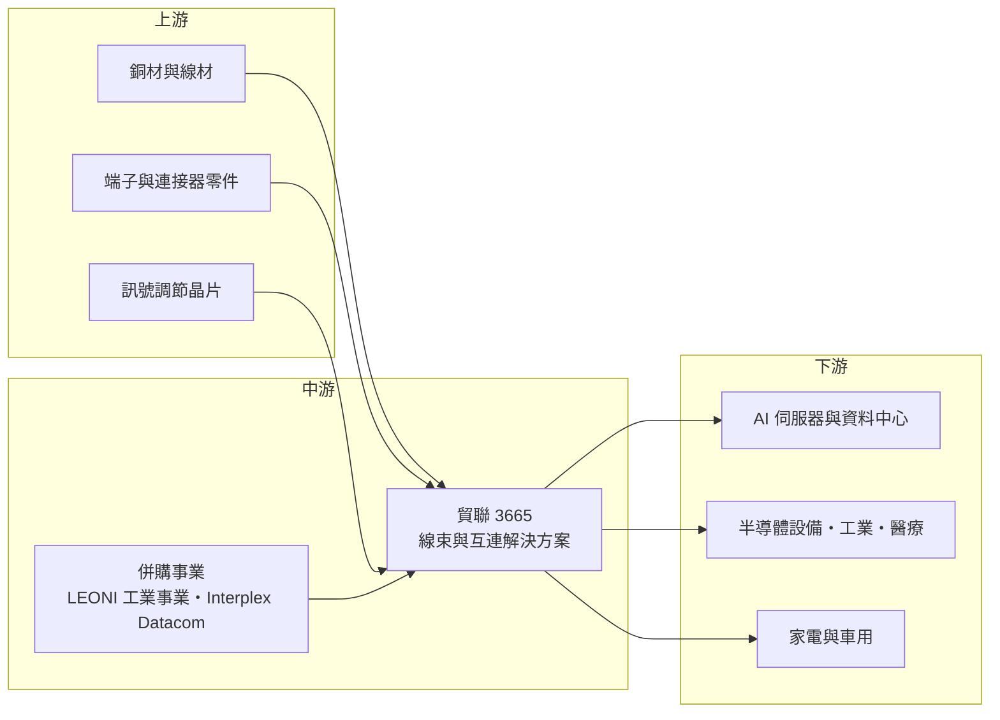

# 3665 貿聯-KY

> 上市｜[[產業索引-其他電子業|其他電子業]]｜上市（櫃）日期 2011/04/21

# 第一章：企業模式與商業藍圖

> [!info] 撰寫說明
> 本文由 Claude 依公開資料整理，架構比照 [[2330台積電]] 的四章研究，資料截至 2026-10-08。財務數字來源：證交所開放資料快照（基本資料、2026 年第二季資產負債與綜合損益、營益分析、2025 年度股利）、Goodinfo 經營績效頁與股利政策頁（2019 至 2025 年）、Yahoo 股市季現金流量表（2021 至 2026 年）、財報狗負債比、MoneyDJ 股本形成表、科技新報與優分析 2026 年 Interplex Datacom 收購報導、聯合新聞網 2026 年 7 月募資報導、旺得富 2022 年 1 月 LEONI 交割報導、Poorstock 2026 年 8 月法說會整理（應用別比重）；集團創立年份與主要客戶名稱係憑記憶或二手整理，尚未逐條比對原始文件。#待校對

在評估一家公司的長期投資價值時，第一步是看懂它靠什麼賺錢、為什麼客戶離不開它。本章針對貿聯控股（股票代號：3665，以下簡稱貿聯）的商業模式進行定性分析，說明一家從電腦周邊線材起家的公司，如何靠客製化與併購，變成橫跨資料中心、半導體設備、工業、醫療、家電與車用的全球互連解決方案供應商。

## 一、核心定位：多產業的客製化互連解決方案供應商

貿聯是在開曼群島註冊的 KY 公司，證交所資料登記的成立日為 2000 年 6 月 1 日，2011 年 4 月 21 日在台上市，董事長為梁華哲。富果研究的整理則指出集團最早創立於 1996 年（待校對）。貿聯的產品包括線束（[[Wire Harness]]）、[[連接器]]、電源線與高速傳輸線材，以及設備內部的電源與訊號連接組件。用最簡單的話說，它做的是「讓設備內部與設備之間的電力和訊號能接通」的零件。

這類零件看似簡單，但貿聯的特色在於兩點。第一是「客製化」：工業設備、半導體機台、醫療儀器與車輛裡的線束，大多需要依客戶的設備外型、電流規格與安規要求量身設計，通過驗證後在整個產品生命週期內持續供貨。第二是「多產業分散」：貿聯不只做電腦與資料中心線材，也服務工業自動化、半導體設備、醫療、家電與車用市場，任何單一產業的景氣起伏，對整體營收的衝擊都會被其他產業部分抵銷。

貿聯的成長史，很大一部分是一部併購史。2022 年 1 月，它以企業價值約 4.51 億歐元完成收購德國 LEONI 集團的工業應用事業群，取得歐洲的工業、醫療與機器人客戶，營收從 2021 年的 286 億元一年跳到 2022 年的 538 億元。2026 年 9 月，它再以企業價值 8.5 億美元（另有最高 5,000 萬美元或有價金）完成收購新加坡 Interplex Datacom，補強資料中心的客製化互連與高精密金屬加工能力。管理層的策略很清楚：用併購快速取得技術、客戶與產能，再用集團的管理系統整合降本。

## 二、終端應用板塊：資訊數據與工業雙主軸

依 2026 年 8 月法說會資料（Poorstock 整理），2026 年第二季營收結構如下：

- **資訊數據（約 42%）：** 包括 AI 伺服器與資料中心的電源連接線束、機櫃內的高速傳輸線材，以及過去就有的電腦周邊與顯示傳輸線。這個板塊是近年成長最快的部分，[[HPC]] 業務在 2026 年第二季年增 67%。AI 伺服器的耗電與傳輸速度不斷提高，機櫃內需要更多、更粗、規格更嚴格的電源與訊號連接，這是貿聯近年獲利率提升的主因。
- **工業（約 35%）：** 包括工廠自動化、半導體設備、醫療儀器與機器人用的線束，大部分來自併購 LEONI 工業事業後擴大的版圖。半導體設備線束在 2026 年第二季年增 52%。這類產品客製化程度高、驗證時間長，單價與毛利相對穩定，是貿聯在 AI 之外最重要的支柱。
- **電器（約 12%）：** 家電用的電源線與線束，毛利率相對較低，主要扮演穩定量能與分攤工廠固定成本的角色。
- **車用（約 10%）：** 電動車的高壓線束與充電相關產品。電動車普及帶來新需求，但車用市場的價格競爭與驗證門檻都很高，這個板塊的成長在 2024 年後明顯放緩。

## 三、資本轉化邏輯：輕資產的設計與組裝平台

- **輕資產、人力密集：** 線束組裝主要靠人工與治具，機器設備投資不大。從 Yahoo 股市的現金流量資料來看，扣除併購的年份，貿聯每年的投資活動支出大多只有營業現金流的一小部分，這讓它在本業上能持續產生現金。代價是對人力成本敏感，因此必須把工廠放在工資相對合理、又靠近客戶的地區。
- **貼近客戶的全球布局：** 貿聯在中國、東南亞、歐洲與墨西哥都有生產據點（具體廠區數未查得），Interplex Datacom 又帶入中國蘇州、惠州，以及越南、馬來西亞與泰國的產能。客戶在不同國家生產設備，貿聯就在附近供貨，這在美中貿易摩擦後成為接單的重要條件。
- **產品組合決定獲利率：** 貿聯的毛利率從 2021 年的 23.2% 提升到 2025 年的 31.7%，營業利益率從 9.3% 升到 17.5%（Goodinfo）。主要原因是 AI 伺服器相關的高規格產品比重提高，而研發、管理等費用相對固定，營收擴大時費用率下降，出現明顯的營運槓桿。

## 四、企業長期藍圖：從線束廠走向資料中心互連要角

- **補強資料中心產品線：** Interplex Datacom 截至 2026 年 3 月底的過去 12 個月營收約 3.92 億美元（約新台幣 125 億元，推算），員工超過 1,900 人，產品是資料中心基礎設施的客製化互連與高精密機械件，可強化 AI 伺服器與機櫃[[匯流排]]（busbar）等產品。這筆交易代表貿聯想從「線材供應商」升級為資料中心電源與訊號互連的整體方案供應商。
- **工業與半導體設備的長期需求：** 半導體設備需求隨全球晶圓廠擴產成長，工業自動化與機器人則受人力短缺推動。這些市場的成長速度不如 AI，但穩定度高，是貿聯平衡景氣循環的基礎。
- **以資本市場支應擴張：** 2026 年 7 月董事會通過發行上限 5 億美元的第七次海外無擔保轉換公司債（[[ECB]]），以及 450 萬至 600 萬股的現金增資參與海外存託憑證（[[GDR]]）。MoneyDJ 的股本形成表也顯示，貿聯股本中約六成來自歷次現金增資。這說明貿聯的成長模式是「營業現金流加上外部募資」，而不是只靠內部盈餘累積。

# 第二章：護城河深度與競爭優勢

在長期價值投資中，「護城河」指企業抵禦競爭、長期維持超額利潤的保護機制。本章分析貿聯的護城河由哪些要素構成、全球主要競爭對手，以及這些優勢在 AI 傳輸技術快速變化的環境下能守住多少。

## 一、貿聯護城河的核心組成要素

貿聯屬於「中等護城河」：它沒有難以複製的專利或規模壟斷，但在客製化線束領域累積了不容易被替代的客戶關係，主要由三個要素組成。

- **1. 客戶驗證與轉換成本：** 半導體設備、醫療儀器、工業機器人與車用線束都必須通過長時間的可靠度與安規驗證。一套線束導入設備後，客戶若要換供應商，就得重新驗證整台設備，時間與風險都很高。因此貿聯的工業與醫療客戶往來關係通常可以持續很多年，這是它獲利穩定的主要原因。
- **2. 產業與地區分散：** 四大應用板塊與全球多地生產，讓貿聯不會被單一產業或單一國家的景氣拖垮。例如 2023 年資訊產品需求轉弱時，工業事業仍維持一定的獲利；而在地化生產也讓它能配合客戶「在哪裡製造就在哪裡供貨」的要求。
- **3. 併購與整合能力：** 貿聯多次完成跨國併購，並在 LEONI 工業事業併入後，讓整體毛利率與營業利益率在幾年內明顯提升。能找到合適的標的、談到合理價格、再把被收購事業整合進集團的成本與管理體系，是一種難以量化但真實存在的組織能力。

## 二、全球主要競爭對手格局

| 對手 | 定位 | 對貿聯的影響 |
|---|---|---|
| 安費諾（Amphenol） | 全球連接器龍頭，資料中心高速互連產品線完整 | 規模與產品線遠大於貿聯，在 AI 伺服器互連市占高 |
| 泰科（TE Connectivity） | 全球連接器大廠，以車用與工業為主 | 在車用、工業線束與連接器正面競爭 |
| 莫仕（Molex） | 連接器大廠 | 資料中心與車用皆有重疊 |
| 立訊精密 | 中國連接器與組裝大廠 | 成本與規模優勢明顯，積極切入 AI 伺服器銅纜與電源連接 |
| [[3533嘉澤]]、[[6197佳必琪]] | 台灣連接器與線材廠 | 在伺服器連接器與高速線材部分競爭 |
| [[3023信邦]]、[[2392正崴]] | 台灣線束與連接器廠 | 在工業、醫療與車用線束有部分重疊 |

## 三、優勢轉化：哪些守得住、哪些守不住

- **守得住：** 工業、半導體設備與醫療線束。這些產品客製化程度高、驗證門檻高、單一客戶訂單量不大但持續多年，國際大廠不一定願意花力氣經營，低價對手也難以快速取得認證。AI 伺服器的電源線束若由客戶在設計階段就指定供應商，也有一定的黏著度。
- **守不住：** 標準化的資料線材、家電線材與一般消費性產品。這類產品規格公開、容易比價，中國對手的成本優勢明顯，貿聯很難在這裡維持高毛利。
- **觀察重點：** 長期而言，可以追蹤三件事。第一是 AI 平台世代交替時，貿聯在新一代機櫃中的供貨內容是否增加；第二是 Interplex Datacom 併入後，毛利率與投入資本報酬率能否維持；第三是工業與半導體設備事業在 AI 需求降溫時，能否撐住整體獲利。

# 第三章：財務體質與盈利規模

資料日期：2026-10-08。數字取自 Goodinfo 經營績效頁與股利政策頁、證交所開放資料快照、Yahoo 股市季現金流量表與財報狗負債比，表格是撰寫當時的快照；最新月營收、毛利率、累計 EPS 由自動排程寫在本筆記的屬性欄位（月營收、毛利率、累計EPS 等）。#待校對

財務報表是檢驗護城河是否真實存在的最終標準。本章用多年度的三率、ROE、現金流與資本報酬，檢視貿聯在併購擴張與 AI 需求帶動下的獲利品質。

## 一、獲利能力的基石：三率

| 年度 | 營收（億元） | [[毛利率]] | [[營業利益率]] | EPS（元） | [[ROE]] |
|---|---|---|---|---|---|
| 2019 | 231 | 24.4% | 10.4% | 15.54 | 17.2% |
| 2020 | 225 | 25.3% | 10.8% | 14.01 | 14.3% |
| 2021 | 286 | 23.2% | 9.31% | 15.22 | 14.2% |
| 2022 | 538 | 25.6% | 10.3% | 25.02 | 20.3% |
| 2023 | 511 | 24.7% | 8.3% | 14.37 | 9.81% |
| 2024 | 541 | 28.2% | 12.1% | 25.41 | 14.4% |
| 2025 | 712 | 31.7% | 17.5% | 46.57 | 21.7% |

（來源：Goodinfo 經營績效頁，合併報表。2026 年上半年依證交所資料，營收 441.4 億元、毛利率 29.80%、營業利益率 16.12%、EPS 26.94 元。）

- **兩次跳升：** 貿聯的營收有兩次明顯的跳升。2022 年主要來自 LEONI 工業事業併表，營收幾乎翻倍，但營業利益率只維持在 10% 左右，代表併購帶來的是規模而不是獲利率。2025 年的跳升則來自 AI 伺服器相關產品，營收成長約三成，營業利益率卻從 12.1% 跳到 17.5%，這是產品組合改善的結果，品質比併購帶來的成長更好。
- **景氣循環仍在：** 2023 年在資訊產品與工業需求同步調整下，營業利益率降到 8.3%、ROE 降到 9.81%。這提醒投資人，即使業務分散，貿聯仍然是會受景氣循環影響的零組件公司。
- **長期成長率：** 2020 至 2025 年營收年複合成長率約 25.9%（推算），但其中包含 LEONI 併購的貢獻，有機成長率會低於這個數字。2021 至 2025 年平均 ROE 約 16.1%（推算）。
- **2026 年上半年：** 毛利率 29.80% 略低於 2025 年全年，證交所資料顯示稅後淨利約 52.5 億元。毛利率的小幅回落，與併入毛利較低的業務及產品組合變化有關（推估）。

## 二、[[ROE]]：資本效率

貿聯 2021 至 2025 年的 ROE 介於 9.8% 至 21.7%，平均約 16%，屬於台股電子零組件中的中上水準。ROE 的高低主要由營業利益率決定：營益率超過 12% 的年份，ROE 大多在 14% 以上；2023 年營益率跌到 8.3%，ROE 就掉到一成以下。

另一個影響 ROE 的因素是股本與權益的擴大。證交所資料顯示，2026 年第二季貿聯的權益總計約 495.6 億元，其中資本公積約 235.7 億元，比保留盈餘約 217.8 億元還多，反映歷次現金增資與可轉債轉換累積的資本。2026 年規劃的 GDR 增資與可轉債若轉換為股本，權益基數會再擴大；只有在併購事業的獲利同步成長時，ROE 才不會被稀釋。

## 三、資本支出、自由現金流與股利

- **營業現金流：** 依 Yahoo 股市季資料加總（推算），貿聯 2023、2024、2025 年的營業活動現金流約為 74.5 億、69.1 億與 86.0 億元，持續為正，而且大致跟著獲利成長。
- **[[自由現金流]]：** 若以營業現金流加上投資活動現金流計算，2023 年約 28.7 億元、2024 年約 25.3 億元，2025 年則約為負 22.4 億元（推算）。2025 年轉負，主要是第三季投資活動流出約 71.5 億元，同季融資流入約 64.7 億元，推估與併購或擴產資金有關。2022 年併入 LEONI 工業事業的那一季，投資流出也接近 99 億元。換句話說，貿聯本業的資本支出不高、現金流健康，但併購會讓個別年份的自由現金流大幅轉負，並需要靠外部募資補足。
- **負債：** 財報狗資料顯示 2025 年第三季至 2026 年第二季負債比在 43% 至 46% 之間。Interplex Datacom 的收購金額約新台幣 270 億元（推算，8.5 億美元乘以約 31.9 的匯率），交割後負債比與有息負債預期會上升。
- **股利穩定度：** 依 Goodinfo 資料，2019 至 2025 年度現金股利由 9 元左右逐步提高到約 15 元，每年都有配發。以現金股利除以 EPS 計算，2021 至 2025 年度的配發率約在 32% 至 62% 之間（推算），2025 年度擬配 15 元，配發率約 32%，明顯偏低，顯示管理層在擴張期選擇保留更多盈餘支應併購。

## 四、[[ROIC]] 與 [[WACC]]：價值創造利差

- **ROIC（推算）：** 以 2025 年營收 712.47 億元乘以營業利益率 17.49%，營業利益約 124.6 億元，扣除 20% 稅率後稅後營業利益約 99.7 億元。投入資本以 2025 年第四季權益總計約 466.4 億元，加上有息負債估計 100 億至 150 億元（本次未查得借款與公司債明細，依非流動負債約 150 億元推估），合計約 566 億至 616 億元，ROIC 約 16% 至 18%（推算）。
- **WACC（推算）：** 以 [[CAPM]] 估算股東權益成本：無風險利率取台灣 10 年期公債約 1.75%，市場風險溢酬 6%，β 假設 1.1（電子零組件同業常見值，未查得貿聯實際數字），權益成本約 8.35%。稅前負債成本假設 3%、稅率 20%，稅後約 2.4%。以帳面價值計算，負債約占投入資本兩成、權益約八成，WACC 約 7.1%（推算）。
- **價值創造判斷：** 2025 年貿聯的 ROIC 約為 WACC 的兩倍以上，代表本業正在創造明顯的超額價值；在 2023 年的低谷，營業利益率只有 8.3%，ROIC 推估降到接近 WACC 的水準，價值創造幅度大幅縮小。
- **併購的考驗：** Interplex Datacom 的投入資本約新台幣 270 億元，若以其年營收約 125 億元、淨利率約 15%（摩根士丹利假設，科技新報引述）粗估，年淨利約 19 億元，對應的投資報酬率約 7%（推算），大致只在 WACC 附近。這代表這筆交易要真正創造價值，必須靠整合後的綜效、交叉銷售或營收成長，而不能只靠被收購事業原本的獲利。觀察交割後兩到三年集團 ROIC 能否維持在 15% 以上，是判斷貿聯併購策略成敗的關鍵。

# 第四章：總體風險與地緣政治

任何企業都無法脫離宏觀環境獨立存在。本章分析貿聯未來必須面對的地緣政治、產業週期、營運與技術風險。

## 一、地緣政治風險

- **中國產能與美國關稅：** 貿聯仍有相當比例的產能在中國，Interplex Datacom 也帶入蘇州與惠州的工廠。美國對中國製產品的關稅與供應鏈去中國化要求，可能迫使客戶要求轉移產地，增加貿聯的搬遷與重複投資成本。貿聯已在墨西哥與東南亞布局，但轉移需要時間。
- **歐洲據點：** 併購 LEONI 工業事業後，歐洲營運比重明顯提高。歐洲的能源成本、工資與工業景氣，都會直接影響這部分的獲利。
- **兩岸風險：** 貿聯雖是 KY 公司、生產據點分散，但營運總部與資本市場在台灣，兩岸緊張升高時，資金與客戶信心仍可能受到影響。

## 二、產業週期與市場結構風險

- **AI 資本支出循環：** 資訊數據已是貿聯最大的板塊，AI 伺服器需求又高度集中在少數雲端業者的資本支出。若雲端業者放緩投資，或 AI 平台世代轉換時零組件規格改變，貿聯的高毛利產品可能出現季度性甚至年度性的修正。
- **工業與車用週期：** 工業自動化、半導體設備與電動車都有明顯的景氣循環。2023 年的獲利下滑就說明，多個產業同時進入調整時，產業分散的保護效果有限。
- **[[長鞭效應]]：** 線束位於供應鏈中段，終端需求的小幅變化傳到貿聯時往往被放大，客戶庫存調整會造成訂單大幅波動。

## 三、營運環境的隱性風險

- **併購整合與商譽：** 貿聯的成長高度依賴併購。跨國併購涉及文化、管理系統與成本結構的整合，若整合不順或被收購事業的獲利不如預期，可能需要提列[[商譽]]減損，並拉低 ROIC。
- **股權稀釋：** 現金增資、GDR 與可轉債是貿聯的重要資金來源，長期會稀釋原股東的持股比例。若募資換來的併購報酬率低於資金成本，股東價值反而會減少。
- **人力與匯率：** 線束組裝人力密集，各地工資上升會壓縮毛利；營收以美元、歐元計價，匯率波動也會影響以新台幣計算的獲利。

## 四、科技演進風險

AI 伺服器內部與機櫃之間的資料傳輸，速度每隔一兩代就翻倍。目前短距離仍以銅纜為主，包括被動式的直連銅纜（[[DAC]]）與加入訊號調節晶片的主動式電纜（[[AEC]]），但隨速率提高，業界正在發展共同封裝光學（[[CPO]]）等以光取代電的方案。若光通訊取代銅纜的速度快於預期，貿聯部分高速線材的需求會受影響。另一方面，AI 機櫃的耗電持續攀升，電源連接與匯流排的需求會隨之增加，這是貿聯較不受「光進銅退」影響、也可能持續成長的領域。

# 專有名詞解析

## 半導體

- **[[CPO]]**：共同封裝光學，把光學收發元件和交換器晶片封裝在一起，可降低高速傳輸的耗電。

## 應用

- **[[HPC]]**：高效能運算，泛指 AI 訓練、雲端資料中心等需要大量運算能力的應用。
- **[[DAC]]**：直連銅纜，不含主動元件的高速銅線，成本低、耗電少，適合機櫃內短距離連接。
- **[[AEC]]**：主動式電纜，在銅纜兩端加入訊號調節晶片，可在較長距離維持高速傳輸，用於 AI 伺服器機櫃間連接。

## 金融

- **[[ECB]]**：海外可轉換公司債，在海外發行、持有人可依約定價格轉換為股票的債券，利率通常較低。
- **[[GDR]]**：全球存託憑證，公司把新發行的股票交由存託機構在海外市場發行憑證，用來向國際投資人募資。
- **[[商譽]]**：併購價格高於被收購公司可辨認淨資產的部分，若被收購事業表現不佳須提列減損。
- **[[自由現金流]]**：營業活動現金流減去資本支出，代表企業可自由用於配息、還債或併購的現金。
- **[[ROIC]]**：投入資本報酬率，稅後營業利益除以股東權益加有息負債，衡量本業運用資本的效率。
- **[[WACC]]**：加權平均資金成本，依股東權益與負債的比重，加權計算公司取得資金的平均成本。
- **[[CAPM]]**：資本資產定價模型，以無風險利率加上 β 乘以市場風險溢酬估算股東要求報酬率。

## 產業

- **[[Wire Harness]]**：線束，把多條電線、端子與連接器組裝成一組，用來在設備內傳輸電力與訊號。
- **[[連接器]]**：讓兩端電路可插拔連接的零件，資料中心、車用與工業設備都大量使用。
- **[[匯流排]]**：以銅排等導體集中分配大電流的元件，AI 伺服器機櫃用它取代大量電源線，英文稱 busbar。
- **[[長鞭效應]]**：終端需求的小幅變動，沿供應鏈往上游傳遞時被逐級放大，造成上游庫存與訂單劇烈波動。

# 核心供應鏈

## 1. 上游：原料與零件
- 銅材、絕緣材料與線材
- 端子、連接器零件與精密金屬件
- 主動式電纜所需的訊號調節晶片

## 2. 中游：貿聯本身與併購事業
- 貿聯集團各地工廠：中國、東南亞、歐洲與墨西哥
- 併購事業：LEONI 工業應用事業群（2022 年交割）、Interplex Datacom（2026 年交割）

## 3. 同業競爭者
- 國際：安費諾、泰科、莫仕、立訊精密
- 台灣：[[3533嘉澤]]、[[6197佳必琪]]、[[3023信邦]]、[[2392正崴]]

## 4. 下游：客戶產業
- AI 伺服器與資料中心：雲端業者與伺服器組裝廠的供應鏈
- 半導體設備、工業自動化、醫療儀器與機器人製造商
- 家電品牌與車廠

## 最新新聞
<!-- news:start（自動產生，請勿手動編輯此範圍） -->
- 2026-10-05 📰 媒體 18:50｜營收速報 - 貿聯-KY(3665)9月營收93.32億元年增率高達39.16％｜[鉅亨網](https://news.cnyes.com/news/id/6621910)
- 2026-10-05 📰 媒體 12:10｜鉅亨速報 - Factset 最新調查：貿聯-KY(3665-TW)EPS預估上修至68.98元，預估目標價為3212.5元｜[鉅亨網](https://news.cnyes.com/news/id/6621621)

完整紀錄：[[3665貿聯-KY 新聞]]
<!-- news:end -->

## 相關連結
- [公開資訊觀測站](https://mopsov.twse.com.tw/mops/web/t05st03?step=1&firstin=1&co_id=3665)
- [Goodinfo](https://goodinfo.tw/tw/StockDetail.asp?STOCK_ID=3665)
- [Yahoo 股市](https://tw.stock.yahoo.com/quote/3665)
- [鉅亨網新聞](https://www.cnyes.com/twstock/3665/news)
