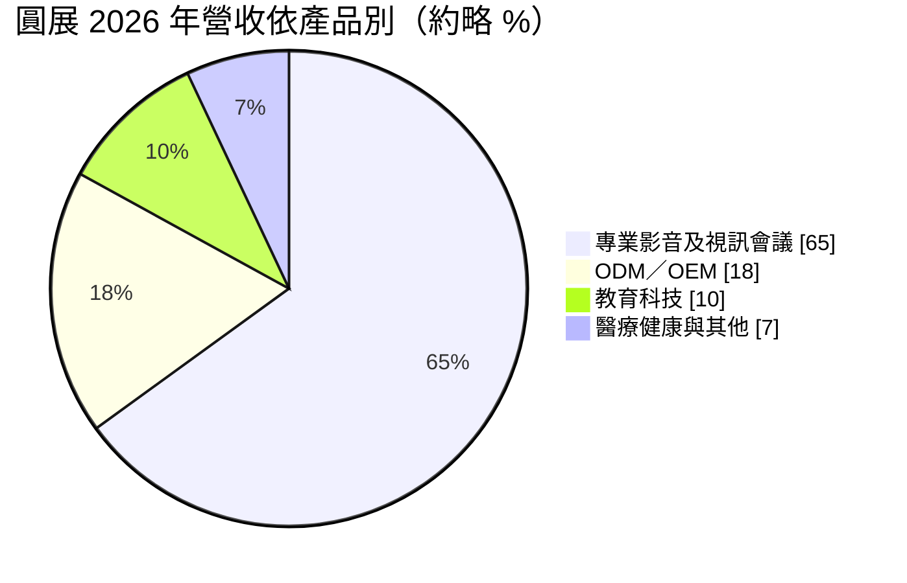
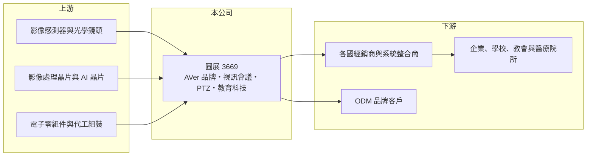

# 3669 圓展

> 上市｜[[產業索引-通信網路業|通信網路業]]｜上市（櫃）日期 2011/08/25

# 第一章：企業模式與商業藍圖

> [!info] 撰寫說明
> 精簡版，由 Claude 依公開資料整理，架構比照 [[2330台積電]] 的四章研究，資料截至 2026-10-08。來源：證交所開放資料（基本資料、2026 年第二季資產負債與損益、股利）、Goodinfo 台灣股市資訊網年度經營績效（2020 至 2025 年）、經濟日報 2026 年 5 月報導；公司沿革與產品細項依記憶整理，已標「待校對」。#待校對

本章拆解圓展科技（股票代號：3669，以下簡稱圓展）的商業模式：它是少數以自有品牌 AVer 經營全球市場的台灣影音設備公司，產品從視訊會議攝影機、專業影音 PTZ 攝影機到教育科技，毛利率遠高於一般電子代工廠。

- **核心業務：** 圓展成立於 2008 年，2011 年上市，由圓剛科技分割商用影音事業而來（待校對）。主要產品包括視訊會議攝影機與會議室系統、專業影音用的 [[PTZ攝影機]]（可遠端控制水平、俯仰與變焦，用於直播、教會、演講廳與教室），以及教育科技產品（實物攝影機、教室錄播與充電車等，待校對）。圓展以自有品牌經營，透過各國經銷商與系統整合商銷售，同時承接部分 [[ODM]] 代工。
- **營收結構：** 依經濟日報 2026 年 5 月報導，專業影音及視訊會議約占 65%，ODM／OEM 代工約 17% 至 20%，教育科技約 10%，另有醫療健康等新業務。品牌產品毛利率高，ODM 比重提高則會拉低整體毛利率。

- **營運據點：** 總部與研發在台灣，銷售網絡遍及歐美與日本；近期成長動能來自歐美專案訂單與日本新專案量產。品牌經營需要在各地建立通路與技術支援，費用率比代工廠高，但也換來較高的毛利率與客戶黏著度。
- **長期方向：** 管理層的策略是以 AI 提升產品附加價值（例如自動追蹤講者、智慧取景），提高高階機種比重，並從單一硬體轉型為[[解決方案平台]]，提高客戶黏著度。醫療健康（遠距醫療）被視為中長期具潛力的市場。2025 年 7 月總經理換人，外界視為集團世代交替。

# 第二章：護城河深度與競爭優勢

圓展的護城河來自品牌、通路與影像技術，在視訊會議這個國際大廠林立的市場中，以專業影音的利基產品站穩位置。

- **競爭優勢：** 第一是自有品牌與全球通路：經營品牌需要長期累積經銷商、系統整合商與售後服務網絡，這是代工廠很難複製的資產。第二是影像與鏡頭控制技術，PTZ 攝影機要求光學變焦、低延遲與遠端控制穩定性，圓展在這個領域有長期累積。第三是產品能與 Zoom、Microsoft Teams 等平台相容認證，[[轉換成本]]來自客戶已建置的會議室與教室系統。
- **主要對手：** 視訊會議領域有 Logitech、Poly（HP 旗下）、Yealink、Jabra、Huddly 等國際品牌；專業影音 PTZ 攝影機領域有 Sony、Panasonic、Canon 等日本大廠；教育科技領域則有多家台灣與中國品牌。台灣影音同業則有圓剛等。圓展在規模上不占優勢，必須靠產品定位與性價比競爭。
- **觀察重點：** 一是毛利率能否維持在 55% 以上，這反映品牌定價力；二是 ODM 比重變化，因為代工比重上升會稀釋毛利率；三是 AI 功能與解決方案化能否帶動營收重新成長，擺脫疫情後的下滑趨勢。

# 第三章：財務體質與盈利規模

資料日期：2026-10-08，表格是撰寫當時的快照；最新月營收、毛利率、累計 EPS 由自動排程寫在本筆記的屬性欄位（月營收、毛利率、累計EPS 等）。#待校對

圓展的財務數字清楚呈現疫情紅利退去的過程：毛利率維持高檔，但營收與營業利益率在 2020 年後連年下滑，2026 年開始回升。

| 年度 | 營收（億元） | [[毛利率]] | [[營業利益率]] | EPS（元） | [[ROE]] |
|---|---|---|---|---|---|
| 2020 | 40.7 | 52.9% | 23.6% | 8.48 | 27.8% |
| 2021 | 36.9 | 52.7% | 20.1% | 7.02 | 21.1% |
| 2022 | 30.1 | 52.3% | 9.69% | 3.58 | 11.5% |
| 2023 | 24.8 | 56.9% | 4.26% | 2.69 | 8.27% |
| 2024 | 26.1 | 60.0% | 6.27% | 2.04 | 5.54% |
| 2025 | 25.3 | 58.4% | 4.39% | 1.13 | 3.04% |
| 2026 上半年 | 14.02 | 60.98% | 10.40% | 1.40 | 未查得 |

註：2020 至 2025 年取自 Goodinfo，2026 年上半年取自證交所開放資料。

- **營收規模：** 2020 年疫情帶動遠距會議與遠距教學需求，營收達 40.7 億元，之後逐年下滑到 2025 年的 25.3 億元，2020 至 2025 年年複合成長率約 -9%（推算）。2026 年上半年營收 14 億元，前四個月年增約 22%，顯示需求已從谷底回升。
- **獲利：** 毛利率始終在 52% 至 61% 之間，甚至在營收下滑時仍上升，證明品牌定價力仍在。但營業利益率從 23.6% 降到 4.4%，原因是品牌經營的研發、行銷與通路費用相對固定，營收縮小後費用率上升，這是典型的[[營運槓桿]]反向作用。2026 年上半年營業利益率回到 10.4%，就是營收回升的槓桿效果。
- **財務特色：** 2021 至 2025 年平均 ROE 約 9.9%（推算），但呈逐年下滑。2025 年度配發現金股利 1 元，配發率約 88%，股利隨獲利下降而減少。2026 年第二季股東權益約 35 億元、每股淨值 37.72 元，總負債約 13.7 億元，負債比約 28%，財務結構穩健。

## [[ROIC]] 與 [[WACC]]

**ROIC 推算：** 2025 年營業利益約 1.11 億元（25.3 億元 × 4.39%），以稅率 20% 計算，稅後營業利益約 0.89 億元。投入資本以 2026 年第二季股東權益約 35 億元近似（有息負債未查得，推估不多），ROIC 約 2.5%（推算）。2020 年稅後營業利益約 7.7 億元，股東權益約 28 億元，ROIC 約 27%（推算）。2026 年上半年營業利益 1.46 億元，年化後 ROIC 約 6.7%（推算）。

**WACC 推算：** 台灣 10 年期公債約 1.75%、市場風險溢酬約 6%、β 取消費與商用電子品牌股的 0.9（假設），股東要求報酬率約 7.15%，WACC 約 7%（推算）。

**解讀：** 2020 至 2022 年 ROIC 高於 WACC，2023 至 2025 年降到約 2% 至 4%，低於約 7% 的資金成本；2026 年上半年年化後接近 WACC。圓展能否重新創造價值，取決於營收能否回到 30 億元以上，讓高毛利率轉化為足夠的營業利益。

# 第四章：總體風險與地緣政治

本章說明圓展長期面對的需求、競爭與成本風險。

- **產業週期：** 視訊會議與教育科技在 2020 至 2021 年因疫情需求暴增，之後出現長達數年的需求回落與通路庫存調整。長期而言，混合辦公與遠距教學已成常態，但換機週期較長，需求成長屬於溫和型；教育市場則受各國政府預算與標案時程影響。
- **營運風險：** 營收規模縮小時，品牌經營的固定費用會壓縮獲利；ODM 比重提高雖能填補營收，但會拉低毛利率。管理層提到備料是最大風險：為因應零組件漲價而提前備料，若需求不如預期，可能產生存貨跌價損失。2026 年調漲品牌產品報價 5% 至 10%，能否被市場接受也需要觀察。
- **其他風險：** 國際大廠與中國品牌在價格上競爭激烈；美國關稅與匯率影響外銷獲利；視訊平台規格（Zoom、Teams 等）的變化，可能要求硬體持續更新認證。

# 專有名詞解析

## 應用

- **[[PTZ攝影機]]**：可遠端控制水平旋轉、俯仰與變焦的攝影機，用於直播、會議、教室與演講廳。

## 金融

- **[[營運槓桿]]**：固定成本比重高的企業，營收小幅成長就能帶動營業利益大幅成長；反之營收下滑時獲利也衰退更快。

## 產業

- **[[ODM]]**：原廠委託設計製造，代工廠負責產品設計與生產，品牌或營運商只提出規格並負責銷售。
- **[[解決方案平台]]**：把硬體、軟體與服務整合成完整方案銷售，客戶黏著度與附加價值高於單賣硬體。
- **[[轉換成本]]**：客戶更換供應商時要付出的時間、金錢與風險，轉換成本越高，供應商的客戶黏著度越高。

# 核心供應鏈

- 上游：影像感測器（例如 [[SONY索尼]]）與光學鏡頭、影像處理與 AI 晶片、電子零組件與組裝代工。
- 下游／客戶：歐美與日本的經銷商與系統整合商，最終用戶為企業會議室、學校、教會與醫療院所，另有 ODM 品牌客戶，公司未揭露具名客戶。
- 同業：Logitech、Poly、Yealink、Sony、Panasonic，台灣同業圓剛。

## 最新新聞
<!-- news:start -->
<!-- news:end -->

## 相關連結
- [公開資訊觀測站](https://mopsov.twse.com.tw/mops/web/t05st03?step=1&firstin=1&co_id=3669)
- [Goodinfo](https://goodinfo.tw/tw/StockDetail.asp?STOCK_ID=3669)
- [Yahoo 股市](https://tw.stock.yahoo.com/quote/3669)
- [鉅亨網新聞](https://www.cnyes.com/twstock/3669/news)
