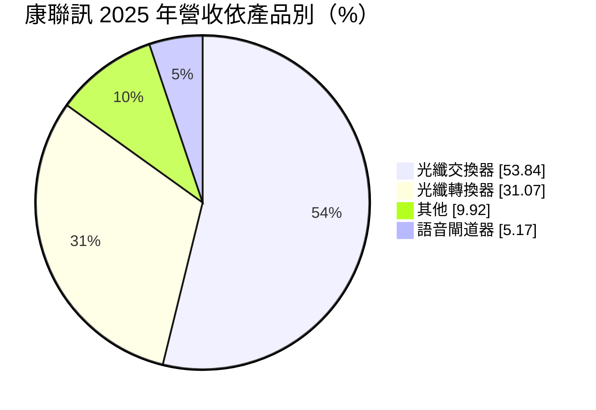
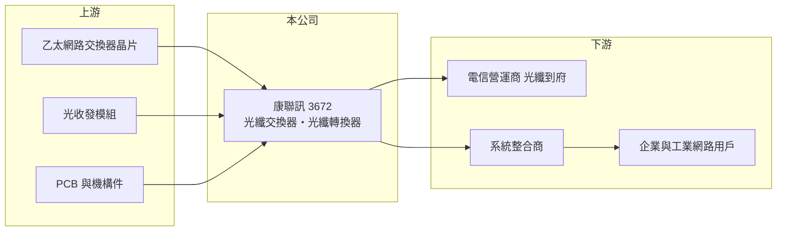

# 3672 康聯訊

> 上櫃｜[[產業索引-通信網路業|通信網路業]]｜上市（櫃）日期 2015/04/20

# 第一章：企業模式與商業藍圖

> [!info] 撰寫說明
> 精簡版，由 Claude 依公開資料整理，架構比照 [[2330台積電]] 的四章研究，資料截至 2026-10-08。來源：櫃買中心開放資料（基本資料、2026 年第二季資產負債與損益）、Goodinfo 台灣股市資訊網年度經營績效（2020 至 2025 年）、MoneyDJ（富邦證券）公司基本資料、nstock 公司概況；應用市場與客戶描述依記憶整理，已標「待校對」。公開資料有限。#待校對

本章拆解康聯訊科技（股票代號：3672，以下簡稱康聯訊）的商業模式：它是一家專做光纖乙太網路設備的小型網通公司，產品是把光纖接到企業、工業現場與住宅的交換器和轉換器，近年營收大幅萎縮，正處於經營低谷。

- **核心業務：** 康聯訊成立於 1998 年，2015 年上櫃，英文品牌為 CTS（官網 ctsystem.com）。主要產品是光纖[[乙太網路]]交換器（Switch）與[[光纖轉換器]]（Media Converter），另有整合語音、數據與影像的 Triple Play 語音閘道器。這類產品用於電信業者的光纖到府（[[FTTx]]）佈建、企業網路與工業網路，特點是需要在戶外或工業環境長期穩定運作（應用描述待校對）。
- **營收結構：** 依 MoneyDJ 資料，2025 年光纖交換器占 53.84%、光纖轉換器 31.07%、語音閘道器 5.17%、其他 9.92%。產品集中在光纖接取設備，屬於網通產業中規模較小、客製化程度較高的利基市場。

- **營運據點：** 公司未揭露生產與銷售據點細節。外銷市場與主要客戶未查得，推估以電信營運商與系統整合商為主（待校對）。
- **長期方向：** 公開資料未揭露明確的長期策略。從產業趨勢看，光纖接取設備的長期需求來自各國光纖普及計畫、工業自動化網路與智慧城市建設；但康聯訊營收規模已縮到每年 2 億多元，能否找到新的成長產品或客戶，是決定公司前景的關鍵。

# 第二章：護城河深度與競爭優勢

康聯訊的護城河很淺：光纖交換器與轉換器的技術成熟，大型網通廠與中國業者都能生產，小型業者只能依賴客製化與特定客戶關係。

- **競爭優勢：** 第一是專注光纖接取產品二十多年的設計經驗，能依營運商需求客製化規格。第二是產品若通過電信營運商認證，同一世代設備通常會沿用數年，形成一定的[[轉換成本]]。第三是毛利率約 30% 至 34%，高於一般網通代工，顯示產品仍有一定的利基性。
- **主要對手：** 台灣光纖與乙太網路設備同業包括 [[6216居易]]、[[2332友訊]]、[[3704合勤控]]、[[6245立端]]、[[2345智邦]]，國際上有 Moxa 等工業網路品牌，以及大量中國光纖設備廠。在價格競爭下，小型業者很難靠規模取勝。
- **觀察重點：** 一是營收能否止跌回升，這是判斷公司能否繼續經營本業的最基本指標；二是毛利率能否維持在 30% 以上；三是虧損對淨值的侵蝕速度，以及公司是否提出新產品、新客戶或轉型計畫。

# 第三章：財務體質與盈利規模

資料日期：2026-10-08，表格是撰寫當時的快照；最新月營收、毛利率、累計 EPS 由自動排程寫在本筆記的屬性欄位（月營收、毛利率、累計EPS 等）。#待校對

康聯訊的財務數字呈現一家營收持續萎縮的公司：毛利率尚可，但營收規模已無法支撐費用。

| 年度 | 營收（億元） | [[毛利率]] | [[營業利益率]] | EPS（元） | [[ROE]] |
|---|---|---|---|---|---|
| 2020 | 8.00 | 29.5% | 3.25% | 0.52 | 4.57% |
| 2021 | 8.54 | 30.8% | 3.35% | 0.24 | 1.68% |
| 2022 | 6.87 | 29.4% | -3.86% | -0.35 | -3.15% |
| 2023 | 3.70 | 34.1% | -19.6% | -1.21 | -10.6% |
| 2024 | 2.94 | 33.0% | -29.9% | -2.04 | -21.0% |
| 2025 | 2.34 | 34.0% | -33.4% | -2.25 | -26.3% |
| 2026 上半年 | 1.08 | 36.41% | -30.5% | -0.82 | 未查得 |

註：2020 至 2025 年取自 Goodinfo，2026 年上半年取自櫃買中心開放資料推算。

- **營收規模：** 營收從 2021 年的 8.54 億元降到 2025 年的 2.34 億元，四年內萎縮約七成，2020 至 2025 年年複合成長率約 -22%（推算）。2023 年營收幾乎腰斬，推估與主要客戶訂單大幅減少有關（原因未查得）。
- **獲利：** 毛利率在 29% 至 36% 之間，營收下滑時反而略升，代表產品本身仍有利潤；但營業利益率從 2021 年的 3.35% 降到 2025 年的 -33.4%，因為研發與管理費用無法隨營收等比例縮減。這是營收規模過小時典型的[[營運槓桿]]反向作用。
- **財務特色：** 2021 至 2025 年平均 ROE 約 -11.9%（推算），近五年平均現金股利約 0.04 元，最近一期未配息。2026 年第二季股東權益約 2.92 億元、每股淨值 7.16 元，已低於面額；總負債約 2.45 億元，負債比約 46%。

## [[ROIC]] 與 [[WACC]]

**ROIC 推算：** 2025 年營業虧損約 0.78 億元（2.34 億元 × -33.4%），虧損年度不計稅負。投入資本以 2026 年第二季股東權益約 2.92 億元近似（有息負債未查得），ROIC 約 -27%（推算）；2026 年上半年營業虧損 0.33 億元，年化後 ROIC 約 -23%（推算）。

**WACC 推算：** 台灣 10 年期公債約 1.75%、市場風險溢酬約 6%、β 取小型網通股常見的 1.0（假設），股東要求報酬率約 7.75%，WACC 約 7.5%（推算）。

**解讀：** 2022 年起 ROIC 轉負，且負值逐年擴大，遠低於約 7.5% 的 WACC，代表康聯訊正持續毀損股東價值。以目前的虧損速度，股東權益約只夠支撐數年，公司需要盡快讓營收回到能覆蓋費用的規模，或縮減費用結構。

# 第四章：總體風險與地緣政治

本章說明康聯訊長期面對的經營、競爭與財務風險。

- **產業週期：** 光纖接取設備跟著各國光纖佈建計畫與營運商資本支出走，佈建高峰過後需求會明顯回落。工業網路需求則與製造業投資相關，景氣下行時企業會延後網路升級。
- **營運風險：** 營收連續多年大幅下滑，代表原有客戶或產品線失去競爭力；費用結構未能同步調整，導致虧損擴大。淨值已低於面額，若虧損持續，可能需要增資、減資彌補虧損或處分資產。小公司對單一客戶依賴度通常較高，任何一個客戶流失都影響重大。
- **其他風險：** 中國光纖設備廠以低價競爭；美國與歐洲對網通設備的資安規範日趨嚴格，認證成本上升；外銷營收受匯率影響。這些因素對規模小的業者壓力特別大。

# 專有名詞解析

## 應用

- **[[光纖轉換器]]**：把銅線網路的電訊號轉換成光纖光訊號的設備，用來延長網路傳輸距離。
- **[[FTTx]]**：光纖到 x，泛指光纖到府（FTTH）、到大樓（FTTB）等把光纖延伸到用戶端的佈建方式。

## 金融

- **[[營運槓桿]]**：固定成本比重高的企業，營收小幅成長就能帶動營業利益大幅成長；反之營收下滑時獲利也衰退更快。

## 產業

- **[[乙太網路]]**：以網路線或光纖連接電腦與網路設備的有線區域網路標準，交換器是其核心設備。
- **[[轉換成本]]**：客戶更換供應商時要付出的時間、金錢與風險，轉換成本越高，供應商的客戶黏著度越高。

# 核心供應鏈

- 上游：乙太網路交換器晶片（例如 [[AVGO博通]]、[[MRVL邁威爾]]、[[2379瑞昱]]）、光收發模組、PCB 與機構件供應商。
- 下游／客戶：電信營運商、系統整合商與企業及工業網路用戶，公司未揭露具名客戶（待校對）。
- 同業：[[6216居易]]、[[2332友訊]]、[[3704合勤控]]、[[6245立端]]、[[2345智邦]]、Moxa。

## 最新新聞
<!-- news:start（自動產生，請勿手動編輯此範圍） -->
- 2026-10-08 🏛️ 重訊 16:01｜公告本公司內部稽核主管及代理發言人異動｜[觀測站](https://mops.twse.com.tw/mops/#/web/t05st01)

完整紀錄：[[3672康聯訊 新聞]]
<!-- news:end -->

## 相關連結
- [公開資訊觀測站](https://mopsov.twse.com.tw/mops/web/t05st03?step=1&firstin=1&co_id=3672)
- [Goodinfo](https://goodinfo.tw/tw/StockDetail.asp?STOCK_ID=3672)
- [Yahoo 股市](https://tw.stock.yahoo.com/quote/3672)
- [鉅亨網新聞](https://www.cnyes.com/twstock/3672/news)
