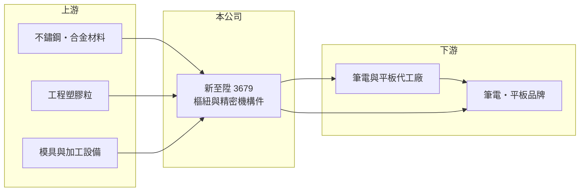

# 3679 新至陞

> 上市｜[[產業索引-電子零組件業|電子零組件業]]｜上市（櫃）日期 2011/10/05

# 第一章：企業模式與商業藍圖

> [!info] 撰寫說明
> 精簡版，由 Claude 依公開資料整理，架構比照 [[2330台積電]]，資料截至 2026-10-08。來源：證交所開放資料（基本資料、2026 年第二季財報、營益分析、股利）、Goodinfo 經營績效頁、nStock 公司簡介（登記業務）。產品以樞紐為主的描述依產業分類與記憶整理，營收比重、廠區與客戶未查得。#待校對

新至陞科技是成立超過四十年的精密零組件廠，登記業務是塑膠製品與模具，市場一般將它歸類為筆電、平板與二合一裝置的[[樞紐]]供應商（待校對）。它的特色是在消費電子零組件中，長期維持兩成上下的營業利益率與高配息。

- **核心業務：** 新至陞成立於 1980 年，2011 年在證交所上市。公司與子公司的登記業務為各類塑膠製品製造加工、模具製造加工與進出口貿易。實際產品以筆電、平板等行動裝置的轉軸樞紐與精密機構件為主（待校對）。
- **營收結構：** 產品別、客戶別與地區別營收比重未查得。從獲利水準推估，公司的產品集中在設計較複雜、單價較高的樞紐機種，而非大量標準品。
- **營運據點：** 生產據點未查得（待校對）。樞紐廠通常在中國等筆電代工聚落設廠，以配合客戶新機種的試產與交期。
- **長期方向：** 筆電與平板市場已成熟，公司成長主要來自新機種的設計規格升級，例如更輕薄、可 360 度翻轉或可拆式裝置所需的特殊樞紐。富果研究有 2025 年 11 月的法說會紀錄，可作為後續校對產品與客戶結構的來源。

# 第二章：護城河深度與競爭優勢

新至陞的護城河在財務數字上相當明顯：在同業普遍只有個位數營業利益率的樞紐產業中，它能長期維持 12% 至 22%。

- **競爭優勢：** 樞紐需要在客戶設計初期就參與開發，機種量產後很少中途更換供應商，形成[[設計導入]]的黏著度。新至陞同時具備模具與塑膠、金屬加工能力，有利於掌握成本與良率；長期高毛利也顯示公司在特定客戶或特定機種上有較強的設計能力（推估）。
- **主要對手：** 筆電與平板樞紐的同業包括 [[3376新日興]]、[[3548兆利]]、[[1582信錦]]，以及中國的樞紐廠。摺疊手機樞紐的 [[6805富世達]] 也具備相近的精密機構能力。
- **觀察重點：** 營收在 35 億至 48 億元之間波動，沒有明顯成長，但獲利能力穩定。觀察重點是公司能否在筆電市場成熟的情況下維持高毛利，以及是否把能力延伸到新的產品類別。

# 第三章：財務體質與盈利規模

資料日期：2026-10-08，表格是撰寫當時的快照；最新月營收、毛利率、累計 EPS 由自動排程寫在本筆記的屬性欄位（月營收、毛利率、累計EPS 等）。#待校對

新至陞的特色是高利潤率與高配息，即使在 2023 年消費電子低谷，營業利益率仍有 13%。

| 年度 | 營收（億元） | [[毛利率]] | [[營業利益率]] | EPS（元） | [[ROE]] |
|---|---|---|---|---|---|
| 2020 | 48.1 | 32.0% | 22.2% | 11.57 | 17.2% |
| 2021 | 48.3 | 28.3% | 18.4% | 9.70 | 13.7% |
| 2022 | 39.3 | 23.7% | 11.6% | 11.32 | 15.7% |
| 2023 | 35.1 | 26.1% | 13.4% | 7.77 | 10.7% |
| 2024 | 42.6 | 30.9% | 19.3% | 13.85 | 18.4% |
| 2025 | 44.7 | 33.0% | 22.4% | 9.78 | 12.3% |
| 2026 上半年 | 20.8 | 29.88% | 17.76% | 4.18 | 未查得 |

- **營收規模：** 2020 至 2025 年營收年複合成長率約 -1.5%（推算），營收規模停滯，獲利主要靠利潤率而非成長。
- **獲利：** 2021 至 2025 年平均 ROE 約 14.2%（推算）。2022 年營業利益率只有 11.6%，EPS 卻達 11.32 元，代表當年有可觀的[[業外收入]]（推估與匯兌收益有關），評估本業時應以營業利益為準。
- **財務特色：** 2026 年第二季總資產 94.8 億元、負債 46.4 億元、權益 48.4 億元，每股淨值 76.78 元。2025 年度配發現金股利 9 元，以 EPS 9.78 元計配發率約 92%（推算），公司把大部分盈餘發還股東。

**[[ROIC]] 與 [[WACC]]：** 開放資料未拆出有息負債，以負債總額 40% 估約 18.6 億元（推算假設）。2025 年營業利益約 10.0 億元，稅後約 8.0 億元，除以權益 48.4 億元加有息負債 18.6 億元，ROIC 約 12%；2024 年約 10%（推算）。WACC 以 CAPM 推估：無風險利率 1.75%、市場風險溢酬 6%、β 取 0.9（高配息零組件股常見值），股權成本約 7.15%；稅後負債成本 2%，股權占比約 72%，WACC 約 5.7%（推算）。ROIC 明顯高於 WACC，表示公司長期在創造價值，且高配息政策代表管理層不傾向把現金投入低報酬的擴張。

# 第四章：總體風險與地緣政治

新至陞的風險在於市場成熟、客戶集中，以及消費電子的週期。

- **產業週期：** 筆電與平板出貨在疫情期間暴增後回落，2022 至 2023 年營收從 48 億元降到 35 億元，顯示[[長鞭效應]]對零組件廠的影響。即使利潤率穩定，營收仍會跟著終端市場起伏。
- **營運風險：** 高利潤率通常來自少數重要客戶或特定機種，若客戶改變設計或轉單，獲利可能大幅下滑（推估）。營收長期沒有成長，代表公司需要新的產品類別才能擴大規模。
- **其他風險：** 生產若集中在中國，會受到美中關稅與客戶要求移轉產地的影響；營收以美元計價，新台幣升值會壓縮獲利。金屬與塑膠原料價格波動也會影響成本。

# 專有名詞解析

## 金融

- **[[業外收入]]**：本業營運以外的收入，例如利息、投資收益、處分資產利益，持續性通常低於本業獲利。
- **[[長鞭效應]]**：終端需求的小幅變動，沿供應鏈往上游傳遞時被逐級放大，造成上游庫存與訂單劇烈波動。

## 產業

- **[[樞紐]]**：讓螢幕或筆電上蓋能開合、旋轉並固定在任意角度的轉軸機構，需兼顧扭力、手感與耐用度。
- **[[設計導入]]**：零件被客戶選入產品設計並完成驗證，之後該產品量產期間都會持續採購，是零組件廠長期營收的來源。

# 核心供應鏈

- 上游：不鏽鋼與合金材料、工程塑膠粒、模具與加工設備。
- 下游／客戶：筆電與平板代工廠及品牌（推估）；具名客戶未查得。
- 同業：[[3376新日興]]、[[3548兆利]]、[[1582信錦]]、[[6805富世達]]。

## 最新新聞
<!-- news:start -->
<!-- news:end -->

## 相關連結
- [公開資訊觀測站](https://mopsov.twse.com.tw/mops/web/t05st03?step=1&firstin=1&co_id=3679)
- [Goodinfo](https://goodinfo.tw/tw/StockDetail.asp?STOCK_ID=3679)
- [Yahoo 股市](https://tw.stock.yahoo.com/quote/3679)
- [鉅亨網新聞](https://www.cnyes.com/twstock/3679/news)
