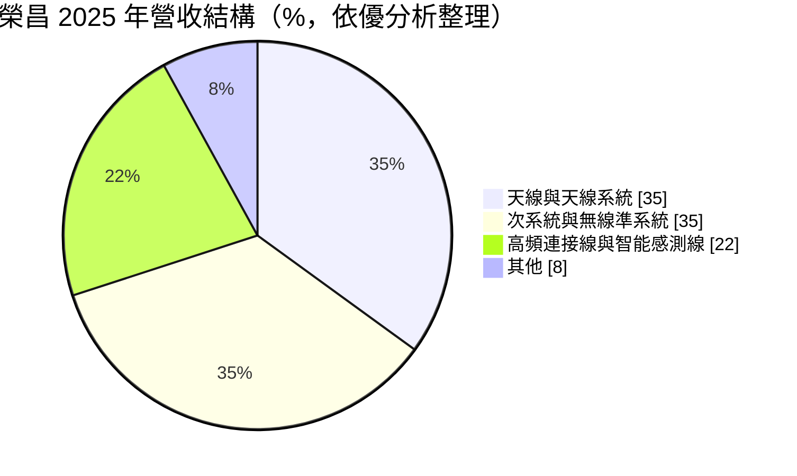
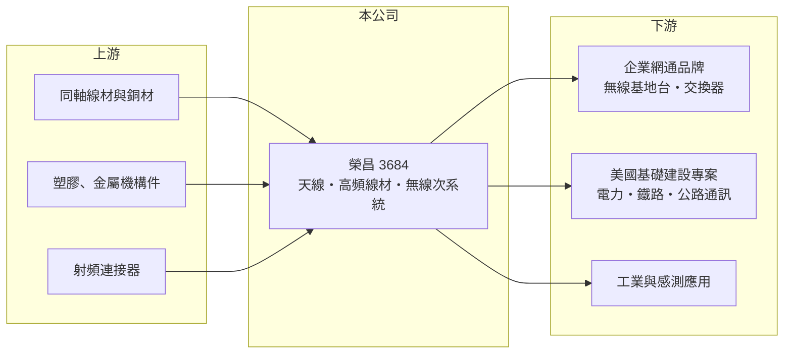

# 3684 榮昌

> 上櫃｜[[產業索引-通信網路業|通信網路業]]｜上市（櫃）日期 2014/03/28

# 第一章：企業模式與商業藍圖

> [!info] 撰寫說明
> 精簡版，由 Claude 依公開資料整理，架構比照 [[2330台積電]] 的四章研究，資料截至 2026-10-08。來源：櫃買中心開放資料（基本資料、綜合損益、資產負債、每月營收、本益比殖利率）、Goodinfo 年度經營績效、優分析 2026 年 1 月文章、經濟日報與自由時報營收報導標題。產品細節與生產據點部分依記憶整理，需逐條比對原始文件。#待校對

本章說明榮昌科技（股票代號：3684，以下簡稱榮昌）的商業模式：一家從高頻線材與天線起家、逐步往無線次系統組裝延伸的小型網通零組件廠。

- **核心業務：** 榮昌成立於 1995 年，2014 年在櫃買中心掛牌，總部位於新北市新店區，實收資本額約 3.03 億元，屬於股本很小的公司。產品分為三大類：高頻連接線與智能感測線、[[天線]]與天線系統、次系統與無線準系統。早年以隧道、地鐵、礦坑使用的[[漏波電纜]]與高頻線材打開知名度（待校對），近年把重心移到企業網通設備使用的整合式天線。
- **營收結構：** 依優分析 2026 年 1 月整理的 2025 年資料，天線與天線系統約占 35%、次系統與無線準系統約占 35%、高頻連接線與智能感測線約占 22%，其餘約 8%。三大產品線比重接近，代表公司已不再只是單一零件供應商，而能把天線、線材和組裝一起交給客戶。

- **營運據點：** 總部與研發在新北市新店，生產據點本次未查得，依記憶在中國設有組裝廠（待校對）。客戶以全球企業網通品牌與美國基礎建設專案為主，報導指出公司已掌握全球前三大企業網通客戶的整合天線訂單。
- **長期方向：** 公司的轉型路線是從單一頻段天線，走向涵蓋 [[Wi-Fi 7]]、5G 與衛星的多頻段整合天線，再往上做次系統與準系統組裝。2025 年 Wi-Fi 7 天線出貨已明顯超越 Wi-Fi 6，美國電力、鐵路與高速公路通訊等基礎建設專案則提供另一條較不受消費景氣影響的需求來源。

# 第二章：護城河深度與競爭優勢

本章評估榮昌的護城河。榮昌的優勢來自射頻設計經驗與客製化能力，但規模小、產品容易被比價，屬於窄護城河。

- **競爭優勢：** 企業級無線基地台的天線必須和機構、散熱與多頻段晶片一起設計，客戶一旦在某一代產品導入，通常會沿用到該代產品生命週期結束，形成一定的轉換成本。榮昌能同時提供天線、高頻線材與次系統組裝，讓客戶少找一家供應商，這是它的毛利率長期維持在 30% 以上的原因。
- **主要對手：** 天線與射頻零組件的對手包括 [[3138耀登]]、[[6143振曜]]、[[2439美律]]、[[3491昇達科]] 等台廠，以及中國與歐美的天線專業廠（對手名單為產業常識整理，待校對）。在高頻線材與工業感測線方面，則和眾多中小型線材廠競爭。
- **觀察重點：** 第一，Wi-Fi 7 及之後的世代更替能否持續帶來單價提升，因為每一代無線規格增加頻段，天線數量與設計難度也隨之增加。第二，美國基礎建設專案能否成為穩定的長期業務。第三，次系統組裝比重提高後，毛利率能否守在 30% 以上。

# 第三章：財務體質與盈利規模

資料日期：2026-10-08。數字取自 Goodinfo 年度經營績效與櫃買中心開放資料，表格是撰寫當時的快照；最新月營收、毛利率、累計 EPS 由自動排程寫在本筆記的屬性欄位（月營收、毛利率、累計EPS 等）。#待校對

榮昌的財務數字顯示營收規模小但成長明確，毛利率穩定在三成以上，獲利會隨網通庫存週期起伏。

| 年度 | 營收（新台幣） | [[毛利率]] | [[營業利益率]] | EPS（元） | [[ROE]] |
|---|---|---|---|---|---|
| 2019 | 4.71 億 | 39.7% | 16.7% | 4.64 | 23.7% |
| 2020 | 5.22 億 | 35.4% | 14.0% | 2.03 | 9.65% |
| 2021 | 9.20 億 | 29.7% | 12.3% | 3.50 | 15.8% |
| 2022 | 11.3 億 | 31.6% | 12.3% | 5.00 | 20.5% |
| 2023 | 8.08 億 | 30.2% | 4.99% | 1.17 | 5.68% |
| 2024 | 9.38 億 | 33.5% | 9.26% | 2.80 | 13.2% |
| 2025 | 11.5 億 | 32.4% | 10.8% | 3.50 | 15.1% |
| 2026 上半年 | 5.86 億 | 34.0% | 11.8% | 1.78 | 未查得 |

註：2019 至 2025 年取自 Goodinfo 合併報表；2026 上半年取自櫃買中心開放資料，毛利率與營業利益率由營業毛利、營業利益除以營收計算。

- **營收規模：** 2020 至 2025 年營收年複合成長率約 17.1%（推算），2025 年營收 11.5 億元創歷史新高、年增 22%。2023 年因網通客戶庫存調整，營收與獲利明顯下滑，2024 年後恢復成長。2026 年 1 至 8 月累計營收 8.00 億元，較去年同期增加約 5.4%。
- **獲利：** 毛利率長期在 30% 至 40% 之間，對零組件廠而言屬於偏高水準，反映客製化設計的附加價值。2021 至 2025 年平均 ROE 約 14.1%（推算），但 2023 年只有 5.68%，顯示營業費用固定、營收下滑時獲利會被放大壓縮。
- **財務特色：** 2026 年第二季底資產總計 14.6 億元、負債 7.52 億元（其中非流動負債 3.55 億元）、股東權益 7.08 億元，每股淨值 23.36 元，負債比約 52%，以零組件廠而言槓桿不低。櫃買中心資料顯示最近一年度每股現金股利約 2.77 元，相對 2025 年 EPS 3.5 元，配息率約八成（推算），公司傾向把多數盈餘發還股東。
- **[[ROIC]] 與 [[WACC]]：** 以 2026 上半年營業利益 0.69 億元年化約 1.39 億元、扣 20% 稅後約 1.11 億元，投入資本以股東權益 7.08 億元加非流動負債 3.55 億元（代替有息負債，實際有息負債未查得）約 10.6 億元計算，ROIC 約 10.4%（推算）；以 2025 年營業利益約 1.24 億元計算也約 9.4%（推算）。WACC 以 CAPM 推估：無風險利率 1.75%、市場風險溢酬 6%、β 取 1.0（推估，中小型網通零組件常見值），權益成本約 7.75%；稅前負債成本假設 2.5%，以權益與負債約 67:33 加權，WACC 約 5.9%（推算）。ROIC 高於 WACC 約 4 個百分點，代表在景氣正常年度能創造價值，但 2023 年這類庫存調整年度利差會接近消失。

# 第四章：總體風險與地緣政治

本章整理榮昌面對的長期風險，主要來自客戶集中與網通庫存週期。

- **產業週期：** 天線與線材需求跟著企業網通設備出貨走，而企業網通設備又受企業 IT 支出與通路庫存影響。2022 年缺料期間客戶大量備貨、2023 年庫存調整，榮昌營收從 11.3 億元降到 8.08 億元，就是典型的[[長鞭效應]]。
- **營運風險：** 公司營收規模約十億元，前幾大企業網通客戶占比可能偏高（推估），任何一家客戶換供應商或延後新機種，都會明顯影響營收。次系統與準系統組裝的毛利通常低於純天線，比重拉高可能稀釋毛利率。
- **其他風險：** 美國基礎建設專案受政府預算與標案時程影響，認列時間不易預測。若生產據點在中國，需面對美國關稅與供應鏈去中化的要求（待校對）。產品以美元計價，新台幣升值會壓縮獲利。

# 專有名詞解析

## 應用

- **[[天線]]**：把電路中的高頻訊號轉成電磁波發射出去、或把電磁波接收回來的元件，無線設備每增加一個頻段就需要更多天線設計。
- **[[漏波電纜]]**：外層開槽、沿線均勻輻射訊號的同軸電纜，用於隧道、地鐵與礦坑等一般天線難以覆蓋的場所。
- **[[Wi-Fi 7]]**：IEEE 802.11be 無線區域網路標準，支援 320MHz 頻寬與多鏈路傳輸，速度與天線數量都高於 Wi-Fi 6。

## 金融

- **[[長鞭效應]]**：終端需求的小幅變動，沿供應鏈往上游傳遞時被逐級放大，造成上游庫存與訂單劇烈波動。
- **[[ROIC]]**：投入資本報酬率，稅後營業利益除以股東權益加有息負債，衡量本業運用資本的效率。
- **[[WACC]]**：加權平均資金成本，股東與債權人要求報酬率的加權平均，是 ROIC 要超越的門檻。

# 核心供應鏈

- 上游：同軸線材、銅材、射頻連接器與機構件供應商（實際供應商未公開）。
- 下游／客戶：全球前三大企業網通品牌（報導未具名），美國電力、鐵路與高速公路通訊等基礎建設專案；企業網通品牌如 [[CSCO思科]] 屬於潛在客戶類型，實際客戶未公開（待校對）。
- 同業：[[3138耀登]]、[[6143振曜]]、[[3491昇達科]]、[[2439美律]]。

## 最新新聞
<!-- news:start -->
<!-- news:end -->

## 相關連結
- [公開資訊觀測站](https://mopsov.twse.com.tw/mops/web/t05st03?step=1&firstin=1&co_id=3684)
- [Goodinfo](https://goodinfo.tw/tw/StockDetail.asp?STOCK_ID=3684)
- [Yahoo 股市](https://tw.stock.yahoo.com/quote/3684)
- [鉅亨網新聞](https://www.cnyes.com/twstock/3684/news)
