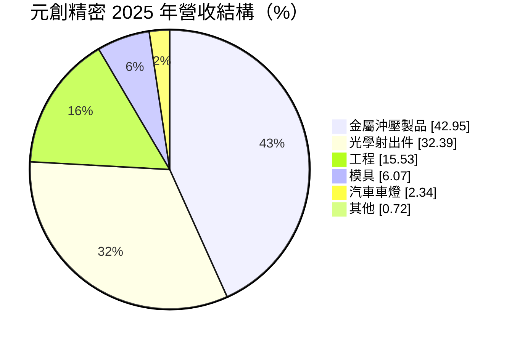
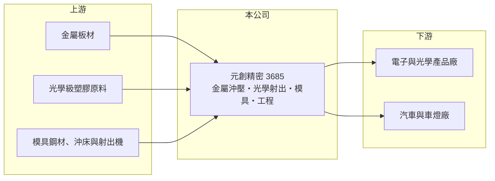

# 3685 元創精密

> 上櫃｜[[產業索引-電機機械|電機機械]]｜上市（櫃）日期 2010/12/08

# 第一章：企業模式與商業藍圖

> [!info] 撰寫說明
> 精簡版，由 Claude 依公開資料整理，架構比照 [[2330台積電]]，資料截至 2026-10-08。來源：櫃買中心開放資料快照（基本資料、2026 年第二季資產負債與損益、本益比殖利率）、Goodinfo 經營績效頁、富邦證券（MoneyDJ）基本資料頁。公開資料有限。#待校對

元創精密車業（以下簡稱元創精密）是台中的精密零件製造商，主力為金屬沖壓件與光學塑膠射出件。理解它的關鍵在於：合併營收中有相當大一部分由非全資子公司貢獻，營業利益看起來不差，但真正歸屬母公司股東的獲利很少。

- **核心業務：** 元創精密成立於 1983 年，2010 年在櫃買中心掛牌，登記地址在台中西屯。依 2025 年營收比重，[[金屬沖壓]]製品占 42.95%、光學射出件占 32.39%、工程占 15.53%、模具占 6.07%、汽車車燈占 2.34%。公司的共同能力是精密模具開發，再延伸到沖壓與射出量產。
- **營收結構：** 金屬沖壓與光學射出合計超過七成，是營收主體。[[光學射出]]件用於鏡片、導光或燈具等需要高透明度與精準曲面的塑膠零件；工程業務的內容未查得。各業務的終端客戶與地區別比重未查得。
- **營運據點：** 登記地址在台中，生產據點與海外布局未查得。依 2026 年第二季資料，股東權益 11.9 億元中歸屬母公司僅約 7.3 億元，非控制權益約 4.6 億元，代表有重要子公司由外部股東共同持有。
- **長期方向：** 公司從模具出發，延伸到沖壓、射出與工程，屬於「一套模具能力、多個應用市場」的多角化路線。長期能否創造股東價值，關鍵在於高毛利的光學件比重能否提升，以及母公司本身的事業能否轉虧為盈。

# 第二章：護城河深度與競爭優勢

元創精密的護城河很窄，模具與精密成型是基本功，但同業眾多，尚未看到明確的定價能力。

- **競爭優勢：** 光學射出件對模具精度、材料流動與成型參數要求高，良率門檻比一般塑膠件高；金屬沖壓則靠連續模設計與量產穩定度。公司同時具備模具、沖壓與射出能力，可提供客戶一站式開發。不過 2020 至 2024 年營業利益率在 −3% 至 0% 之間，顯示這些能力尚未轉化為穩定的超額利潤。
- **主要對手：** 光學塑膠件領域有 [[3019亞光]]、[[3406玉晶光]] 等光學廠，以及大量的模具與射出廠；金屬沖壓同業眾多，包括中國與東南亞廠商。元創精密的直接競爭對手名單未查得。
- **觀察重點：** 長期最該追蹤的是母公司 EPS 能否轉正並穩定。2025 年營業利益率回升到 4.35%，但 EPS 為 −1.02 元；2026 年上半年營業利益率約 10.6%，合併淨利 0.59 億元中歸屬母公司僅 0.17 億元，EPS 0.21 元。獲利大量流向非控制權益，是投資人需要特別理解的結構。

# 第三章：財務體質與盈利規模

資料日期：2026-10-08，表格是撰寫當時的快照；最新月營收、毛利率、累計 EPS 由自動排程寫在本筆記的屬性欄位（月營收、毛利率、累計EPS 等）。#待校對

元創精密的財務是「合併營業利益改善、母公司股東報酬仍弱」的型態，閱讀時要把合併數字與歸屬母公司的數字分開看。

| 年度 | 營收（億元） | [[毛利率]] | [[營業利益率]] | EPS（元） | [[ROE]] |
|---|---|---|---|---|---|
| 2021 | 14.9 | 14.2% | −0.45% | 0.05 | 0.32% |
| 2022 | 15.5 | 14.0% | −2.95% | −0.75 | −4.00% |
| 2023 | 15.2 | 17.5% | −1.26% | −0.77 | −3.42% |
| 2024 | 12.5 | 16.0% | 0.23% | −0.53 | −1.46% |
| 2025 | 12.0 | 20.8% | 4.35% | −1.02 | −6.82% |

（來源：Goodinfo 經營績效頁。2026 年上半年依櫃買中心資料，營收 7.23 億元、毛利率約 23.4%、營業利益率約 10.6%、EPS 0.21 元。）

- **營收規模：** 營收由 2016 年的 3.45 億元成長到 2022 年的 15.5 億元高點，推估包含併購或新增子公司（推估，待校對），之後回落到 12 億元左右。2020 至 2025 年年複合成長率約 4.4%（推算）。
- **獲利：** 2021 至 2025 年平均 ROE 約 −3.1%（推算），五年中四年虧損。毛利率由 2021 年的 14.2% 改善到 2025 年的 20.8%，顯示產品組合或成本有所調整，但營業外支出與非控制權益讓母公司股東仍拿不到獲利。
- **財務特色：** 依 2026 年第二季資料，總資產約 22.9 億元、負債約 11.0 億元、權益約 11.9 億元（歸屬母公司約 7.3 億元），負債比約 48%，每股淨值 9.21 元，低於面額 10 元，代表累積虧損已侵蝕股本。Goodinfo 統計的歷年平均現金股利約 0.53 元，近年未配息。
- **[[ROIC]] 與 [[WACC]]：** 以 2025 年營業利益約 0.52 億元（12.0 億元 × 4.35%）、稅率 20% 計算，稅後營業利益約 0.42 億元；有息負債未查得，投入資本以權益 11.9 億元到總資產 22.9 億元為區間，ROIC 約 1.8% 至 3.5%（推算），2021 至 2024 年多為零或負值。WACC 以 CAPM 推估：無風險利率 1.75%、市場風險溢酬 6%、β 假設 0.9，權益成本約 7.2%；稅後負債成本 2%、負債占四成，WACC 約 5.1%（推算）。ROIC 長期低於 WACC，即使 2026 年營業利益率改善，也要持續數年才算真正開始創造價值。

# 第四章：總體風險與地緣政治

元創精密的風險主要在獲利結構與客戶產業的不確定性，加上公開資訊有限，研究時需要更多原始資料佐證。

- **產業週期：** 金屬沖壓與光學射出件的需求來自下游的消費電子、汽車或照明產品，下游新機種或新車種的週期決定訂單起伏。模具與工程業務屬專案性質，營收認列不平均。
- **營運風險：** 獲利大量歸屬非控制權益，母公司股東能分到的盈餘有限；若子公司的合資方調整持股或經營方向，對合併營收影響很大。每股淨值低於面額，未來若需增資或減資彌補虧損，會影響股東權益。
- **其他風險：** 金屬與塑膠原料價格波動影響成本；外銷比重若高則受匯率影響（比重未查得）。中國與東南亞的模具與成型廠以低價競爭，壓縮代工價格。

# 專有名詞解析

## 金融

- **[[非控制權益]]**：合併子公司中不屬於母公司的股東所持有的權益，相應的獲利不會計入母公司 EPS。

## 產業

- **[[金屬沖壓]]**：用模具與沖床把金屬板料一次或連續成形為零件的製程，適合大量生產。
- **[[光學射出]]**：以高透明塑膠射出成型鏡片、導光板等光學零件，對模具精度與成型參數要求極高。

# 核心供應鏈

- 上游：金屬板材、光學級塑膠原料（如 PC、PMMA）供應商，以及模具鋼材、沖床與射出成型設備廠。
- 下游／客戶：電子、光學與照明產品廠，以及汽車與車燈業者（具體客戶公開資料未點名，#待校對）。
- 同業：光學塑膠件與精密零件業者，例如 [[3019亞光]]、[[3406玉晶光]]；沖壓與模具同業眾多。

## 最新新聞
<!-- news:start -->
<!-- news:end -->

## 相關連結
- [公開資訊觀測站](https://mopsov.twse.com.tw/mops/web/t05st03?step=1&firstin=1&co_id=3685)
- [Goodinfo](https://goodinfo.tw/tw/StockDetail.asp?STOCK_ID=3685)
- [Yahoo 股市](https://tw.stock.yahoo.com/quote/3685)
- [鉅亨網新聞](https://www.cnyes.com/twstock/3685/news)
