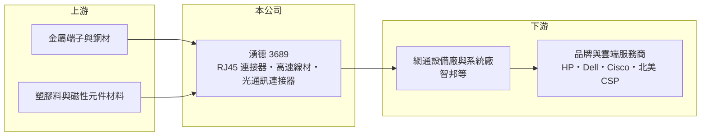

# 3689 湧德

> 上櫃｜[[產業索引-電子零組件業|電子零組件業]]｜上市（櫃）日期 2012/10/18

# 第一章：企業模式與商業藍圖

> [!info] 撰寫說明
> 精簡版，由 Claude 依公開資料整理，架構比照 [[2330台積電]]，資料截至 2026-10-08。來源：櫃買中心開放資料（基本資料、2026 年第二季資產負債與綜合損益、股利）、Goodinfo 經營績效頁、優分析 2025 年 5 月個股報導。產品比重未查得，生產據點與同業部分憑記憶整理。#待校對

湧德是一家以網路接頭起家的連接器廠，要理解它，關鍵在於資料中心流量長期成長，如何轉化為它的接頭與線材需求。

- **核心業務：** 湧德的主力產品是整合型 [[RJ45]] 連接器，也就是網路線插進交換器、伺服器時的那個方形接口，內部通常整合了訊號隔離用的磁性元件。依優分析 2025 年的報導，湧德的全球市占率約 8% 至 10%，排名第二，僅次於美國的 Bel Fuse。RJ45 單價不高，但每台交換器、伺服器、電視與遊戲機都需要，是一個量大、規格穩定的基礎元件市場。
- **產品延伸：** 除了 RJ45，湧德也供應高速線材，並自 2018 年起跨入光通訊連接器，產品包括 SFP、QSFP 與 QSFP-DD 等可插拔[[光收發模組]]的插槽與相關元件。這一步的意義在於，資料中心的傳輸速度從 100G 升級到 400G、800G 後，光纖化的比重會愈來愈高，只做銅線 RJ45 的廠商成長空間會被壓縮。報導指出光纖相關營收比重逐年上升，法人預估 2025 年有機會超過一成。
- **客戶與通路：** 湧德多半不是直接出貨給終端品牌，而是透過網通設備廠與 [[ODM]] 系統廠間接進入 HP、Dell、Cisco 等品牌，台灣客戶以 [[2345智邦]] 為代表。2025 年它透過代工夥伴以第二供應商身分打入北美雲端服務商（CSP）供應鏈，供應 200G、400G 的 SFP 連接器與線材。這種「躲在系統廠後面」的位置，讓它的接單取決於系統廠的認證，而不是品牌的行銷。
- **營運據點與長期方向：** 湧德在台灣設立，主要生產基地早年位於中國，近年為因應客戶分散產地的要求在越南擴產，越南新產能於 2025 年下半年開出（中國廠區細節待校對）。長期來看，公司把自己定位為 AI 基礎建設的傳輸元件供應商，成長動能來自交換器速率升級與光纖產品放量。

# 第二章：護城河深度與競爭優勢

湧德的競爭力不在技術獨占，而在於長年累積的量產規模、認證資格與客戶關係。

- **競爭優勢：** RJ45 看似簡單，但內含磁性元件的整合型產品對訊號完整性、耐壓與良率有一定要求，進入網通大廠的合格供應商名單需要長時間驗證。湧德在這個利基市場排到全球前二，代表它在成本與交期上已具規模優勢。近五年毛利率從 18% 升到接近 30%，顯示產品組合往高速、高附加價值移動，而非單純拚價格。
- **主要對手：** 全球 RJ45 龍頭為 Bel Fuse，其他競爭者包括 Amphenol 等國際連接器大廠，以及台灣與中國的多家磁性元件與連接器廠（例如帛漢，待校對）。在光通訊連接器與高速線材方面，則會遇到 [[3665貿聯-KY]]、[[2392正崴]] 等規模更大的對手，湧德在這個領域屬於後進者。
- **觀察重點：** 第一是光纖相關產品能否從送樣走到穩定量產，特別是 800G 世代的認證進度。第二是北美雲端客戶的份額能否從第二供應商往上提升。第三是越南產能的良率與利用率，這會決定「中國以外產能」的優勢能否轉成價格與份額。

# 第三章：財務體質與盈利規模

資料日期：2026-10-08，表格是撰寫當時的快照；最新月營收、毛利率、累計 EPS 由自動排程寫在本筆記的屬性欄位（月營收、毛利率、累計EPS 等）。#待校對

湧德近五年的財務是一段典型的「產品升級帶動利潤率提升」故事：營收規模變化不大，但毛利率與營業利益率幾乎年年改善。

| 年度 | 營收（億元） | [[毛利率]] | [[營業利益率]] | EPS（元） | [[ROE]] |
|---|---|---|---|---|---|
| 2020 | 49.8 | 18.1% | 1.38% | 1.37 | 3.48% |
| 2021 | 61.6 | 18.7% | 3.95% | 3.28 | 8.96% |
| 2022 | 63.2 | 19.2% | 4.90% | 4.25 | 10.1% |
| 2023 | 61.2 | 21.5% | 6.16% | 4.94 | 11.7% |
| 2024 | 51.5 | 27.1% | 10.1% | 6.42 | 13.6% |
| 2025 | 62.1 | 29.9% | 13.3% | 7.55 | 14.7% |
| 2026 上半年 | 41.4 | 29.6% | 12.5% | 4.47 | 半年，不年化 |

（2020 至 2025 年取自 Goodinfo；2026 上半年依櫃買中心第二季綜合損益計算。）

- **營收規模：** 2020 至 2025 年營收由 49.8 億元增至 62.1 億元，年複合成長率約 4.5%。2024 年曾因網通庫存調整掉到 51.5 億元，2026 年上半年已達 41.4 億元，規模明顯高於過去同期，反映資料中心需求的拉動。
- **獲利：** 毛利率由 2020 年的 18.1% 一路升到 2025 年的 29.9%，營業利益率由 1.4% 升到 13.3%，EPS 由 1.37 元增至 7.55 元。這種在營收持平時利潤率仍大幅改善的走勢，說明增量主要來自高速、光纖等高單價產品，以及費用的 [[營運槓桿]]。
- **資本報酬與股利：** 近五年（2021 至 2025）平均 ROE 約 11.8%，且逐年上升到 14.7%。最近一次現金股利約 3.65 元，相對 2025 年 EPS 7.55 元，配息率約 48%（推算），保留約一半盈餘支應越南擴產。2026 年第二季底股東權益 51.1 億元、負債 37.7 億元，其中非流動負債僅 1.5 億元，財務結構保守。
- **[[ROIC]] 與 [[WACC]]：** 有息負債金額未查得，以股東權益近似投入資本（會略為高估 ROIC）。2025 年稅後營業利益約 62.1 億 × 13.3% × (1 − 20%) ≈ 6.6 億元，除以權益 51.1 億元，ROIC 約 13%（推算）；若以 2026 上半年營業利益 5.16 億元年化，約 16%（推算）。WACC 以 [[CAPM]] 推估：無風險利率 1.75%、市場風險溢酬 6%、β 取電子零組件常見值 1.1，股權成本約 8.4%；負債比重低，WACC 約 8%（推算）。ROIC 高出 WACC 約 5 至 8 個百分點，代表近兩年的產品升級確實在創造價值；但 2020 至 2022 年 ROIC 明顯低於 8%，說明這個利差是近期才建立，需要觀察能否在網通下行週期中守住。

# 第四章：總體風險與地緣政治

湧德的風險主要來自網通設備的庫存週期、技術世代轉換，以及客戶集中在少數系統廠。

- **產業週期：** 網通與伺服器設備具有明顯的庫存週期，2024 年營收年減約 16% 就是品牌與系統廠去化庫存的結果。由於湧德位在供應鏈上游，終端需求的小幅波動會被 [[長鞭效應]] 放大，營收波動往往大於終端市場。
- **技術替代：** 資料中心內部愈來愈多連線改用光纖與高速銅纜，傳統 RJ45 的長期需求可能在高階機種逐漸被取代。湧德若無法在光通訊連接器與高速線材建立規模，現有優勢可能隨世代轉換而縮小。
- **營運風險：** 進入北美雲端供應鏈多半透過代工夥伴，議價能力有限，一旦系統廠換供應商或要求降價，獲利會受影響。越南新廠初期的良率、人力與管理成本，也可能在擴產期間壓抑利潤率。
- **其他風險：** 營收以美元計價為主，新台幣升值會壓縮以台幣計算的獲利。美國關稅政策與「中國以外產能」的要求變化，會影響中國與越南廠之間的產能配置。銅等原物料價格上漲也會增加成本壓力。

# 專有名詞解析

## 金融

- **[[營運槓桿]]**：固定成本占比較高時，營收增加會讓利潤以更快的速度成長，反之亦然。
- **[[ROIC]]**：投入資本報酬率，衡量公司運用股東與債權人資金創造營業利潤的效率。
- **[[WACC]]**：加權平均資金成本，是股權與債權資金成本依資本結構加權後的平均值。

## 產業

- **[[RJ45]]**：乙太網路線使用的 8 芯方形接頭與插座，整合型產品內含隔離訊號用的磁性元件，廣泛用於交換器、伺服器與家用電子。
- **[[光收發模組]]**：把電訊號轉成光訊號在光纖中傳輸的可插拔模組，SFP、QSFP、QSFP-DD 等為常見規格。
- **[[ODM]]**：原廠委託設計製造，代工廠負責設計與生產，再以客戶品牌出貨。

# 核心供應鏈

- 上游：銅材、端子、塑膠原料與磁性元件材料供應商（未查得具名廠商）。
- 下游／客戶：網通設備與交換器廠 [[2345智邦]]、ODM 系統廠，終端品牌包括 HP、Dell、[[CSCO思科]] 與北美雲端服務商。
- 同業：Bel Fuse、Amphenol、[[3665貿聯-KY]]、[[2392正崴]]、帛漢。

## 最新新聞
<!-- news:start -->
<!-- news:end -->

## 相關連結
- [公開資訊觀測站](https://mopsov.twse.com.tw/mops/web/t05st03?step=1&firstin=1&co_id=3689)
- [Goodinfo](https://goodinfo.tw/tw/StockDetail.asp?STOCK_ID=3689)
- [Yahoo 股市](https://tw.stock.yahoo.com/quote/3689)
- [鉅亨網新聞](https://www.cnyes.com/twstock/3689/news)
