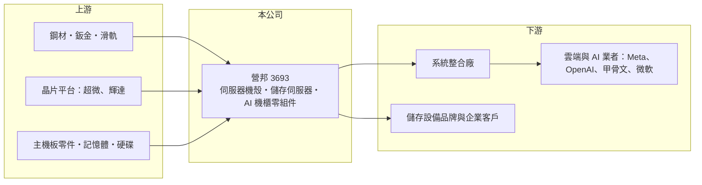

# 3693 營邦

> 上櫃｜[[產業索引-電腦及週邊設備業|電腦及週邊設備業]]｜上市（櫃）日期 2013/11/27

# 第一章：企業模式與商業藍圖

> [!info] 撰寫說明
> 精簡版，由 Claude 依公開資料整理，架構比照 [[2330台積電]]，資料截至 2026-10-08。來源：櫃買中心開放資料（基本資料、2026 年第二季資產負債與綜合損益、2026 年 8 月營收）、Goodinfo 經營績效頁、經濟日報 2026 年 9 月 11 日專欄。產品別營收比重未查得，部分產品描述依整理性知識撰寫。#待校對

營邦是由 [[伺服器機殼]] 起家、逐步升級為儲存伺服器與 AI 機櫃零組件設計製造的公司，近年打進 AMD 與 NVIDIA 的 AI 平台供應鏈，正從「賣鐵殼」轉向「賣系統」。

- **核心業務：** 營邦成立於 1996 年，2013 年在櫃買中心掛牌，英文品牌為 AIC（待校對）。產品包括伺服器與儲存機殼、儲存伺服器（如大量硬碟或固態硬碟的擴充櫃）、伺服器 [[準系統]] 與主機板。儲存伺服器需要同時處理硬碟密度、散熱氣流與訊號傳輸，設計門檻高於一般機殼，這是營邦毛利率能維持在 25% 至 30% 的原因。
- **AI 平台角色：** 依 2026 年 9 月報導，營邦參與 AMD Helios 機櫃平台（MI455X、72 顆 GPU、液冷，採 Meta 的雙寬機櫃規格），負責機櫃、運算托盤（Compute Tray）與機構件設計，最後由系統整合廠完成整機。Helios 的終端客戶包括 Meta、OpenAI、甲骨文、微軟等。在 NVIDIA AI Storage 方面，營邦已能提供機殼、主機板、組裝、測試到 L10 出貨，單機價值與客戶黏著度都提高。
- **營運據點：** 生產基地在台灣富岡與越南。越南廠以標準化製程為主，服務北美客戶與「去中化」需求；富岡廠負責高複雜度產品、研發打樣與核心產品，簡單工序外包給協力廠以保持產能彈性。
- **長期方向：** 公司的轉型方向是從機構件供應商升級為 [[AI 伺服器]] 與儲存系統的設計製造夥伴，並以 [[機櫃級整合]] 能力爭取更多雲端與 AI 平台專案。報導提醒，AMD 未來可能引進第二、第三家供應商，首家供應商地位並非獨家，真正的護城河要靠設計與量產經驗累積。

# 第二章：護城河深度與競爭優勢

營邦的護城河是儲存伺服器的機構與系統設計經驗，以及與晶片平台商的早期合作，但在 AI 平台的地位仍需靠量產表現鞏固。

- **競爭優勢：** 儲存伺服器與 AI 機櫃的機構設計要配合晶片平台的散熱、供電與維修需求，供應商須在平台開發初期就參與，量產經驗越多越容易拿到下一代平台。營邦從機殼做到 L10 系統出貨，代表它能提供比單純機殼廠更完整的服務。越南與台灣雙基地，也符合北美客戶對產地分散的要求。
- **主要對手：** 伺服器機殼與機構件有 [[8210勤誠]]、[[3013晟銘電]]、[[6117迎廣]]、[[2059川湖]]（滑軌）；儲存伺服器與準系統則與美超微（Supermicro）、[[2376技嘉]]、[[3515華擎]] 等競爭；AI 機櫃整合的大型廠商為 [[2382廣達]]、[[6669緯穎]]、[[2317鴻海]]、[[3231緯創]]。
- **觀察重點：** 第一是 AMD Helios 能否在 2026 至 2027 年順利放量，以及營邦能否維持主要供應商地位。第二是營收中外購零組件比重提高後，毛利率能否守住 25% 以上。第三是營業利益率能否回到 2023 至 2024 年 14% 至 15% 的水準。

# 第三章：財務體質與盈利規模

資料日期：2026-10-08，表格是撰寫當時的快照；最新月營收、毛利率、累計 EPS 由自動排程寫在本筆記的屬性欄位（月營收、毛利率、累計EPS 等）。#待校對

營邦的財務特色是 2022 至 2024 年營收與獲利大幅躍升，ROE 一度接近四成，2025 年因產品轉換回落，2026 年再度回升。

| 年度 | 營收（億元） | [[毛利率]] | [[營業利益率]] | EPS（元） | [[ROE]] |
|---|---|---|---|---|---|
| 2020 | 29.9 | 24.7% | 4.77% | 2.14 | 5.23% |
| 2021 | 34.6 | 22.0% | 4.24% | 3.08 | 7.17% |
| 2022 | 55.1 | 26.9% | 10.4% | 11.83 | 23.9% |
| 2023 | 87.9 | 28.3% | 14.1% | 24.10 | 37.5% |
| 2024 | 85.4 | 31.6% | 15.1% | 27.30 | 27.6% |
| 2025 | 75.2 | 28.8% | 11.7% | 15.50 | 12.2% |
| 2026 上半年 | 41.0 | 26.2% | 10.3% | 8.66 | 半年，不年化 |

（2020 至 2025 年取自 Goodinfo；2026 上半年依櫃買中心第二季綜合損益計算。）

- **營收規模：** 2020 至 2025 年營收由 29.9 億元成長到 75.2 億元，年複合成長率約 20.3%。2026 年 1 至 8 月累計營收 65.9 億元、年增約 25%，第二季單季營收 25.39 億元、EPS 7.11 元。
- **獲利：** 近五年平均 ROE 約 21.7%。營業利益率由 4% 至 5% 提高到 2024 年的 15%，顯示產品升級帶來的經營槓桿；2025 年營收減少一成多，營業利益率就回落到 11.7%。系統出貨比重提高後，外購零組件占成本比重增加，毛利率不一定隨營收上升。
- **財務結構：** 2026 年第二季底總資產 100.4 億元、負債 47.1 億元，負債比約 47%，以流動負債 42.1 億元為主，與備料與應付帳款增加有關。權益 53.2 億元，股本僅 4.30 億元，每股淨值 122.14 元。逐年股利本次未查得。
- **[[ROIC]] 與 [[WACC]]：** 2025 年營業利益約 75.2 億 × 11.7% ≈ 8.8 億元，稅後約 7.0 億元；有息負債未查得，以權益 53.2 億元計算 ROIC 上限約 13%，計入借款後約 11% 至 13%；2024 年營業利益約 12.9 億元，當年 ROIC 約 20% 以上（推算）。WACC 以 CAPM 推估：無風險利率 1.75%、市場風險溢酬 6%，AI 伺服器相關股波動大，β 假設 1.3，股權成本約 9.55%；負債成本假設 2.5%（稅後 2%）、有息負債約占一成，WACC 約 9%（推算）。ROIC 長期高於 WACC，代表公司升級成功、持續創造價值，但利差會隨 AI 平台出貨節奏大幅波動。

# 第四章：總體風險與地緣政治

營邦的風險主要是 AI 平台集中、客戶議價力強，以及轉為系統出貨後的毛利與存貨壓力。

- **產業週期：** 伺服器需求跟著雲端與 AI 資本支出起伏，2025 年營收回落就反映產品世代轉換時的空窗。AI 平台每一兩年就換代，若新平台沒有取得設計導入，營收可能出現斷層。
- **營運風險：** 營邦在 AI 平台的地位依賴少數晶片商與雲端業者，AMD 引進其他供應商、或客戶延後建置，都會直接影響出貨。系統出貨需要大量備料，GPU、記憶體等零件缺貨或價格波動時，存貨與跌價風險升高。
- **其他風險：** 越南廠涉及當地人力、匯率與供應鏈建置風險；美國關稅與對中國產地的限制，會影響客戶的採購安排；新台幣升值會壓縮以美元計價的獲利。

# 專有名詞解析

## 應用

- **[[AI 伺服器]]**：搭載 GPU 等加速晶片、用於訓練與推論 AI 模型的伺服器，對散熱與電源規格要求很高。

## 產業

- **[[伺服器機殼]]**：容納伺服器主機板、電源、硬碟與散熱元件的金屬外殼，需配合系統設計氣流與結構強度。
- **[[準系統]]**：已裝好機殼、主機板與電源，由使用者或通路再自行加裝處理器、記憶體與硬碟的電腦半成品。
- **[[機櫃級整合]]**：以整個機櫃為單位整合伺服器、網路、電源與散熱，出貨後可直接上線運作。

# 核心供應鏈

- 上游：鋼材與鈑金、滑軌（如 [[2059川湖]]）、[[AMD超微]] 與 [[NVDA輝達]] 的晶片平台、主機板零件、記憶體與硬碟供應商。
- 下游／客戶：AI 機櫃系統整合廠，終端為 [[META臉書]]、OpenAI、甲骨文、[[MSFT微軟]] 等雲端與 AI 業者；儲存設備品牌與企業客戶（未具名）。
- 同業：[[8210勤誠]]、[[3013晟銘電]]、[[6117迎廣]]、美超微、[[2376技嘉]]、[[3515華擎]]。

## 最新新聞
<!-- news:start（自動產生，請勿手動編輯此範圍） -->
- 2026-10-07 📰 媒體 17:50｜營收速報 - 營邦(3693)9月營收15.37億元年增率高達138.93％｜[鉅亨網](https://news.cnyes.com/news/id/6623800)
- 2026-10-07 🏛️ 重訊 17:42｜更正公告本公司115年6.7.8.9月營收公告備註｜[觀測站](https://mops.twse.com.tw/mops/#/web/t05st01)

完整紀錄：[[3693營邦 新聞]]
<!-- news:end -->

## 相關連結
- [公開資訊觀測站](https://mopsov.twse.com.tw/mops/web/t05st03?step=1&firstin=1&co_id=3693)
- [Goodinfo](https://goodinfo.tw/tw/StockDetail.asp?STOCK_ID=3693)
- [Yahoo 股市](https://tw.stock.yahoo.com/quote/3693)
- [鉅亨網新聞](https://www.cnyes.com/twstock/3693/news)
