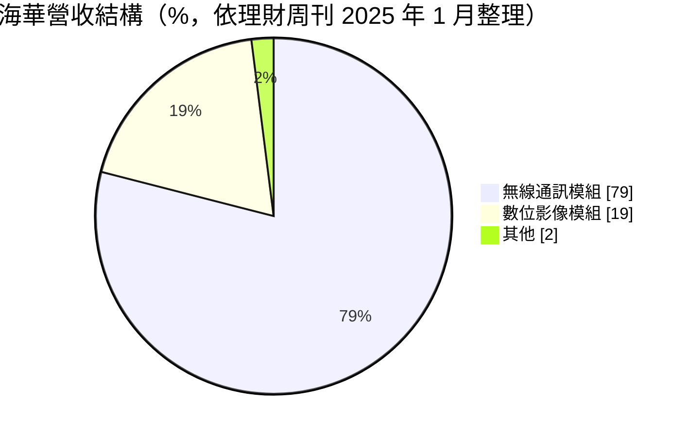
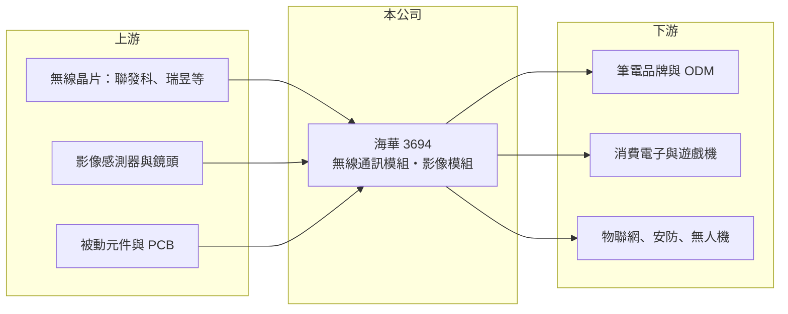

# 3694 海華

> 上市｜[[產業索引-通信網路業|通信網路業]]｜上市（櫃）日期 2011/05/03

# 第一章：企業模式與商業藍圖

> [!info] 撰寫說明
> 精簡版，由 Claude 依公開資料整理，架構比照 [[2330台積電]] 的四章研究，資料截至 2026-10-08。來源：證交所開放資料（基本資料、綜合損益、資產負債、營益分析、股利、每月營收）、Goodinfo 年度經營績效、理財周刊 2025 年 1 月文章。集團關係、晶片供應商與生產據點依記憶整理，需逐條比對原始文件。#待校對

本章說明海華科技（股票代號：3694，英文品牌 AzureWave，以下簡稱海華）的商業模式：把無線晶片做成標準化[[無線模組]]，賣給筆電、消費電子與物聯網設備廠的模組專業廠。

- **核心業務：** 海華成立於 2005 年，2011 年在證交所上市，總部位於新北市新店區，實收資本額約 15.5 億元，與 [[2357華碩]] 集團有淵源（待校對）。主要產品是 Wi-Fi／藍牙無線通訊模組，以及筆電使用的數位影像（相機）模組，近年再延伸到 AI 安防感測模組、無人機方案與智慧眼鏡模組。模組廠的價值在於替客戶完成射頻設計、天線匹配與各國認證，客戶可以直接把模組焊上主機板，不必自己處理射頻問題。
- **營收結構：** 依理財周刊 2025 年 1 月整理，無線通訊模組約占 79%、數位影像模組約占 19%、其他約 2%。無線模組是絕對主力，因此海華的成長節奏與筆電、物聯網的無線規格世代更替高度相關。

- **營運據點：** 總部與研發在新北市，量產據點本次未查得，依記憶在中國設有生產基地（待校對）。客戶以筆電品牌與 ODM、消費電子與物聯網設備商為主。
- **長期方向：** 無線規格每一次升級，模組單價就會跟著提高。理財周刊引述的看法是 [[Wi-Fi 7]] 模組單價較 Wi-Fi 6 高約四至六成，因此規格滲透率是海華最重要的長期成長來源。另一方面，公司開發 AI 無線模組、AI 相機模組與機器人視覺辨識產品，試圖降低對筆電單一市場的依賴。

# 第二章：護城河深度與競爭優勢

本章評估海華的護城河。模組廠本身附加價值有限，海華的優勢在於與晶片廠的合作關係與認證經驗，屬於窄護城河。

- **競爭優勢：** 無線模組要通過美國 FCC、歐盟 CE 等各國射頻認證，還要和筆電、遊戲機的機構與天線匹配，客戶導入後同一平台通常會用到產品生命週期結束。海華長期與 [[2454聯發科]]、[[2379瑞昱]] 等晶片廠合作開發參考設計（待校對），新規格推出時能較早拿到晶片並完成驗證，這是它穩定取得訂單的原因。
- **主要對手：** 無線模組的對手包括 [[6285啟碁]]、[[4906正文]]、日本村田製作所與中國模組廠（對手名單為產業常識整理，待校對）；相機模組則與 [[3019亞光]]、光寶科等廠商競爭。
- **觀察重點：** 第一，Wi-Fi 7 在筆電與物聯網的滲透速度，以及單價提升能否轉成毛利率提升。第二，AI 相機、智慧眼鏡、機器人視覺等新產品能否形成規模。第三，晶片廠是否把更多射頻功能整合進晶片，使模組的價值被壓縮。

# 第三章：財務體質與盈利規模

資料日期：2026-10-08。數字取自 Goodinfo 年度經營績效與證交所開放資料，表格是撰寫當時的快照；最新月營收、毛利率、累計 EPS 由自動排程寫在本筆記的屬性欄位（月營收、毛利率、累計EPS 等）。#待校對

海華的財務數字呈現典型模組廠的樣貌：毛利率約一成多、營業利益率個位數，但近年毛利率穩步提升。

| 年度 | 營收（新台幣） | [[毛利率]] | [[營業利益率]] | EPS（元） | [[ROE]] |
|---|---|---|---|---|---|
| 2019 | 76.8 億 | 9.92% | -0.84% | -0.76 | -6.82% |
| 2020 | 95.9 億 | 12.2% | 3.32% | 2.02 | 17.7% |
| 2021 | 114 億 | 10.6% | 2.31% | 2.05 | 15.8% |
| 2022 | 101 億 | 12.3% | 2.85% | 1.93 | 12.5% |
| 2023 | 95.3 億 | 13.3% | 3.30% | 2.18 | 12.0% |
| 2024 | 92.5 億 | 14.5% | 3.82% | 2.75 | 13.1% |
| 2025 | 114 億 | 14.6% | 4.95% | 4.03 | 17.4% |
| 2026 上半年 | 59.1 億 | 14.36% | 4.14% | 1.82 | 未查得 |

註：2019 至 2025 年取自 Goodinfo 合併報表；2026 上半年取自證交所營益分析與綜合損益開放資料。

- **營收規模：** 2020 至 2025 年營收年複合成長率約 3.5%（推算），營收在 90 億至 115 億元之間循環，沒有長期大幅擴張。2026 年 1 至 8 月累計營收 78.9 億元，較去年同期增加約 2.5%。
- **獲利：** 毛利率從 2019 年的 9.9% 逐步提升到 2025 年的 14.6%，營業利益率也從虧損提升到約 5%，顯示產品組合往較高單價的規格移動。2021 至 2025 年平均 ROE 約 14.2%（推算），以低毛利的模組廠而言資本效率不差，原因是存貨與廠房投入相對輕。
- **財務特色：** 2026 年第二季底資產總計 81.6 億元、負債 45.0 億元，其中流動負債 43.7 億元、非流動負債只有 1.27 億元，股東權益 36.6 億元，每股淨值 23.63 元。負債幾乎都是應付帳款等營運性流動負債（推估），長期借款很少。2025 年度每股配發現金股利 2.3 元，相對 EPS 4.03 元，配息率約 57%（推算）。
- **[[ROIC]] 與 [[WACC]]：** 以 2025 年營業利益約 5.64 億元（營收 114 億元 × 4.95%）扣 20% 稅後約 4.51 億元，投入資本以股東權益 36.6 億元加非流動負債 1.27 億元（代替有息負債）約 37.9 億元計算，ROIC 約 11.9%（推算）；2026 上半年年化約 10.3%（推算）。若流動負債中含短期借款，實際 ROIC 會略低。WACC 以 CAPM 推估：無風險利率 1.75%、市場風險溢酬 6%、β 取 1.0（推估，電子零組件常見值），權益成本約 7.75%，因負債比重極低，WACC 約 7.5%（推算）。ROIC 高出 WACC 約 3 至 4 個百分點，代表海華在近年規格升級期間能創造價值，但利差不寬，景氣下行時可能縮小。

# 第四章：總體風險與地緣政治

本章整理海華面對的長期風險，主要來自終端需求集中與模組價值被晶片整合壓縮。

- **產業週期：** 筆電與消費電子的出貨有明顯的換機週期，2021 年疫情需求高峰後 2022 至 2024 年營收回落，呈現[[長鞭效應]]。無線規格世代更替能部分抵銷出貨量下滑，但無法完全消除週期。
- **營運風險：** 模組廠的毛利率低，晶片價格、被動元件與記憶體成本上漲時，若無法即時轉嫁，獲利會被快速壓縮。客戶集中於少數筆電品牌與 ODM，單一客戶平台切換可能造成營收波動。
- **其他風險：** 主要晶片來自少數晶片廠，晶片廠若直接推出整合天線的封裝方案或扶植其他模組廠，海華的議價空間會被削弱。生產若集中在中國，需面對美國關稅與供應鏈轉移的成本（待校對）。產品以美元計價，匯率波動會影響獲利。

# 專有名詞解析

## 應用

- **[[無線模組]]**：把 Wi-Fi、藍牙晶片與射頻電路、天線匹配做成一個小電路板，並先完成各國認證，讓設備廠可直接焊上使用。
- **[[Wi-Fi 7]]**：IEEE 802.11be 無線區域網路標準，支援 320MHz 頻寬與多鏈路傳輸，速度與天線數量都高於 Wi-Fi 6。

## 金融

- **[[長鞭效應]]**：終端需求的小幅變動，沿供應鏈往上游傳遞時被逐級放大，造成上游庫存與訂單劇烈波動。
- **[[ROIC]]**：投入資本報酬率，稅後營業利益除以股東權益加有息負債，衡量本業運用資本的效率。
- **[[WACC]]**：加權平均資金成本，股東與債權人要求報酬率的加權平均，是 ROIC 要超越的門檻。

# 核心供應鏈

- 上游：無線晶片 [[2454聯發科]]、[[2379瑞昱]]、[[QCOM高通]] 等（實際採購比重未公開，待校對），影像感測器與鏡頭、被動元件。
- 下游／客戶：筆電品牌與 ODM，如 [[2357華碩]]、[[2382廣達]]、[[2324仁寶]] 屬於潛在客戶類型（實際客戶未公開，待校對），以及消費電子、物聯網與安防設備商。
- 同業：[[6285啟碁]]、[[4906正文]]、[[3019亞光]]、日本村田製作所。

## 最新新聞
<!-- news:start -->
<!-- news:end -->

## 相關連結
- [公開資訊觀測站](https://mopsov.twse.com.tw/mops/web/t05st03?step=1&firstin=1&co_id=3694)
- [Goodinfo](https://goodinfo.tw/tw/StockDetail.asp?STOCK_ID=3694)
- [Yahoo 股市](https://tw.stock.yahoo.com/quote/3694)
- [鉅亨網新聞](https://www.cnyes.com/twstock/3694/news)
