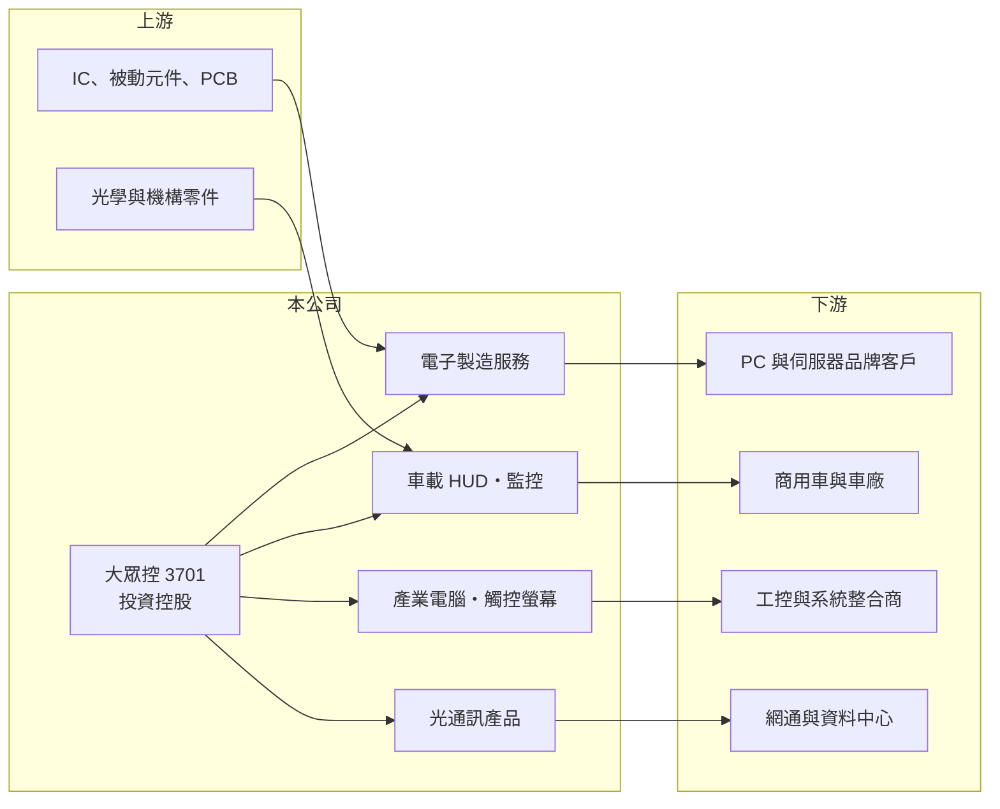

# 3701 大眾控

> 上市｜[[產業索引-電腦及週邊設備業|電腦及週邊設備業]]｜上市（櫃）日期 2004/08/30

# 第一章：企業模式與商業藍圖

> [!info] 撰寫說明
> 精簡版，由 Claude 依公開資料整理，架構比照 [[2330台積電]]，資料截至 2026-10-08。來源：證交所開放資料（基本資料、2026 年上半年財報、每月營收、股利）、Goodinfo 經營績效頁、nStock 公司簡介，以及財經媒體標題。子公司名稱與營收比重公開資料有限，大眾電腦的創辦背景憑過往認知整理。#待校對

本章說明大眾全球投資控股（3701，以下簡稱大眾控）的商業模式：一家由老牌主機板廠轉型而成、旗下事業分散在多個電子次產業的[[投資控股公司]]。

- **核心業務：** 大眾控在 2004 年 8 月以股份轉換方式設立，前身是 1980 年代起家的主機板廠大眾電腦（創辦背景待校對），同日在證交所掛牌。控股公司本身不直接製造產品，而是管理旗下子公司，合併報表中的業務包括光通訊產品、車載產品、監控產品、產業電腦與觸控螢幕，以及電腦、伺服器等產品的[[EMS]]電子製造服務，另有不動產租賃收入。
- **營收結構：** 公開資料沒有揭露各事業的營收比重。依業務描述推估，電子製造服務與產業電腦屬於量大但毛利較低的代工型業務，車載與光通訊則是公司希望拉高比重的較高附加價值產品。合併毛利率長年只有 12% 至 17%，也印證整體仍以製造服務為主。
- **營運據點：** 總部位於台北市內湖，董事長兼總經理為簡民智。生產據點分布在台灣與海外的子公司，具體廠區公開資料有限（待校對）。
- **長期方向：** 從媒體報導標題看，公司近年推出 AR 抬頭顯示器（[[HUD]]）切入商用車智慧座艙，代表集團想從傳統代工轉向車載電子等利基產品。控股架構的好處是可以隨時調整事業組合，但也意味著股東持有的是一籃子規模不一的事業，價值高度取決於經營層的資本配置能力。

# 第二章：護城河深度與競爭優勢

本章分析大眾控的競爭位置：它的優勢在於老牌電子廠的製造經驗與客戶關係，但在任何單一領域都不是規模最大的業者。

- **競爭優勢：** 大眾電腦時代累積的主機板與系統製造能力，讓集團能承接中小批量、多樣化的電子製造訂單，這類訂單大型 EMS 廠通常不願意接。車載 HUD、光通訊與觸控產品則需要光學、機構與軟體整合，一旦通過車廠或系統廠驗證，客戶不會輕易更換供應商。
- **主要對手：** 電子製造服務面對 [[2317鴻海]]、[[4938和碩]]、[[2324仁寶]] 等大廠的規模競爭；產業電腦與觸控螢幕有 [[2395研華]]、[[3088艾訊]]、[[3416融程電]] 等同業；光通訊元件有 [[3234光環]]、[[3363上詮]] 等。
- **觀察重點：** 長期要看集團能否把資源集中到毛利較高的車載與光通訊事業，並讓營業利益率穩定站上 5% 以上。過去 2022 至 2023 年曾短暫達到 3% 至 5%，2025 年又跌回損益兩平以下，代表護城河仍淺，景氣一轉弱獲利就被侵蝕。

# 第三章：財務體質與盈利規模

資料日期：2026-10-08，表格是撰寫當時的快照；最新月營收、毛利率、累計 EPS 由自動排程寫在本筆記的屬性欄位（月營收、毛利率、累計EPS 等）。#待校對

本章用多年度數字檢視大眾控的獲利能力，重點是它長期處於低毛利、低營業利益率的狀態。

| 年度 | 營收（億元） | [[毛利率]] | [[營業利益率]] | EPS（元） | [[ROE]] |
|---|---|---|---|---|---|
| 2020 | 74.0 | 12.6% | -0.79% | -0.21 | -0.35% |
| 2021 | 100 | 12.1% | 1.6% | 1.32 | 9.97% |
| 2022 | 124 | 13.4% | 3.41% | 2.23 | 16.0% |
| 2023 | 133 | 15.5% | 4.92% | 1.49 | 10.6% |
| 2024 | 131 | 13.7% | 1.9% | 0.11 | 3.57% |
| 2025 | 98.3 | 17.5% | -0.15% | -0.38 | -1.69% |

- **營收規模：** 2020 至 2025 年營收年複合成長率約 5.8%，但走勢是先升後降，2023 年 133 億元達到高峰後，2025 年回落到約 98 億元（nStock 數字為 96.9 億元，口徑略有差異）。2026 年上半年營收 40.6 億元，前 8 月累計年減約 18%，規模仍在縮小。
- **獲利：** 毛利率長期在 12% 至 18% 之間，扣掉營業費用後營業利益率最高不到 5%。2026 年上半年毛利率降到 12.0%、營業利益率 -8.7%，歸屬母公司淨損 3.0 億元、EPS -1.28 元，顯示營收下滑時固定費用的負擔相當沉重。
- **財務特色：** 近 5 年（2021 至 2025）平均 ROE 約 7.7%。2026 年第二季總資產 148 億元、權益 66.6 億元，其中非控制權益 19.3 億元，代表不少子公司有外部股東。2025 年雖然虧損仍配發 0.2 元現金股利，股利長期偏低且不穩定，歷年平均約 0.1 元。
- **[[ROIC]] 與 [[WACC]]：** 公開資料沒有有息負債明細，以非流動負債 29.2 億元粗估長期資金，投入資本約 95.8 億元（權益 66.6 億元加上 29.2 億元）。2023 年景氣高點營業利益約 6.5 億元，稅後約 5.2 億元，ROIC 約 5.5%；2025 年營業利益接近零，ROIC 約 0%（推算）。WACC 以 [[CAPM]] 推估：無風險利率 1.75%、市場風險溢酬 6%、β 假設 1.0（電子代工股常見值），股東權益成本約 7.75%；稅後負債成本假設 2%、負債占資本 30%，WACC 約 6.0%（推算）。即使在 2023 年高點 ROIC 也略低於 WACC，代表集團長期沒有創造經濟價值，轉型能否成功是關鍵。

# 第四章：總體風險與地緣政治

本章整理大眾控長期要面對的風險。

- **產業週期：** 電子製造服務與產業電腦跟著 PC、伺服器與工控景氣起伏，客戶庫存調整時訂單會明顯縮減。2024 至 2026 年營收連續下滑，就是需求轉弱加上產品轉換期的結果。
- **營運風險：** 控股公司旗下事業多而分散，每個事業的規模都不大，研發與管理費用難以攤提。若轉型中的車載與光通訊產品無法放量，低毛利的代工業務又縮減，虧損可能延續。
- **其他風險：** 外銷產品以美元計價，新台幣升值會壓縮毛利；海外生產據點面臨關稅與地緣政治變化。控股公司的資訊揭露較粗略，投資人不易評估個別事業的價值。

# 專有名詞解析

## 應用

- **[[HUD]]**：抬頭顯示器，把車速、導航等資訊投射到駕駛前方視野，AR HUD 能把圖像疊合在實景上。

## 金融

- **[[投資控股公司]]**：本身不直接營運，透過持有子公司股權管理多個事業的公司，合併報表反映整個集團。
- **[[非控制權益]]**：子公司中不屬於母公司的股權部分，代表其他股東對子公司淨值的權利。
- **[[CAPM]]**：資本資產定價模型，以無風險利率加上 β 乘以市場風險溢酬，推估股東要求的報酬率。

## 產業

- **[[EMS]]**：電子製造服務，替品牌客戶進行電路板組裝與系統組裝的代工模式。

# 核心供應鏈

- 上游：IC、被動元件、印刷電路板，以及光學與機構零組件供應商（個別供應商公開資料有限）。
- 下游／客戶：PC 與伺服器品牌客戶、商用車廠、工控系統整合商、網通與資料中心客戶（客戶名稱未查得）。
- 同業：[[2317鴻海]]、[[4938和碩]]、[[2395研華]]、[[3088艾訊]]、[[3416融程電]]、[[3234光環]]、[[3363上詮]]。

## 最新新聞
<!-- news:start（自動產生，請勿手動編輯此範圍） -->
- 2026-10-18 🏛️ 重訊 21:07｜代子公司 PRO3C (Malaysia) Sdn. Bhd. 公告與Cape EMS Berhad 簽署策略合作備忘錄（MOA）｜[觀測站](https://mops.twse.com.tw/mops/#/web/t05st01)
- 2026-10-18 🏛️ 重訊 21:07｜代子公司 PRO3C (Malaysia) Sdn. Bhd.公告與 Cape EMS Berhad 簽署RCPS協議｜[觀測站](https://mops.twse.com.tw/mops/#/web/t05st01)
- 2026-10-16 📰 媒體 14:30｜AI光通訊需求強勁，大眾控馬來西亞產線擬擴至30條，搶攻800G、1.6T商機｜[鉅亨網](https://news.cnyes.com/news/id/6632020)
- 2026-10-15 🏛️ 重訊 17:42｜公告董事會決議召開民國115年第二次股東臨時會｜[觀測站](https://mops.twse.com.tw/mops/#/web/t05st01)
- 2026-10-15 🏛️ 重訊 17:37｜公告本公司董事會決議通過以私募方式辦理 現金增資發行普通股｜[觀測站](https://mops.twse.com.tw/mops/#/web/t05st01)

完整紀錄：[[3701大眾控 新聞]]
<!-- news:end -->

## 相關連結
- [公開資訊觀測站](https://mopsov.twse.com.tw/mops/web/t05st03?step=1&firstin=1&co_id=3701)
- [Goodinfo](https://goodinfo.tw/tw/StockDetail.asp?STOCK_ID=3701)
- [Yahoo 股市](https://tw.stock.yahoo.com/quote/3701)
- [鉅亨網新聞](https://www.cnyes.com/twstock/3701/news)
