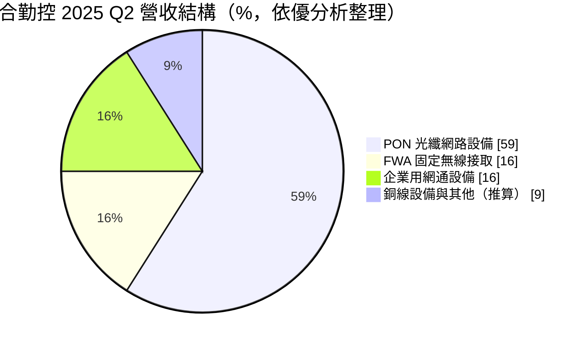
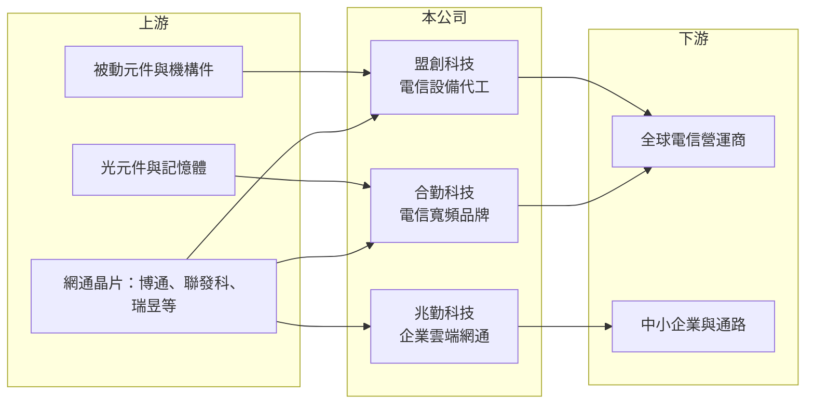

# 3704 合勤控

> 上市｜[[產業索引-通信網路業|通信網路業]]｜上市（櫃）日期 2010/08/16

# 第一章：企業模式與商業藍圖

> [!info] 撰寫說明
> 精簡版，由 Claude 依公開資料整理，架構比照 [[2330台積電]] 的四章研究，資料截至 2026-10-08。來源：證交所開放資料（基本資料、綜合損益、資產負債、營益分析、股利、每月營收）、Goodinfo 年度經營績效、優分析 2025 年 7 月文章。集團沿革與生產據點部分依記憶整理，需逐條比對原始文件。#待校對

本章說明合勤投資控股（股票代號：3704，以下簡稱合勤控）的商業模式：一家旗下同時擁有電信設備品牌、代工與企業網通品牌的網通控股公司。

- **核心業務：** 合勤控是 2010 年以股份轉換成立的控股公司，同日在證交所上市，總部位於新竹市，實收資本額約 41.5 億元，董事長為合勤科技創辦人朱順一。集團有三個主要事業：合勤科技（Zyxel Communications）以 ZyXEL 品牌供應電信營運商寬頻終端；盟創科技（MitraStar）專做電信設備 [[ODM]] 代工；兆勤科技（Zyxel Networks）經營中小企業與家用的雲端網管網通設備，毛利率較高。三者分工讓集團同時賺品牌與代工兩種錢。
- **營收結構：** 依優分析 2025 年 7 月整理的 2025 年第二季資料，[[PON]] 光纖網路設備約占 59%，[[FWA]] 固定無線接取設備與企業用網通設備各約 16%，銅線設備、配件與其他約 9%（推算）。電信寬頻設備占大宗，代表合勤控的命運與全球電信營運商的光纖到府與 5G 投資節奏綁在一起。

- **營運據點：** 總部在新竹科學園區，生產據點本次未查得，依記憶在台灣與中國設有工廠（待校對）。客戶遍及歐洲、南亞與美洲，報導列出的電信客戶包括 [[2412中華電]]、泰國 Jasmine、挪威 Telenor、美國 Sprint 與 US Internet。
- **長期方向：** 電信網路的長期升級方向是從銅線轉向光纖、從 4G 轉向 5G FWA、從 Wi-Fi 6 轉向 [[Wi-Fi 7]]。合勤控 2025 年表示整合 5G 與 Wi-Fi 7 的 FWA 產品已打進多家歐洲一線電信商，而兆勤的雲端網管產品則是提高集團毛利率的關鍵。

# 第二章：護城河深度與競爭優勢

本章評估合勤控的護城河。電信設備的認證門檻提供一定保護，但產品同質化與價格競爭激烈，屬於窄護城河。

- **競爭優勢：** 電信營運商採購寬頻終端需要長時間的互通測試與軟體客製化，供應商一旦打進某家營運商的標案，往往能供應數年並延續到下一代產品。合勤科技經營歐洲電信市場數十年，熟悉當地規範與營運商需求，這是它與純代工廠最大的差異。兆勤的雲端網管平台則讓中小企業客戶持續付費，具備一定的黏著度。
- **主要對手：** 電信寬頻終端的對手包括 [[3596智易]]、[[5388中磊]]、[[2419仲琦]]、[[3062建漢]]、[[4906正文]]，以及中國華為、中興；企業網通則與 [[CSCO思科]]、TP-Link、[[2332友訊]]、[[3558神準]] 等競爭（對手名單為產業常識整理，待校對）。
- **觀察重點：** 第一，歐洲 5G FWA 與 PON 升級訂單能否延續數年。第二，兆勤的營收與獲利貢獻是否持續提高。第三，毛利率能否維持在 24% 以上，擺脫低毛利產品。

# 第三章：財務體質與盈利規模

資料日期：2026-10-08。數字取自 Goodinfo 年度經營績效與證交所開放資料，表格是撰寫當時的快照；最新月營收、毛利率、累計 EPS 由自動排程寫在本筆記的屬性欄位（月營收、毛利率、累計EPS 等）。#待校對

合勤控的財務數字顯示營收規模大但利潤薄，獲利高度依賴電信營運商的投資週期。

| 年度 | 營收（新台幣） | [[毛利率]] | [[營業利益率]] | EPS（元） | [[ROE]] |
|---|---|---|---|---|---|
| 2019 | 240 億 | 21.2% | 0.73% | 未查得 | 1.4% |
| 2020 | 223 億 | 26.0% | 5.81% | 1.91 | 10.7% |
| 2021 | 257 億 | 23.6% | 5.55% | 2.49 | 12.5% |
| 2022 | 305 億 | 22.9% | 6.05% | 3.87 | 16.9% |
| 2023 | 304 億 | 22.0% | 4.24% | 3.38 | 12.8% |
| 2024 | 260 億 | 24.8% | 1.70% | 1.41 | 5.28% |
| 2025 | 253 億 | 26.7% | 3.43% | 1.56 | 5.64% |
| 2026 上半年 | 150.6 億 | 23.83% | 5.46% | 1.55 | 未查得 |

註：2019 至 2025 年取自 Goodinfo 合併報表；2026 上半年取自證交所營益分析與綜合損益開放資料。

- **營收規模：** 2020 至 2025 年營收年複合成長率約 2.6%（推算），2022 至 2023 年在缺料與電信投資高峰時達 300 億元以上，2024 至 2025 年回落到 250 億元上下。2026 年 1 至 8 月累計營收 195.9 億元，較去年同期增加約 12.4%，上半年 EPS 1.55 元已接近 2025 全年的 1.56 元。
- **獲利：** 毛利率長期在 21% 至 27%，高於純代工網通廠，反映品牌與營運商客製化的價值；但營業費用率約 20%，使營業利益率只有 2% 至 6%。2021 至 2025 年平均 ROE 約 10.6%（推算），2024 至 2025 年降到 5% 左右。
- **財務特色：** 2026 年第二季底資產總計 289.8 億元、負債 166.1 億元（流動負債 158.7 億元、非流動負債 7.3 億元），歸屬母公司權益 121.2 億元，每股淨值 29.70 元。2025 年度每股配發現金股利 0.4 元，相對 EPS 1.56 元配息率約 26%（推算），股利政策偏保守，可能保留資金支應營運資金與兆勤的發展。
- **[[ROIC]] 與 [[WACC]]：** 以 2025 年營業利益約 8.68 億元（253 億元 × 3.43%）扣 20% 稅後約 6.94 億元，投入資本以歸屬母公司權益 121.2 億元加非流動負債 7.3 億元（代替有息負債，流動負債中的短期借款未查得）約 128.5 億元計算，ROIC 約 5.4%（推算）；2026 上半年年化營業利益約 16.4 億元，ROIC 約 10.2%（推算）。WACC 以 CAPM 推估：無風險利率 1.75%、市場風險溢酬 6%、β 取 1.0（推估，網通設備股常見值），權益成本約 7.75%，負債比重低，WACC 約 7.5%（推算）。2024 至 2025 年 ROIC 低於 WACC，2026 上半年回到 WACC 之上，代表合勤控只有在電信投資循環向上時才創造價值。

# 第四章：總體風險與地緣政治

本章整理合勤控面對的長期風險，主要來自電信資本支出週期與價格競爭。

- **產業週期：** 電信營運商的寬頻與 5G 投資有明顯的循環，2022 年缺料期間營運商大量備貨，2024 年進入庫存調整，合勤控營業利益率從 6% 掉到 1.7%，呈現[[長鞭效應]]。
- **營運風險：** 營收集中在少數電信營運商，標案得失會造成單年營收大幅波動。電信設備以標案定價，晶片與記憶體成本上漲時不易轉嫁。代工事業毛利低，若比重提高會稀釋整體毛利率。
- **其他風險：** 歐洲營運商排除中國設備的政策對合勤控有利，但美國關稅與各國資安規範會提高生產與合規成本。營收多以歐元與美元計價，匯率波動曾造成匯損。

# 專有名詞解析

## 應用

- **[[PON]]**：被動光纖網路，用一條光纖經分光器分給多戶使用的光纖到府技術，GPON、XGS-PON 為主流規格。
- **[[FWA]]**：固定無線接取，用 4G／5G 行動網路取代實體線路提供家用或企業寬頻，常用於光纖難以佈建的地區。
- **[[Wi-Fi 7]]**：IEEE 802.11be 無線區域網路標準，支援 320MHz 頻寬與多鏈路傳輸，速度與天線數量都高於 Wi-Fi 6。

## 金融

- **[[ROIC]]**：投入資本報酬率，稅後營業利益除以股東權益加有息負債，衡量本業運用資本的效率。
- **[[WACC]]**：加權平均資金成本，股東與債權人要求報酬率的加權平均，是 ROIC 要超越的門檻。

## 產業

- **[[ODM]]**：原廠委託設計製造，代工廠可提出設計方案並負責生產，與客戶綁定較深，議價能力較高。

# 核心供應鏈

- 上游：網通晶片 [[AVGO博通]]、[[2454聯發科]]、[[2379瑞昱]]、[[QCOM高通]] 等（實際採購比重未公開，待校對），光元件、記憶體與被動元件。
- 下游／客戶：[[2412中華電]]、泰國 Jasmine、挪威 Telenor、美國 Sprint、US Internet 與多家歐洲一線電信商；兆勤則透過通路銷售給中小企業。
- 同業：[[3596智易]]、[[5388中磊]]、[[2419仲琦]]、[[3062建漢]]、[[4906正文]]、[[3380明泰]]、[[3558神準]]。

## 最新新聞
<!-- news:start（自動產生，請勿手動編輯此範圍） -->
- 2026-10-12 📰 媒體 18:50｜營收速報 - 合勤控(3704)9月營收32.21億元年增率高達46.15％｜[鉅亨網](https://news.cnyes.com/news/id/6628387)

完整紀錄：[[3704合勤控 新聞]]
<!-- news:end -->

## 相關連結
- [公開資訊觀測站](https://mopsov.twse.com.tw/mops/web/t05st03?step=1&firstin=1&co_id=3704)
- [Goodinfo](https://goodinfo.tw/tw/StockDetail.asp?STOCK_ID=3704)
- [Yahoo 股市](https://tw.stock.yahoo.com/quote/3704)
- [鉅亨網新聞](https://www.cnyes.com/twstock/3704/news)
