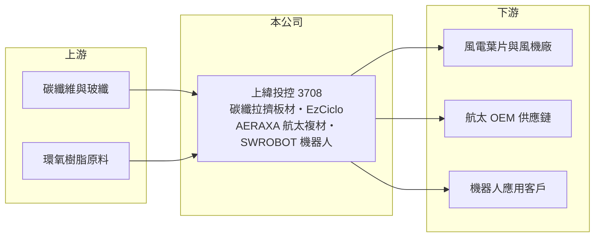

# 3708 上緯投控

> 上市｜[[產業索引-綠能環保|綠能環保]]｜上市（櫃）日期 2016/08/31

# 第一章：企業模式與商業藍圖

> [!info] 撰寫說明
> 精簡版，由 Claude 依公開資料整理，架構比照 [[2330台積電]]，資料截至 2026-10-08。來源：Goodinfo 經營績效年表（2019 至 2025 年）；富果 2026 年 5 月 12 日法說會摘要（AI 整理，業務板塊、處分利益、資本配置）；自由時報 2025 年處分上緯新材股權報導標題；證交所開放資料快照（基本資料、2026 年第二季資產負債與上半年損益、股利）。上緯新材買方與剩餘持股比例未查得。#待校對

上緯國際控股（以下簡稱上緯投控）於 2016 年 8 月以股份轉換成立並上市，總部在南投市，董事長為蔡朝陽，總經理為蔡孝德。集團原本是以環氧樹脂、風電葉片材料與碳纖複材聞名的材料廠，2025 年處分中國子公司上緯新材料（上海科創板 688585）的控制股權後，本業規模大幅縮小，轉型成「手握大量資金、重新布局高附加價值材料與機器人」的控股公司。

- **核心業務：** 依 2026 年法說資料，上緯投控目前有四大板塊：先進材料（[[碳纖維複合材料]]的[[拉擠成型]]板材，主要用在風電葉片主樑）、循環經濟材料（[[可回收環氧樹脂]] EzCiclo 與再生材料）、2025 年成立的航太複材子公司 AERAXA，以及 AI 機器人子公司 SWROBOT（品牌「台智寶 TaiiBot」）。
- **營收結構：** 處分新材料事業後，2025 年營收僅約 10.1 億元，2026 年上半年 5.88 億元。2026 年第一季航太複材約占 14%、AI 機器人約占 5%，其餘主要是碳纖板材與材料業務，比重未查得。
- **重大結構轉變：** 2025 年處分上緯新材股權，認列[[停業單位]]利益約 43.82 億元，2025 年 EPS 因此高達 35.57 元（買方為中國機器人公司智元，待校對）。公司仍持有部分上緯新材股權，以公允價值入帳，因此股東權益從 2026 年 3 月底的 174.6 億元升到 6 月底的 217.4 億元（推估主要來自持股市價變動）。
- **長期方向：** 公司表示將以處分所得資金投入更高值化的材料應用、機器人產業鏈與能帶來財務貢獻的併購，目標新事業平均毛利率不低於 30%，並承諾 2026 至 2028 年全年股利不低於過往水準。換句話說，上緯投控未來十年的價值，取決於經營層如何把一筆龐大的現金與股權轉換成新的本業。

# 第二章：護城河深度與競爭優勢

上緯投控過去的護城河在樹脂配方與風電材料認證；轉型後，新事業的競爭力尚待驗證，目前最大的優勢是資金。

- **競爭優勢：** 上緯在環氧樹脂與風電葉片材料領域累積了三十年的配方與客戶認證經驗，碳纖拉擠板材需要通過葉片廠與風機廠的長時間驗證。EzCiclo 可回收樹脂則對應風電葉片退役後難以回收的問題，若法規推動，可能成為技術型利基。帳上 50 億元以上的現金與上緯新材持股，讓公司在轉型期不需要外部融資。
- **主要對手：** 碳纖與複材領域有 [[1301台塑]]（碳纖維）、日本東麗與美國赫氏（Hexcel）；風電葉片材料有歐美化學大廠；機器人領域則有 [[2049上銀]] 等台廠與大量中國業者。上緯在每個新領域都是後進者。
- **觀察重點：** 航太複材能否取得國際航太 OEM 的認證訂單、機器人事業能否從展示走向量產銷售，以及剩餘上緯新材股權的處置與資金運用。資本配置的紀律，是判斷經營層的最重要指標。

# 第三章：財務體質與盈利規模

資料日期：2026-10-08，表格是撰寫當時的快照；最新月營收、毛利率、累計 EPS 由自動排程寫在本筆記的屬性欄位（月營收、毛利率、累計EPS 等）。#待校對

上緯投控的財務在 2024 年前後斷層明顯：2023 年以前合併上緯新材、年營收 70 至 100 億元；2024 年起新材料事業列為停業單位，營收只剩 10 多億元，本業轉為虧損，獲利主要來自處分利益。

| 年度 | 營收（億元） | [[毛利率]] | [[營業利益率]] | EPS（元） | [[ROE]] |
|---|---|---|---|---|---|
| 2019 | 61.5 | 18.6% | 4.38% | 8.97 | 15.7% |
| 2020 | 98.7 | 17.7% | 7.95% | 6.82 | 12.2% |
| 2021 | 107 | 12.5% | 1.39% | 2.01 | 3.37% |
| 2022 | 97.7 | 15.6% | 4.85% | 9.48 | 13.2% |
| 2023 | 72.9 | 18.3% | 3.15% | 12.88 | 15.4% |
| 2024 | 14.5 | 22.7% | -9.25% | 2.71 | 4.09% |
| 2025 | 10.1 | 15.2% | -45.5% | 35.57 | 31.0% |
| 2026 上半年 | 5.88 | 19.41% | -7.81% | -0.87 | 未查得 |

註：2019 至 2025 年取自 Goodinfo（欄位依比率對應，待校對），2026 年上半年取自證交所開放資料。2024 年起營收不含停業單位，與以前年度不可直接比較；2025 年 EPS 含處分利益。

- **長期指標：** 由於合併範圍改變，營收年複合成長率沒有意義。2021 至 2025 年平均 ROE 約 13.4%（推算），但多數來自業外與處分利益，不代表本業獲利能力。2025 年下半年擬配現金股利 6 元，屬於把處分利益回饋股東；公司另有庫藏股與減資等資本操作。
- **[[ROIC]] 與 [[WACC]]：** 2026 年上半年營業損失約 0.46 億元，年化約 -0.92 億元；2025 年營業損失約 4.6 億元（10.1 億 × -45.5%）。第二季權益 217.4 億元，總負債 34.7 億元幾乎都是流動負債，有息負債未查得，假設約 5 億元，投入資本約 222 億元，ROIC 約 -0.4%（以 2026 年上半年年化，推算），2025 年約 -2%（推算）。WACC 以無風險利率 1.75%、市場風險溢酬 6%、β 1.0（材料與控股公司常見值）、權益比重約 98% 計算約 7.6%（推算）。ROIC 為負代表現有本業仍在燒錢；且權益多為現金與金融資產，真正投入營運的資本遠小於帳面，新事業能否在數年內轉為正的營業利益，是公司能否重新創造價值的關鍵。
- **財務特色：** 2026 年第二季資產 252.1 億元、負債比率約 14%，每股淨值高達 241.49 元，其中大部分是現金與上緯新材持股的公允價值。這使股價和淨值容易隨上海股市波動，而不是隨本業表現。

# 第四章：總體風險與地緣政治

上緯投控的風險已經從「材料景氣」轉為「轉型執行與資產價值波動」。

- **產業週期：** 碳纖板材主要用於風電葉片，需求跟著全球風機裝機量與葉片廠庫存起伏，2021 年營業利益率僅 1.39% 就是風電材料價格戰的例子。航太與機器人的景氣週期不同，新事業若成功，可分散對風電的依賴。
- **營運風險：** 新事業規模小、尚在虧損，若投入過多資金卻無法量產，會侵蝕處分所得。以併購推動轉型也有買貴或整合失敗的風險。
- **其他風險：** 剩餘上緯新材持股以公允價值入帳，市價大幅波動會直接影響淨值；中國資本市場與兩岸政策變化；處分利益相關的未分配盈餘加徵稅等一次性稅負（依法說資料 2026 年 5 月約 1.55 億元）。

# 專有名詞解析

## 金融

- **[[停業單位]]**：企業已處分或計畫處分的事業部門，其損益在財報上與持續營業部分分開表達。
- **[[ROIC]]**：投入資本報酬率，稅後營業利益除以股東權益加有息負債，衡量本業運用資本的效率。
- **[[WACC]]**：加權平均資金成本，股東與債權人要求報酬率的加權平均，是 ROIC 要超越的門檻。

## 產業

- **[[碳纖維複合材料]]**：以碳纖維為補強、樹脂為基材的材料，重量輕、強度高，用於風電葉片、航太與運動器材。
- **[[拉擠成型]]**：把纖維連續拉過樹脂槽與加熱模具、一次成型為固定斷面板材的製程，適合大量生產葉片主樑板。
- **[[可回收環氧樹脂]]**：在特定條件下可分解、讓纖維與樹脂分離回收的環氧樹脂，用來解決風電葉片退役後的廢棄問題。

# 核心供應鏈

- 上游：碳纖維供應商如 [[1301台塑]]、日本東麗（實際供貨關係未查得）。
- 下游／客戶：風電葉片廠、航太 OEM 供應鏈與機器人應用客戶，名單未查得；轉投資上緯新材料（688585）。
- 同業：[[1301台塑]]（碳纖）、[[2049上銀]]（機器人）、[[1717長興]]（樹脂）。

## 最新新聞
<!-- news:start -->
<!-- news:end -->

## 相關連結
- [公開資訊觀測站](https://mopsov.twse.com.tw/mops/web/t05st03?step=1&firstin=1&co_id=3708)
- [Goodinfo](https://goodinfo.tw/tw/StockDetail.asp?STOCK_ID=3708)
- [Yahoo 股市](https://tw.stock.yahoo.com/quote/3708)
- [鉅亨網新聞](https://www.cnyes.com/twstock/3708/news)
