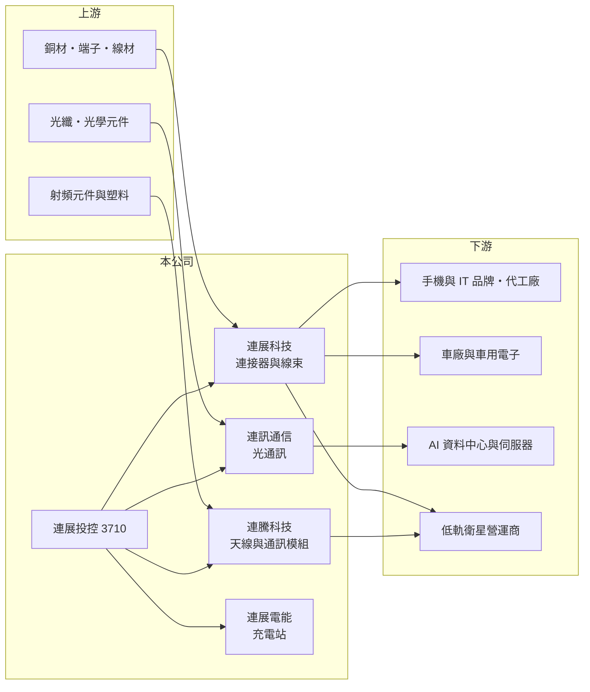

# 3710 連展投控

> 上櫃｜[[產業索引-電子零組件業|電子零組件業]]｜上市（櫃）日期 2017/12/29

# 第一章：企業模式與商業藍圖

> [!info] 撰寫說明
> 精簡版，由 Claude 依公開資料整理，架構比照 [[2330台積電]]，資料截至 2026-10-08。來源：櫃買中心開放資料（基本資料、2026 年第二季資產負債與綜合損益）、Goodinfo 經營績效頁、富果研究 2026 年 9 月 29 日法說會摘要。集團完整營收比重未查得。#待校對

連展投控是一家正在轉型的連接器集團，它的故事重點不是現有規模，而是能否把連年虧損的消費性電子業務，換成車用、AI 與低軌衛星等較高毛利的新業務。

- **核心業務：** 連展投控於 2017 年以股份轉換方式成立，是控股公司，旗下有四個主要事業。連展科技做 [[連接器]] 與 [[線束]] 傳輸方案，過去以手機、IT 與消費性電子為主；連騰科技做無線通訊模組與天線；連訊通信做光通訊產品；連展電能經營電動車充電站與停車場，截至 2026 年 7 月全台共 156 站。這種「控股公司底下多個小事業」的架構，好處是可以分別引進資金或上市，缺點是管理資源分散。
- **營收結構：** 依 2026 年法說會，連訊前八個月營收 8.04 億元，年增 42%，其中 AI 資料中心相關比重由 34% 升到 49%，是集團成長最快的單位。其餘大部分營收仍來自連展科技的手機與 IT 連接器，屬於成熟、價格競爭激烈的市場，這也是集團毛利率長期停在 15% 至 21% 的主因。
- **營運據點：** 公司總部在台灣，連騰與連訊均在泰國布局產能，2026 年連訊投資約 1 億泰銖在泰國以租賃廠房擴產，初期生產 MPO 光纖連接器與 FAU 光纖陣列，目標月產能分別為 30 萬條與 10 萬套。這是為了回應客戶要求中國以外產能的 [[非紅供應鏈]] 趨勢。
- **長期方向：** 管理層的轉型方向是從手機與 IT 轉向車用電子、AI 伺服器、[[低軌衛星]]、工控與機器人。法說會指出低軌衛星業務預計 2026 年第四季開始貢獻營收、毛利率估 35% 至 45%，連訊的 [[CPO]] 矽光子相關產品預計 2026 年第四季試產、2027 年第一季量產，並規劃推動連騰、連訊上櫃。這些都屬公司規劃，能否實現仍待驗證。

# 第二章：護城河深度與競爭優勢

連展投控目前的護城河相當薄，競爭力主要寄望在新領域取得 [[設計導入]] 後形成的轉換成本。

- **競爭優勢：** 連接器與線束一旦被設計進車輛、衛星終端或伺服器，客戶在產品生命週期內很少更換供應商，這是連展轉往車用與衛星的主要理由。公司表示已在 AI 伺服器與車用高速互連取得設計導入，並與一家全球指標性低軌衛星客戶深度合作。不過這些優勢尚未反映在財報上，過去六年只有 2020 年營業利益為正。
- **主要對手：** 消費性連接器面對 [[3533嘉澤]]、[[2392正崴]]、[[6197佳必琪]] 及中國立訊等大廠，規模與成本都占優勢。光通訊方面有 [[3450聯鈞]]、[[3363上詮]]、[[6442光聖]] 等專業廠，低軌衛星與車用線束則有 [[3665貿聯-KY]]、[[3023信邦]] 等對手。
- **觀察重點：** 第一是低軌衛星營收能否如期在 2027 年接近連展科技的一半，並把毛利率拉高。第二是連訊在泰國的光通訊產能能否放量。第三是低毛利手機與 IT 產品的比重能否實際下降，這會直接反映在毛利率是否回到 20% 以上。

# 第三章：財務體質與盈利規模

資料日期：2026-10-08，表格是撰寫當時的快照；最新月營收、毛利率、累計 EPS 由自動排程寫在本筆記的屬性欄位（月營收、毛利率、累計EPS 等）。#待校對

連展投控的財務特徵是營收規模尚可、但本業長期虧損，股東權益持續被侵蝕。

| 年度 | 營收（億元） | [[毛利率]] | [[營業利益率]] | EPS（元） | [[ROE]] |
|---|---|---|---|---|---|
| 2020 | 77.4 | 18.0% | 0.42% | -0.78 | -7.3% |
| 2021 | 73.2 | 15.4% | -3.95% | -2.50 | -25.2% |
| 2022 | 64.0 | 18.8% | -2.37% | -1.39 | -15.0% |
| 2023 | 61.0 | 17.4% | -4.41% | -0.78 | -9.04% |
| 2024 | 73.3 | 21.3% | 1.44% | -0.48 | -2.17% |
| 2025 | 69.5 | 19.5% | -3.08% | -1.48 | -20.7% |
| 2026 上半年 | 38.4 | 18.0% | -5.2% | -1.41 | 半年，不年化 |

（2020 至 2025 年取自 Goodinfo；2026 上半年依櫃買中心第二季綜合損益計算。）

- **營收規模：** 2020 至 2025 年營收由 77.4 億元降到 69.5 億元，年複合成長率約 -2.1%。2026 年上半年營收 38.4 億元、年增約 10%，主要來自光通訊業務，但並未改善獲利。
- **獲利：** 六年來 EPS 全部為負，近五年平均 ROE 約 -14.4%。法說會說明 2026 年上半年毛利率由 20.2% 降到 18.0%，原因是低毛利產品比重較高與原物料上漲，營業費用則因研發與業務擴張年增約 22%，稅後淨損 3.81 億元。轉型期間費用先行、營收後到，是虧損擴大的主因。
- **財務結構：** 2026 年第二季底總資產 83.7 億元、負債 69.0 億元，負債比約 82%；歸屬母公司權益僅 10.4 億元，保留盈餘為 -15.1 億元的 [[累積虧損]]，每股淨值 3.63 元。櫃買中心基本資料顯示實收資本額 17.7 億元，低於第二季報表的股本 28.7 億元，推測其後曾辦理減資彌補虧損（待校對）。近年未發放現金股利。
- **[[ROIC]] 與 [[WACC]]：** 2025 年營業損失約 69.5 億 × -3.08% ≈ -2.1 億元，ROIC 為負值（推算）；有息負債金額未查得，但即使只以權益 14.7 億元計算，ROIC 也低於 -10%。WACC 以 CAPM 推估：無風險利率 1.75%、市場風險溢酬 6%，因高負債與虧損，β 假設 1.3，股權成本約 9.6%；負債成本假設 3%、稅後 2.4%，以負債約占八成估算 WACC 約 4% 至 6%（推算，高負債使加權數字偏低，實際風險更高）。ROIC 長期低於 WACC，代表過去六年持續在消耗股東價值，轉型能否讓 ROIC 轉正是最核心的觀察指標。

# 第四章：總體風險與地緣政治

連展投控的主要風險是轉型失敗或拖延，以及高負債下的財務彈性不足。

- **產業週期：** 手機與 IT 連接器需求跟著消費性電子的換機週期起伏，且競爭者眾多，價格壓力長期存在。新事業中的光通訊受 AI 資本支出影響大，低軌衛星則取決於少數營運商的建置節奏，兩者都有集中度高、波動大的特性。
- **營運風險：** 轉型需要同時投入研發、擴產與上市準備，費用增加的速度若持續快過新業務營收，虧損會擴大。低軌衛星業務高度依賴單一指標客戶，一旦訂單調整，對預期營收的影響會很大。
- **財務風險：** 負債比約八成、權益已被累積虧損大幅侵蝕，若虧損持續，可能需要再透過 [[現金增資]]、減資或出售資產來補強資本，對既有股東造成稀釋。
- **其他風險：** 泰國擴產涉及匯率、當地人力與供應鏈建置風險；銅等原物料上漲會壓縮連接器毛利；美國關稅與地緣政治也會影響客戶對產地的要求。

# 專有名詞解析

## 半導體

- **[[CPO]]**：共同封裝光學，把光學引擎與交換晶片封裝在一起，以降低高速傳輸的耗電。

## 金融

- **[[累積虧損]]**：公司歷年虧損累積超過盈餘後，在資產負債表保留盈餘欄出現的負數。

## 產業

- **[[連接器]]**：讓電子零件或設備之間可插拔連接、傳輸電力與訊號的元件。
- **[[線束]]**：把多條電線、端子與連接器組裝成一束的配線組件，廣泛用於汽車與設備內部。
- **[[低軌衛星]]**：在約 500 至 2,000 公里高度運行的通訊衛星，延遲低，需要大量地面終端設備。
- **[[非紅供應鏈]]**：排除中國大陸產地與廠商的供應鏈安排，常見於美系客戶與國防相關採購。

# 核心供應鏈

- 上游：銅材與端子、光纖與光學元件、射頻元件供應商（未查得具名廠商）。
- 下游／客戶：手機與 IT 品牌及代工廠、車用電子廠、AI 資料中心、全球低軌衛星營運商（未具名）。
- 同業：[[3533嘉澤]]、[[2392正崴]]、[[6197佳必琪]]、[[3665貿聯-KY]]、[[3023信邦]]、[[3450聯鈞]]、[[3363上詮]]、[[6442光聖]]、立訊。

## 最新新聞
<!-- news:start（自動產生，請勿手動編輯此範圍） -->
- 2026-10-19 🏛️ 重訊 15:45｜代重要子公司連展科技股份有限公司公告董事會決議 現金增資發行新股｜[觀測站](https://mops.twse.com.tw/mops/#/web/t05st01)
- 2026-10-19 🏛️ 重訊 15:28｜依「公開發行公司資金貸與及背書保證處理準則」 第二十五條第一項第二款、第一項第三款 之規定公告｜[觀測站](https://mops.twse.com.tw/mops/#/web/t05st01)
- 2026-10-19 🏛️ 重訊 15:27｜代子公司連展科技(江西)有限公司 依「公開發行公司資金貸與及背書保證處理準則」 第二十二條第一項第二款及第三款之規定公告｜[觀測站](https://mops.twse.com.tw/mops/#/web/t05st01)
- 2026-10-19 🏛️ 重訊 15:27｜代子公司連展科技(深圳)有限公司 依「公開發行公司資金貸與及背書保證處理準則」 第二十二條第一項第二款及第三款之規定公告｜[觀測站](https://mops.twse.com.tw/mops/#/web/t05st01)
- 2026-10-19 🏛️ 重訊 15:26｜本公司依「公開發行公司資金貸與及背書保證處理準則」 第二十二條第一項第二款及第三款之規定公告｜[觀測站](https://mops.twse.com.tw/mops/#/web/t05st01)

完整紀錄：[[3710連展投控 新聞]]
<!-- news:end -->

## 相關連結
- [公開資訊觀測站](https://mopsov.twse.com.tw/mops/web/t05st03?step=1&firstin=1&co_id=3710)
- [Goodinfo](https://goodinfo.tw/tw/StockDetail.asp?STOCK_ID=3710)
- [Yahoo 股市](https://tw.stock.yahoo.com/quote/3710)
- [鉅亨網新聞](https://www.cnyes.com/twstock/3710/news)
