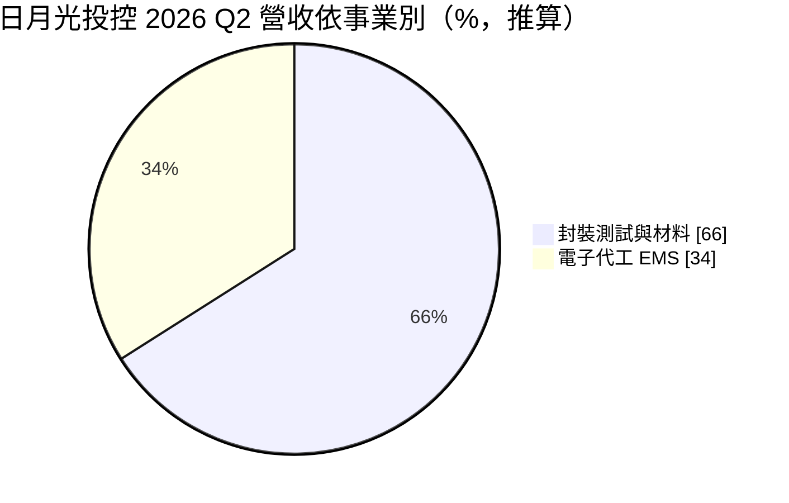
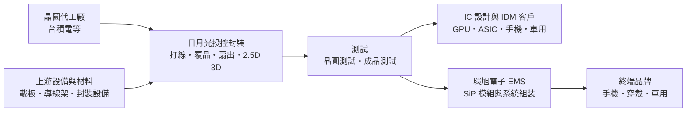
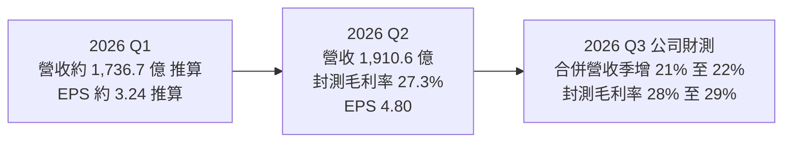
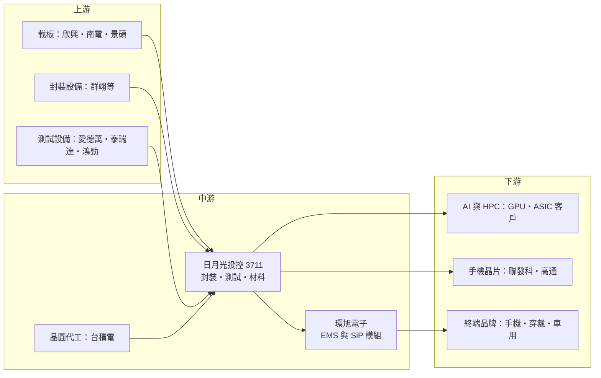

# 3711 日月光投控

> 上市｜[[產業索引-半導體業|半導體業]]｜上市（櫃）日期 2018/04/30

# 第一章：企業模式與商業藍圖

> [!info] 撰寫說明
> 本文由 Claude 依公開資料整理，架構比照 [[2330台積電]] 的四章研究，資料截至 2026-10-08。財務數字來源：Goodinfo 經營績效頁（2020 至 2025 年度）、證交所開放資料快照（基本資料、2026 年上半年損益與第二季資產負債、股利）、數位時代 2026 年 7 月法說會報導、優分析 2026 年 2 月法說會報導；公司沿革為憑記憶整理，標註待校對；產業描述為整理性內容，尚未逐條比對原始文件。#待校對

在評估單一個股的長期投資價值時，首要步驟是拆解企業的底層獲利邏輯。本章針對日月光投資控股（股票代號：3711，以下簡稱日月光投控）的商業模式進行定性分析，說明全球最大的專業封測集團如何從「晶片的包裝工廠」走向 AI 時代的先進封裝與測試夥伴。

## 一、核心定位：全球第一大專業封裝測試集團

日月光投控成立於 2018 年 4 月，是由日月光半導體與矽品精密兩大封測廠以共同轉換股份方式組成的控股公司（待校對）。日月光半導體創立於 1984 年、總部在高雄，矽品則以台中為基地，兩家原本是台灣封測業的第一與第二名，合併後成為全球規模最大的專業封裝測試代工（[[OSAT]]）集團。使用者在核心供應鏈章節中，把日月光投控列為台積電供應鏈的「全球第一大專業封測廠」，以及 [[2454聯發科]] 供應鏈的「全球最大高階封裝主力廠」，正是這個地位的反映。

封裝測試是晶片製造的後段。晶圓廠做好的晶圓，要經過切割、把晶粒固定並連接到載板或導線架上、用材料包覆保護，再經過電性測試，才能成為可以焊在電路板上的晶片。日月光投控旗下有三大業務：

* **封裝：** 從傳統的[[打線封裝]]、[[覆晶封裝]]，到晶圓級封裝、扇出型封裝（[[Fan-out]]）與 2.5D／3D [[先進封裝]]，幾乎涵蓋所有封裝技術。
* **測試：** 包括晶圓測試與成品測試，近年隨 AI 晶片需求快速成長。
* **電子代工服務（[[EMS]]）：** 由子公司環旭電子負責，提供系統級封裝（[[SiP]]）模組與電子產品組裝，客戶包括手機、穿戴裝置與車用電子品牌（客戶細節待校對）。

日月光投控的商業定位有兩個重點：

* **規模與一站式服務：** 同一個集團可以提供從封裝、測試到模組組裝的完整服務，客戶可以把複雜產品整包交給日月光投控，減少在不同供應商之間協調的成本。
* **與晶圓代工廠分工合作：** 台積電自建 [[CoWoS]] 等先進封裝後，外界一度擔心封測廠被邊緣化。依數位時代報導，日月光投控管理層強調與晶圓代工廠的關係「不是零和遊戲」，而是依客戶需求與技術分工合作，承接台積電產能之外與前後段延伸的需求。

## 二、終端應用板塊：封測為主、電子代工為輔

依數位時代報導，2026 年第二季合併營收 1,910.64 億元，其中封測營收 1,261.48 億元。以此推算的營收結構如下：

* **封裝測試（ATM）：** 是集團獲利的主要來源，2026 年第二季封測毛利率 27.3%。其中最受關注的是先進封裝與測試（公司稱為 LEAP），依優分析報導，LEAP 營收由 2025 年的 16 億美元，預期在 2026 年倍增到約 32 億美元；數位時代報導的 2026 年 7 月法說會則表示，2026 年 LEAP 營收將超過 35 億美元，2027 年目標再倍增。
* **一般封測：** 包括工業、電源、連接與儲存元件等應用，服務電動車、AI 資料中心等終端。依數位時代報導，2026 年一般封測業務成長預估由 13% 上修到 20%。
* **電子代工（EMS）：** 營收規模大但毛利率低，2026 年第三季營業利益率預估約 3.2% 至 3.4%。這一塊讓日月光投控的合併毛利率看起來比純封測廠低，評估時應把兩個事業分開看。

## 三、資本轉化邏輯：先進封測的產能競賽

* **產能利用率驅動毛利：** 封測廠的機台與廠房折舊占成本比重高。依數位時代報導，2026 年第二季整體稼動率約 80% 至 85%，多數既有產能接近滿載。管理層表示封測毛利率可能突破原先設定的 30% 結構性上限，代表產能吃緊時，封測廠也能擁有一定的定價能力。
* **大規模資本支出：** 依數位時代報導，2026 年資本支出上看 105 億美元，約新台幣 3,350 億元，其中機器設備約 65 億美元、廠房與設施約 40 億美元；設備約 56% 用於封裝、40% 用於測試，約 70% 與領先製程相關。目前有 13 項新建廠房工程與 8 項既有廠房收購改造，產能可支應到 2028 年。
* **一站式的完整製程服務：** 日月光投控推動從晶圓到成品的「完整製程」（Full Process）服務，依數位時代報導，2026 年約 3 億美元，2027 年預期明顯成長。這代表封測廠正嘗試承接更多原本由晶圓廠負責的先進封裝步驟。

## 四、企業長期藍圖：從後段代工走向先進封裝平台

* **LEAP 倍增計畫：** 先進封裝與測試是日月光投控未來成長的主軸。由 2025 年 16 億美元到 2026 年超過 35 億美元，再到 2027 年目標倍增，LEAP 的占比提升將逐步改變集團的獲利結構。
* **測試業務的擴張：** 依優分析報導，晶圓測試與 oS 是先進封測的重點，成品測試預期占測試業務約一成。測試業務的毛利率通常高於封裝，擴大測試比重有助於提升整體獲利能力。
* **新技術布局：** 依數位時代報導，面板級封裝（[[FOPLP]]）採用 310 × 310 毫米全自動產線，預計 2027 年第一季量產；共同封裝光學（[[CPO]]）2026 年底開始小量推出；玻璃基板仍在評估，未來 12 個月沒有量產計畫。
* **全球產能分散：** 日月光投控在台灣高雄、中壢、台中，以及中國、馬來西亞、新加坡、日本、韓國、墨西哥等地都有據點（待校對），可依客戶的地緣政治需求分配產能。

# 第二章：護城河深度與競爭優勢

在長期價值投資中，「護城河」指企業抵禦競爭、維持超額利潤的保護機制。本章分析日月光投控的護城河構成、全球主要競爭對手，以及這些優勢在晶圓廠跨入先進封裝之後能守住多少。

## 一、日月光投控護城河的核心組成要素

封測產業整體的技術門檻低於晶圓代工，但日月光投控憑藉規模建立了「中等寬度」的護城河，由三個要素組成：

* **1. 規模經濟與議價能力：** 作為全球最大的封測集團，日月光投控向設備與材料商採購的量最大，也能把研發與自動化投資分攤到最多的產品上。規模讓它在一般封測的成本上具有優勢，也能比同業更早投資新技術。
* **2. 技術廣度與一站式服務：** 從打線、覆晶、扇出型封裝到 2.5D、3D 先進封裝，再加上測試與 SiP 模組，日月光投控能提供最完整的封測組合。客戶的產品線越複雜，越傾向把多種產品交給同一家供應商，以簡化供應鏈管理。
* **3. 客戶驗證與長期合作：** 封裝與測試都需要配合晶片設計共同開發，並通過客戶的可靠度認證，車用與 AI 晶片的驗證時間更長。一旦導入，客戶通常不會輕易換廠。

## 二、全球主要競爭對手格局

| 對手 | 定位 | 對日月光投控的威脅 |
|---|---|---|
| [[2330台積電]] | 晶圓代工龍頭，自建 CoWoS、SoIC 等先進封裝 | 最高階 AI 晶片封裝由台積電主導，封測廠只能承接部分外溢與延伸需求 |
| [[AMKR艾克爾]] | 全球第二大封測廠，美國亞利桑那建廠 | 具美國本土產能，受惠美國在地化政策 |
| 長電科技、通富微電 | 中國最大封測廠 | 在中國市場享有政策支持，以價格競爭一般封測 |
| [[6239力成]] | 台灣記憶體封測龍頭，布局面板級封裝 | 在記憶體與面板級封裝領域競爭 |
| [[2449京元電子]] | 台灣專業測試廠，AI 晶片測試主力 | 在 AI GPU 與 ASIC 測試直接競爭 |
| [[005930三星電子]]、[[INTC英特爾]] | IDM 自建先進封裝 | 以自家封裝技術爭取外部客戶 |

## 三、優勢轉化：哪些市場守得住、哪些守不住

* **守得住：** 一般封測的規模市場，以及需要多種封裝與測試整合的複雜產品。日月光投控在這些市場的成本與服務廣度，是中小型封測廠難以匹敵的。AI 帶動的電源、連接與工業元件封測需求，也讓一般封測業務重回成長。
* **守不住或需要分工：** 最頂級的 AI 晶片 2.5D／3D 封裝核心步驟，目前仍由台積電主導。日月光投控的策略是承接 CoWoS 的後段（oS）、測試與台積電產能外溢的部分，並逐步擴大完整製程服務。
* **觀察重點：** 第一，LEAP 營收能否如期在 2027 年再倍增，並占封測營收越來越高的比重；第二，約 105 億美元的資本支出完成後，產能利用率與封測毛利率能否站穩 30% 以上；第三，與台積電的分工是否穩定，或台積電擴大自建封裝產能而壓縮外包比例。

# 第三章：財務體質與盈利規模

資料日期：2026-10-08。數字取自 Goodinfo 經營績效頁、證交所開放資料快照與法說會報導，表格是撰寫當時的快照；最新月營收、毛利率、累計 EPS 由自動排程寫在本筆記的屬性欄位（月營收、毛利率、累計EPS 等）。#待校對

財務報表是檢驗護城河是否真實存在的最終標準。本章用多年度的三率、[[ROE]]、現金流與資本報酬，檢視日月光投控在先進封裝擴產期的獲利品質。

## 一、獲利能力的基石：三率

| 年度 | 營收（新台幣） | [[毛利率]] | [[營業利益率]] | EPS（元） | [[ROE]] |
|---|---|---|---|---|---|
| 2020 | 4,770 億 | 16.3% | 7.31% | 未查得 | 未查得 |
| 2021 | 5,700 億 | 19.4% | 10.9% | 14.84 | 25.9% |
| 2022 | 6,709 億 | 20.1% | 12.0% | 14.53 | 21.9% |
| 2023 | 5,819 億 | 15.8% | 6.93% | 7.39 | 10.5% |
| 2024 | 5,954 億 | 16.3% | 6.58% | 7.52 | 10.2% |
| 2025 | 6,454 億 | 17.7% | 7.86% | 9.37 | 11.6% |
| 2026 上半年 | 3,647 億 | 20.55% | 10.59% | 8.04 | 約 18.1%（年化推算） |

資料來源：2020 至 2025 年為 Goodinfo 經營績效頁（合併報表，含 EMS）；2026 上半年依證交所綜合損益與營益分析快照（營收 3,647.3 億元、營業利益 386.3 億元、歸屬母公司淨利 352.0 億元），ROE 以上半年淨利年化除以 2026 年第二季歸屬母公司權益 3,892.1 億元推算。

* **合併毛利率被 EMS 稀釋：** 日月光投控的合併毛利率長期在 16% 到 20% 之間，看起來不高，是因為合併報表包含毛利率很低的 EMS 業務。單看封測事業，2026 年第二季毛利率已達 27.3%，第三季預估 28% 到 29%。
* **週期性明顯：** 2021、2022 年半導體景氣高峰時營業利益率超過 10%，2023、2024 年庫存調整期降到 6.6% 到 6.9%；2025 年開始回升，2026 年上半年回到 10.59%。封測廠的獲利同樣隨產能利用率起伏，但波動幅度小於記憶體或載板產業。
* **AI 推動的結構性改善：** 2026 年上半年營業利益率已回到 2021、2022 年的高峰水準，這一次的主要動力是 LEAP 先進封測，而不是全面性的景氣過熱，若 LEAP 占比持續提升，獲利率的底部可能比過去更高（推估）。

## 二、[[ROE]]：資本效率

日月光投控 2021 至 2025 年的 ROE 分別為 25.9%、21.9%、10.5%、10.2% 與 11.6%，五年平均約 16.0%（推算）。2020 年到 2025 年營收從 4,770 億元成長到 6,454 億元，年複合成長率約 6.2%（推算）。

依證交所 2026 年第二季資產負債快照，日月光投控資產總計 10,713.3 億元，負債 6,521.4 億元，權益 4,192.0 億元，每股淨值 88.50 元。負債比約 61%，在台灣科技業中偏高，非流動負債達 3,153.4 億元，推估主要是長期借款與公司債。封測是重資產產業，再加上合併矽品時的資金需求，財務槓桿一向比 IC 設計公司高，這也放大了 ROE 在景氣好壞時的波動。

## 三、資本支出、自由現金流與股利

* **[[CapEx]] 創新高：** 依數位時代報導，2026 年資本支出上看 105 億美元（約新台幣 3,350 億元），接近 2025 年全年營收的一半，這是日月光投控歷史上最大規模的擴產。
* **[[自由現金流]]轉負：** 管理層在法說會表示，大規模投資期間自由現金流可能維持負值。過去在一般擴產年度，日月光投控的營業現金流通常可以支應資本支出與股利（推估）；這一輪需要更多借款支應。
* **股利：** 依證交所股利資料，2025 年度配發現金股利 6.6 元，以 EPS 9.37 元計算配發率約 70%（推算）。公司章程採剩餘股利政策，現金股利不低於股利總額的 30%。

## 四、[[ROIC]] 與 [[WACC]]：價值創造利差

**ROIC 推算：** 2025 年營收 6,454 億元 × 營業利益率 7.86% ＝ 營業利益約 507 億元，以 20% 稅率計算稅後營業利益約 406 億元。投入資本以 2026 年第二季權益總計 4,192.0 億元，加上非流動負債 3,153.4 億元作為有息負債的近似值（短期借款與有息負債明細未查得），合計約 7,345 億元，2025 年 ROIC 約 5.5%（推算）。2026 年上半年營業利益 386.3 億元年化後稅後約 618 億元，ROIC 約 8.4%（推算）。

**WACC 推算：** 台灣 10 年期公債殖利率取 1.75%，市場風險溢酬取 6%，β 取大型封測股常見的 1.0 至 1.2（日月光投控本身的 β 未查得），股東權益成本約 7.8% 至 9.0%。負債成本取 2.2%，稅後約 1.8%，以權益約 57%、負債約 43% 計算，WACC 約 5.2% 至 5.9%（推算）。

**解讀：** 2023 至 2025 年景氣低谷期，日月光投控的 ROIC 與 WACC 大致相當，價值創造有限；2026 年上半年 ROIC 回升到約 8.4%，高於 WACC 約 2.5 到 3 個百分點，代表先進封測帶動的獲利改善已轉化為實質的價值創造。不過 2026 年約 3,350 億元的資本支出將大幅擴大投入資本，若 LEAP 營收無法如期倍增，ROIC 可能再度被稀釋。

# 第四章：總體風險與地緣政治

任何企業都無法脫離宏觀環境獨立存在。本章分析日月光投控未來必須面對的地緣政治、產業週期與營運風險。

## 一、地緣政治風險

* **中國產能的調整壓力：** 日月光投控在中國有多個封測與 EMS 據點，美中科技對抗下，美國客戶可能要求把產品移出中國生產，中國客戶則可能被要求優先採用本土封測廠。
* **美國在地化要求：** 美國推動半導體供應鏈在地化，競爭對手艾克爾已在亞利桑那建廠。若主要 AI 晶片客戶要求在美國完成封測，日月光投控需要評估美國投資，而美國的建廠與人力成本遠高於台灣。
* **台灣集中風險：** 最先進的封測產能仍集中在高雄與中壢，兩岸情勢若影響台灣生產，日月光投控與台積電會同時受到衝擊。

## 二、產業週期與市場結構風險

* **半導體庫存週期：** 封測位於晶圓製造之後，2023 年的庫存調整讓日月光投控營收下滑約 13%、EPS 幾乎腰斬。終端需求的變化會透過[[長鞭效應]]放大反映在封測訂單上。
* **AI 投資週期：** LEAP 是最主要的成長來源，若雲端業者放緩 AI 投資，先進封測擴產可能面臨產能過剩。
* **與晶圓廠的競合：** 台積電、英特爾、三星都在擴充自家先進封裝產能，晶圓廠若把更多封裝步驟留在內部，專業封測廠能承接的高附加價值業務會受到壓縮。

## 三、營運環境的隱性風險

* **執行風險：** 依數位時代報導，管理層自己也表示目前的核心挑戰是執行能力，包括廠房建置、設備安裝與產能爬坡，而不是市場需求。13 項新建廠房與 8 項收購改造同時進行，任何延誤都會影響營收認列。
* **財務槓桿：** 負債比約 61%，加上大規模資本支出，利率上升或景氣反轉時，財務壓力會比低負債的同業更大。
* **EMS 的低毛利與成本轉嫁：** EMS 業務營業利益率只有 3% 左右，零組件漲價時毛利容易被壓縮，也拉低集團的整體獲利率。
* **環保、水電與人才：** 封測廠用水用電量大，高雄廠區過去曾發生環保事件（待校對），未來在綠電、廢水處理與工程人才上都需要持續投資。

## 四、科技演進風險

封裝技術正處於快速變革期。晶片從單一大晶片走向以 [[Chiplet]] 小晶片架構與 [[HBM]] 整合，封裝的重要性大幅提升，但最關鍵的 2.5D、3D 整合步驟需要晶圓級的製程能力，這正是晶圓廠的強項。面板級封裝、共同封裝光學與玻璃基板等新技術，可能重新分配晶圓廠、封測廠與載板廠之間的工作範圍。日月光投控能否在這些新技術上站穩，決定它在 AI 時代是「被分工的後段代工」，還是「與晶圓廠並列的先進封裝平台」。

# 專有名詞解析

## 半導體

- **[[打線封裝]]**：以金線或銅線連接晶片與導線架的傳統封裝方式，成本低，用於大多數成熟晶片。
- **[[覆晶封裝]]**：把晶片翻面、以凸塊直接接合載板的封裝方式，訊號路徑短，用於高效能晶片。
- **[[Fan-out]]**：扇出型封裝，把晶片線路向外延伸到晶片面積以外，不需要載板，可做出更薄的封裝。
- **[[SiP]]**：系統級封裝，把多顆晶片與被動元件封裝在同一個模組內，常用於手機與穿戴裝置。
- **[[先進封裝]]**：把多顆晶片以中介層、混合鍵合等方式高密度整合的封裝技術，例如 CoWoS、SoIC。
- **[[CoWoS]]**：台積電的 2.5D 先進封裝技術，把運算晶片與 HBM 並排放在矽中介層上，是 AI 晶片的主流封裝方式。
- **[[FOPLP]]**：面板級扇出型封裝，以方形面板取代圓形晶圓進行封裝，可提高面積利用率並降低成本。
- **[[CPO]]**：共同封裝光學，把光學收發元件和運算或交換晶片封裝在一起，以降低高速傳輸的耗電。
- **[[Chiplet]]**：小晶片架構，把大晶片拆成多顆小晶片再以先進封裝整合，可提高良率並混用不同製程。
- **[[HBM]]**：高頻寬記憶體，以多層 DRAM 堆疊並緊鄰處理器封裝，是 AI 加速器的關鍵元件。

## 金融

- **[[CapEx]]**：資本支出，企業購買土地、廠房與設備的支出。
- **[[自由現金流]]**：營業活動現金流減去資本支出，代表企業可自由用於配息、還債或併購的現金。
- **[[長鞭效應]]**：終端需求的小幅變動，沿供應鏈往上游傳遞時被逐級放大，造成上游庫存與訂單劇烈波動。

## 產業

- **[[OSAT]]**：委外封裝測試代工，專門替晶片公司提供封裝與測試服務的業者，代表廠商為日月光投控、艾克爾。
- **[[EMS]]**：電子製造服務，替品牌客戶進行電子產品或模組的組裝代工。

# 核心供應鏈

## 1. 上游：載板、設備與材料
- ABF 與 BT 載板：[[3037欣興]]、[[8046南電]]、[[3189景碩]]（推估，載板多由晶片客戶指定）
- 面板級封裝相關設備：[[6664群翊]]（群翊已交付板級封裝相關設備）
- 測試機台：愛德萬（Advantest）、泰瑞達（Teradyne）（待校對）
- 測試分選機：[[7769鴻勁]]（今周刊 2026 年 1 月報導列日月光投控為鴻勁的間接客戶）

## 2. 中游：晶圓代工夥伴與日月光投控本身
- 先進封裝分工合作：[[2330台積電]]（承接 CoWoS 後段 oS、測試與產能外溢需求）
- 封裝測試：日月光半導體（高雄、中壢）、矽品（台中）
- 電子代工與 SiP 模組：環旭電子

## 3. 下游：IC 設計與 IDM 客戶
- 手機晶片高階封裝：[[2454聯發科]]、[[QCOM高通]]（高通待校對）
- AI GPU 與 ASIC：[[NVDA輝達]]、[[AMD超微]]（待校對）
- SiP 模組的終端品牌：[[AAPL蘋果]]（待校對）

## 4. 同業競爭
- 全球封測廠：[[AMKR艾克爾]]、長電科技、通富微電
- 台灣封測與測試廠：[[6239力成]]、[[2449京元電子]]
- 自建先進封裝的晶圓廠與 IDM：[[2330台積電]]、[[005930三星電子]]、[[INTC英特爾]]

延伸閱讀：[[台積電供應鏈]]、[[聯發科供應鏈]]

## 供應鏈關係
- 與 [[2330台積電]] 合作：全球第一大專業封測廠（台積電供應鏈 › 下游：專業封裝與最終測試廠 (OSAT)）
- 供應給 [[2454聯發科]]：全球最大高階封裝主力廠（聯發科供應鏈 › 中游：專業封裝與最終測試廠 (OSAT)）

## 最新新聞
<!-- news:start（自動產生，請勿手動編輯此範圍） -->
- 2026-10-21 📰 媒體 19:07｜日月光投控：矽品精密工業10/14~21向聖暉*取得廠務工程，計約8.06億元｜[台視全球資訊網](https://news.google.com/rss/articles/CBMikgFBVV95cUxOZTVBYWVRRTlVR3VNYVNTQWgyUElvaW1sRUhmUFlaLUJiMWpUbW5qQkpVM1prT2taWTJGSkR6cXFVSXNudk1PNzg1dGNkaENBaUZQek95eTdjbHVLZU1OalpvZWY4OG84em5DUGxORUx0MkM2Q2pWc1VWWVlzRVJHenFVZzZhenZrMHZXUWdoc0hmQQ?oc=5)
- 2026-10-21 📰 媒體 19:04｜日月光投控子公司114/12/26~115/10/21向政美應用取得供營業用機器設備，計約10.8億｜[台視全球資訊網](https://news.google.com/rss/articles/CBMikgFBVV95cUxQYlVWRG8tNkIyUThZdi13eHRqeG5PVTY5bW5wRG5lVjBVYXZSUnczSVM2UXdMV3lBR3VDaVVhN3drNDhQMEN4TjVUTXByZFAyVkhnRThRcUtibVBHLVNOS09sc0FXZTV6MndZc25TT1I2M1VyazJpWmExa0Q3Q3dnWUEyVUwyMVd6cXplUUR0aWFfdw?oc=5)
- 2026-10-21 📰 媒體 17:07｜《半導體》日月光投控子公司矽品斥資8.05億元向聖暉取得廠務工程｜[富聯網](https://news.google.com/rss/articles/CBMiiAFBVV95cUxOY2s0dzdiMkNIQUl1RUFfemU1Yk15eWJpQ0RxSXR0YUYwQmNoVGh2WjBEdGJvYUdJbGtfQVZLeFlQTzZlclRwRzBrNEZ0bGE0ZGRZUEVGZ0tUVDJ5R0J3MDdpYWNJMzQ1dzl5ODFvM2RBMHJ4MlJlODlGeWpKc2pXR01sS0lCU191?oc=5)
- 2026-10-21 📰 媒體 12:22｜日月光投控推3D PowerSiP，AI高功率封裝再升級｜[台視全球資訊網](https://news.google.com/rss/articles/CBMikgFBVV95cUxNd1lqcjV6dTdkQzliSkpGeGtQUm4ydXZlN2d6X053RkVnc1V6SGJQcExQRkVnZlJRb01CWGZYSm51M0FONzlrR01qR1llaGctd0FzdnV0SFNMVHJvZXFXVlNoalM4NURTSDBSMEwtbkkzWjRDR3ZQQ3hjY3M5amNWd1o4R3k2SmliYjQ1bWV3aFBFZw?oc=5)
- 2026-10-21 📰 媒體 10:35｜日月光投控：矽品精密工業10/5~20取得營業用機器設備4批，計約15.95億元｜[台視全球資訊網](https://news.google.com/rss/articles/CBMikgFBVV95cUxOTi1FNzJwenJrb3FYQnlaVWFNa1plWU1XOXI4TzY4NGcxdVd3SGM3ekxfRXZsRmNFbVhxVzBJODRhSXZzSUkybjN5M2NOLVBnM0JLeHFWN0xCUWgzU0FWRHp1NGJWeHFWS0hiX1Q3MHlmVjdNN3BuSmMyTHVPcDZtVXhOOFA2dUo5NUhWbjdER3pDUQ?oc=5)

完整紀錄：[[3711日月光投控 新聞]]
<!-- news:end -->

## 相關連結
- [公開資訊觀測站](https://mopsov.twse.com.tw/mops/web/t05st03?step=1&firstin=1&co_id=3711)
- [Goodinfo](https://goodinfo.tw/tw/StockDetail.asp?STOCK_ID=3711)
- [Yahoo 股市](https://tw.stock.yahoo.com/quote/3711)
- [鉅亨網新聞](https://www.cnyes.com/twstock/3711/news)
