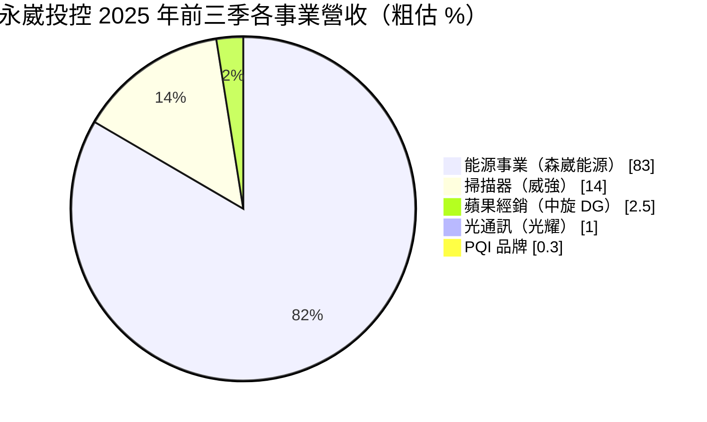
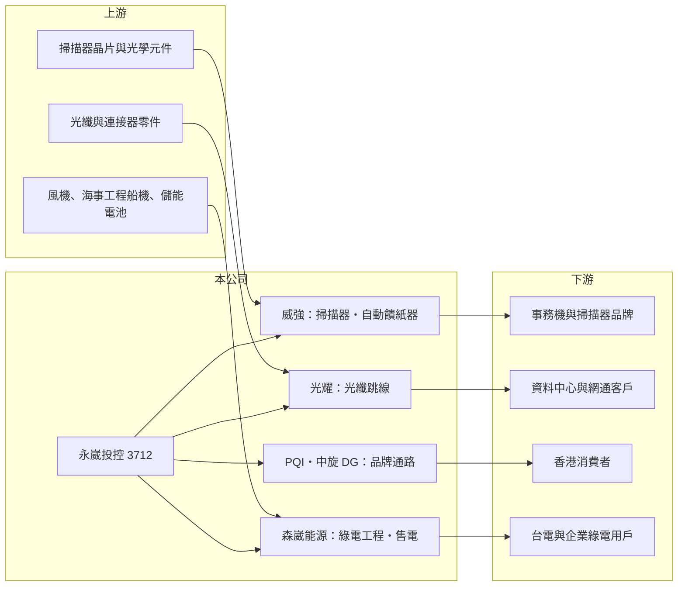

# 3712 永崴投控

> 上市｜[[產業索引-電腦及週邊設備業|電腦及週邊設備業]]｜上市（櫃）日期 2018/10/01

# 第一章：企業模式與商業藍圖

> [!info] 撰寫說明
> 精簡版，由 Claude 依公開資料整理，架構比照 [[2330台積電]]，資料截至 2026-10-08。來源：證交所開放資料（基本資料、2026 年上半年財報、每月營收、股利）、Goodinfo 經營績效頁、富果研究 2025 年 11 月法說會整理。各子公司營收比重以子公司營收除以合併營收粗估，可能含集團內部交易。#待校對

本章說明永崴投資控股（3712，以下簡稱永崴投控）的商業模式：一家同時擁有電子零組件、消費電子通路與大型綠能工程事業的控股公司，其中能源事業決定了集團的營收規模與風險。

- **核心業務：** 永崴投控在 2018 年 10 月以股份轉換方式成立，董事長為郭台強，屬於 [[2392正崴]] 集團。旗下分為三大事業群：電子零組件（威強的掃描器與自動饋紙器、光耀的光通訊元件與鏡頭）、品牌通路（PQI 品牌與香港蘋果經銷商中旋 DG），以及持股約 44% 並納入合併的 [[6806森崴能源]]。
- **營收結構：** 依 2025 年前三季子公司營收粗估，能源事業約占八成以上，掃描器約 14%，其餘通路與光通訊合計不到 5%。因此永崴投控雖然被歸類在電腦及週邊設備業，實際上的營收與損益主要由綠電開發與工程統包決定。
- **營運據點：** 總部在新北市土城。能源事業以台灣為主，包含離岸風電工程、彰化陸域風電（四風電力，持股 51%）、綠電交易與儲能（滬崴電力）及天然氣（欣鑫）；通路事業在香港，並規劃拓展日本與東南亞。
- **長期方向：** 電子事業朝高階掃描器與 400G、800G 以至 1.6T 的高速光纖跳線發展；能源事業則以處理台電離岸風電二期工程的成本與工期為優先，同時擴大綠電交易與 [[儲能]] 業務。集團的長期價值取決於能源事業能否從一次性的工程虧損，轉為穩定收取電費的經常性收入。

# 第二章：護城河深度與競爭優勢

本章分析永崴投控的競爭位置：電子事業有技術利基，但規模小；能源事業規模大，卻因為工程統包出現鉅額虧損，護城河尚未成形。

- **競爭優勢：** 威強具備自行開發掃描器晶片組的能力，在掃描器與自動饋紙器這個成熟但集中的市場中有成本與技術優勢。能源事業則擁有從開發、工程統包到運維與售電的完整鏈條，若案場順利完工，運維與[[綠電交易]]可以帶來長期、可預測的現金流。
- **主要對手：** 掃描器領域的同業有 [[2380虹光]]；光通訊跳線有 [[3363上詮]]、[[3450聯鈞]] 等；能源工程與綠電開發面對國內外開發商與工程統包商，例如 [[1513中興電]]、[[1519華城]] 等電力設備與工程業者在部分案場也有合作或競爭關係。
- **觀察重點：** 最關鍵的是 [[離岸風電]]二期專案能否取得追加預算與工期展延，並在 2029 年前後完工。其次是陸域風電併網、儲能案場與綠電交易能否帶來穩定獲利，以及掃描器業務在需求萎縮下能否守住毛利。

# 第三章：財務體質與盈利規模

資料日期：2026-10-08，表格是撰寫當時的快照；最新月營收、毛利率、累計 EPS 由自動排程寫在本筆記的屬性欄位（月營收、毛利率、累計EPS 等）。#待校對

本章用多年度數字檢視永崴投控的獲利能力。2025 年的鉅額虧損讓多年累積的盈餘一次歸零，是理解這家公司最重要的財務事件。

| 年度 | 營收（億元） | [[毛利率]] | [[營業利益率]] | EPS（元） | [[ROE]] |
|---|---|---|---|---|---|
| 2022 | 121 | 未查得 | 未查得 | 未查得 | 未查得 |
| 2023 | 174 | 13.1% | 5.84% | 2.31 | 5.69% |
| 2024 | 269 | 13.4% | 6.44% | 4.56 | 7.74% |
| 2025 | 328 | -47.9% | -53.7% | -22.85 | -162% |

- **營收規模：** 營收從 2022 年 121 億元擴大到 2025 年 328 億元，主要來自離岸風電工程依進度認列收入。工程收入隨施工進度大幅波動，2026 年前 8 月累計營收年減約 30%，月營收也因工程認列時點出現劇烈起伏，因此營收規模不代表集團的長期獲利能力。
- **獲利：** 2025 年前三季營業毛損約 130 億元、歸屬母公司淨損 48.7 億元，主因是富崴能源承攬的離岸風電二期專案預算超支。2026 年上半年營業利益回到 8.4 億元、歸屬母公司 EPS 2.11 元，但所得稅費用高達 10 億元，合併本期淨利仍為小幅虧損，損益結構相當複雜。
- **財務特色：** 2025 年度不配發股利，並以法定盈餘公積約 2.3 億元與資本公積約 49.6 億元彌補虧損。2026 年第二季總資產 541 億元、權益僅 43.9 億元，負債比率約 92%，流動負債 428 億元，財務槓桿很高。
- **[[ROIC]] 與 [[WACC]]：** 2025 年營業損失約 176 億元，ROIC 為大幅負值（推算）。以 2026 年上半年營業利益 8.4 億元年化約 16.7 億元、稅後約 13.4 億元，除以權益 43.9 億元加非流動負債 68.5 億元，ROIC 約 12%（推算）；但流動負債中可能含短期借款，真實投入資本更大，ROIC 應明顯低於此數。WACC 以 [[CAPM]] 推估：無風險利率 1.75%、市場風險溢酬 6%、β 假設 1.5（高槓桿且虧損，波動大於一般電子股），股東權益成本約 10.75%；稅後負債成本假設 2.4%、負債占資本 60%，WACC 約 5.7%（推算）。2025 年的虧損已大幅摧毀股東價值，未來即使 ROIC 回到 WACC 以上，也需要多年才能彌補。

# 第四章：總體風險與地緣政治

本章整理永崴投控長期要面對的風險，其中工程與財務風險遠大於電子業的景氣風險。

- **產業週期：** 掃描器屬於成熟且逐漸萎縮的市場，需求跟著辦公設備景氣與數位化趨勢下滑；光通訊跳線則受資料中心投資週期影響。能源事業受政府再生能源政策、躉購費率與電力市場開放程度影響。
- **營運風險：** 離岸風電工程規模龐大、施工期長，海象、船機調度與供應鏈價格都可能讓成本再度超支。工期延誤可能產生違約金，追加預算是否獲准也存在不確定性。
- **其他風險：** 負債比率超過九成，若工程虧損擴大或銀行收緊授信，資金調度壓力很大。集團內部持股與交易複雜，少數股權子公司的盈虧會讓母公司損益難以判讀；通路事業則受 [[AAPL蘋果]] 新品上市時程影響。

# 專有名詞解析

## 金融

- **[[工程統包]]**：承包商一次負責設計、採購與施工，價格多為事先議定，成本超支時由承包商承擔。
- **[[CAPM]]**：資本資產定價模型，以無風險利率加上 β 乘以市場風險溢酬，推估股東要求的報酬率。

## 產業

- **[[離岸風電]]**：在海上設置風力發電機組，單一案場投資金額大、工程期長，需要專用船機與海事工程能力。
- **[[儲能]]**：以電池等設備儲存電力，可在用電尖峰放電，協助電網調頻與穩定再生能源輸出。
- **[[綠電交易]]**：再生能源發電業者把綠電與憑證直接售予企業用戶，取代傳統的固定躉購模式。

# 核心供應鏈

- 上游：掃描器光學與晶片零件、光纖連接器零件，以及風機、海事工程船機與儲能電池（個別供應商未查得）。
- 下游／客戶：事務機與掃描器品牌、資料中心與網通客戶、香港蘋果產品消費者、台電與企業綠電用戶。
- 同業：[[6806森崴能源]]（合併子公司）、[[2380虹光]]、[[3363上詮]]、[[3450聯鈞]]、[[1513中興電]]、[[1519華城]]；集團關係企業 [[2392正崴]]。

## 最新新聞
<!-- news:start（自動產生，請勿手動編輯此範圍） -->
- 2026-10-21 🏛️ 重訊 17:33｜公告本公司董事會決議辦理現金增資發行新股｜[觀測站](https://mops.twse.com.tw/mops/#/web/t05st01)
- 2026-10-21 🏛️ 重訊 17:32｜公告本公司115年第一次股東臨時會重要決議事項｜[觀測站](https://mops.twse.com.tw/mops/#/web/t05st01)
- 2026-10-15 🏛️ 重訊 17:48｜代子公司光燿科技股份有限公司公告向關係人取得使用權資產｜[觀測站](https://mops.twse.com.tw/mops/#/web/t05st01)
- 2026-10-12 🏛️ 重訊 17:04｜本公司因處分子公司，其營收改列停業單位損益，更正本公 司115年1月到8月營收公告數｜[觀測站](https://mops.twse.com.tw/mops/#/web/t05st01)

完整紀錄：[[3712永崴投控 新聞]]
<!-- news:end -->

## 相關連結
- [公開資訊觀測站](https://mopsov.twse.com.tw/mops/web/t05st03?step=1&firstin=1&co_id=3712)
- [Goodinfo](https://goodinfo.tw/tw/StockDetail.asp?STOCK_ID=3712)
- [Yahoo 股市](https://tw.stock.yahoo.com/quote/3712)
- [鉅亨網新聞](https://www.cnyes.com/twstock/3712/news)
