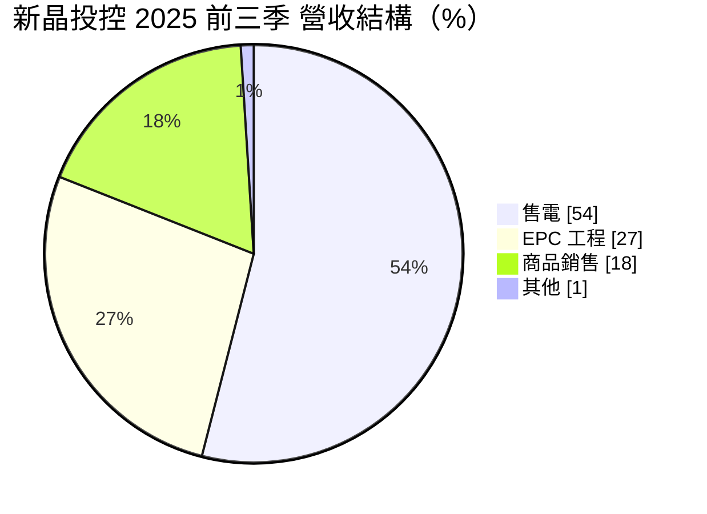
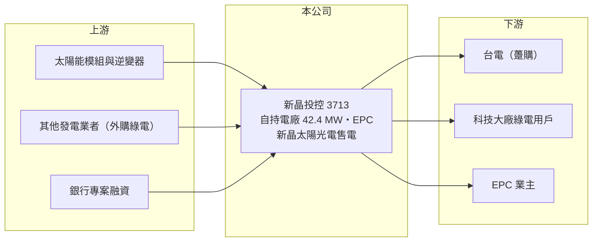

# 3713 新晶投控

> 上櫃｜[[產業索引-綠能環保|綠能環保]]｜上市（櫃）日期 2020/02/27

# 第一章：企業模式與商業藍圖

> [!info] 撰寫說明
> 精簡版，由 Claude 依公開資料整理，架構比照 [[2330台積電]]，資料截至 2026-10-08。來源：Goodinfo 經營績效年表（2019 至 2025 年）；富果 2025 年 12 月 26 日法說會摘要（AI 整理，業務、子公司、營收結構、電廠容量）；櫃買中心開放資料快照（基本資料、2026 年第二季資產負債與上半年損益）。控股公司成立前的沿革未查得，公開資料有限。#待校對

新晶投控（以下簡稱新晶）是 2020 年 2 月成立並掛牌的產業控股公司，總部在新竹縣竹北市，董事長兼總經理為資三德。公司過去以太陽能模組製造與電廠 [[EPC]] 工程為主，近年轉向「自己持有電廠、賣綠電」的模式，目前營收只有數億元，仍在虧損邊緣。

- **核心業務：** 依法說資料，新晶的業務涵蓋太陽能電廠投資與建置（EPC 與自持）、綠電銷售、氫能、廢棄物處理及商品代理。子公司新晶太陽光電已取得售電業執照，2025 年起經營[[綠電轉供]]，向其他發電業者購電再轉供給國內科技大廠；鵬騰航太負責太陽能模組、逆變器與航太零件代理；新晶氫能正尋找策略夥伴。重要子公司另有頂晶科技（業務未查得）。
- **營收結構：** 2025 年前三季售電收入占 54%（前一年同期 31%）、EPC 工程占 27%（前一年同期 38%）、商品銷售約 18%。售電比重快速上升，代表營收正從一次性的工程收入轉為長期穩定的電費收入。
- **案場與裝置容量：** 截至 2025 年 12 月，自有電廠（含權益法）併網容量 42.4 MW，主要分布在嘉義以北與台南；EPC 累計代建併網容量 64 MW。公司目標自有電廠總容量 70 MW，每年新增約 10 MW；綠電轉供平台目標 2026 年達到 100 MW 轉供容量。
- **長期方向：** 自有電廠的售電對象正從台電[[躉購]]（FIT）逐步轉為售予企業的綠電轉供，以提高單價與利潤。依法說估算，若 40 MW 以上案場全數綠電銷售，年電費收入有機會超過 2 億元（推估）。2025 年 9 月完成現金增資，實收資本額由 7.8 億元增至 8.8 億元。

# 第二章：護城河深度與競爭優勢

新晶的競爭力在於已建立的電廠組合與售電執照，但規模小、資金成本高，在綠能業屬於小型參與者，尚無明確護城河。

- **競爭優勢：** 太陽能電廠一旦併網就有 20 年的穩定電費收入，42 MW 的自有電廠是新晶最實在的資產。售電業執照讓公司可以把自有與外購綠電組合後直接賣給科技大廠，賺取轉供差價，這是單純 EPC 業者沒有的收入來源。
- **主要對手：** 台灣綠能開發與售電同業包括 [[6869雲豹能源]]、[[6873泓德能源]]、[[6806森崴能源]]、[[3576聯合再生]]、[[6443元晶]]、[[3073天方能源]]，前四家的裝置容量與企業客戶規模都遠大於新晶。
- **觀察重點：** 2026 年能否如公司目標轉虧為盈、綠電轉供平台能否達到 100 MW，以及每年新增 10 MW 電廠所需的資金能否在不大幅增資的情況下取得。

# 第三章：財務體質與盈利規模

資料日期：2026-10-08，表格是撰寫當時的快照；最新月營收、毛利率、累計 EPS 由自動排程寫在本筆記的屬性欄位（月營收、毛利率、累計EPS 等）。#待校對

新晶的營收在 2022 年 EPC 高峰後大幅縮小，2023 至 2025 年連續虧損，2026 年上半年本業轉為小幅獲利，但業外費用仍讓全期虧損。

| 年度 | 營收（億元） | [[毛利率]] | [[營業利益率]] | EPS（元） | [[ROE]] |
|---|---|---|---|---|---|
| 2019 | 2.81 | 24.3% | -9.7% | -0.77 | -11.5% |
| 2020 | 1.69 | 24.4% | 1.93% | 0.07 | 0.77% |
| 2021 | 6.76 | 17.5% | 6.41% | 0.43 | 5.91% |
| 2022 | 12.8 | 16.4% | 8.96% | 0.88 | 10.6% |
| 2023 | 7.60 | 17.9% | 0.56% | -0.27 | -3.61% |
| 2024 | 3.53 | 29.3% | -2.74% | -0.53 | -6.65% |
| 2025 | 3.24 | 13.1% | -9.19% | -1.13 | -13.5% |
| 2026 上半年 | 2.38 | 24.5% | 4.6% | -0.20 | 未查得 |

註：2019 至 2025 年取自 Goodinfo，2026 年上半年取自櫃買中心開放資料推算（毛利 0.58 億、營業利益 0.11 億、業外 -0.22 億）。2019 年為控股公司成立前數字。

- **長期指標：** 2020 至 2025 年營收年複合成長率約 13.9%（推算），但主要是 2020 年基期極低，2022 年後實際在萎縮；2021 至 2025 年平均 ROE 約 -1.5%（推算）。股利紀錄這次未查得，以連年虧損推估近年未配息。
- **[[ROIC]] 與 [[WACC]]：** 2025 年營業損失約 0.30 億元（3.24 億 × -9.19%），2026 年上半年營業利益 0.11 億元，年化稅後約 0.18 億元。第二季權益 7.0 億元，總負債 21.2 億元中非流動負債 15.7 億元（推估為電廠專案貸款），假設有息負債約 17 億元，投入資本約 24 億元，ROIC 在 2025 年約 -1.2%、2026 年上半年年化約 0.7%（推算）。WACC 以無風險利率 1.75%、市場風險溢酬 6%、β 1.0（綠能開發商常見值）、稅前負債成本 3%、稅率 20%、權益比重約 29% 計算約 4.0%（推算）。ROIC 遠低於 WACC，代表目前的電廠組合尚未賺回資金成本；需要靠綠電轉供提高售電單價、並減少虧損的工程與商品業務，才有機會讓利差轉正。
- **財務特色：** 2026 年第二季資產 28.2 億元、負債比率約 75%，每股淨值 7.84 元，低於 10 元面額。電廠以專案貸款融資是業界常態，但高槓桿加上淨值偏低，使公司對利率與現金流變化很敏感。

# 第四章：總體風險與地緣政治

新晶的風險在於高負債下的轉型執行，以及綠能政策與電價的變化。

- **產業週期：** EPC 工程收入跟著台灣太陽能裝置量的政策目標與土地取得難度起伏，2022 年營收 12.8 億元之後兩年掉到 3 億多元，就是工程案源減少的結果。自持電廠收入較穩定，但前期資本支出大。
- **營運風險：** 負債比率約 75%、淨值低於面額，若轉型不順或電廠發電量不如預期，可能需要再度增資稀釋股東。氫能、廢棄物處理與航太代理等新業務分散資源，執行風險高。
- **其他風險：** 綠電轉供規則、躉購費率與再生能源憑證價格等政策變化；利率上升墊高專案貸款成本；颱風與設備衰減影響發電量；企業綠電需求若轉向大型離岸風電或境外採購，小型售電業者的議價力可能下降。

# 專有名詞解析

## 金融

- **[[ROIC]]**：投入資本報酬率，稅後營業利益除以股東權益加有息負債，衡量本業運用資本的效率。
- **[[WACC]]**：加權平均資金成本，股東與債權人要求報酬率的加權平均，是 ROIC 要超越的門檻。

## 產業

- **[[EPC]]**：設計、採購與施工統包工程，廠商替業主從規劃到完工一手包辦電廠或工廠的建置。
- **[[綠電轉供]]**：再生能源業者透過台電電網把綠電輸送給企業用戶，由售電業者撮合買賣，是企業取得綠電的主要方式。
- **[[躉購]]**：再生能源電廠以政府公告的固定費率把電長期賣給台電的制度，英文為 FIT。

# 核心供應鏈

- 上游：模組與逆變器供應商未查得，台灣模組廠如 [[6443元晶]]、[[3576聯合再生]]（是否供貨未查得）。
- 下游／客戶：台電、國內科技大廠綠電用戶（名單未查得）、EPC 業主。
- 同業：[[6869雲豹能源]]、[[6873泓德能源]]、[[6806森崴能源]]、[[3073天方能源]]。

## 最新新聞
<!-- news:start（自動產生，請勿手動編輯此範圍） -->
- 2026-10-07 🏛️ 重訊 16:33｜代重要子公司公告-頂晶科技股份有限公司115年9月 銀行融資額度使用情形及未來三個月現金收支預估情形｜[觀測站](https://mops.twse.com.tw/mops/#/web/t05st01)

完整紀錄：[[3713新晶投控 新聞]]
<!-- news:end -->

## 相關連結
- [公開資訊觀測站](https://mopsov.twse.com.tw/mops/web/t05st03?step=1&firstin=1&co_id=3713)
- [Goodinfo](https://goodinfo.tw/tw/StockDetail.asp?STOCK_ID=3713)
- [Yahoo 股市](https://tw.stock.yahoo.com/quote/3713)
- [鉅亨網新聞](https://www.cnyes.com/twstock/3713/news)
