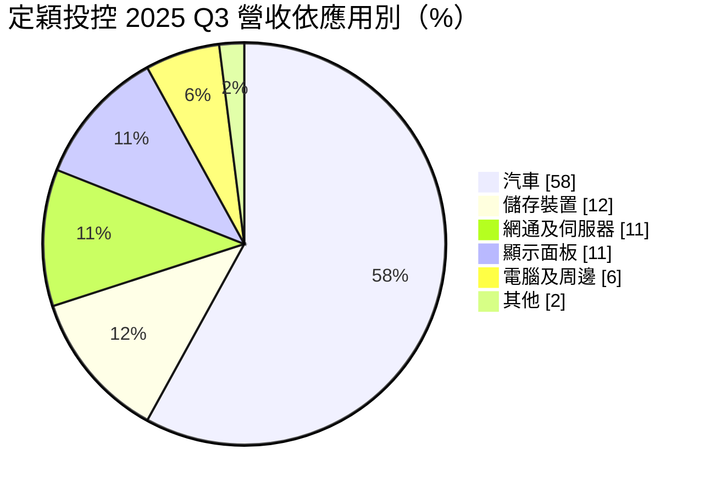
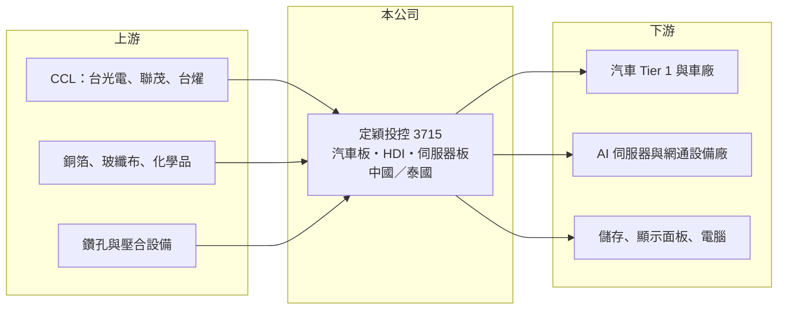

# 3715 定穎投控

> 上市｜[[產業索引-電子零組件業|電子零組件業]]｜上市（櫃）日期 2022/08/25

# 第一章：企業模式與商業藍圖

> [!info] 撰寫說明
> 精簡版，由 Claude 依公開資料整理，架構比照 [[2330台積電]]，資料截至 2026-10-08。來源：證交所開放資料快照（基本資料、2026 上半年損益與資產負債、股利）、Goodinfo 經營績效頁（2021 至 2025 年度）、富果研究 2025 年第三季法說會摘要、優分析與財經媒體標題。中國生產據點與控股架構部分憑記憶整理，標註待校對。#待校對

定穎投控是以汽車用印刷電路板起家的 [[PCB]] 製造集團，近年把重心從汽車板擴大到 [[AI 伺服器]]用板。它正處於一次大型轉型的中途：舊事業成熟、新產能剛開出，財務數字因此特別起伏。

- **核心業務：** 定穎投控於 2022 年 8 月以股份轉換方式成立並上市，取代原本的定穎電子成為上市主體，總部在桃園蘆竹。集團透過新加坡的 Dynamic Electronics Holding Pte. Ltd. 等子公司持有海外工廠（控股層級細節待校對）。它是 PCB 代工廠：向 CCL 廠買進基板，鑽孔、電鍍、壓合成多層板與 [[HDI]] 板，再賣給[[車用電子]]、儲存、網通與伺服器客戶。
- **營收結構：** 依 2025 年第三季法說會，汽車板占 58%、儲存裝置 12%、網通及伺服器 11%、顯示面板 11%、電腦及周邊 6%，其他約 2%。以技術分，高階 HDI 板占 39%。汽車板長期是集團的核心，但比重正逐步下降，網通與伺服器比重則快速上升。
- **營運據點：** 主要量產基地過去在中國湖北黃石（待校對），泰國廠是約 2022 年起規劃的新成長基地。泰國廠在一期之後再投入約 65 億元進行二期擴產，包括 P5 廠二期、新建 P5A 廠與鑽孔中心，目標在 2026 年第四季全廠滿載，總產值由約 60 億元提升到 125 億元以上。泰國廠滿載後約八到九成產能用於網通與伺服器。
- **長期方向：** 公司的目標是讓 AI 相關營收在 2026 年達到兩成，並同時供應 GPU 與 ASIC 兩種 AI 伺服器平台。車用方面則轉向自動駕駛、ADAS 與智慧座艙所需的車用 HDI，讓汽車板從一般多層板升級為高單價產品。這代表定穎正從「車用 PCB 專家」轉型為「車用加 AI 雙主軸」的 PCB 廠。

# 第二章：護城河深度與競爭優勢

汽車板的護城河來自漫長的認證，AI 伺服器板的護城河來自技術與產能，定穎正試圖從前者跨到後者。本章分析它的優勢與對手。

- **競爭優勢：** 汽車板必須通過車廠與一階供應商的可靠度驗證，產品一旦導入，會在車型生命週期內供貨五到七年，轉單成本很高。定穎長期是台商汽車板的前幾大供應商，累積了品質紀錄與 Tier 1 客戶關係。這份穩定的基本盤，讓它有能力承擔泰國廠前期虧損的投資。
- **主要對手：** 汽車板的主要台灣對手是 [[3044健鼎]]、[[2367燿華]]、[[2316楠梓電]] 與 [[2313華通]]，國際對手包括日本 CMK 與歐洲 AT&S、Schweizer。AI 伺服器板的對手則是 [[2368金像電]]、[[3044健鼎]]、[[2313華通]]、[[4958臻鼎-KY]] 與中國的滬電、勝宏，這些廠商在伺服器板起步較早、規模較大。
- **轉型的挑戰：** 定穎在 AI 伺服器板屬於後進者，必須在泰國從零建立量產良率與客戶認證。2025 年第三季泰國廠[[產能利用率]]約 60%，樣品試產的費用先發生、營收尚未跟上，拉低了集團毛利率。後進者通常只能先拿到第二供應商的位置，議價能力有限。
- **觀察重點：** 第一，泰國廠能否在 2026 年第四季如期滿載並轉為獲利。第二，AI 相關營收比重能否達到 20%，以及 ASIC 專案的量產進度。第三，汽車板在電動車補助縮減與關稅影響下能否維持穩定。

# 第三章：財務體質與盈利規模

資料日期：2026-10-08，表格是撰寫當時的快照；最新月營收、毛利率、累計 EPS 由自動排程寫在本筆記的屬性欄位（月營收、毛利率、累計EPS 等）。#待校對

定穎的財務數字反映一家穩定的汽車板廠，正在承擔大型轉型投資的過程。本章用五年數據檢視它的獲利能力，以及高負債擴產對資本報酬的影響。

| 年度 | 營收（億元） | [[毛利率]] | [[營業利益率]] | EPS（元） | [[ROE]] |
|---|---|---|---|---|---|
| 2021 | 158 | 16.4% | 4.1% | 1.70 | 8.5% |
| 2022 | 153 | 17.4% | 5.5% | 1.97 | 9.5% |
| 2023 | 157 | 24.1% | 10.4% | 3.61 | 15.8% |
| 2024 | 178 | 23.1% | 8.6% | 3.78 | 14.4% |
| 2025 | 195 | 19.3% | 6.0% | 2.70 | 7.5% |
| 2026 上半年 | 125.0 | 15.0% | 1.6% | -1.55 | 未查得 |

資料來源：2021 至 2025 年為 Goodinfo 經營績效頁（2022 年以前為定穎電子時期的數字）；2026 上半年依證交所綜合損益開放資料計算。2019、2020 年未查得。

- **營收規模：** 營收從 2021 年的 158 億元成長到 2025 年的 195 億元，四年年複合成長率約 5.4%（推算）。2026 年上半年營收 125.0 億元，已達 2025 年全年的六成以上，主要來自泰國新產能與漲價效應。
- **獲利：** 毛利率在 2023 年達到 24.1% 的高點後連續下滑，2026 年上半年只剩 15.0%，營業利益率 1.6%，原因是泰國廠在產能爬坡期間折舊與試產費用先行。更大的衝擊來自業外：上半年營業外損失 9.4 億元，使稅前淨利轉為虧損，歸屬母公司淨損 4.4 億元，EPS -1.55 元。業外損失的組成未查得，可能與匯兌或財務成本有關（推估）。
- **財務特色：** 2026 年第二季末總資產 488.9 億元，負債 367.1 億元，負債比約 75%，在 PCB 同業中偏高，公司曾表示目標是降到 70% 以下。2021 至 2025 年平均 ROE 約 11.1%（推算）。2025 年度每股現金股利 1.08 元，以 EPS 2.70 元計，配息率約 40%（推算）。擴產期間資本支出龐大，自由現金流近年應為負值（推估，未查得實際數字）。

**[[ROIC]] 與 [[WACC]]：** 開放資料未拆分有息負債，以下以非流動負債 189.1 億元作為有息負債的近似值（實際有息負債可能更高，因流動負債中也含短期借款），加上權益總額 121.8 億元，投入資本約 311 億元（推算）。2025 年營業利益約 11.6 億元（195 億 × 6.0%），稅後約 9.3 億元，ROIC 約 3.0%（推算）；以 2026 年上半年營業利益 2.0 億元年化，稅後約 3.2 億元，ROIC 約 1.0%（推算）。本業 ROIC 仍為正，但淨利因業外損失轉負，股東實際報酬為負。WACC 以 CAPM 推估：無風險利率 1.75%、市場風險溢酬 6%、β 考量高財務槓桿取 1.5（未查得公司實際數字），權益成本約 10.8%；負債成本假設 3%、稅率 20%，稅後 2.4%，負債占資本約 60%，WACC 約 5.7%（推算）。目前 ROIC 明顯低於 WACC，代表擴產期間正在毀損價值；2023 至 2024 年營業利益 15 億至 16 億元的時期，ROIC 大致與 WACC 相當。泰國廠滿載後營業利益率能否回到 8% 以上，是 ROIC 重新超過 WACC 的關鍵。

# 第四章：總體風險與地緣政治

定穎的風險同時來自汽車與 AI 兩個市場的週期、高財務槓桿，以及海外擴產的執行。

- **產業週期：** 汽車板需求跟著全球汽車與[[電動車]]銷量走，電動車補助退場與關稅會直接影響出貨，2025 年第三季汽車板比重就因此下降。AI 伺服器需求成長快，但平台換代快、客戶集中，訂單波動也大。
- **營運風險：** 泰國廠是集團未來幾年的成敗關鍵，稼動率爬坡、良率與客戶認證任何一環延誤，都會讓折舊與費用持續侵蝕獲利。作為 AI 伺服器板的後進者，可能長期只能拿到次要供應商的份額。
- **財務風險：** 負債比約 75%，利率上升或獲利未如預期時，財務成本與償債壓力會放大。為了擴產曾辦理現金增資與可轉換公司債，未來若再籌資，可能進一步稀釋股權。
- **其他風險：** 中國與泰國生產據點分別暴露於美中貿易管制與東南亞的電力、人力條件；營收以美元計價為主，新台幣升值會壓縮毛利；銅箔、玻纖布等原物料漲價若無法轉嫁，也會影響毛利率。

# 專有名詞解析

## 應用

- **[[AI 伺服器]]**：搭載 GPU 或 ASIC 等加速晶片、專門執行 AI 訓練與推論的伺服器，對高速傳輸板材的規格要求最高。
- **[[車用電子]]**：汽車上的電子系統，例如動力控制、ADAS、智慧座艙，對可靠度與認證的要求高於消費電子。
- **[[電動車]]**：以電池與馬達驅動的汽車，電子零件含量高於燃油車，帶動汽車板需求。

## 金融

- **[[產能利用率]]**：實際產出占總產能的比例，新廠爬坡期間利用率低，折舊會壓縮毛利。

## 產業

- **[[PCB]]**：印刷電路板，用來承載並連接電子元件的板子，幾乎所有電子產品都需要。
- **[[HDI]]**：高密度互連板，以雷射微孔與多次增層提高線路密度，用於手機、車用 ADAS 與 AI 伺服器。

# 核心供應鏈

- 上游：CCL 廠 [[2383台光電]]、[[6213聯茂]]、[[6274台燿]]（實際供應商未揭露）；更上游的[[8358金居]]（銅箔）、[[1815富喬]]（玻纖布）。
- 下游／客戶：汽車一階供應商與車廠、AI 伺服器與網通設備廠、儲存裝置與顯示面板廠（公司因募資緘默期未揭露客戶名稱）。
- 同業：[[3044健鼎]]、[[2367燿華]]、[[2316楠梓電]]、[[2313華通]]、[[2368金像電]]、[[4958臻鼎-KY]]、[[5469瀚宇博]]，以及 CMK、AT&S、滬電、勝宏。

## 最新新聞
<!-- news:start（自動產生，請勿手動編輯此範圍） -->
- 2026-10-14 🏛️ 重訊 14:06｜代重要子公司Dynamic Electronics Overseas Investment Holding Pte. Ltd.公告董事變更｜[觀測站](https://mops.twse.com.tw/mops/#/web/t05st01)
- 2026-10-14 🏛️ 重訊 14:05｜代重要子公司Dynamic Electronics Holding Pte. Ltd. 公告董事變更｜[觀測站](https://mops.twse.com.tw/mops/#/web/t05st01)
- 2026-10-14 🏛️ 重訊 14:04｜公告本公司背書保證達處理準則第二十五條第一項第四款｜[觀測站](https://mops.twse.com.tw/mops/#/web/t05st01)
- 2026-10-08 🏛️ 重訊 19:31｜代子公司Dynamic Technology Manufacturing (Thailand)公告取得設備｜[觀測站](https://mops.twse.com.tw/mops/#/web/t05st01)
- 2026-10-06 📰 媒體 18:50｜營收速報 - 定穎投控(3715)9月營收32.26億元年增率高達84.7％｜[鉅亨網](https://news.cnyes.com/news/id/6622881)

完整紀錄：[[3715定穎投控 新聞]]
<!-- news:end -->

## 相關連結
- [公開資訊觀測站](https://mopsov.twse.com.tw/mops/web/t05st03?step=1&firstin=1&co_id=3715)
- [Goodinfo](https://goodinfo.tw/tw/StockDetail.asp?STOCK_ID=3715)
- [Yahoo 股市](https://tw.stock.yahoo.com/quote/3715)
- [鉅亨網新聞](https://www.cnyes.com/twstock/3715/news)
