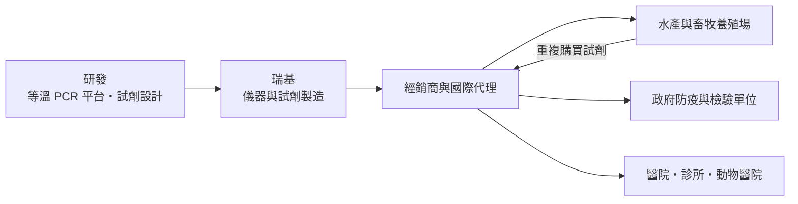
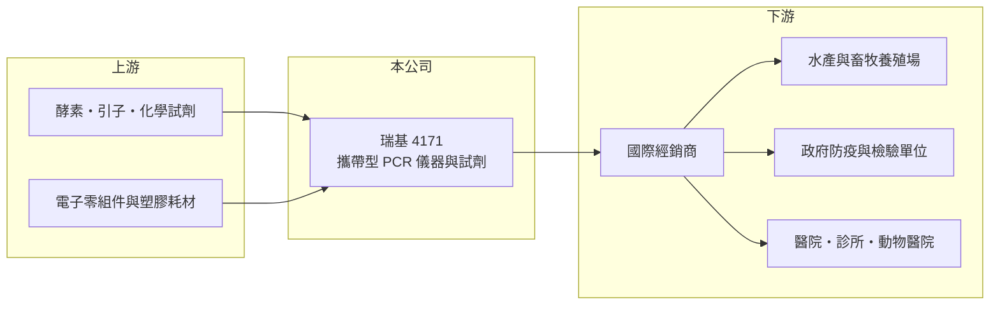

# 4171 瑞基

> 上櫃｜[[產業索引-農業科技業|農業科技業]]｜上市（櫃）日期 2018/03/28

# 第一章：企業模式與商業藍圖

> [!info] 撰寫說明
> 本文由 Claude 依公開資料整理，架構比照 [[2330台積電]] 的四章研究，資料截至 2026-10-08。財務數字來源：Goodinfo 年度經營績效頁、nStock 公司簡介、櫃買中心開放資料（基本資料、2026 年第二季資產負債與綜合損益、本益比殖利率）；產品線與應用領域主要憑記憶整理，營收比重與產能未查得。公開資料有限。#待校對

瑞基海洋生物科技（股票代號：4171，以下簡稱瑞基）是一家以攜帶型[[PCR]] 核酸檢測為核心的生技公司。本章說明它如何從水產與動物檢測起家，在疫情期間營收暴增，之後又回到虧損，以及這段經歷對長期價值的意義。

## 一、核心定位：攜帶型核酸檢測平台

瑞基成立於 2004 年，2014 年 8 月在櫃買中心掛牌，實收資本額約 5.81 億元，產業類別為農業科技。登記營業項目包括動物用藥製造、生物技術服務、醫療器材製造與一般儀器製造。

依記憶，瑞基的核心技術是可攜式的等溫 PCR 檢測平台（產品名 POCKIT），把原本需要在實驗室進行的核酸檢測，縮小成可以帶到養殖場、豬場或診所使用的小型儀器，再搭配各種疾病的檢測試劑（待校對）。這種「儀器加耗材」的模式，類似印表機與墨水匣：儀器建立裝機量，試劑帶來持續收入。

## 二、產品線與應用

公開資料未查得瑞基的營收比重。依記憶與登記業務，產品可分為（待校對）：

* **水產檢測：** 蝦類白點病等水產疾病的檢測，是瑞基最早的事業，名稱中的「海洋」即由此而來。
* **畜禽檢測：** 例如[[非洲豬瘟]]等家畜疾病的現場快速檢測，用於養殖場防疫與政府監測。
* **人醫與寵物檢測：** 2020 至 2022 年疫情期間，瑞基推出新冠病毒檢測試劑，營收從 2019 年的 3.66 億元暴增到 2021 年的 10.1 億元；疫情後人醫需求大幅下降。

## 三、資本轉化邏輯

* **高毛利、高費用：** 試劑的[[毛利率]]很高，2026 上半年約 76%，但研發、法規認證與國際行銷費用固定且龐大。營收規模不夠大時，毛利不足以支付費用，就會出現虧損。
* **認證門檻：** 檢測產品需要取得各國的動物用或醫療器材認證，認證過程耗時，但一旦取得也形成進入門檻。

## 四、長期方向

疫情結束後，瑞基的課題是把營收重新建立在動物檢測與非疫情相關的人醫應用上。2023 至 2025 年營收停在 2 億元出頭，連續三年虧損；2026 年 1 至 9 月累計營收約 1.69 億元、年增約 5%（nStock），虧損幅度已明顯縮小，2026 上半年每股虧損 0.16 元。長期價值取決於新產品與國際市場能否讓營收回到損益兩平以上。

# 第二章：護城河深度與競爭優勢

瑞基的護城河來自技術平台與認證，但市場規模與需求穩定度是最大的限制。本章分析它的競爭位置。

## 一、護城河的組成

* **攜帶型 PCR 技術平台：** 把實驗室等級的核酸檢測做到現場可用，在水產與畜牧防疫領域有明確需求。平台建立後，新增檢測項目只需開發新試劑，具有擴充性。
* **裝機量與試劑綁定：** 客戶購買儀器後，需要持續購買專用試劑，形成重複收入。
* **國際認證與實績：** 動物疾病檢測需要取得官方認可，累積的認證與政府採購實績是新進者的門檻（待校對）。

## 二、主要競爭對手

| 對手 | 定位 | 與瑞基的比較 |
|---|---|---|
| 國際分子診斷大廠 | 實驗室 PCR 與高通量檢測 | 準確度與品牌優勢，但設備昂貴、需要實驗室 |
| 動物診斷大廠 | 抗原、抗體快篩與實驗室服務 | 在畜牧與寵物市場通路完整 |
| [[6615慧智]]、[[4155訊映]] | 台灣分子與體外診斷 | 在人醫檢測部分重疊 |
| 中國與東南亞快篩廠商 | 低價快篩試劑 | 以價格搶占養殖戶市場 |

## 三、守得住與守不住

* **守得住：** 已建立裝機量的水產與畜牧客戶的試劑需求，以及政府防疫體系的採用。
* **守不住：** 疫情期間的人醫檢測營收。疫情需求已消失，且人醫市場由國際大廠主導。
* **觀察重點：** 營收能否回到 3 億元以上的損益兩平水準、新產品的國際銷售，以及費用控制。

# 第三章：財務體質與盈利規模

資料日期：2026-10-08，表格是撰寫當時的快照；最新月營收、毛利率、累計 EPS 由自動排程寫在本筆記的屬性欄位（月營收、毛利率、累計EPS 等）。#待校對

瑞基的財報是一段「疫情紅利與退潮」的完整案例，從中可以看清楚高毛利生技公司的營運槓桿如何雙向作用。

## 一、多年度財務表

| 年度 | 營收（新台幣） | [[毛利率]] | [[營業利益率]] | EPS（元） | [[ROE]] |
|---|---|---|---|---|---|
| 2019 | 3.66 億 | 82.6% | 30.6% | 2.00 | 20.7% |
| 2020 | 8.57 億 | 74.1% | 41.5% | 6.34 | 36.4% |
| 2021 | 10.1 億 | 73.8% | 47.7% | 9.01 | 38.1% |
| 2022 | 7.50 億 | 65.3% | 32.2% | 4.82 | 19.9% |
| 2023 | 2.25 億 | 12.2% | -102% | -2.89 | -17.3% |
| 2024 | 2.06 億 | 57.3% | -63.5% | -2.07 | -15.6% |
| 2025 | 2.33 億 | 69.1% | -34.3% | -1.93 | -17.1% |
| 2026 上半年 | 1.12 億 | 76.4% | -20.1% | -0.16 | 未查得 |

資料來源：Goodinfo；2026 上半年為櫃買中心開放資料。2023 年毛利率 12.2% 推估與疫情相關存貨跌價有關（未查得公司說明）。

* **營運槓桿的雙向作用：** 營收從 3.66 億元增加到 10.1 億元時，營業利益率從 30.6% 跳升到 47.7%；營收回落到 2 億元出頭時，固定費用無法縮減，營業利益率變成大幅負值。
* **虧損收斂：** 營業虧損從 2023 年的 2.29 億元縮小到 2025 年的 0.80 億元，2026 上半年約 0.23 億元，費用控制與毛利率回升有成效。
* **配息：** 疫情期間曾配發現金股利，2025 年度未配息；2026 年第二季底保留盈餘約為 -1.27 億元，在彌補虧損前不易恢復配息。

## 二、ROE 與長期指標

2021 至 2025 年平均 ROE 約 1.6%（推算），疫情高峰與後續虧損互相抵銷。2020 至 2025 年營收年複合成長率約 -22.9%（推算），反映疫情需求消退。2026 年第二季底權益約 5.81 億元、負債約 2.77 億元，財務結構仍穩健，短期沒有資金壓力，但持續虧損會侵蝕權益。

## 三、[[ROIC]] 與 [[WACC]]

**ROIC 推算：** 2025 年營業利益為 -0.80 億元。虧損時沒有所得稅可扣抵，直接以營業虧損計算；2026 年第二季底權益約 5.81 億元，有息負債未查得，假設約 0 至 0.8 億元（推估），投入資本約 5.8 億至 6.6 億元，ROIC 約 -12% 至 -14%（推算）。以 2026 上半年營業虧損 0.23 億元年化，ROIC 約 -7% 至 -8%（推算）。疫情高峰的 2021 年，以營業利益 4.82 億元計算，ROIC 曾超過 50%（推算，資本基礎以近期數字代替）。

**WACC 推算：** 台灣 10 年期公債殖利率假設 1.75%、市場風險溢酬 6%、β 取生技醫療業常見值 1.0（同業估計值），股東權益成本約 7.75%；負債比重低，WACC 約 7.5%（推算）。

**結論：** 目前瑞基的 ROIC 為負，遠低於約 7.5% 的資金成本，代表公司正在消耗股東價值。ROIC 為負並不代表公司沒有價值，而是代表現有營收規模不足以支撐費用結構；只有營收回到損益兩平以上，或大幅精簡費用，ROIC 才可能轉正。

# 第四章：總體風險與地緣政治

瑞基的風險集中在需求波動、規模不足與持續虧損。本章整理長期風險。

## 一、產業週期

* **疫情型需求：** 人醫檢測需求受疫情驅動，來得快、去得也快。2020 至 2022 年的營收高峰不應視為常態。
* **動物疫情：** 非洲豬瘟、禽流感、蝦類疾病等疫情爆發時，檢測需求短期增加；疫情平息後需求回落，營收具有事件驅動的特性。

## 二、營運風險

* **持續虧損：** 連續三年虧損，若營收無法回升，權益會持續被侵蝕，可能需要增資或進一步縮減規模。
* **費用結構：** 研發與法規認證費用難以大幅削減，削減過度又會影響長期競爭力。
* **新產品不確定性：** 新檢測項目與新市場的推出需要時間，認證與市場接受度都有不確定性。

## 三、其他風險

* **法規與認證：** 各國動物用與醫療器材法規不同，認證延遲會影響上市時程。
* **匯率：** 外銷比重高（推估），新台幣升值會壓縮以台幣計算的營收與毛利。
* **價格競爭：** 低價快篩產品可能在價格敏感的養殖市場搶占份額。

# 專有名詞解析

## 應用

- **[[PCR]]**：聚合酶連鎖反應，把特定 DNA 片段大量複製以便偵測的技術，是核酸檢測的基礎。
- **[[核酸檢測]]**：偵測病原體 DNA 或 RNA 的檢驗方式，準確度高於抗原快篩，可在感染早期發現病原。

## 金融

- **[[毛利率]]**：營業毛利占營收的比例，反映產品定價能力與生產成本控制。
- **[[營業利益率]]**：扣除營業費用後的營業利益占營收的比例，衡量本業整體獲利能力。
- **[[ROE]]**：股東權益報酬率，稅後淨利除以股東權益，衡量公司運用股東資金的效率。
- **[[ROIC]]**：投入資本報酬率，稅後營業利益除以股東權益與有息負債的合計，衡量本業對所有資金提供者的報酬。
- **[[WACC]]**：加權平均資金成本，依股東權益與負債的比重加權計算的資金成本，ROIC 高於它才代表創造價值。

## 產業

- **[[非洲豬瘟]]**：豬隻的高致死率病毒性傳染病，沒有疫苗，防疫高度仰賴快速檢測與撲殺。
- **[[營運槓桿]]**：固定成本占比高的公司，營收增減時利潤會以更大的幅度變動。

# 核心供應鏈

## 1. 上游：原料
- 酵素、引子與探針等分子生物試劑
- 儀器用電子零組件與塑膠耗材

## 2. 中游：瑞基與同業
- 台灣分子與體外診斷同業：[[6615慧智]]、[[4155訊映]]
- 國際分子診斷與動物診斷大廠

## 3. 下游：客戶
- 水產、豬、禽養殖業者
- 各國政府防疫與檢驗單位、醫療與動物醫療院所

## 最新新聞
<!-- news:start -->
<!-- news:end -->

## 相關連結
- [公開資訊觀測站](https://mopsov.twse.com.tw/mops/web/t05st03?step=1&firstin=1&co_id=4171)
- [Goodinfo](https://goodinfo.tw/tw/StockDetail.asp?STOCK_ID=4171)
- [Yahoo 股市](https://tw.stock.yahoo.com/quote/4171)
- [鉅亨網新聞](https://www.cnyes.com/twstock/4171/news)
