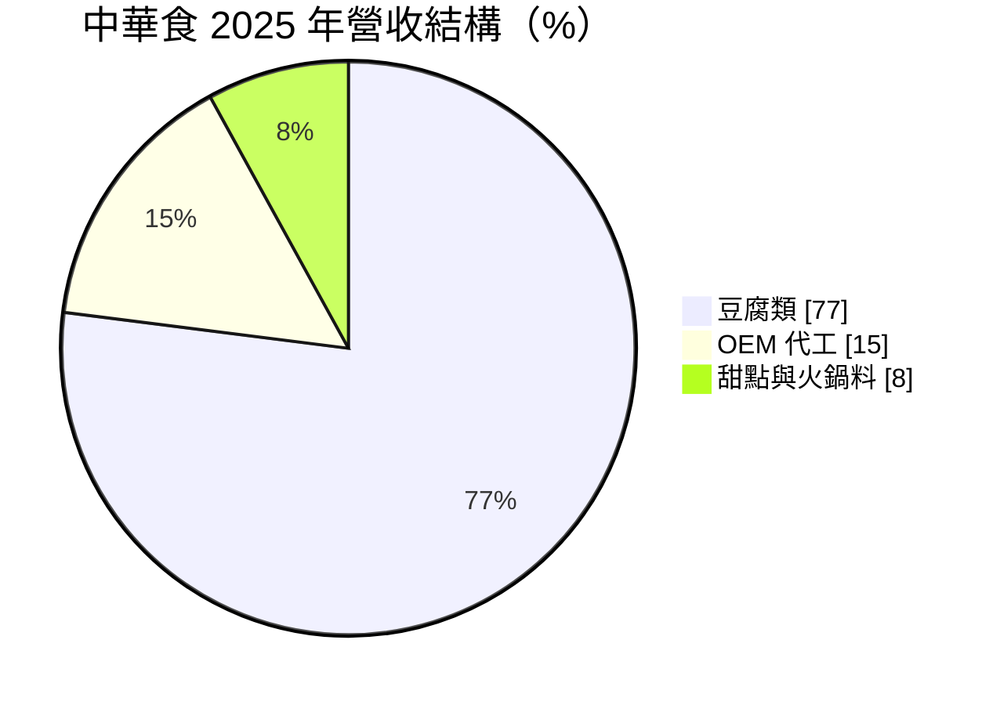
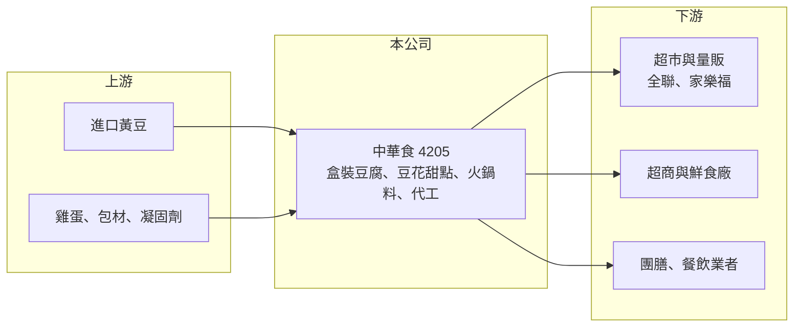

# 4205 中華食

> 上櫃｜[[產業索引-食品工業|食品工業]]｜上市（櫃）日期 1999/01/31

# 第一章：企業模式與商業藍圖

> [!info] 撰寫說明
> 精簡版，由 Claude 依公開資料整理，架構比照 [[2330台積電]]，資料截至 2026-10-08。來源：櫃買中心開放資料快照（基本資料、2026 年上半年資產負債與綜合損益）、Goodinfo 歷年經營績效、富果 2026 年 9 月法說會摘要（AI 整理，非公司原始文件）、CMoney 文章標題（盒裝豆腐龍頭）。#待校對

中華食是台灣盒裝豆腐的龍頭廠商，賣的是每天都會被吃掉、單價低但需求極穩定的冷藏食品，它的價值來自規模、冷鏈配送與長期穩定的高配息。

- **核心業務：** 公司成立於 1980 年，1999 年上櫃，主要生產超嫩豆腐、雞蛋豆腐、有機豆腐、鹽滷豆腐等[[盒裝豆腐]]，另有花生豆花、水果豆花、甜愛玉等甜點，以及百頁豆腐、年糕等火鍋料。豆腐保存期限短，必須在消費地附近生產並以冷藏車配送，這讓本地龍頭具有天然的地域優勢。
- **營收結構：** 依法說會資料，2025 年豆腐類約占營收 77%、OEM 代工約 15%、甜點與火鍋料約 8%。豆腐全年銷量約 1 億 945 萬盒，比前一年增加約 229 萬盒，顯示需求以量的穩定成長為主。
- **營運據點：** 生產基地在高雄大樹廠與屏東廠，屏東新廠已投產，解決過去產能不足的問題。銷售區域北部約 47%、中部 26%、南部 27%，通路涵蓋全聯、[[2912統一超]]、家樂福等超市與量販，以及鮮食廠、團膳與餐飲業者。
- **長期方向：** 公司規劃推出小盒豆腐點心、高纖與高蛋白豆腐、布丁與豆乳粉粿等新品，並與協力廠合作開發火鍋料。長期成長主要來自產品組合升級與代工訂單，而不是豆腐總需求大幅成長。

# 第二章：護城河深度與競爭優勢

中華食的護城河是規模經濟加上冷鏈配送網，讓它能以比小型豆腐廠更低的成本、更穩定的品質供應全台通路。

- **競爭優勢：** 盒裝豆腐單價低、毛利靠量，龍頭的產線自動化程度與採購量讓單位成本低於傳統豆腐坊。通路商也偏好能穩定供貨、通過食品安全稽核的大廠，長年合作的上架關係是新進者難以取得的資源。
- **品牌與信任：** 豆腐是每天食用的生鮮食品，消費者重視新鮮與安全，長期沒有重大食安事件的品牌比較能維持信任。這種信任需要長年累積，是中華食定價相對穩定的基礎。
- **主要對手：** 量販與超市自有品牌、各地傳統豆腐廠，以及 [[1216統一]]、[[1201味全]] 等大型食品集團的冷藏豆製品。對手多但規模分散，中華食在盒裝豆腐的領先地位相對穩固。
- **觀察重點：** 毛利率長年維持在 37% 至 41%，代表成本轉嫁能力良好。若黃豆與雞蛋價格大漲時毛利率仍能守住，就說明護城河有效；2026 年上半年因成本上升毛利下滑，是需要追蹤的訊號。

# 第三章：財務體質與盈利規模

資料日期：2026-10-08，表格是撰寫當時的快照；最新月營收、毛利率、累計 EPS 由自動排程寫在本筆記的屬性欄位（月營收、毛利率、累計EPS 等）。#待校對

中華食的財務特色是成長慢但極度穩定，高毛利、高 ROE、幾乎沒有借款，並把大部分盈餘發給股東。

| 年度 | 營收（億元） | [[毛利率]] | [[營業利益率]] | EPS（元） | [[ROE]] |
|---|---|---|---|---|---|
| 2020 | 16.5 | 41.1% | 24.9% | 4.21 | 21.5% |
| 2021 | 17.2 | 40.9% | 24.2% | 3.76 | 19.5% |
| 2022 | 18.4 | 39.6% | 23.9% | 3.97 | 19.1% |
| 2023 | 19.5 | 36.7% | 21.6% | 3.91 | 18.0% |
| 2024 | 20.2 | 39.3% | 23.7% | 4.45 | 19.4% |
| 2025 | 20.6 | 40.1% | 24.1% | 4.14 | 18.3% |
| 2026 上半年 | 9.84 | 36.8% | 21.2% | 1.85 | 未查得 |

資料來源：Goodinfo 歷年經營績效；2026 上半年取自櫃買中心開放資料。

- **營收規模：** 2020 至 2025 年營收從 16.5 億元成長到 20.6 億元，年複合成長率約 4.5%（推算），幾乎每年小幅創新高，符合民生必需品的特性。2026 年上半年營收約 9.8 億元，與前一年同期持平。
- **獲利：** 營業利益率穩定在 22% 至 25%，對一家食品製造廠來說相當高。近 5 年（2021 至 2025）平均 ROE 約 18.9%（推算），波動非常小。
- **配息：** 2025 年度現金股利 3.5 元，為公司新高，近 5 年平均盈餘分配率約 78%，且已連續多年配息。高配息加上低資本支出，代表自由現金流長期為正（推估）。
- **[[ROIC]] 與 [[WACC]]：** 2026 年第二季底權益約 21.7 億元、負債約 7.0 億元，負債多為流動性的應付款項，有息負債未單獨查得，以約 0.5 億元推估。2025 年營業利益約 4.96 億元（20.6 億 × 24.1%），稅後約 3.97 億元，ROIC ≈ 3.97 ÷（21.7＋0.5）≈ 18%（推算）。WACC 以無風險利率 1.75%、市場風險溢酬 6%、β 取民生食品常見值 0.5，股東權益成本約 4.75%，幾乎無負債，WACC 約 4.7%（推算）。ROIC 長期高出 WACC 十個百分點以上，是典型能持續替股東創造價值的穩定型企業。

# 第四章：總體風險與地緣政治

中華食的風險主要在原料成本與人力成本，需求面反而相當穩定。

- **產業週期：** 豆腐需求幾乎不受景氣影響，但主要原料黃豆與雞蛋價格受國際期貨、氣候與禽流感影響。法說會提到 2026 年 9 月黃豆期貨價格明顯高於前一年同期，雞蛋產地價也上升，成本壓力會先反映在毛利率。
- **營運風險：** 成長空間受限於台灣人口與豆腐人均消費量，長期營收成長大約只有個位數。新廠投產後折舊增加，若新品與代工訂單成長不如預期，產能利用率會下降。
- **其他風險：** 食品安全事件對生鮮食品品牌的傷害極大；黃豆幾乎全數進口，新台幣貶值會推高成本；基本工資調升與缺工也影響工廠營運。通路集中在少數大型超市與超商，通路議價力強也是潛在壓力。

# 專有名詞解析

## 金融

- **[[ROIC]]**：投入資本報酬率，稅後營業利益除以股東權益加有息負債，用來衡量公司運用所有資本的獲利能力。
- **[[WACC]]**：加權平均資金成本，股東權益成本與稅後負債成本依資本結構加權，ROIC 高於它才代表創造價值。
- **[[盈餘分配率]]**：現金股利占每股盈餘的比例，用來衡量公司把多少獲利發給股東。

## 產業

- **[[盒裝豆腐]]**：以充填封盒方式生產並冷藏配送的豆腐，保存期限較傳統板豆腐長，是超市與超商的主要豆腐型態。
- **[[冷鏈]]**：從工廠到門市全程維持冷藏或冷凍溫度的物流系統，是生鮮與冷凍食品能否穩定供貨的關鍵。

# 核心供應鏈

- 上游：進口黃豆（主要來源國未查得），國內雞蛋與包材供應商。
- 下游／客戶：全聯、[[2912統一超]]、家樂福等零售通路，超商鮮食廠、軍公教團膳與餐飲業者。
- 同業：[[1216統一]]、[[1201味全]]（冷藏食品），各地豆腐廠與通路自有品牌。

## 最新新聞
<!-- news:start -->
<!-- news:end -->

## 相關連結
- [公開資訊觀測站](https://mopsov.twse.com.tw/mops/web/t05st03?step=1&firstin=1&co_id=4205)
- [Goodinfo](https://goodinfo.tw/tw/StockDetail.asp?STOCK_ID=4205)
- [Yahoo 股市](https://tw.stock.yahoo.com/quote/4205)
- [鉅亨網新聞](https://www.cnyes.com/twstock/4205/news)
