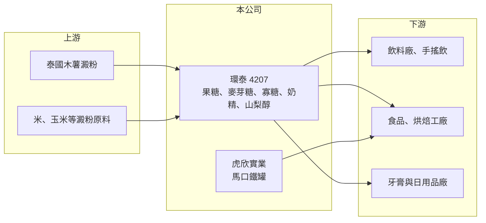

# 4207 環泰

> 上櫃｜[[產業索引-食品工業|食品工業]]｜上市（櫃）日期 2000/01/21

# 第一章：企業模式與商業藍圖

> [!info] 撰寫說明
> 精簡版，由 Claude 依公開資料整理，架構比照 [[2330台積電]]，資料截至 2026-10-08。來源：櫃買中心開放資料快照（基本資料、2026 年上半年資產負債與綜合損益）、Goodinfo 歷年經營績效、股感 2019 年 12 月公司介紹（以 2018 年資料為主，比重可能已改變）。#待校對

環泰是台灣液體糖漿的主要供應商，把木薯澱粉等原料加工成果糖、麥芽糖、山梨醇等[[澱粉糖]]，再賣給飲料、食品與民生用品工廠，海外工廠的營收已超過台灣本地。

- **核心業務：** 公司 1984 年以「新和美果糖」之名成立，技術來自日本三重化糧，2000 年上櫃。產品包括[[高果糖糖漿]]、麥芽糖、寡糖、奶精與糊精，泰國子公司另生產[[山梨醇]]。台灣子公司虎欣實業生產馬口鐵罐，延伸到食品包材。
- **營收結構：** 依 2019 年整理資料，約六成營收來自海外，山梨醇約占合併營收三成，主要客戶之一是高露潔，用於牙膏等日用品。最新的產品比重未查得，但海外與山梨醇占比高這兩個特性，決定了環泰的獲利主要看東南亞事業。
- **營運據點：** 台灣北部（桃園）工廠供應國內飲料與食品業；馬來西亞、菲律賓廠以果糖與麥芽糖為主，菲律賓廠 2018 年底投產；泰國廠生產果糖、麥芽糖、山梨醇與糊精，並規劃以米為原料的新廠。泰國是木薯澱粉主要產地，就近設廠可降低原料與運輸成本。
- **長期方向：** 國內糖漿市場成熟，長期成長來自東南亞飲料與食品需求擴張，以及山梨醇等非食品用途的工業客戶。原料多元化（從木薯擴及米）也是降低成本波動的策略。#待校對

# 第二章：護城河深度與競爭優勢

環泰的護城河是國內市占率與東南亞的就近產能，糖漿是同質性高的大宗原料，競爭主要拼成本與交貨穩定。

- **競爭優勢：** 依 2019 年資料，台灣果糖市場由環泰、[[1220台榮]]、豐年三家掌握約 95%，環泰在國內液體糖漿市占率約 77%，是唯一能生產全系列液體糖漿的國內廠商。液體糖漿要用槽車配送、保存期限有限，大型飲料廠傾向與鄰近的穩定供應商長期合作，市占率因此不易被撼動。#待校對
- **成本與地點：** 東南亞工廠靠近木薯產地，原料成本低於從國外進口澱粉的廠商；同時服務當地成長中的飲料市場。山梨醇客戶為國際民生用品大廠，品質認證門檻較高，客戶關係較穩定。
- **主要對手：** 國內有 [[1220台榮]] 與豐年，東南亞則有當地與跨國澱粉糖大廠。跨國大廠規模更大，環泰的空間在於區域性的服務與彈性。
- **觀察重點：** 毛利率長年在 13% 至 15%，2025 年升到約 19.5%。長期要看的是這次利潤率提升是原料成本下跌的短期效果，還是產品組合（山梨醇、寡糖）升級帶來的結構改善。

# 第三章：財務體質與盈利規模

資料日期：2026-10-08，表格是撰寫當時的快照；最新月營收、毛利率、累計 EPS 由自動排程寫在本筆記的屬性欄位（月營收、毛利率、累計EPS 等）。#待校對

環泰的財務特色是營收規模中等、毛利率低，屬於典型的原料加工業，獲利隨原料與售價的價差變化。

| 年度 | 營收（億元） | [[毛利率]] | [[營業利益率]] | EPS（元） | [[ROE]] |
|---|---|---|---|---|---|
| 2020 | 39.0 | 14.8% | 7.73% | 0.92 | 8.02% |
| 2021 | 43.9 | 13.7% | 6.84% | 2.25 | 20.0% |
| 2022 | 50.4 | 12.6% | 6.31% | 0.79 | 6.29% |
| 2023 | 53.4 | 14.0% | 7.91% | 1.25 | 9.29% |
| 2024 | 56.3 | 13.8% | 7.80% | 1.09 | 8.26% |
| 2025 | 51.6 | 19.5% | 12.8% | 1.76 | 11.8% |
| 2026 上半年 | 28.3 | 18.5% | 11.8% | 0.95 | 未查得 |

資料來源：Goodinfo 歷年經營績效；2026 上半年取自櫃買中心開放資料。2021 年 EPS 明顯偏高，原因未查得，可能含一次性收益（推估）。

- **營收規模：** 2020 至 2025 年營收從 39 億元成長到 51.6 億元，年複合成長率約 5.8%（推算），成長主要來自海外產能擴充與售價隨原料調整。2026 年上半年約 28.3 億元，略高於前一年的半年水準。
- **獲利：** 營業利益率多數年份在 6% 至 8%，2025 年起提升到 12% 左右。近 5 年（2021 至 2025）平均 ROE 約 11.1%（推算），若排除 2021 年則約 9%。
- **財務特色：** 2026 年第二季底權益總計約 40.7 億元，其中非控制權益約 11.8 億元，代表部分海外子公司有其他股東；負債約 25.3 億元，非流動負債約 12.5 億元，與海外建廠有關。配息資料未查得。
- **[[ROIC]] 與 [[WACC]]：** 有息負債未單獨查得，以約 18 億元推估。2025 年營業利益約 6.6 億元（51.6 億 × 12.8%），稅後約 5.3 億元，ROIC ≈ 5.3 ÷（40.7＋18）≈ 9%（推算）；2024 年同法約 6%。WACC 以無風險利率 1.75%、市場風險溢酬 6%、β 取食品原料業常見值 0.7，股東權益成本約 6%；負債成本約 3%、稅後 2.4%，權益占比約七成，WACC 約 5%（推算）。過去 ROIC 大致略高於 WACC，創造的超額價值不大；2025 年利差擴大，能否維持取決於原料與產品組合。

# 第四章：總體風險與地緣政治

環泰的風險集中在原料價格、東南亞營運與替代甜味劑的長期趨勢。

- **產業週期：** 木薯、玉米與米的價格受氣候、各國農業政策與能源價格影響，澱粉糖售價調整常落後於原料，價差擴大或縮小會直接改變毛利率。飲料需求在夏季較旺，也受東南亞消費景氣影響。
- **營運風險：** 海外營收占比高，泰國、馬來西亞、菲律賓的政治、勞工與匯率變動都會影響獲利。新廠投資若產能利用率不足，折舊會壓低利潤率。
- **其他風險：** 各國陸續推動含糖飲料稅與減糖政策，長期可能壓抑果糖需求，飲料廠也可能改用代糖；泰銖、馬幣、披索兌新台幣的匯率會影響換算損益。山梨醇客戶集中於少數國際大廠，訂單變動影響明顯。

# 專有名詞解析

## 金融

- **[[ROIC]]**：投入資本報酬率，稅後營業利益除以股東權益加有息負債，用來衡量公司運用所有資本的獲利能力。
- **[[WACC]]**：加權平均資金成本，股東權益成本與稅後負債成本依資本結構加權，ROIC 高於它才代表創造價值。

## 產業

- **[[澱粉糖]]**：以澱粉為原料，經酵素水解製成的糖類，包括葡萄糖漿、果糖、麥芽糖、寡糖等。
- **[[高果糖糖漿]]**：以澱粉轉化成的液體甜味劑，甜度接近蔗糖、溶解性好，是手搖飲與瓶裝飲料的主要甜味來源。
- **[[山梨醇]]**：由葡萄糖氫化而成的糖醇，可作甜味劑與保濕劑，廣泛用於牙膏、口香糖與化妝品。

# 核心供應鏈

- 上游：泰國木薯澱粉、米與其他澱粉原料供應商，以及酵素與包材供應商。
- 下游／客戶：台灣與東南亞的飲料廠、手搖飲業者、食品工廠，山梨醇客戶包括高露潔等國際日用品廠。
- 同業：[[1220台榮]]、豐年（國內糖漿），東南亞與跨國澱粉糖廠。

## 最新新聞
<!-- news:start -->
<!-- news:end -->

## 相關連結
- [公開資訊觀測站](https://mopsov.twse.com.tw/mops/web/t05st03?step=1&firstin=1&co_id=4207)
- [Goodinfo](https://goodinfo.tw/tw/StockDetail.asp?STOCK_ID=4207)
- [Yahoo 股市](https://tw.stock.yahoo.com/quote/4207)
- [鉅亨網新聞](https://www.cnyes.com/twstock/4207/news)
