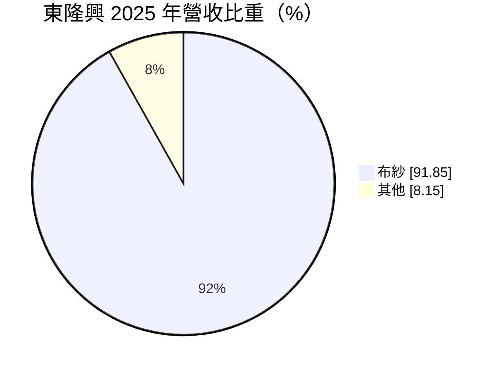
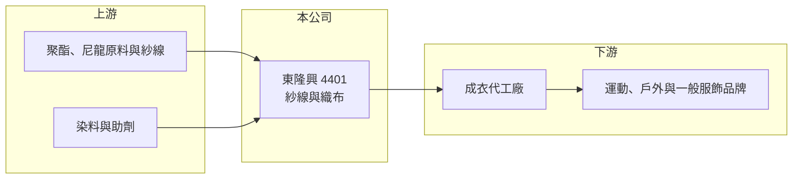

# 4401 東隆興

> 上櫃｜[[產業索引-紡織纖維|紡織纖維]]｜上市（櫃）日期 1996/05/09

# 第一章：企業模式與商業藍圖

> [!info] 撰寫說明
> 精簡版，由 Claude 依公開資料整理，架構比照 [[2330台積電]]，資料截至 2026-10-08。來源：Goodinfo 經營績效年表（2020 至 2025 年）、富邦 MoneyDJ 基本資料（2025 年營收比重）；櫃買中心開放資料快照（基本資料、2026 年上半年資產負債與損益、本益比殖利率、每月營收）。產品細項、產地與客戶這次未查得，憑記憶部分已標「待校對」。#待校對

東隆興業成立於 1961 年 8 月、1996 年 5 月上櫃，總部在新北市板橋，董事長游志成、總經理游榮利，是經營超過一甲子的老牌紡織公司。它的營收規模約 30 至 50 億元，以布與紗為主，獲利率薄、隨紡織景氣起伏，是理解台灣傳統化纖紡織中游的典型案例。

- **核心業務：** 東隆興的營收有九成以上來自布與紗，產品主要是合成纖維的織布，供應運動、戶外與一般衣著用途（產品細項待校對）。中游織布廠的角色是把上游的聚酯、尼龍紗加工成布，再賣給成衣廠，賺取加工價差，因此[[毛利率]]長期只有 6% 至 13%。
- **營收結構：** 2025 年布紗占 91.85%、其他占 8.15%。營收在 2021 年達到 50.2 億元高點，2023 年因品牌去化庫存掉到 28.2 億元，2024 與 2025 年回到約 39 億元，波動幅度明顯大於一般製造業，反映紡織中游受下游庫存調整的影響。
- **營運據點：** 公司登記在板橋，生產據點與海外布局這次未查得。2026 年第二季資產負債表中非流動資產約 31.7 億元，占總資產的 55%，且有非控制權益，代表公司擁有相當規模的廠房土地或子公司投資（細節待校對）。
- **長期方向：** 對這類老牌織布廠來說，長期課題是從大宗規格布轉向[[機能性布料]]與環保回收材質，並把產能配置在關稅與工資較有利的地區。東隆興在這方面的具體規劃這次未查得，讀者可從年報的產品與產能說明追蹤。

# 第二章：護城河深度與競爭優勢

東隆興的競爭力主要來自長年累積的客戶關係與量產規模，但在一般規格布料上的定價能力有限。

- **競爭優勢：** 經營六十多年的織布廠，通常擁有穩定的染整與成衣廠客戶網絡，能夠承接大批量、交期穩定的訂單，這是新進業者短期難以複製的。不過若產品以通用規格為主，客戶可以在台灣、中國、東南亞的布廠之間比價，護城河偏窄。
- **主要對手：** 台灣同業包括 [[1434福懋]]、[[1409新纖]]、[[1447力鵬]]、[[1460宏遠]]、[[1464得力]] 等化纖與織布廠，以及中國大陸大量的中小型布廠。中國布廠在規格品上價格競爭激烈，台灣廠商要靠品質、研發與環保認證取得溢價。
- **觀察重點：** 2021 年[[營業利益率]]曾達 8.41%，之後回到 2% 至 4% 之間，2023 年甚至轉為小幅營業虧損。若東隆興能把營業利益率穩定拉回 5% 以上，代表產品組合真的往高附加價值移動；若持續在 3% 附近，則仍屬於景氣循環型的代工布廠。

# 第三章：財務體質與盈利規模

資料日期：2026-10-08，表格是撰寫當時的快照；最新月營收、毛利率、累計 EPS 由自動排程寫在本筆記的屬性欄位（月營收、毛利率、累計EPS 等）。#待校對

東隆興的財務特徵是「營收大、利潤薄、資產重」，獲利跟著紡織景氣明顯起伏。

| 年度 | 營收（億元） | [[毛利率]] | [[營業利益率]] | EPS（元） | [[ROE]] |
|---|---|---|---|---|---|
| 2021 | 50.2 | 12.70% | 8.41% | 2.64 | 12.10% |
| 2022 | 41.0 | 10.70% | 3.92% | 1.37 | 6.22% |
| 2023 | 28.2 | 6.09% | -0.33% | -0.13 | -0.45% |
| 2024 | 39.2 | 8.66% | 3.28% | 1.06 | 4.91% |
| 2025 | 39.0 | 8.22% | 2.59% | 0.73 | 3.94% |

註：2026 年上半年營收 19.35 億元、營業利益 0.60 億元、EPS 0.60 元（櫃買中心資料）。

- **長期指標：** 2021 至 2025 年營收年複合成長率約 -6.1%（推算），但這是以 2021 年景氣高點為基期；近 5 年平均 [[ROE]] 約 5.3%（推算）。櫃買中心資料顯示最近一年度現金股利 0.6 元，約為 2025 年 EPS 0.73 元的八成，公司在獲利不高的年度仍維持配息。
- **[[ROIC]] 與 [[WACC]]：** 2025 年稅後營業利益約 0.81 億元（營業利益率 2.59% × 營收 39.0 億元 × 0.8），投入資本約 42.6 億元（2026 年第二季權益總計 27.57 億元，加上以總負債 30.03 億元的一半推估的有息負債約 15.0 億元），ROIC 約 1.9%（推算）。WACC 約 4.9%（推算：無風險利率 1.75%、市場風險溢酬 6%、β 取紡織同業常見值 0.8，股東權益成本 6.55%；稅前負債成本 2.5%、稅率 20%；權益比重約 65%）。ROIC 低於 WACC，代表以目前的獲利水準，本業尚未為股東創造超額報酬，只有在 2021 年那類景氣高峰（推算 ROIC 約 8%）才明顯超過資金成本。
- **財務特色：** 2026 年第二季負債比率約 52%（負債 30.03 億元 ÷ 資產 57.60 億元），在紡織股中偏高，流動負債 21.94 億元與流動資產 25.92 億元相近，營運資金需要靠銀行短期借款周轉（推估）。股價淨值比約 0.63 倍，市場對其資產報酬率偏低的評價反映在折價上。

# 第四章：總體風險與地緣政治

東隆興的風險主要來自紡織景氣循環與較高的財務槓桿。

- **產業週期：** 織布廠位在供應鏈中段，品牌去化庫存時訂單會被放大縮減，也就是[[長鞭效應]]，2023 年營收年減約 31% 就是例子。景氣回升時營收能快速恢復，但每一輪循環都會讓獲利出現大起大落。
- **營運風險：** 負債比率超過五成，在景氣低迷、營收下滑時，利息與營運資金壓力會放大虧損。毛利率只有 8% 左右，原料、電價、工資任何一項上漲 1 至 2 個百分點，就可能吃掉大部分營業利益。
- **其他風險：** 合成纖維原料價格跟著原油波動；外銷以美元計價，新台幣升值會壓縮毛利；歐美品牌對回收材料比例、化學品管理與碳足跡的要求日益嚴格，達不到標準就可能失去訂單。

# 專有名詞解析

## 金融

- **[[ROIC]]**：投入資本報酬率，稅後營業利益除以股東權益加有息負債，衡量本業運用資本的效率。
- **[[WACC]]**：加權平均資金成本，股東與債權人要求報酬率的加權平均，是 ROIC 要超越的門檻。

## 產業

- **[[長鞭效應]]**：終端需求的小幅變動沿供應鏈往上游傳遞時被逐級放大，造成上游庫存與訂單劇烈波動。
- **[[機能性布料]]**：具備吸濕排汗、防水透氣、抗紫外線等功能的布料，主要用於運動與戶外服飾。

# 核心供應鏈

- 上游：化纖原料與紗線供應商如 [[1326台化]]、[[1303南亞]]、[[1409新纖]]、[[1447力鵬]]（是否為東隆興供應商未查得）。
- 下游／客戶：成衣代工廠與服飾品牌，客戶名單未查得。
- 同業：[[1434福懋]]、[[1460宏遠]]、[[1464得力]]、[[1447力鵬]]。

## 最新新聞
<!-- news:start -->
<!-- news:end -->

## 相關連結
- [公開資訊觀測站](https://mopsov.twse.com.tw/mops/web/t05st03?step=1&firstin=1&co_id=4401)
- [Goodinfo](https://goodinfo.tw/tw/StockDetail.asp?STOCK_ID=4401)
- [Yahoo 股市](https://tw.stock.yahoo.com/quote/4401)
- [鉅亨網新聞](https://www.cnyes.com/twstock/4401/news)
