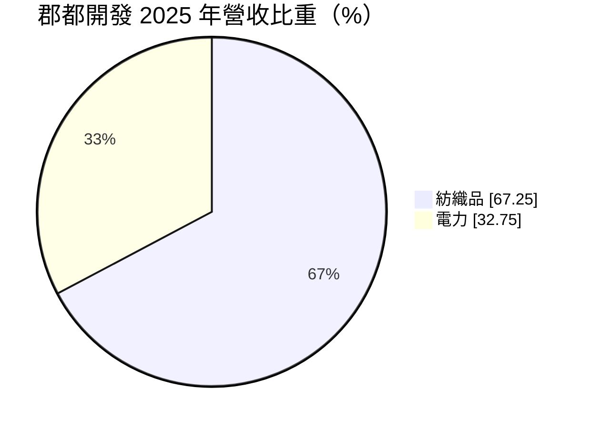
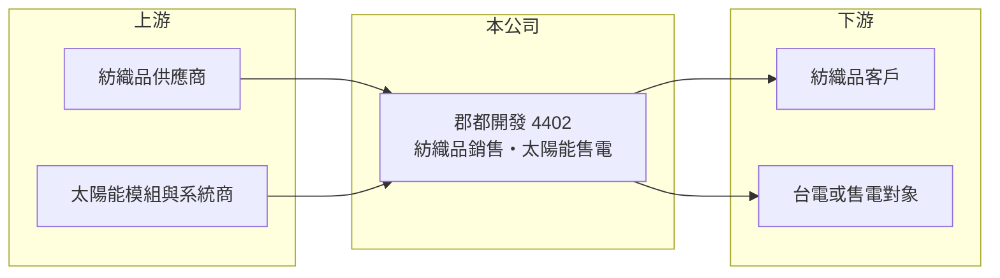

# 4402 郡都開發

> 上櫃｜[[產業索引-紡織纖維|紡織纖維]]｜上市（櫃）日期 1997/07/23

# 第一章：企業模式與商業藍圖

> [!info] 撰寫說明
> 精簡版，由 Claude 依公開資料整理，架構比照 [[2330台積電]]，資料截至 2026-10-08。來源：Goodinfo 經營績效年表（2020 至 2025 年）、富邦 MoneyDJ 基本資料（2025 年營收比重）；櫃買中心開放資料快照（基本資料、2026 年上半年資產負債與損益、每月營收）。公開資料有限，業務轉型的細節與時間點這次未查得，相關描述為推估。#待校對

郡都開發成立於 1970 年 4 月、1997 年 7 月上櫃，總部在高雄市前金區，董事長唐承、總經理唐銘。從公司名稱與營收組成來看，它已經從傳統紡織廠轉型為規模很小、兼營紡織品與電力的公司，年營收只有數千萬元，連續多年營業虧損，屬於轉型中的殼型小公司。

- **核心業務：** 2025 年營收中紡織品占 67.25%、電力占 32.75%。電力收入應來自[[太陽能電廠]]的售電（推估），這類業務一旦建置完成，就能依長期購電合約取得穩定現金流，是許多老紡織廠轉型時常見的選擇。
- **營收結構：** 營收從 2020 年的 1.20 億元、2022 年的 1.72 億元，萎縮到 2024 年 0.18 億元與 2025 年 0.24 億元，原本的紡織本業已大幅縮小。2026 年 1 至 8 月累計營收 0.23 億元，比前一年同期成長約 36%，但絕對規模仍很小。
- **營運據點：** 公司登記在高雄，工廠與電廠位置這次未查得。2026 年第二季非流動資產約 4.28 億元、占總資產約 69%，代表公司資產主要是長期性資產，例如土地、電廠設備或長期投資（推估）。
- **長期方向：** 公司名稱中的「開發」與資產結構，顯示經營方向可能包含資產開發或能源投資（推估）。2026 年上半年財報出現「共同控制下前手權益」，代表公司在 2026 年併入了一家與大股東同屬一個控制體系的事業，這類交易會改變公司未來的業務組成，值得從公告追蹤其內容（交易細節待校對）。

# 第二章：護城河深度與競爭優勢

郡都開發目前的本業規模太小，談不上傳統意義的護城河，評價重點落在資產價值與轉型能否成功。

- **競爭優勢：** 若太陽能售電業務持續擴大，收入會具有長期合約保障，波動比紡織小，這是轉型後最可能形成的穩定來源。但目前電力營收每年只有數百萬元，尚不足以支撐公司的營運費用。
- **主要對手：** 紡織品方面面對眾多中小型布廠與貿易商；電力方面則與 [[6806森崴能源]]、[[6869雲豹能源]]、[[6873泓德能源]] 等太陽能電廠開發商相比，規模差距非常大，不具成本或融資優勢。
- **觀察重點：** 2020 至 2025 年[[營業利益率]]全部為負，營業費用遠大於毛利。投資人應觀察 2026 年併入的新事業能否帶來具規模的營收，以及公司是否有清楚的資產開發或能源投資計畫，否則長期虧損會持續侵蝕淨值。

# 第三章：財務體質與盈利規模

資料日期：2026-10-08，表格是撰寫當時的快照；最新月營收、毛利率、累計 EPS 由自動排程寫在本筆記的屬性欄位（月營收、毛利率、累計EPS 等）。#待校對

郡都開發連續多年營業虧損，財務數字反映的是一家營收萎縮、靠資產與低負債支撐的公司。

| 年度 | 營收（億元） | [[毛利率]] | [[營業利益率]] | EPS（元） | [[ROE]] |
|---|---|---|---|---|---|
| 2021 | 1.53 | -0.03% | -23.8% | -0.86 | -13.0% |
| 2022 | 1.72 | 12.6% | -6.82% | -0.17 | -2.86% |
| 2023 | 0.77 | -2.32% | -52.7% | -0.43 | -5.31% |
| 2024 | 0.18 | 14.5% | -128% | -0.09 | -1.15% |
| 2025 | 0.24 | 17.3% | -74.5% | -0.13 | -1.46% |

註：2026 年上半年營收 0.12 億元、營業損失 0.12 億元、EPS -0.10 元（櫃買中心資料）。

- **長期指標：** 2021 至 2025 年營收年複合成長率約 -37%（推算），近 5 年平均 [[ROE]] 約 -4.8%（推算）。2026 年第二季保留盈餘為 -2.63 億元，累積虧損下依法無法配發盈餘股利，近年未見配息紀錄。
- **[[ROIC]] 與 [[WACC]]：** 2025 年營業損失約 0.18 億元（營業利益率 -74.5% × 營收 0.24 億元，虧損不計稅盾），投入資本約 5.97 億元（2026 年第二季權益總計 5.74 億元，加上以總負債 0.46 億元的一半推估的有息負債約 0.23 億元），ROIC 約 -3.0%（推算）。WACC 約 6.4%（推算：無風險利率 1.75%、市場風險溢酬 6%、β 取紡織同業常見值 0.8，股東權益成本 6.55%；稅前負債成本 2.5%、稅率 20%；權益比重約 96%）。ROIC 為負且遠低於 WACC，代表本業持續消耗股東資本，公司價值主要取決於所持資產能否透過[[資產活化]]變現。
- **財務特色：** 2026 年第二季負債只有 0.46 億元、負債比率約 7%，財務風險低。其他權益約 1.57 億元，可能來自長期投資或資產的未實現評價利益（推估），是每股淨值 8.44 元中的重要成分；股價淨值比約 1.58 倍，市場價格明顯反映轉型或資產題材，而不是本業獲利。

# 第四章：總體風險與地緣政治

郡都開發的風險在於本業長期虧損、轉型方向不夠清楚，以及小型股常見的治理與流動性問題。

- **產業週期：** 紡織部分已萎縮到很小，景氣循環對公司的影響反而下降；太陽能售電受日照、躉購費率與電網併網條件影響，收入穩定但成長受限於電廠規模。
- **營運風險：** 營業費用每年約 0.2 至 0.3 億元，若新事業無法帶來足夠營收，虧損會持續侵蝕淨值。公司曾辦理私募（私募股數 2,200 萬股），私募與關係人交易的價格與條件，是外部股東需要留意的治理議題。
- **其他風險：** 太陽能相關法規與饋線容量限制會影響新案場開發；若公司持有土地或投資部位，其價值也會受不動產與股市景氣影響。股本小、成交量低，股價容易受消息面影響而大幅波動。

# 專有名詞解析

## 金融

- **[[ROIC]]**：投入資本報酬率，稅後營業利益除以股東權益加有息負債，衡量本業運用資本的效率。
- **[[WACC]]**：加權平均資金成本，股東與債權人要求報酬率的加權平均，是 ROIC 要超越的門檻。

## 產業

- **[[太陽能電廠]]**：以太陽能板發電並出售電力的電廠，通常有長期購電合約，收入穩定。
- **[[資產活化]]**：把閒置土地、廠房或資產重新開發、出租或出售，提高資產的報酬。

# 核心供應鏈

- 上游：太陽能模組與系統供應商，名單未查得。
- 下游／客戶：紡織品買家與電力收購方（太陽能售電一般售予台電，待校對）。
- 同業：太陽能電廠開發商 [[6806森崴能源]]、[[6869雲豹能源]]、[[6873泓德能源]]；同為老紡織廠轉型的 [[1438三地開發]]。

## 最新新聞
<!-- news:start（自動產生，請勿手動編輯此範圍） -->
- 2026-10-08 📰 媒體 17:23｜營收速報 - 郡都開發(4402)9月營收710萬元年增率高達313.94％｜[鉅亨網](https://news.cnyes.com/news/id/6625019)

完整紀錄：[[4402郡都開發 新聞]]
<!-- news:end -->

## 相關連結
- [公開資訊觀測站](https://mopsov.twse.com.tw/mops/web/t05st03?step=1&firstin=1&co_id=4402)
- [Goodinfo](https://goodinfo.tw/tw/StockDetail.asp?STOCK_ID=4402)
- [Yahoo 股市](https://tw.stock.yahoo.com/quote/4402)
- [鉅亨網新聞](https://www.cnyes.com/twstock/4402/news)
