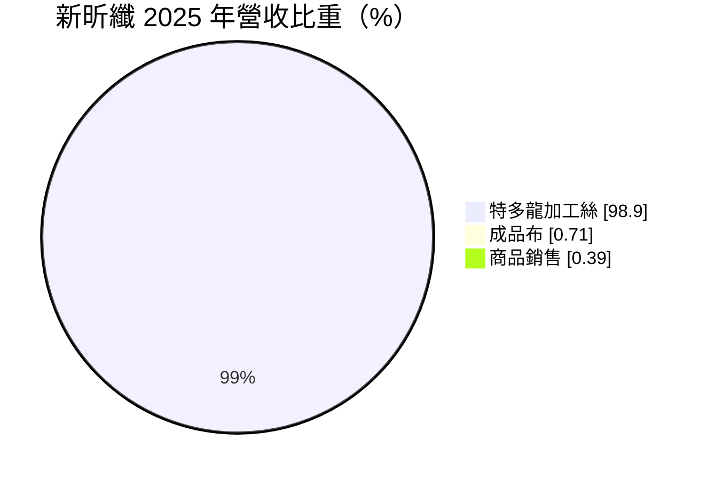
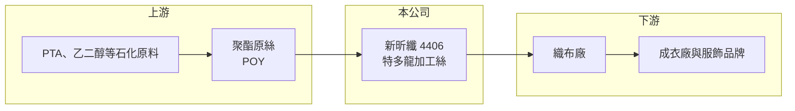

# 4406 新昕纖

> 上櫃｜[[產業索引-紡織纖維|紡織纖維]]｜上市（櫃）日期 1999/01/14

# 第一章：企業模式與商業藍圖

> [!info] 撰寫說明
> 精簡版，由 Claude 依公開資料整理，架構比照 [[2330台積電]]，資料截至 2026-10-08。來源：Goodinfo 經營績效年表（2020 至 2025 年）、富邦 MoneyDJ 基本資料（2025 年營收比重）；櫃買中心開放資料快照（基本資料、2026 年上半年資產負債與損益、每月營收）。公開資料有限，工廠位置、產能與客戶這次未查得。#待校對

新昕纖維成立於 1980 年 4 月、1999 年 1 月上櫃，總部在台北市，董事長莊育霖、總經理莊晉嘉，是以特多龍（聚酯）加工絲為單一產品的小型化纖廠。它的處境代表了台灣大宗化纖中游的共同困境：產品同質、規模小，在中國大量產能的價格壓力下長期難以獲利。

- **核心業務：** 新昕纖 2025 年營收有 98.9% 來自特多龍[[加工絲]]，也就是把上游的[[聚酯]]原絲經過假撚加工，讓紗線具備蓬鬆、彈性與手感，再賣給織布廠。加工絲是化纖供應鏈中技術門檻較低、資本密集度中等的環節，產品差異化有限，價格大多跟著原料與市場供需走。
- **營收結構：** 營收從 2022 年的 5.70 億元高點降到 2023 年 4.10 億元，2025 年為 4.79 億元，規模一直在 4 至 6 億元之間。2026 年 1 至 8 月累計營收只有 1.14 億元，年減約 66%，8 月單月營收僅約 218 萬元，顯示營運規模在 2026 年出現大幅收縮，原因這次未查得，可能與減產或調整產線有關（推估）。
- **營運據點：** 公司登記在台北市，生產工廠位置這次未查得。2026 年第二季非流動資產約 4.19 億元，占總資產一半，主要應為廠房土地與機器設備（推估）。
- **長期方向：** 對單一產品的小型加工絲廠而言，長期出路通常是轉向差別化或回收再生紗線、與下游布廠合作開發機能產品，或活化廠房土地。新昕纖在 2026 年營收急縮後的經營方向，是判斷公司長期價值的關鍵，需從公司公告追蹤。

# 第二章：護城河深度與競爭優勢

新昕纖缺乏明顯的護城河，在同質化的加工絲市場中主要只能以價格與服務競爭。

- **競爭優勢：** 小型加工絲廠的優勢在於可以接少量、多樣的訂單，配合下游布廠快速調整纖度與規格，並以地利維持交期。但這類優勢容易被規模較大的同業複製，難以轉化為長期定價能力。
- **主要對手：** 台灣同業包括 [[1409新纖]]、[[1444力麗]]、[[1447力鵬]]、[[1455集盛]] 等擁有聚合、紡絲到加工一貫產線的化纖大廠，以及中國大陸龐大的加工絲產能。大廠具備原料自給與規模經濟，中國廠則以低價出口，兩者都壓縮小廠的利潤空間。
- **觀察重點：** 2023 至 2025 年[[毛利率]]連續為負（-5.04%、-7.44%、-4.32%），代表售價連生產成本都無法覆蓋。若公司無法扭轉毛利為負的狀態，縮減營運或轉型可能是合理選擇，投資人應關注公司是否有資產處分或新事業計畫。

# 第三章：財務體質與盈利規模

資料日期：2026-10-08，表格是撰寫當時的快照；最新月營收、毛利率、累計 EPS 由自動排程寫在本筆記的屬性欄位（月營收、毛利率、累計EPS 等）。#待校對

新昕纖近 5 年只有 2021 與 2022 年小幅獲利，其餘年度虧損，且虧損幅度逐年擴大。

| 年度 | 營收（億元） | [[毛利率]] | [[營業利益率]] | EPS（元） | [[ROE]] |
|---|---|---|---|---|---|
| 2021 | 4.93 | 9.39% | 4.34% | 0.33 | 2.95% |
| 2022 | 5.70 | 4.25% | -0.79% | 0.40 | 3.22% |
| 2023 | 4.10 | -5.04% | -11.9% | -0.39 | -3.12% |
| 2024 | 4.48 | -7.44% | -13.6% | -0.73 | -6.26% |
| 2025 | 4.79 | -4.32% | -12.6% | -1.07 | -9.17% |

註：2026 年上半年營收 1.05 億元、毛損 0.06 億元、營業損失 0.29 億元、EPS -0.42 元（櫃買中心資料）。

- **長期指標：** 2021 至 2025 年營收年複合成長率約 -0.7%（推算），近 5 年平均 [[ROE]] 約 -2.5%（推算），且 2023 年後逐年惡化。2026 年第二季保留盈餘為 -0.36 億元，處於累積虧損，近年未見配息；Goodinfo 統計的歷年平均現金股利僅約 0.03 元。
- **[[ROIC]] 與 [[WACC]]：** 2025 年營業損失約 0.60 億元（營業利益率 -12.6% × 營收 4.79 億元，虧損不計稅盾），投入資本約 7.2 億元（2026 年第二季股東權益 6.07 億元，加上以總負債 2.32 億元的一半推估的有息負債約 1.16 億元），ROIC 約 -8.3%（推算）。WACC 約 5.8%（推算：無風險利率 1.75%、市場風險溢酬 6%、β 取紡織同業常見值 0.8，股東權益成本 6.55%；稅前負債成本 2.5%、稅率 20%；權益比重約 84%）。ROIC 為負，代表本業每年都在消耗股東資本，和 WACC 之間的缺口超過 14 個百分點，長期持續將使淨值不斷下降。
- **財務特色：** 2026 年第二季負債比率約 28%（負債 2.32 億元 ÷ 資產 8.40 億元），財務槓桿不高，短期內償債壓力有限。其他權益約 0.84 億元，可能來自金融資產的未實現評價利益（推估），2026 年上半年其他綜合損益 0.10 億元部分抵銷了本業虧損。股價淨值比約 0.86 倍，反映市場對其資產報酬的低評價。

# 第四章：總體風險與地緣政治

新昕纖的風險集中在本業長期虧損與營運規模急縮。

- **產業週期：** 加工絲價格跟著聚酯原料與下游織布需求波動，中國產能過剩時，台灣小廠首當其衝。紡織品牌去化庫存的[[長鞭效應]]，會讓加工絲這類上游產品的訂單波動比終端更大。
- **營運風險：** 毛利連續三年為負，代表售價、產能利用率或成本結構出了根本問題。2026 年營收大幅萎縮後，固定成本難以分攤，若沒有新業務或資產處分，虧損可能持續擴大並侵蝕每股淨值（2026 年第二季為 11.70 元）。
- **其他風險：** 原油價格影響聚酯原料成本；電價上漲對加工絲這類耗電製程影響明顯；歐美品牌要求回收聚酯比例提高，若公司沒有相應的再生紗產品，可能進一步失去下游訂單。

# 專有名詞解析

## 金融

- **[[ROIC]]**：投入資本報酬率，稅後營業利益除以股東權益加有息負債，衡量本業運用資本的效率。
- **[[WACC]]**：加權平均資金成本，股東與債權人要求報酬率的加權平均，是 ROIC 要超越的門檻。

## 產業

- **[[加工絲]]**：將化纖原絲經假撚等加工，使紗線具備蓬鬆、彈性與手感，再供織布廠使用的紗線產品。
- **[[聚酯]]**：以 PTA 與乙二醇聚合而成的合成纖維與塑膠原料，用於衣料、寶特瓶與工業用布。
- **[[長鞭效應]]**：終端需求的小幅變動沿供應鏈往上游傳遞時被逐級放大，造成上游庫存與訂單劇烈波動。

# 核心供應鏈

- 上游：聚酯原料與原絲供應商如 [[1326台化]]、[[1303南亞]]、[[1409新纖]]（是否為新昕纖供應商未查得）。
- 下游／客戶：織布廠，客戶名單未查得。
- 同業：[[1409新纖]]、[[1444力麗]]、[[1447力鵬]]、[[1455集盛]]。

## 最新新聞
<!-- news:start -->
<!-- news:end -->

## 相關連結
- [公開資訊觀測站](https://mopsov.twse.com.tw/mops/web/t05st03?step=1&firstin=1&co_id=4406)
- [Goodinfo](https://goodinfo.tw/tw/StockDetail.asp?STOCK_ID=4406)
- [Yahoo 股市](https://tw.stock.yahoo.com/quote/4406)
- [鉅亨網新聞](https://www.cnyes.com/twstock/4406/news)
