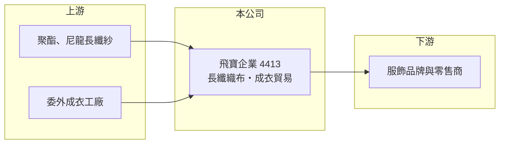

# 4413 飛寶企業

> 上櫃｜[[產業索引-紡織纖維|紡織纖維]]｜上市（櫃）日期 1999/07/29

# 第一章：企業模式與商業藍圖

> [!info] 撰寫說明
> 精簡版，由 Claude 依公開資料整理，架構比照 [[2330台積電]]，資料截至 2026-10-08。來源：Goodinfo 經營績效年表（2020 至 2025 年）與公司基本資料（主要業務）；櫃買中心開放資料快照（基本資料、2026 年上半年資產負債與損益、本益比殖利率、每月營收）。公開資料有限，營收比重、產地與客戶這次未查得。#待校對

飛寶企業成立於 1987 年 10 月、1999 年 7 月上櫃，總部在新北市三重，董事長蔡煌瑯、總經理韓佳芳，股本約 3.1 億元，是規模很小的紡織公司。它同時經營長纖織布與成衣國際貿易，營收規模約 4 至 9 億元，獲利波動大，屬於接單型態明顯的小型紡織股。

- **核心業務：** 依 Goodinfo 公司基本資料，飛寶的主要業務為「成衣國際貿易業、長纖紡織業」。長纖紡織指以聚酯、尼龍等連續長絲織成布料；成衣貿易則是接下品牌或零售商的訂單，再委託工廠生產並負責品管與出貨，屬於輕資產的[[成衣貿易商]]模式。
- **營收結構：** 兩項業務的比重這次未查得。營收從 2020 年 4.5 億元成長到 2022 年 6.93 億元，2023 至 2024 年回落到 4 億元左右，2025 年又跳升到 8.62 億元，2026 年 1 至 8 月累計 3.34 億元、年減約 38%。營收大起大落，通常代表接單集中在少數客戶或專案，訂單有無直接決定全年規模（推估）。
- **營運據點：** 公司登記在新北市三重，織布工廠與委外生產地點這次未查得。2026 年第二季非流動資產約 1.38 億元，占總資產不到三成，資產結構偏輕，與貿易業務比重不低的推論一致（推估）。
- **長期方向：** 小型紡織貿易商要長期生存，關鍵是能否把一次性的訂單變成長期合作的客戶，並在東南亞建立穩定的協力工廠網絡。飛寶近年的長期策略這次未查得，2025 年營收倍增的來源是否具延續性，是最需要追蹤的問題。

# 第二章：護城河深度與競爭優勢

飛寶的規模小、資料少，看不出明顯的結構性護城河，競爭力主要取決於接單與供應鏈管理能力。

- **競爭優勢：** 同時具備織布與成衣貿易能力，可以替客戶從布料開發一路處理到成衣交貨，對中小型品牌而言能省下自己協調多家供應商的成本。但這類服務的門檻不高，客戶隨時可以轉向更大的貿易商或直接找成衣廠。
- **主要對手：** 成衣貿易與代工方面的大型同業有 [[1477聚陽]]、[[1476儒鴻]]、[[1451年興]] 等，它們擁有自有工廠與大客戶；織布方面則與眾多台灣及中國中小型布廠競爭。飛寶在規模上明顯落後，只能鎖定較小眾的訂單。
- **觀察重點：** 2022 年[[營業利益率]]曾達 5.08%，2024 年卻降到 -4.67%，2025 年在營收倍增下仍為 -0.47%，顯示營收放大並未帶來規模效益。若營收成長無法轉化為穩定的營業利益，代表新訂單的利潤偏薄，長期價值有限。

# 第三章：財務體質與盈利規模

資料日期：2026-10-08，表格是撰寫當時的快照；最新月營收、毛利率、累計 EPS 由自動排程寫在本筆記的屬性欄位（月營收、毛利率、累計EPS 等）。#待校對

飛寶的財務數字顯示營收波動劇烈、本業接近損益兩平，獲利主要靠少數好年度與業外收入。

| 年度 | 營收（億元） | [[毛利率]] | [[營業利益率]] | EPS（元） | [[ROE]] |
|---|---|---|---|---|---|
| 2021 | 6.41 | 10.7% | 1.19% | 0.20 | 2.13% |
| 2022 | 6.93 | 15.5% | 5.08% | 1.72 | 16.8% |
| 2023 | 4.48 | 21.6% | 1.60% | 0.58 | 5.20% |
| 2024 | 4.01 | 18.8% | -4.67% | 0.06 | 0.52% |
| 2025 | 8.62 | 12.9% | -0.47% | 0.53 | 4.78% |

註：2026 年上半年營收 2.40 億元、毛利率約 20.1%、營業損失 0.02 億元、EPS 0.06 元（櫃買中心資料）。

- **長期指標：** 2021 至 2025 年營收年複合成長率約 7.7%（推算），近 5 年平均 [[ROE]] 約 5.9%（推算），但主要由 2022 年單一年度拉高。櫃買中心資料顯示最近一年度現金股利 0.3 元，約為 2025 年 EPS 0.53 元的 57%；Goodinfo 統計的長期平均現金股利只有約 0.05 元，配息並不穩定。
- **[[ROIC]] 與 [[WACC]]：** 2025 年營業損失約 0.04 億元（營業利益率 -0.47% × 營收 8.62 億元，虧損不計稅盾），投入資本約 4.2 億元（2026 年第二季股東權益 3.42 億元，加上以總負債 1.55 億元的一半推估的有息負債約 0.78 億元），ROIC 約 -1.0%（推算）。WACC 約 5.7%（推算：無風險利率 1.75%、市場風險溢酬 6%、β 取紡織同業常見值 0.8，股東權益成本 6.55%；稅前負債成本 2.5%、稅率 20%；權益比重約 81%）。只有 2022 年的 ROIC（推算約 7%）高於 WACC，其餘年度本業報酬都低於資金成本，長期而言並未穩定創造價值。
- **財務特色：** 2026 年第二季負債比率約 31%（負債 1.55 億元 ÷ 資產 4.97 億元），流動資產 3.59 億元遠大於流動負債 0.70 億元，短期償債能力充足。公司曾辦理私募（私募股數 2,095 萬股），股價淨值比約 1.82 倍，高於本業報酬所能支撐的水準，市場評價可能包含題材成分。

# 第四章：總體風險與地緣政治

飛寶的風險來自訂單集中、規模小與本業獲利薄。

- **產業週期：** 成衣與布料訂單跟著歐美品牌的庫存週期走，品牌去化庫存時，小型貿易商往往最先被砍單，2023 年營收年減約 35% 即為例子。
- **營運風險：** 營收在一年內可以倍增也可以腰斬，代表客戶集中度可能很高（推估），單一客戶的變動就足以改變全年獲利。本業長期接近損益兩平，費用控制稍有閃失就會轉為虧損。
- **其他風險：** 外銷訂單多以美元計價，匯率波動影響毛利；美國對東南亞與中國的關稅政策會改變品牌下單的產地；私募股東與經營權的變化，也可能影響公司未來的經營方向。

# 專有名詞解析

## 金融

- **[[ROIC]]**：投入資本報酬率，稅後營業利益除以股東權益加有息負債，衡量本業運用資本的效率。
- **[[WACC]]**：加權平均資金成本，股東與債權人要求報酬率的加權平均，是 ROIC 要超越的門檻。

## 產業

- **[[成衣貿易商]]**：接下品牌訂單後委託工廠生產，負責打樣、品管與出貨協調的中間商，資產輕但利潤較薄。

# 核心供應鏈

- 上游：長纖紗供應商與委外成衣工廠，名單未查得；化纖紗大廠如 [[1409新纖]]、[[1447力鵬]] 可作參考。
- 下游／客戶：服飾品牌與零售商，客戶名單未查得。
- 同業：[[1477聚陽]]、[[1476儒鴻]]、[[1451年興]]。

## 最新新聞
<!-- news:start（自動產生，請勿手動編輯此範圍） -->
- 2026-10-19 🏛️ 重訊 17:14｜本公司董事辭任｜[觀測站](https://mops.twse.com.tw/mops/#/web/t05st01)

完整紀錄：[[4413飛寶企業 新聞]]
<!-- news:end -->

## 相關連結
- [公開資訊觀測站](https://mopsov.twse.com.tw/mops/web/t05st03?step=1&firstin=1&co_id=4413)
- [Goodinfo](https://goodinfo.tw/tw/StockDetail.asp?STOCK_ID=4413)
- [Yahoo 股市](https://tw.stock.yahoo.com/quote/4413)
- [鉅亨網新聞](https://www.cnyes.com/twstock/4413/news)
