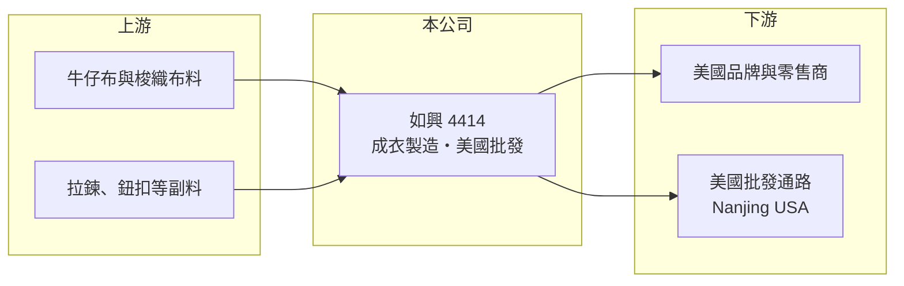

# 4414 如興

> 上市｜[[產業索引-紡織纖維|紡織纖維]]｜上市（櫃）日期 2004/09/06

# 第一章：企業模式與商業藍圖

> [!info] 撰寫說明
> 精簡版，由 Claude 依公開資料整理，架構比照 [[2330台積電]]，資料截至 2026-10-08。來源：富邦 MoneyDJ 財務比率年表（2018 至 2025 年）、Goodinfo 公司基本資料（主要業務與子公司）；證交所開放資料快照（基本資料、2026 年上半年資產負債與損益、2025 年度股利、每月營收）。營收比重這次未查得，產品、產地與客戶中憑記憶的部分已標「待校對」，營收金額由每股營業額與成長率推算。#待校對

如興成立於 1977 年 11 月、2004 年 9 月上市，總部在台北市松山區，董事長紀宗明，總經理由外籍經理人 James Ian Harrison 擔任。它是年營收超過百億元的成衣製造集團，但過去十年多數年度虧損，2025 年沖銷累積虧損後才重新起步，是觀察「大型成衣代工廠如何走出長期虧損」的案例。

- **核心業務：** 依 Goodinfo 資料，如興的主要業務為成衣與成衣附屬品的製造、加工、買賣與進出口，產品以牛仔褲等休閒褲裝為主（待校對）。子公司包括中國的常州東奧服裝（成衣與布料製造）、香港的玖地貿易（成衣貿易），以及美國的 Nanjing USA（時裝批發與分銷），代表如興不只做[[成衣代工]]，也在美國市場經營批發通路。
- **營收結構：** 依每股營業額與營收成長率推算，2025 年營收約 133 億元（推算），2022 年高點約 163 億元（推算）。2026 年上半年營收 71.45 億元，1 至 8 月累計 102.0 億元、年增約 11%，營收規模仍在成長。代工與批發兩類業務的比重這次未查得。
- **營運據點：** 生產據點包括中國常州，以及東南亞與中美洲的成衣廠（柬埔寨、尼加拉瓜等，待校對）。成衣是勞力密集產業，工廠的國家分布決定了工資成本與輸美關稅，對以美國為主要市場的如興影響特別大（推估）。
- **長期方向：** 2025 年度期初累積虧損約 73 億元，公司以[[減資彌補虧損]]等方式沖銷後（推估，依股利資料與每股數字的變化判斷），期末未分配盈餘轉為正值約 2 億元，並配發每股 0.01 元現金與 0.1 元股票股利。這代表財務結構完成一次重整，接下來的長期課題是讓毛利率回升的成果轉化為穩定的營業利益。

# 第二章：護城河深度與競爭優勢

如興擁有大型成衣代工廠的規模與多國產能，但過去的長期虧損顯示，規模本身並不等於護城河。

- **競爭優勢：** 年營收百億元以上的規模，讓如興能承接美國大型品牌與零售商的大量訂單，多國生產據點也讓客戶可以依關稅與交期分散下單。透過美國子公司經營批發，則讓公司更接近終端市場，取得比純代工更高的毛利（推估）。
- **主要對手：** 台灣成衣代工同業有 [[1477聚陽]]、[[1476儒鴻]]、[[1451年興]]、[[4438廣越]]，海外則有中國、越南、孟加拉的大型成衣集團。聚陽與儒鴻的[[營業利益率]]長期在一成上下，如興則長年在 0% 附近，差距主要來自產品組合、客戶結構與工廠效率。
- **觀察重點：** [[毛利率]]從 2022 年的 10.62% 改善到 2025 年的 19.66%，顯示產品組合或成本結構確實在改善，但營業費用率也高，2026 年上半年營業利益率又回到 -0.73%。毛利率改善能否穩定轉為營業利益，是判斷如興轉型是否成功的核心指標。

# 第三章：財務體質與盈利規模

資料日期：2026-10-08，表格是撰寫當時的快照；最新月營收、毛利率、累計 EPS 由自動排程寫在本筆記的屬性欄位（月營收、毛利率、累計EPS 等）。#待校對

如興過去五年經歷大幅虧損、減資重整，再到小幅獲利，財務數字的重點在於高負債與獲利能否持續。

| 年度 | 營收（億元） | [[毛利率]] | [[營業利益率]] | EPS（元） | [[ROE]] |
|---|---|---|---|---|---|
| 2021 | 約 156（推算） | 13.32% | -7.03% | -2.31 | -19.78% |
| 2022 | 約 163（推算） | 10.62% | -14.12% | -5.32 | -66.79% |
| 2023 | 約 128（推算） | 16.41% | -1.52% | -0.66 | -12.70% |
| 2024 | 約 141（推算） | 16.78% | 1.25% | 0.08 | 2.32% |
| 2025 | 約 133（推算） | 19.66% | 3.71% | 0.68 | 3.86% |

註：2025 年營收以本期淨利 1.70 億元 ÷ EPS 0.68 元推得加權股數約 2.5 億股，再乘以每股營業額 53.41 元推算；其他年度依 MoneyDJ 營收成長率回推。2025 年每股營業額與每股淨值大幅跳升，反映減資後股數減少。2026 年上半年 EPS 為 -1.07 元（證交所資料）。

- **長期指標：** 2021 至 2025 年營收年複合成長率約 -3.8%（推算），近 5 年平均 [[ROE]] 約 -18.6%（推算），主要被 2022 年的大額虧損拉低。每股現金流量 2018 至 2025 年多數為正，2025 年為 4.62 元，顯示本業現金流比帳面獲利穩定。股利方面長期因累積虧損無法配發，2025 年度才恢復象徵性的配息配股。
- **[[ROIC]] 與 [[WACC]]：** 2025 年稅後營業利益約 3.95 億元（營業利益率 3.71% × 營收約 133 億元 × 0.8），投入資本約 90.5 億元（2026 年第二季權益總計 44.25 億元，加上以總負債 92.57 億元的一半推估的有息負債約 46.3 億元），ROIC 約 4.4%（推算）。WACC 約 5.0%（推算：無風險利率 1.75%、市場風險溢酬 6%、因財務槓桿高 β 取 1.0，股東權益成本 7.75%；稅前負債成本 3%、稅率 20%；權益比重約 49%）。2025 年 ROIC 已接近但仍略低於 WACC，2021 至 2023 年 ROIC 則為負，代表公司長期在毀損價值，直到最近才接近損益平衡。
- **財務特色：** 2026 年第二季負債比率約 68%（負債 92.57 億元 ÷ 資產 136.82 億元），流動負債 88.86 億元高於流動資產 82.38 億元，短期資金調度壓力大。2026 年上半年業外損失約 1.98 億元，使稅前由營業損失 0.52 億元擴大為 2.50 億元，業外項目（可能包括利息與匯兌）是獲利的主要變數（推估）。股價淨值比約 0.55 倍。

# 第四章：總體風險與地緣政治

如興的風險集中在高財務槓桿、成衣產地的關稅政策，以及轉型成果的持續性。

- **產業週期：** 成衣代工跟著美國零售與品牌的庫存週期走，2023 年營收年減約 22% 就是品牌去化庫存的結果。高負債的公司在景氣下行時，營收下滑與利息負擔會同時壓縮獲利。
- **營運風險：** 流動比率低於 100%，代表公司需要持續仰賴銀行融資周轉，一旦獲利惡化或銀行緊縮額度，營運資金壓力會迅速放大。公司曾辦理私募（私募股數約 5,016 萬股），經營權與大股東結構的變化也會影響長期策略。
- **其他風險：** 主要市場在美國，美國對各成衣出口國的關稅調整會直接影響訂單與毛利；以美元計價的營收與負債帶來匯率風險；棉花價格波動影響牛仔布料成本；品牌對勞工權益、用水與化學品管理的稽核要求也日益嚴格。

# 專有名詞解析

## 金融

- **[[ROIC]]**：投入資本報酬率，稅後營業利益除以股東權益加有息負債，衡量本業運用資本的效率。
- **[[WACC]]**：加權平均資金成本，股東與債權人要求報酬率的加權平均，是 ROIC 要超越的門檻。
- **[[減資彌補虧損]]**：以註銷股本的方式沖銷累積虧損，股數減少但股東權益總額不變，讓公司未來有機會恢復配息。

## 產業

- **[[成衣代工]]**：替服飾品牌依其設計與規格生產成衣，不自有品牌，利潤來自製造效率與接單規模。

# 核心供應鏈

- 上游：牛仔布與梭織布料供應商，名單未查得；副料供應商如 [[9938百和]]（是否為如興供應商未查得）。
- 下游／客戶：美國服飾品牌與零售商，客戶名單待校對。
- 同業：[[1477聚陽]]、[[1476儒鴻]]、[[1451年興]]、[[4438廣越]]。

## 最新新聞
<!-- news:start（自動產生，請勿手動編輯此範圍） -->
- 2026-10-12 📰 媒體 18:51｜營收速報 - 如興(4414)9月營收14.80億元年增率高達34.7％｜[鉅亨網](https://news.cnyes.com/news/id/6628389)

完整紀錄：[[4414如興 新聞]]
<!-- news:end -->

## 相關連結
- [公開資訊觀測站](https://mopsov.twse.com.tw/mops/web/t05st03?step=1&firstin=1&co_id=4414)
- [Goodinfo](https://goodinfo.tw/tw/StockDetail.asp?STOCK_ID=4414)
- [Yahoo 股市](https://tw.stock.yahoo.com/quote/4414)
- [鉅亨網新聞](https://www.cnyes.com/twstock/4414/news)
