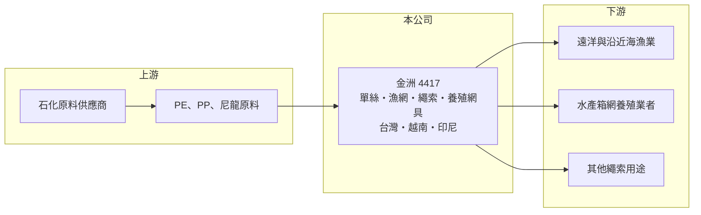

# 4417 金洲

> 上櫃｜[[產業索引-紡織纖維|紡織纖維]]｜上市（櫃）日期 2000/11/07

# 第一章：企業模式與商業藍圖

> [!info] 撰寫說明
> 精簡版，由 Claude 依公開資料整理，架構比照 [[2330台積電]]，資料截至 2026-10-08。來源：Goodinfo 經營績效年表（2020 至 2025 年）與公司基本資料（主要業務、越南與印尼子公司）；櫃買中心開放資料快照（基本資料、2026 年上半年資產負債與損益、本益比殖利率、每月營收）。營收比重這次未查得，客戶與應用市場中憑記憶的部分已標「待校對」。#待校對

金洲海洋科技成立於 1973 年 12 月、2000 年 11 月上櫃，總部在高雄，董事長兼總經理陳加仁。它雖然被歸在紡織類股，實際上是生產漁網、繩索與水產養殖網具的[[產業用紡織品]]公司，客戶是全球的漁業與養殖業者，而不是服飾品牌。這個定位讓金洲的獲利率明顯高於一般紡織股，是台灣少數長期穩定賺錢的利基型紡織公司。

- **核心業務：** 依 Goodinfo 資料，金洲的主要業務是各類漁網、線索與繩索。產品應用涵蓋遠洋與沿近海捕撈漁網，以及鮭魚等魚類[[箱網養殖]]使用的網具（應用比重待校對）。漁網與養殖網具需要耐鹽水、抗紫外線、高強度，並依客戶海域與魚種客製，技術與經驗門檻高於一般布料。
- **營收結構：** 營收從 2021 年的 23.8 億元成長到 2025 年的 34.9 億元，2026 年 1 至 8 月累計 23.1 億元、年增約 5%。捕撈與養殖兩類市場的比重這次未查得；一般而言，養殖網具需求跟著全球水產養殖擴張而成長，受景氣影響比服飾小，這是金洲營收波動相對溫和的原因（推估）。
- **營運據點：** 除台灣高雄外，金洲在 2010 年設立越南金洲海洋科技，生產網、線、索與漁網配件；2022 年設立印尼金大海洋科技，生產 PE、PP、尼龍單絲等合成纖維製品。印尼廠讓公司往上游單絲原料延伸，越南與印尼也提供較低的人工成本。
- **長期方向：** 全球野生漁獲量成長有限，蛋白質需求的增量主要來自水產養殖，養殖業又朝更大型、更深海的箱網發展，對高強度網具的需求隨之提高。金洲透過印尼單絲廠強化[[垂直整合]]，長期可望在成本與品質控制上取得優勢（推估）。

# 第二章：護城河深度與競爭優勢

金洲的護城河來自利基市場的專業技術、長期客戶關係與多國生產布局，屬於規模不大但相當穩固的類型。

- **競爭優勢：** 漁網與養殖網具攸關客戶的漁獲與魚群安全，網具破損可能造成整個箱網的魚逃逸，因此客戶重視品質紀錄與長期配合，更換供應商的意願低。五十年的經營經驗、從單絲到成網的製程掌握，以及台灣、越南、印尼的產能分布，構成金洲的主要競爭壁壘。
- **主要對手：** 主要對手是日本、歐洲與中國的漁網與繩索廠，例如日本的日東製網、中國的大型漁網業者（待校對）。台灣上市櫃公司中沒有以漁網為主業的直接同業，比較時應以國際漁網與繩索廠為基準。
- **觀察重點：** 2025 年[[營業利益率]]達 20.1%、2026 年上半年約 22.1%，是近年高點。觀察重點在於養殖網具的成長能否延續，以及印尼廠的單絲自製是否持續推升毛利率，若營業利益率能長期守在 15% 以上，代表護城河相當穩固。

# 第三章：財務體質與盈利規模

資料日期：2026-10-08，表格是撰寫當時的快照；最新月營收、毛利率、累計 EPS 由自動排程寫在本筆記的屬性欄位（月營收、毛利率、累計EPS 等）。#待校對

金洲過去五年營收穩定成長、獲利率持續提升，財務表現在紡織類股中屬於前段。

| 年度 | 營收（億元） | [[毛利率]] | [[營業利益率]] | EPS（元） | [[ROE]] |
|---|---|---|---|---|---|
| 2021 | 23.8 | 29.2% | 13.9% | 3.12 | 9.27% |
| 2022 | 32.7 | 29.5% | 16.4% | 4.80 | 13.3% |
| 2023 | 29.4 | 25.2% | 13.3% | 3.69 | 9.97% |
| 2024 | 30.9 | 28.7% | 18.5% | 4.41 | 11.4% |
| 2025 | 34.9 | 30.7% | 20.1% | 6.13 | 15.1% |

註：2026 年上半年營收 15.49 億元、毛利率約 32.3%、營業利益率約 22.1%、EPS 2.33 元（櫃買中心資料）。

- **長期指標：** 2021 至 2025 年營收年複合成長率約 10.0%（推算），近 5 年平均 [[ROE]] 約 11.8%（推算），而且五年都維持獲利。櫃買中心資料顯示最近一年度現金股利 3.5 元，約為 2025 年 EPS 6.13 元的 57%，殖利率約 7.2%，配息政策穩定且具吸引力。
- **[[ROIC]] 與 [[WACC]]：** 2025 年稅後營業利益約 5.61 億元（營業利益率 20.1% × 營收 34.9 億元 × 0.8），投入資本約 44.5 億元（2026 年第二季權益總計 35.77 億元，加上以總負債 17.54 億元的一半推估的有息負債約 8.8 億元），ROIC 約 12.6%（推算）。WACC 約 5.7%（推算：無風險利率 1.75%、市場風險溢酬 6%、β 取紡織同業常見值 0.8，股東權益成本 6.55%；稅前負債成本 2.5%、稅率 20%；權益比重約 80%）。ROIC 比 WACC 高出約 7 個百分點，代表金洲本業長期為股東創造價值；不過實際有效稅率較高（2026 年上半年所得稅占稅前淨利約 30%），以實際稅率計算的 ROIC 約 11%（推算），結論不變。
- **財務特色：** 2026 年第二季負債比率約 33%（負債 17.54 億元 ÷ 資產 53.31 億元），流動資產 31.82 億元約為流動負債的 2.6 倍，財務穩健。合併報表中有約 4.11 億元的非控制權益，代表部分子公司有外部股東，2026 年上半年歸屬非控制權益的淨利約 0.16 億元。

# 第四章：總體風險與地緣政治

金洲的風險主要來自原料價格、海外營運與全球漁業政策。

- **產業週期：** 捕撈漁網的需求受漁獲配額、燃油價格與漁船作業天數影響；養殖網具則受鮭魚等魚價與養殖業者資本支出影響。2023 年營收年減約 10%，顯示金洲雖然波動小於服飾紡織，仍有一定的景氣循環。
- **營運風險：** PE、PP、尼龍等原料價格跟著石化景氣與原油波動，原料上漲若無法即時轉嫁，會壓縮毛利。越南與印尼據點面臨當地工資上漲、法規變動與管理難度，海外工廠的良率與效率直接影響獲利。
- **其他風險：** 產品外銷以美元、歐元計價，匯率波動影響營收與毛利；各國對海洋塑膠廢棄物與廢棄漁具（幽靈漁網）的管制逐漸嚴格，長期可能要求網具可回收或可追溯，這既是風險也是產品升級的機會。

# 專有名詞解析

## 金融

- **[[ROIC]]**：投入資本報酬率，稅後營業利益除以股東權益加有息負債，衡量本業運用資本的效率。
- **[[WACC]]**：加權平均資金成本，股東與債權人要求報酬率的加權平均，是 ROIC 要超越的門檻。

## 產業

- **[[產業用紡織品]]**：用於工業、農漁業、醫療、建築等非服飾用途的紡織品，例如漁網、繩索、濾布，重視強度與耐候性。
- **[[箱網養殖]]**：在海上以浮框與網具圍出養殖空間的水產養殖方式，鮭魚、鱸魚等多以此法大量養殖。
- **[[垂直整合]]**：同一家公司掌握上下游多個生產環節，例如從織布、染整到成衣縫製都自己做，可縮短交期並保留更多利潤。

# 核心供應鏈

- 上游：PE、PP 與尼龍原料供應商如 [[6505台塑化]]、[[1301台塑]]、[[1304台聚]]（是否為金洲供應商未查得）。
- 下游／客戶：全球漁業公司與水產養殖業者，客戶名單未查得。
- 同業：以日本、歐洲與中國的漁網與繩索廠為主，台灣上市櫃無直接同業。

## 最新新聞
<!-- news:start -->
<!-- news:end -->

## 相關連結
- [公開資訊觀測站](https://mopsov.twse.com.tw/mops/web/t05st03?step=1&firstin=1&co_id=4417)
- [Goodinfo](https://goodinfo.tw/tw/StockDetail.asp?STOCK_ID=4417)
- [Yahoo 股市](https://tw.stock.yahoo.com/quote/4417)
- [鉅亨網新聞](https://www.cnyes.com/twstock/4417/news)
