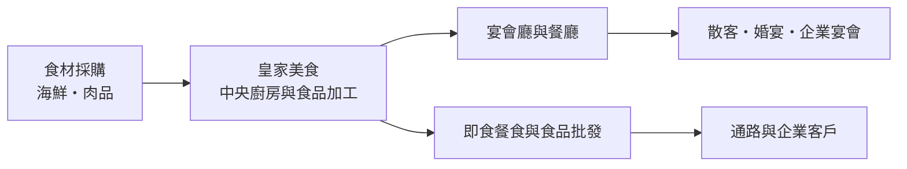
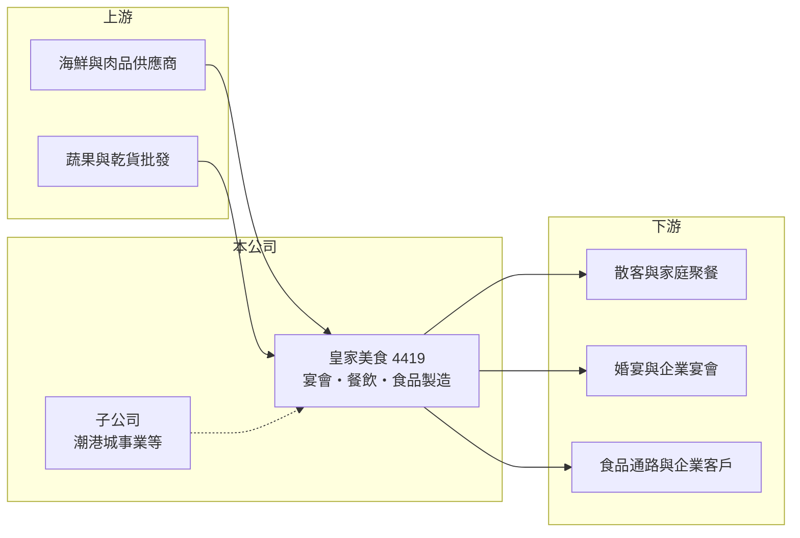

# 4419 皇家美食

> 上櫃｜[[產業索引-觀光餐旅|觀光餐旅]]｜上市（櫃）日期 2001/06/26

# 第一章：企業模式與商業藍圖

> [!info] 撰寫說明
> 本文由 Claude 依公開資料整理，架構比照 [[2330台積電]] 的四章研究，資料截至 2026-10-08。財務數字來源：櫃買中心開放資料（基本資料、2026 年第二季資產負債表與綜合損益表）、Goodinfo 年度經營績效頁、nStock 公司簡介；公開資料有限，查不到各事業的營收比重、門市數與完整子公司名單，產業描述為整理性內容，尚未逐條比對原始文件。#待校對

在評估單一個股的長期投資價值時，首要步驟是拆解企業的底層獲利邏輯。本章說明皇家國際美食（股票代號：4419，以下簡稱皇家美食）如何從一家營收極小的公司，透過整合餐飲事業在兩年內把營收放大到 20 億元以上。

## 一、核心定位：以宴會與餐飲為主的集團

皇家美食於 1991 年 9 月設立，原名元勝國際實業，2001 年 6 月在櫃買中心上櫃，2024 年 3 月股東會通過更名為皇家國際美食，登記地址在台南市。依 nStock 整理的營業項目，公司經營餐飲服務、喜慶綜合服務、即食餐食製造、食品加工製造與食品什貨批發，也就是從宴會、餐廳一路延伸到食品製造的整合型餐飲集團。

公司的重要子公司之一是「潮港城事業」，2023 年曾辦理減資彌補虧損（依 nStock 整理的新聞）。潮港城以大型海鮮餐廳與宴會廳為主要型態（憑記憶補充，待校對），這類業態的特點是單店面積大、可同時承接散客與喜宴，但前期裝修與租金投入也很高。

## 二、規模跳升：2024 年營收放大近五倍

皇家美食的營收在 2023 年只有 3.96 億元，2024 年跳升到 18.9 億元，2025 年再成長到 26.6 億元。這種倍數成長通常不是原有門市自然成長的結果，比較可能是合併新的餐飲事業或子公司所致（推估）。規模擴大後，公司可以把食材採購與[[中央廚房]]集中，理論上能降低單位成本，但從 2024、2025 年營業利益率仍為負值來看，整合效益尚未出現。

## 三、長期方向

皇家美食長期的關鍵，是把「營收規模」轉化為「獲利能力」。即食餐食與食品加工如果能做大，可以讓集團不只依賴受場地限制的宴會業務，也能透過通路銷售擴大市場。另一方面，2026 年上半年歸屬母公司淨損 0.97 億元，但非控制權益卻有 0.17 億元的淨利，代表集團內有部分子公司獲利、母公司及其他事業虧損，各事業體質差異大，資源配置是經營層需要面對的課題。

# 第二章：護城河深度與競爭優勢

「護城河」指企業抵禦競爭、維持超額利潤的保護機制。餐飲與宴會業競爭分散，本章說明皇家美食的相對優勢與限制。

## 一、相對優勢

皇家美食的優勢在於規模與業態完整。年營收超過 25 億元，在台灣上櫃餐飲公司中已屬中型規模，具備較大的食材議價空間；同時擁有宴會、餐廳與食品製造，可以把同一套採購與廚房產能用在不同通路。大型宴會廳在地方上也具有一定的稀缺性，新進者要找到同等面積與停車條件的場地並不容易。不過這些優勢目前反映在營收上，還沒有反映在獲利上，因此只能算是尚待驗證的窄幅護城河。

## 二、主要競爭對手

| 對手 | 定位 | 對皇家美食的威脅 |
|---|---|---|
| [[1268漢來美食]] | 南部飯店級餐飲與宴會龍頭 | 在高雄、台南的中高價宴會與自助餐市場直接競爭 |
| [[2727王品]] | 多品牌連鎖餐飲 | 以品牌力與展店速度爭奪外食客群 |
| [[2748雲品]] | 飯店與宴會 | 婚宴與企業宴會場地競爭 |
| 地方型海鮮餐廳 | 價格彈性大 | 以低價搶婚宴與家庭聚餐 |

## 三、守得住／守不住／觀察重點

守得住的是已建立的營收規模與大型宴會場地。守不住的是毛利率：從 2022 年的 45.6% 降到 2025 年的 26.2%，反映新增事業的成本結構較重，或食材與人力成本上升。長期觀察重點是毛利率能否回升、營業利益率能否轉正，以及母公司與子公司之間的獲利是否趨於一致。

# 第三章：財務體質與盈利規模

資料日期：2026-10-08，表格是撰寫當時的快照；最新月營收、毛利率、累計 EPS 由自動排程寫在本筆記的屬性欄位（月營收、毛利率、累計EPS 等）。#待校對

財務報表是檢驗護城河是否真實存在的最終標準。本章用六年的三率、ROE 與資本報酬檢視皇家美食的獲利品質。

## 一、多年度經營績效

| 年度 | 營收（新台幣） | [[毛利率]] | [[營業利益率]] | EPS（元） | [[ROE]] |
|---|---|---|---|---|---|
| 2020 | 0.02 億 | 6.98% | 未查得（營收過小無意義） | -1.33 | -44.4% |
| 2021 | 1.03 億 | 29.5% | -70.7% | -0.60 | -31.3% |
| 2022 | 2.46 億 | 45.6% | -10.7% | -0.63 | -23.8% |
| 2023 | 3.96 億 | 38.9% | 2.19% | -0.31 | -1.47% |
| 2024 | 18.9 億 | 27.4% | -6.25% | -0.72 | -10.6% |
| 2025 | 26.6 億 | 26.2% | -7.77% | -1.45 | -23.6% |
| 2026 上半年 | 13.87 億 | 28.4% | -5.0% | -0.57 | 未查得 |

資料來源：2020 至 2025 年為 Goodinfo，2026 上半年為櫃買中心開放資料。

這張表清楚呈現兩個階段：2023 年以前營收不到 4 億元，2024 年起營收規模放大到二、三十億元。可惜規模擴大後毛利率下降、營業利益率由正轉負，2025 年 EPS -1.45 元是近六年最差。2021 至 2025 年平均 ROE 約 -18%（推算），五年都是虧損；由於營收是靠擴張事業而跳升，營收年複合成長率不具參考意義。近五年沒有配發現金股利。

## 二、財務結構

2026 年第二季底，皇家美食總資產 29.1 億元、負債 19.4 億元，負債比約 66%；流動資產 5.4 億元，流動負債 12.1 億元，流動比率僅約 44%，短期償債壓力高。保留盈餘 -11.1 億元，累積虧損約為股本 16.9 億元的 66%，每股淨值 5.38 元。

## 三、[[ROIC]] 與 [[WACC]]：價值創造利差

**ROIC 推算：** 2025 年營業虧損約 2.07 億元（26.6 億 × -7.77%），虧損年度不計稅盾。2026 年第二季底權益總計約 9.78 億元，負債 19.4 億元中假設一半為有息負債約 9.7 億元（推估），投入資本約 19.5 億元，ROIC 約 -11%（推算）。

**WACC 推算：** 台灣 10 年期公債取 1.75%、市場風險溢酬 6%、β 取虧損型餐飲股常見值 1.0，股東權益成本約 7.75%；負債成本假設 3.5%，虧損無法抵稅以稅前計；權益與負債約各占一半，WACC 約 5.6%（推算）。

**結論：** ROIC 低於 WACC 超過 15 個百分點，公司目前處於價值消耗狀態。規模擴張若要轉為價值創造，必須先讓營業利益率回到正數，並降低對短期借款的依賴。

# 第四章：總體風險與地緣政治

任何企業都無法脫離宏觀環境獨立存在。本章分析皇家美食長期必須面對的風險。

## 一、流動性與財務風險

流動比率不到五成、累積虧損超過股本六成，是皇家美食最需要注意的風險。若營運現金流不足以支應到期債務，公司可能需要增資、出售資產或[[減資彌補虧損]]，對股東權益造成影響。

## 二、整合與管理風險

營收在兩年內放大近七倍，代表集團內部有大量新事業需要整合。不同餐廳品牌、宴會廳與食品工廠的管理方式差異大，整合不順可能讓費用率居高不下，也可能出現子公司獲利、母公司虧損的分歧狀況。

## 三、成本與需求風險

海鮮與肉品價格波動大，人力成本與基本工資逐年上升，都會壓縮毛利。需求面則受結婚對數下降、企業尾牙預算與景氣影響；疫情等突發事件對宴會業的衝擊尤其明顯。

# 專有名詞解析

## 金融

- **[[減資彌補虧損]]**：公司以減少股本的方式沖銷累積虧損，股東持股數減少但持股比例不變，常見於長期虧損的公司。
- **[[ROIC]]**：投入資本報酬率，稅後營業利益除以股東權益加有息負債，衡量本業運用資本的效率。
- **[[WACC]]**：加權平均資金成本，股東與債權人要求報酬率的加權平均，是 ROIC 要超越的門檻。

## 產業

- **[[中央廚房]]**：集中製作半成品或成品再配送到各門市的廚房，能統一品質並降低門市人力與食材成本。

# 核心供應鏈

## 1. 上游：食材供應
- 海鮮、肉品、蔬果與乾貨供應商

## 2. 中游：皇家美食與子公司
- 宴會與餐廳經營、即食餐食與食品加工；子公司潮港城事業

## 3. 下游與同業
- 客戶：散客、婚宴與企業宴會、食品通路
- 同業：[[1268漢來美食]]、[[2727王品]]、[[2748雲品]]、[[2729瓦城]]

## 最新新聞
<!-- news:start -->
<!-- news:end -->

## 相關連結
- [公開資訊觀測站](https://mopsov.twse.com.tw/mops/web/t05st03?step=1&firstin=1&co_id=4419)
- [Goodinfo](https://goodinfo.tw/tw/StockDetail.asp?STOCK_ID=4419)
- [Yahoo 股市](https://tw.stock.yahoo.com/quote/4419)
- [鉅亨網新聞](https://www.cnyes.com/twstock/4419/news)
