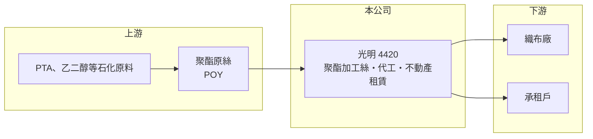

# 4420 光明

> 上櫃｜[[產業索引-紡織纖維|紡織纖維]]｜上市（櫃）日期 2002/04/18

# 第一章：企業模式與商業藍圖

> [!info] 撰寫說明
> 精簡版，由 Claude 依公開資料整理，架構比照 [[2330台積電]]，資料截至 2026-10-08。來源：Goodinfo 經營績效年表（2020 至 2025 年）與公司基本資料（主要業務）；櫃買中心開放資料快照（基本資料、2026 年上半年資產負債與損益、本益比殖利率、每月營收）。2023 至 2025 年營業利益明顯高於毛利，原因這次未查得，文中解讀為推估。#待校對

光明絲織廠成立於 1966 年 6 月、2002 年 4 月上櫃，總部在台北市內湖，董事長詹正田、總經理李業振。它的本業是聚酯加工絲，同時有加工與租賃收入。從財務數字看，光明近年的獲利主要不是來自加工絲，而是來自資產處分與租賃等非本業項目，評價這家公司時，應把它看成「薄利的加工絲廠」加上「一筆可觀的不動產與金融資產」。

- **核心業務：** 依 Goodinfo 資料，光明的主要業務為聚酯[[加工絲]]、加工收入與租賃收入。加工絲是把[[聚酯]]原絲經假撚加工後賣給織布廠的中間產品，產品同質性高，價格跟著原料與市場供需走，因此本業[[毛利率]]長期偏低，2023 與 2024 年甚至接近零或為負。
- **營收結構：** 營收從 2021 年的 9.17 億元降到 2023 年 6.89 億元，2025 年回到 10.3 億元。各項收入比重這次未查得。2026 年上半年營收 4.78 億元，1 至 8 月累計 6.47 億元，年減約 6%。
- **營運據點：** 公司登記在台北市內湖，加工絲工廠位置這次未查得。2026 年第二季非流動資產約 12.65 億元、占總資產的 78%，遠高於加工絲業務所需的設備規模，代表公司持有相當數量的土地、出租不動產或長期投資（推估）。
- **長期方向：** 2023 年營業利益達 17.5 億元、遠高於當年營收 6.89 億元，EPS 高達 40.44 元，應是處分土地或資產的大額利益（推估）。這類[[資產活化]]讓公司一次取得大量現金，之後的長期價值取決於公司如何運用這筆資金，例如維持高配息、轉投資或擴大出租資產。

# 第二章：護城河深度與競爭優勢

光明的加工絲本業缺乏護城河，真正的價值來源是資產，以及經營層對資產的處置與資本配置。

- **競爭優勢：** 加工絲本業只能靠彈性接單與交期服務競爭，難以形成定價能力。光明較特別的優勢在於擁有可出租或可開發的不動產，租賃收入穩定、不受紡織景氣影響，可以在本業低迷時支撐公司的現金流。
- **主要對手：** 加工絲方面的同業包括 [[1409新纖]]、[[1444力麗]]、[[1447力鵬]]、[[1455集盛]]、[[4406新昕纖]]，以及中國大陸的大量加工絲廠。大廠具備原料一貫化與規模優勢，光明這類小廠在價格上處於劣勢。
- **觀察重點：** 2024 與 2025 年毛利率只有 0.06% 與 3.34%，[[營業利益率]]卻有 35.2% 與 24.6%，代表營業利益主要來自非加工絲的項目（推估為租賃與資產處分利益）。投資人應把一次性的處分利益排除後，觀察經常性的租賃收入與本業加工絲是否能穩定獲利。

# 第三章：財務體質與盈利規模

資料日期：2026-10-08，表格是撰寫當時的快照；最新月營收、毛利率、累計 EPS 由自動排程寫在本筆記的屬性欄位（月營收、毛利率、累計EPS 等）。#待校對

光明近五年的財務數字被資產處分利益大幅扭曲，閱讀時要把 2023 年起的高獲利與本業分開看。

| 年度 | 營收（億元） | [[毛利率]] | [[營業利益率]] | EPS（元） | [[ROE]] |
|---|---|---|---|---|---|
| 2021 | 9.17 | 14.1% | 8.28% | 2.04 | 6.64% |
| 2022 | 9.29 | 7.67% | 2.49% | -0.11 | -0.36% |
| 2023 | 6.89 | -1.05% | 254% | 40.44 | 84.4% |
| 2024 | 8.36 | 0.06% | 35.2% | 6.18 | 11.8% |
| 2025 | 10.3 | 3.34% | 24.6% | 5.53 | 14.8% |

註：2023 年營業利益率超過 100%，代表營業利益包含大額非經常性利益（推估為處分資產）。2026 年上半年營收 4.78 億元、毛利率約 7.2%、營業利益率約 2.2%、EPS 0.94 元，其中業外收益 0.35 億元占稅前淨利約 77%（櫃買中心資料）。

- **長期指標：** 2021 至 2025 年營收年複合成長率約 2.9%（推算）；近 5 年平均 [[ROE]] 約 23.5%（推算），但幾乎全由 2023 年的一次性利益貢獻，不能代表經常性獲利能力。櫃買中心資料顯示最近一年度現金股利 3.0 元，約為 2025 年 EPS 5.53 元的 54%；Goodinfo 統計的歷年平均現金股利約 3.07 元，近年配息明顯受惠於資產處分所得。
- **[[ROIC]] 與 [[WACC]]：** 若以 2025 年帳面營業利益計算，稅後營業利益約 2.03 億元（營業利益率 24.6% × 營收 10.3 億元 × 0.8），投入資本約 15.2 億元（2026 年第二季股東權益 14.21 億元，加上以總負債 1.92 億元的一半推估的有息負債約 0.96 億元），ROIC 約 13%（推算）；但若只看經常性本業，以 2026 年上半年營業利益 0.11 億元年化計算，稅後約 0.17 億元，ROIC 只有約 1.1%（推算）。WACC 約 6.3%（推算：無風險利率 1.75%、市場風險溢酬 6%、β 取紡織同業常見值 0.8，股東權益成本 6.55%；稅前負債成本 2.5%、稅率 20%；權益比重約 94%）。經常性本業 ROIC 低於 WACC，公司過去的價值創造主要來自資產處分，而不是加工絲本業。
- **財務特色：** 2026 年第二季負債比率約 12%（負債 1.92 億元 ÷ 資產 16.13 億元），幾乎沒有財務壓力。每股淨值 35.12 元，股價淨值比約 1.0 倍，殖利率約 8.6%，市場價格大致反映資產價值與高配息，而不是本業成長。

# 第四章：總體風險與地緣政治

光明的風險在於一次性利益消退後的獲利空窗，以及加工絲本業的長期萎縮。

- **產業週期：** 加工絲跟著聚酯原料價格與下游織布需求波動，中國產能過剩時售價承壓，2022 至 2024 年毛利率一路下滑到接近零即反映這點。品牌庫存調整造成的[[長鞭效應]]也會放大上游加工絲的訂單波動。
- **營運風險：** 資產處分利益不會每年發生，若未來沒有新的處分或租賃收入成長，EPS 可能回到每股 1 元以下的水準，高配息也難以維持。本業毛利率偏低，電價與原料成本上升可能使加工絲業務轉為虧損。
- **其他風險：** 持有的不動產與長期投資價值受房地產與金融市場影響；聚酯原料價格隨原油波動；歐美品牌對回收聚酯紗的要求提高，若沒有再生紗產品，本業訂單可能持續流失。

# 專有名詞解析

## 金融

- **[[ROIC]]**：投入資本報酬率，稅後營業利益除以股東權益加有息負債，衡量本業運用資本的效率。
- **[[WACC]]**：加權平均資金成本，股東與債權人要求報酬率的加權平均，是 ROIC 要超越的門檻。

## 產業

- **[[加工絲]]**：將化纖原絲經假撚等加工，使紗線具備蓬鬆、彈性與手感，再供織布廠使用的紗線產品。
- **[[聚酯]]**：以 PTA 與乙二醇聚合而成的合成纖維與塑膠原料，用於衣料、寶特瓶與工業用布。
- **[[資產活化]]**：把閒置土地、廠房或資產重新開發、出租或出售，提高資產的報酬。
- **[[長鞭效應]]**：終端需求的小幅變動沿供應鏈往上游傳遞時被逐級放大，造成上游庫存與訂單劇烈波動。

# 核心供應鏈

- 上游：聚酯原料與原絲供應商如 [[1326台化]]、[[1303南亞]]、[[1409新纖]]（是否為光明供應商未查得）。
- 下游／客戶：織布廠與不動產承租戶，名單未查得。
- 同業：[[1409新纖]]、[[1444力麗]]、[[1447力鵬]]、[[1455集盛]]、[[4406新昕纖]]。

## 最新新聞
<!-- news:start（自動產生，請勿手動編輯此範圍） -->
- 2026-10-08 🏛️ 重訊 15:01｜本公司取得廣達電腦股份有限公司 普通股股票達實收資本額百分之二十｜[觀測站](https://mops.twse.com.tw/mops/#/web/t05st01)

完整紀錄：[[4420光明 新聞]]
<!-- news:end -->

## 相關連結
- [公開資訊觀測站](https://mopsov.twse.com.tw/mops/web/t05st03?step=1&firstin=1&co_id=4420)
- [Goodinfo](https://goodinfo.tw/tw/StockDetail.asp?STOCK_ID=4420)
- [Yahoo 股市](https://tw.stock.yahoo.com/quote/4420)
- [鉅亨網新聞](https://www.cnyes.com/twstock/4420/news)
