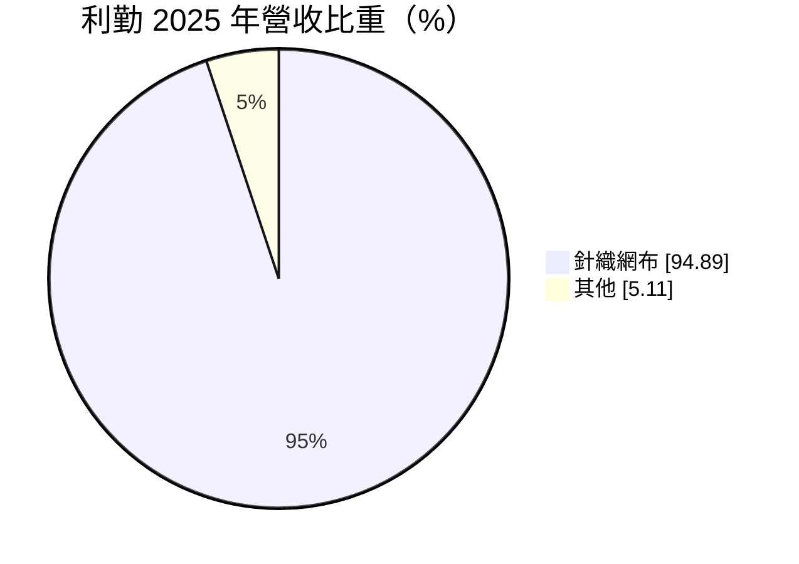
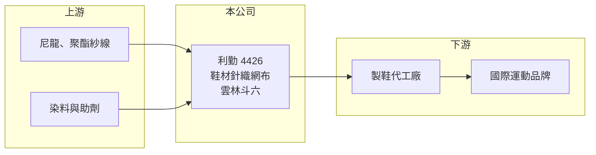

# 4426 利勤

> 上市｜[[產業索引-紡織纖維|紡織纖維]]｜上市（櫃）日期 2011/12/16

# 第一章：企業模式與商業藍圖

> [!info] 撰寫說明
> 精簡版，由 Claude 依公開資料整理，架構比照 [[2330台積電]]，資料截至 2026-10-08。來源：富邦 MoneyDJ 財務比率年表（2018 至 2025 年）與基本資料（2025 年營收比重）；證交所開放資料快照（基本資料、2026 年上半年資產負債與損益、2025 年度股利、每月營收）。產品應用、客戶與海外據點中憑記憶的部分已標「待校對」，營收金額由每股營業額與成長率推算。#待校對

利勤實業成立於 1997 年 9 月、2011 年 12 月上市，總部與工廠在雲林縣斗六工業區，董事長洪文耀。它專做針織網布，主要用於運動鞋鞋面，曾經是毛利率三成、營業利益率二成的高獲利利基廠，但 2020 年後營收大幅萎縮並轉為虧損，至今尚未恢復，是觀察「利基型供應商失去訂單後如何調整」的案例。

- **核心業務：** 利勤 2025 年營收有 94.89% 來自[[針織網布]]，主要應用是運動鞋的鞋面與內裡，包括具立體結構、透氣與支撐功能的三明治網布（應用細節待校對）。這類鞋材要配合品牌的鞋款開發，從打樣到量產需要長時間驗證，一旦進入品牌指定的材料名單，就能隨鞋款熱賣取得大量訂單。
- **營收結構：** 依每股營業額與營收成長率推算，2019 年營收約 23 億元（推算），2020 與 2021 年連續兩年各年減約 47%，2021 年只剩約 6.4 億元（推算）；2022 年回升到約 14 億元，之後又逐年下滑到 2025 年約 8.8 億元（推算）。2026 年 1 至 8 月累計營收 6.22 億元，年增約 6.5%，規模仍遠低於 2019 年高峰。
- **營運據點：** 生產集中在雲林斗六廠（海外布局待校對）。2026 年第二季非流動資產約 34.2 億元、占總資產 83%，而年營收不到 10 億元，代表公司持有的廠房設備與土地遠大於目前營收所需，產能利用率偏低（推估）。
- **長期方向：** 利勤的長期關鍵在於能否重新打入品牌的主力鞋款，或把針織技術延伸到其他應用，讓龐大的固定資產重新產生報酬。總經理一職在證交所資料中顯示「待補」，經營團隊的調整也是觀察公司轉型方向的指標。

# 第二章：護城河深度與競爭優勢

利勤曾經擁有鞋材利基市場的護城河，但近年的虧損顯示，依附少數品牌與鞋款的護城河並不穩固。

- **競爭優勢：** 鞋面網布需要配合品牌的設計開發，供應商要具備快速打樣、穩定色差與物性測試的能力，並通過品牌的材料認證，這構成一定的[[轉換成本]]。2018 至 2019 年利勤的毛利率達 28% 至 32%，證明它曾在這個利基市場中享有定價能力。
- **主要對手：** 鞋材網布的競爭者包括台灣的 [[1460宏遠]]、[[9938百和]] 等鞋材與布料廠，以及中國、越南的鞋材供應商；品牌的鞋面技術若轉向其他材料（例如一體成型的編織鞋面），也會取代傳統網布需求。
- **觀察重點：** 2024 與 2025 年毛利率為 -3.60% 與 -18.51%，代表售價已低於生產成本，主因應是產能利用率過低、固定成本無法分攤（推估）。觀察重點是毛利率何時轉正，以及營收能否回到 15 億元以上，讓既有產能重新發揮效益。

# 第三章：財務體質與盈利規模

資料日期：2026-10-08，表格是撰寫當時的快照；最新月營收、毛利率、累計 EPS 由自動排程寫在本筆記的屬性欄位（月營收、毛利率、累計EPS 等）。#待校對

利勤從高獲利的利基廠，轉變為連續六年虧損的公司，財務數字的落差非常大。

| 年度 | 營收（億元） | [[毛利率]] | [[營業利益率]] | EPS（元） | [[ROE]] |
|---|---|---|---|---|---|
| 2019 | 約 23.0（推算） | 32.24% | 21.35% | 2.26 | 11.44% |
| 2021 | 約 6.4（推算） | -41.87% | -67.82% | -2.15 | -12.72% |
| 2022 | 約 14.0（推算） | 8.88% | -11.34% | -0.46 | -2.93% |
| 2023 | 約 12.9（推算） | 17.97% | -1.70% | -0.24 | -1.57% |
| 2024 | 約 9.7（推算） | -3.60% | -28.31% | -1.36 | -9.28% |
| 2025 | 約 8.8（推算） | -18.51% | -44.31% | -2.94 | -23.65% |

註：2025 年營收以每股營業額 5.10 元乘以約 1.73 億股推算，其他年度依 MoneyDJ 營收成長率回推；2019 年列出作為高峰期對照。2026 年上半年營收 4.37 億元、毛利率 -5.75%、營業利益率 -26.28%、EPS -0.78 元（證交所資料）。

- **長期指標：** 2021 至 2025 年營收年複合成長率約 8.2%（推算），但這是從 2021 年的谷底起算；若與 2019 年相比，營收萎縮超過六成。近 5 年平均 [[ROE]] 約 -10.0%（推算）。2025 年度可分配盈餘為負（約 -2.59 億元），未配發股利；每股淨值從 2019 年的 20.64 元降到 2025 年的 10.85 元，長期虧損已侵蝕近一半淨值。
- **[[ROIC]] 與 [[WACC]]：** 2025 年營業損失約 3.90 億元（營業利益率 -44.31% × 營收約 8.8 億元，虧損不計稅盾），投入資本約 29.3 億元（2026 年第二季權益總計 17.44 億元，加上以總負債 23.72 億元的一半推估的有息負債約 11.9 億元），ROIC 約 -13.3%（推算）。WACC 約 5.6%（推算：無風險利率 1.75%、市場風險溢酬 6%、因虧損與槓桿較高 β 取 1.0，股東權益成本 7.75%；稅前負債成本 3%、稅率 20%；權益比重約 59%）。ROIC 為負且與 WACC 相差近 19 個百分點，代表龐大的資產目前正在毀損股東價值；相對地，2019 年營業利益率 21.35%、ROE 11.44% 時，ROIC 應明顯高於資金成本（推估）。
- **財務特色：** 2026 年第二季負債比率約 58%（負債 23.72 億元 ÷ 資產 41.16 億元），非流動負債 15.11 億元，推估主要為長期借款。每股現金流量 2025 年為 -1.72 元，本業已無法自給現金，若虧損持續，可能需要增資或處分資產來支應。股價淨值比約 0.75 倍。

# 第四章：總體風險與地緣政治

利勤的風險集中在客戶集中、產能閒置與財務壓力三方面。

- **產業週期：** 運動鞋材料跟著國際品牌的庫存週期與鞋款生命週期走，品牌去化庫存或熱賣鞋款退燒時，上游鞋材訂單會被放大縮減，形成[[長鞭效應]]。2020 至 2021 年營收連續腰斬就是這種效應的極端例子。
- **營運風險：** 鞋材供應商的訂單高度依賴少數品牌與鞋款（待校對），一旦主力鞋款換用其他材料或供應商，營收就會大幅下滑。固定資產龐大而營收不足，折舊與人事成本無法分攤，使毛利率持續為負。
- **其他風險：** 負債比率接近六成且現金流為負，利率上升與銀行授信條件都會影響營運；原料尼龍、聚酯紗價格隨原油波動；品牌產地逐漸集中在越南、印尼，台灣生產的鞋材在運費與交期上較不利。

# 專有名詞解析

## 金融

- **[[ROIC]]**：投入資本報酬率，稅後營業利益除以股東權益加有息負債，衡量本業運用資本的效率。
- **[[WACC]]**：加權平均資金成本，股東與債權人要求報酬率的加權平均，是 ROIC 要超越的門檻。

## 產業

- **[[針織網布]]**：以針織方式織成、具孔洞與透氣性的布料，常用於運動鞋鞋面、內裡與運動服。
- **[[轉換成本]]**：客戶更換供應商時需付出的時間、金錢與風險，轉換成本愈高，供應商的客戶黏著度愈高。
- **[[長鞭效應]]**：終端需求的小幅變動沿供應鏈往上游傳遞時被逐級放大，造成上游庫存與訂單劇烈波動。

# 核心供應鏈

- 上游：紗線供應商如 [[1409新纖]]、[[1447力鵬]]、[[1326台化]]（是否為利勤供應商未查得）。
- 下游／客戶：製鞋代工廠如 [[9904寶成]]、[[9910豐泰]]、[[9802鈺齊-KY]]（是否為利勤客戶待校對），以及其背後的國際運動品牌。
- 同業：[[1460宏遠]]、[[9938百和]]。

## 最新新聞
<!-- news:start -->
<!-- news:end -->

## 相關連結
- [公開資訊觀測站](https://mopsov.twse.com.tw/mops/web/t05st03?step=1&firstin=1&co_id=4426)
- [Goodinfo](https://goodinfo.tw/tw/StockDetail.asp?STOCK_ID=4426)
- [Yahoo 股市](https://tw.stock.yahoo.com/quote/4426)
- [鉅亨網新聞](https://www.cnyes.com/twstock/4426/news)
