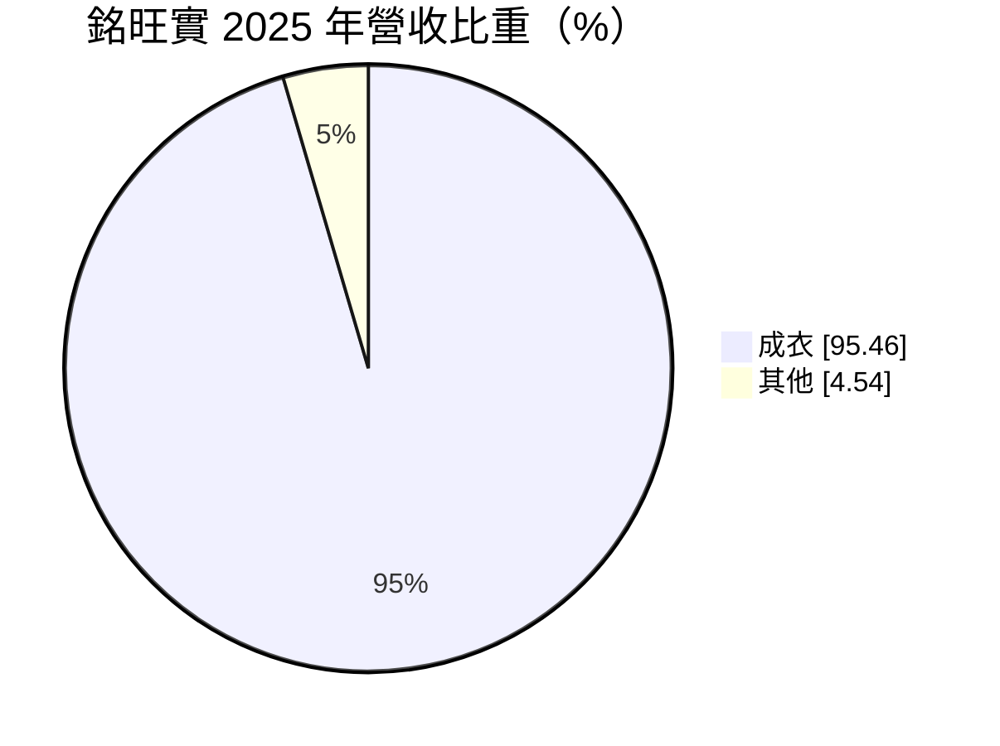
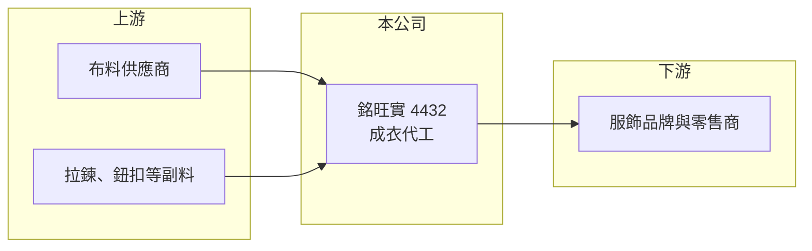

# 4432 銘旺實

> 上櫃｜[[產業索引-紡織纖維|紡織纖維]]｜上市（櫃）日期 2012/11/26

# 第一章：企業模式與商業藍圖

> [!info] 撰寫說明
> 精簡版，由 Claude 依公開資料整理，架構比照 [[2330台積電]]，資料截至 2026-10-08。來源：富邦 MoneyDJ 財務比率年表（2018 至 2025 年）與基本資料（2025 年營收比重）；櫃買中心開放資料快照（基本資料、2026 年上半年資產負債與損益、本益比殖利率、每月營收）。公開資料有限，產品類型、生產據點與客戶這次未查得，營收金額由每股營業額與成長率推算。#待校對

銘旺實業成立於 1986 年 2 月、2012 年 11 月上櫃，總部在新北市五股，董事長陳盈璇、總經理呂清裕。它是以成衣為主的中小型代工廠，年營收約 10 至 15 億元，近年營收逐步縮小，但帳上累積了大量流動資產，財務結構相當保守。

- **核心業務：** 銘旺實 2025 年營收有 95.46% 來自成衣，屬於替品牌客戶生產的[[成衣代工]]模式，具體品類（針織或梭織、運動或休閒）這次未查得。成衣代工的利潤來自工廠效率與接單規模，代工廠本身不負責品牌行銷，因此[[毛利率]]通常在 15% 至 25% 之間。
- **營收結構：** 依每股營業額與營收成長率推算，2018 年營收約 19.9 億元（推算），2022 年約 15.4 億元，2025 年降到約 10.9 億元（推算）。2026 年 1 至 8 月累計營收 6.49 億元，年減約 15%，營收規模呈現長期縮小的趨勢。
- **營運據點：** 公司登記在新北市五股，海外生產據點這次未查得。資產負債表中的其他權益約 -0.81 億元，通常來自海外子公司的外幣換算差額，顯示公司在海外設有營運據點（推估）。成衣是勞力密集產業，台灣成衣廠的生產多已移往東南亞。
- **長期方向：** 營收逐年縮小、帳上流動資產超過 15 億元，代表公司目前的資本配置偏向保守，較少擴充產能。2026 年上半年[[業外收益]]達 1.62 億元，遠大於本業，來源這次未查得（推估包含處分資產或投資利益），公司是否藉此調整業務結構，是長期觀察的重點。

# 第二章：護城河深度與競爭優勢

銘旺實的規模在台灣成衣代工業中偏小，競爭力主要來自長期客戶關係與穩健財務，而非規模優勢。

- **競爭優勢：** 2022 至 2025 年毛利率維持在 22% 至 25%，在成衣代工中屬於不差的水準，代表產品組合或客戶具有一定的利潤空間。財務幾乎沒有負債，讓公司在景氣低迷時有能力維持營運與客戶關係，這對講究長期配合的品牌供應鏈而言是一項優勢。
- **主要對手：** 台灣成衣代工同業包括 [[1477聚陽]]、[[1476儒鴻]]、[[1451年興]]、[[4438廣越]]、[[4414如興]]，國際上則有中國、越南、孟加拉的大型成衣集團。這些同業規模多半大上數倍到數十倍，在接大品牌訂單與分散產地方面更具優勢。
- **觀察重點：** [[營業利益率]]從 2022 年的 9.04% 一路降到 2025 年的 3.28%，2026 年上半年接近零，顯示營收縮小後營業費用的負擔變重。若營收無法止跌回升，本業獲利將持續被壓縮，公司價值會更依賴帳上資產。

# 第三章：財務體質與盈利規模

資料日期：2026-10-08，表格是撰寫當時的快照；最新月營收、毛利率、累計 EPS 由自動排程寫在本筆記的屬性欄位（月營收、毛利率、累計EPS 等）。#待校對

銘旺實的財務特徵是「營收縮小、毛利尚可、資產充裕」，本業獲利能力近年逐步下滑。

| 年度 | 營收（億元） | [[毛利率]] | [[營業利益率]] | EPS（元） | [[ROE]] |
|---|---|---|---|---|---|
| 2021 | 約 13.5（推算） | 7.55% | -5.89% | -2.04 | -9.08% |
| 2022 | 約 15.4（推算） | 21.88% | 9.04% | 3.41 | 14.76% |
| 2023 | 約 11.7（推算） | 23.96% | 7.79% | 1.92 | 7.52% |
| 2024 | 約 11.2（推算） | 25.37% | 6.77% | 2.64 | 9.54% |
| 2025 | 約 10.9（推算） | 22.62% | 3.28% | 0.88 | 3.06% |

註：2025 年營收以每股營業額 21.53 元乘以約 5,059 萬股推算，其他年度依 MoneyDJ 營收成長率回推。2026 年上半年營收 4.49 億元、營業利益約 4 萬元、業外收益 1.62 億元、EPS 2.96 元（櫃買中心資料）。

- **長期指標：** 2021 至 2025 年營收年複合成長率約 -5.2%（推算），近 5 年平均 [[ROE]] 約 5.2%（推算）。櫃買中心資料顯示最近一年度現金股利 0.4 元，約為 2025 年 EPS 0.88 元的 45%。每股現金流量 2022 至 2024 年皆為正（4.45 至 6.20 元），2025 年降到 0.01 元，現金創造能力隨本業轉弱。
- **[[ROIC]] 與 [[WACC]]：** 2025 年稅後營業利益約 0.29 億元（營業利益率 3.28% × 營收約 10.9 億元 × 0.8），投入資本約 17.1 億元（2026 年第二季股東權益 15.77 億元，加上以總負債 2.69 億元的一半推估的有息負債約 1.34 億元），ROIC 約 1.7%（推算）。WACC 約 6.2%（推算：無風險利率 1.75%、市場風險溢酬 6%、β 取紡織同業常見值 0.8，股東權益成本 6.55%；稅前負債成本 2.5%、稅率 20%；權益比重約 92%）。2022 年 ROIC 約 6.5%（推算）時大致與 WACC 持平，之後持續低於資金成本；ROIC 偏低的另一原因是權益中有大量流動資產閒置，分母被放大。
- **財務特色：** 2026 年第二季負債比率約 15%（負債 2.69 億元 ÷ 資產 18.46 億元），流動資產 15.89 億元是流動負債 2.54 億元的 6 倍以上，財務非常保守。股價淨值比約 0.49 倍、本益比約 3.2 倍（含業外收益），市場對其本業前景與資金運用效率的評價偏低。

# 第四章：總體風險與地緣政治

銘旺實的風險主要來自營收長期縮小與成衣代工的產業壓力。

- **產業週期：** 成衣代工跟著歐美品牌的庫存週期走，2023 年營收年減約 24%，就是品牌去化庫存時的典型表現。規模較小的代工廠在品牌整併供應商時，往往是最先被縮減訂單的一群。
- **營運風險：** 營收持續下滑而營業費用相對固定，使營業利益率逐年下降；2026 年上半年本業已接近損益兩平，獲利幾乎全靠業外。若業外收益屬一次性，未來 EPS 可能大幅回落。
- **其他風險：** 成衣訂單以美元計價，新台幣升值會壓縮毛利；美國對東南亞各國的關稅變化會影響品牌下單地點；品牌對工廠勞動條件、碳排與化學品管理的稽核要求日益提高，增加小型代工廠的合規成本。

# 專有名詞解析

## 金融

- **[[ROIC]]**：投入資本報酬率，稅後營業利益除以股東權益加有息負債，衡量本業運用資本的效率。
- **[[WACC]]**：加權平均資金成本，股東與債權人要求報酬率的加權平均，是 ROIC 要超越的門檻。
- **[[業外收益]]**：本業以外的收入，例如利息、投資收益或處分資產利益，通常不具持續性。

## 產業

- **[[成衣代工]]**：替服飾品牌依其設計與規格生產成衣，不自有品牌，利潤來自製造效率與接單規模。

# 核心供應鏈

- 上游：布料與副料供應商，名單未查得；布料廠如 [[1460宏遠]]、[[1434福懋]]、副料廠 [[9938百和]] 可作參考。
- 下游／客戶：服飾品牌與零售商，客戶名單未查得。
- 同業：[[1477聚陽]]、[[1476儒鴻]]、[[1451年興]]、[[4438廣越]]、[[4414如興]]。

## 最新新聞
<!-- news:start -->
<!-- news:end -->

## 相關連結
- [公開資訊觀測站](https://mopsov.twse.com.tw/mops/web/t05st03?step=1&firstin=1&co_id=4432)
- [Goodinfo](https://goodinfo.tw/tw/StockDetail.asp?STOCK_ID=4432)
- [Yahoo 股市](https://tw.stock.yahoo.com/quote/4432)
- [鉅亨網新聞](https://www.cnyes.com/twstock/4432/news)
