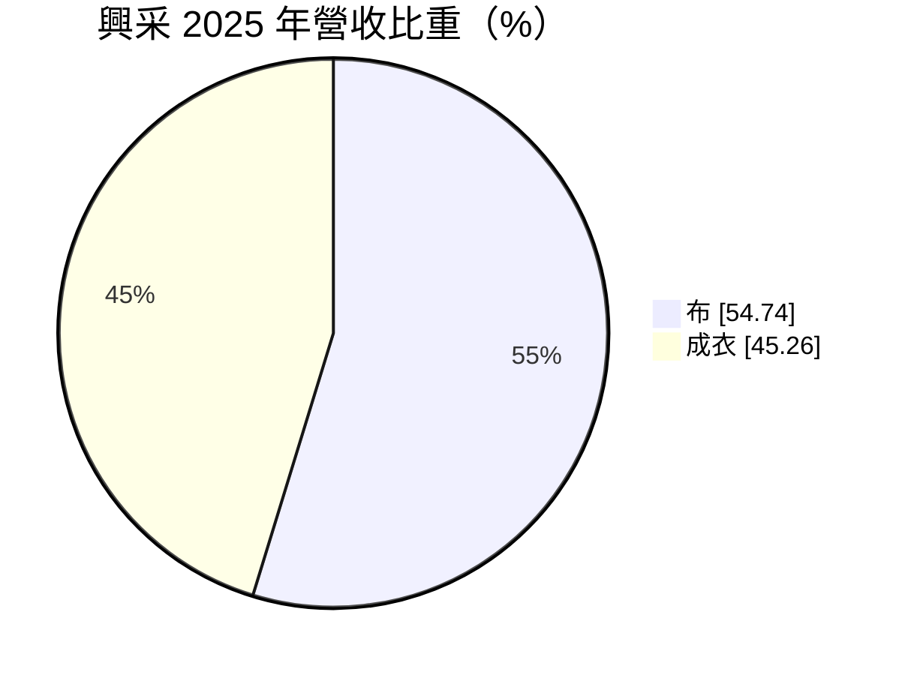
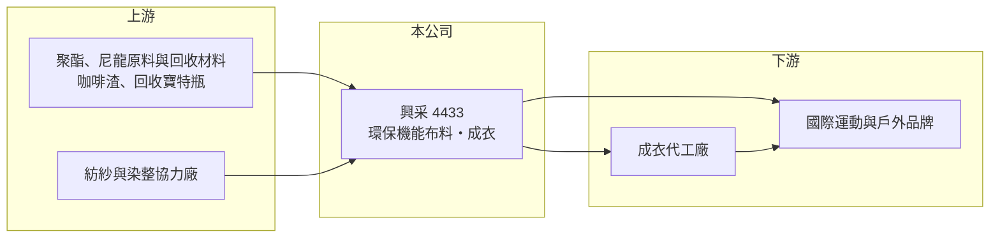

# 4433 興采

> 上櫃｜[[產業索引-紡織纖維|紡織纖維]]｜上市（櫃）日期 2014/11/03

# 第一章：企業模式與商業藍圖

> [!info] 撰寫說明
> 精簡版，由 Claude 依公開資料整理，架構比照 [[2330台積電]]，資料截至 2026-10-08。來源：富邦 MoneyDJ 財務比率年表（2018 至 2025 年）與基本資料（2025 年營收比重）；櫃買中心開放資料快照（基本資料、2026 年上半年資產負債與損益、本益比殖利率、每月營收）。產品技術、品牌客戶與產地中憑記憶的部分已標「待校對」；年度營收金額推算結果與月營收對不上，表格中寫「未查得」。#待校對

興采實業成立於 1989 年 3 月、2014 年 11 月上櫃，總部在新北市新莊，董事長陳國欽、總經理黃松筠。它以環保機能布料聞名，代表性技術是把回收咖啡渣融入紗線的咖啡紗（待校對），並由布料延伸到成衣，是台灣少數以自有材料技術與品牌形象接單的布料公司。不過近年公司大舉擴張資產、負債升高，本業獲利卻偏薄，資本效率成為最大課題。

- **核心業務：** 2025 年營收中布料占 54.74%、成衣占 45.26%。興采的布料主打[[機能性布料]]與回收再生材料，例如以咖啡渣製成的紗線具備除臭、快乾與抗紫外線等特性（待校對），供應國際運動與戶外品牌。成衣業務則讓公司能替品牌提供從布料到成品的整合服務，提高單一客戶的營收貢獻。
- **營收結構：** MoneyDJ 資料顯示營收在 2020 與 2021 年分別成長 33% 與 37%，2023 年衰退約 7%，2024 與 2025 年再分別成長約 8% 與 12%。2026 年 1 至 8 月累計營收 16.05 億元，年減約 19%，8 月單月年減約 46%，營收在 2026 年明顯轉弱。
- **營運據點：** 總部位於新北市新莊，布料生產與成衣代工據點分布這次未查得（推估成衣主要在東南亞生產）。2026 年第二季非流動資產約 45.4 億元，占總資產七成，遠高於一般布料公司的資產結構，可能包含總部大樓、廠房土地或長期投資（細節待校對）。
- **長期方向：** 歐美品牌對回收材質、碳足跡與化學品管理的要求愈來愈嚴格，長期而言有利於掌握[[循環經濟]]材料技術的布料商。興采的方向是以環保材料技術為核心，向品牌提供布料與成衣的一站式服務；但近年的資產擴張需要轉化為更高的營收與獲利，才能證明這條路線的資本報酬。

# 第二章：護城河深度與競爭優勢

興采的護城河來自環保材料技術與品牌形象，但這些優勢尚未反映在穩定的高利潤上。

- **競爭優勢：** 擁有專利或獨特製程的環保紗線，能讓品牌在行銷上講出永續故事，這種差異化比單純比價的規格布更有黏著度。興采長期維持約 20% 至 23% 的[[毛利率]]，比一般紡織中游高，顯示材料技術確實帶來一定的溢價。
- **主要對手：** 機能布料方面的台灣同業有 [[1460宏遠]]、[[1434福懋]]、[[1464得力]]、[[1402遠東新]]，成衣方面則有 [[1477聚陽]]、[[1476儒鴻]]。遠東新在回收聚酯規模上遠大於興采，宏遠也積極發展環保機能布，環保題材本身已不是獨占優勢。
- **觀察重點：** [[營業利益率]]長期只有 1% 至 4.5%，毛利與營業利益之間的差距大，代表研發、行銷與管理費用偏高。2026 年上半年營業利益率約 -12.4%，本業轉為虧損，觀察重點是營收能否回穩，以及費用結構能否配合營收調整。

# 第三章：財務體質與盈利規模

資料日期：2026-10-08，表格是撰寫當時的快照；最新月營收、毛利率、累計 EPS 由自動排程寫在本筆記的屬性欄位（月營收、毛利率、累計EPS 等）。#待校對

興采的毛利率穩定，但營業利益率偏低、負債比率持續上升，資本效率是財務面的主要問題。

| 年度 | 營收（億元） | [[毛利率]] | [[營業利益率]] | EPS（元） | [[ROE]] |
|---|---|---|---|---|---|
| 2021 | 未查得 | 19.97% | 2.93% | 1.21 | 3.13% |
| 2022 | 未查得 | 20.78% | 4.39% | 2.51 | 4.94% |
| 2023 | 未查得 | 21.79% | 1.27% | 0.53 | 1.17% |
| 2024 | 未查得 | 20.84% | 1.05% | 0.72 | 1.81% |
| 2025 | 未查得 | 21.18% | 4.55% | 1.06 | 2.78% |

註：以 MoneyDJ 2025 年每股營業額 59.73 元乘以現有股數約 6,130 萬股約得 36.6 億元，但 2025 年 1 至 8 月月營收累計只有 19.75 億元，兩者對不上，因此不採用；2025 年營收推估介於 30 億至 37 億元之間。2026 年上半年營收 11.12 億元、毛利率約 12.4%、營業利益率約 -12.4%、EPS -1.38 元（櫃買中心資料）。

- **長期指標：** 近 5 年平均 [[ROE]] 約 2.8%（推算），只有 2020 年曾達 18.51%（EPS 7.82 元）。櫃買中心資料顯示最近一年度現金股利 1.0 元，約等於 2025 年 EPS 1.06 元，配息率接近百分之百。每股現金流量 2024 與 2025 年分別為 -1.90 元與 -0.29 元，本業加上投資的現金需求超過營業現金流入，配息部分仰賴借款或既有資金。
- **[[ROIC]] 與 [[WACC]]：** 2025 年稅後營業利益約 1.1 億至 1.3 億元（營業利益率 4.55% × 營收 30 億至 36.6 億元 × 0.8），投入資本約 42 億元（2026 年第二季權益總計 19.15 億元，加上以總負債 45.63 億元的一半推估的有息負債約 22.8 億元），ROIC 約 2.6% 至 3.2%（推算）。WACC 約 4.4%（推算：無風險利率 1.75%、市場風險溢酬 6%、因槓桿較高 β 取 0.9，股東權益成本 7.15%；稅前負債成本 2.5%、稅率 20%；權益比重約 46%）。ROIC 低於 WACC，且 2026 年上半年本業轉虧，代表近年擴張的資產尚未帶來足夠報酬，公司目前並未為股東創造超額價值。
- **財務特色：** 負債比率從 2018 年的 45.98% 一路升到 2025 年的 71.16%，2026 年第二季約 70%（負債 45.63 億元 ÷ 資產 64.79 億元），流動負債 24.62 億元高於流動資產 19.39 億元，財務槓桿在紡織股中偏高。2026 年上半年業外收益 1.49 億元、歸屬非控制權益淨利 0.64 億元，但歸屬母公司仍虧損 0.83 億元，代表獲利集中在有外部股東的子公司，母公司股東分到的較少。

# 第四章：總體風險與地緣政治

興采的風險集中在高負債、資產報酬偏低與營收轉弱。

- **產業週期：** 機能布料與成衣跟著國際運動與戶外品牌的庫存週期走，品牌去化庫存時訂單會被放大縮減，也就是[[長鞭效應]]。2026 年營收年減近兩成，若下滑持續，在高固定成本與高負債下，虧損會被放大。
- **營運風險：** 負債比率約七成、流動比率低於 100%，公司需要穩定的銀行融資支撐營運；若獲利不佳導致授信收緊，資金壓力會迅速浮現。大量非流動資產的報酬率偏低，若無法提升資產使用效率，ROE 將長期停留在低檔。
- **其他風險：** 環保材料的溢價取決於品牌的永續策略，若品牌削減永續預算或改用成本更低的回收聚酯，興采的差異化優勢會縮小；外銷以美元計價帶來匯率風險；美國關稅政策也會影響成衣產地與訂單分配。

# 專有名詞解析

## 金融

- **[[ROIC]]**：投入資本報酬率，稅後營業利益除以股東權益加有息負債，衡量本業運用資本的效率。
- **[[WACC]]**：加權平均資金成本，股東與債權人要求報酬率的加權平均，是 ROIC 要超越的門檻。

## 產業

- **[[機能性布料]]**：具備吸濕排汗、防水透氣、抗紫外線等功能的布料，主要用於運動與戶外服飾。
- **[[循環經濟]]**：把廢棄物回收再製成原料重新使用的生產模式，例如以回收寶特瓶或咖啡渣製成紗線。
- **[[長鞭效應]]**：終端需求的小幅變動沿供應鏈往上游傳遞時被逐級放大，造成上游庫存與訂單劇烈波動。

# 核心供應鏈

- 上游：化纖原料與回收聚酯供應商如 [[1326台化]]、[[1303南亞]]、[[1402遠東新]]（是否為興采供應商未查得）。
- 下游／客戶：國際運動與戶外品牌及其成衣代工廠，客戶名單待校對。
- 同業：[[1460宏遠]]、[[1434福懋]]、[[1464得力]]、[[1402遠東新]]。

## 最新新聞
<!-- news:start -->
<!-- news:end -->

## 相關連結
- [公開資訊觀測站](https://mopsov.twse.com.tw/mops/web/t05st03?step=1&firstin=1&co_id=4433)
- [Goodinfo](https://goodinfo.tw/tw/StockDetail.asp?STOCK_ID=4433)
- [Yahoo 股市](https://tw.stock.yahoo.com/quote/4433)
- [鉅亨網新聞](https://www.cnyes.com/twstock/4433/news)
