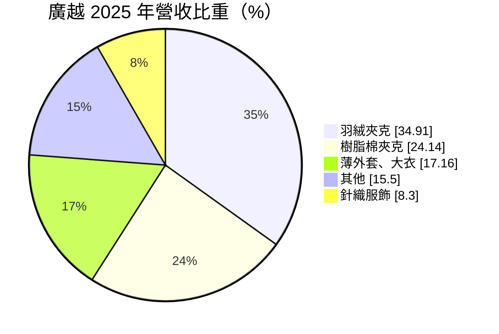
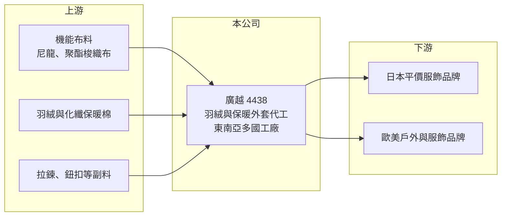

# 4438 廣越

> 上市｜[[產業索引-紡織纖維|紡織纖維]]｜上市（櫃）日期 2016/10/18

# 第一章：企業模式與商業藍圖

> [!info] 撰寫說明
> 精簡版，由 Claude 依公開資料整理，架構比照 [[2330台積電]]，資料截至 2026-10-08。來源：富邦 MoneyDJ 財務比率年表（2018 至 2025 年）與基本資料（2025 年營收比重）；證交所開放資料快照（基本資料、2026 年上半年資產負債與損益、2025 年度股利、每月營收）。品牌客戶與海外工廠分布為憑記憶整理，已標「待校對」；營收金額由每股營業額與成長率推算。#待校對

廣越企業成立於 1995 年 10 月、2016 年 10 月上市，總部在台北市內湖，董事長吳朝筆、總經理唐湘梅。它是台灣以羽絨外套與保暖外套為主力的成衣代工廠，年營收近兩百億元，客戶以國際平價服飾與戶外品牌為主。外套類產品單價高、季節性強，讓廣越的營收集中在下半年，獲利也跟著主要客戶的訂單起伏。

- **核心業務：** 2025 年營收中[[羽絨]]夾克占 34.91%、樹脂棉（化纖棉）夾克占 24.14%、薄外套與大衣占 17.16%，外套類合計超過七成五，針織服飾占 8.30%。保暖外套的車縫、充絨與防水壓膠工序複雜，對工廠的技術與品管要求比一般 T 恤高，因此單價與進入門檻也較高。
- **營收結構：** 依每股營業額與成長率推算，2025 年營收約 196 億元（推算），2022 年約 202 億元（推算）為近年高點。客戶結構方面，主要客戶包括日本平價服飾大廠 Fast Retailing（UNIQLO）與歐美戶外品牌（客戶名單與比重待校對），大客戶集中度高是廣越的重要特徵。2026 年 1 至 8 月累計營收 128.0 億元，年增約 4%。
- **營運據點：** 生產據點主要在越南、柬埔寨、印尼等東南亞國家（待校對），台灣總部負責接單、開發與管理。外套類成衣勞力密集，產地的工資、關稅與政治穩定度，直接決定廣越的成本與客戶下單意願。
- **長期方向：** 品牌持續推動「[[中國加一]]」與產地分散，具備多國產能的代工廠較能承接轉單。廣越的長期方向是擴大東南亞產能、提高機能外套比重，並分散客戶以降低對單一品牌的依賴（策略細節待校對）。

# 第二章：護城河深度與競爭優勢

廣越的護城河來自外套類代工的技術門檻與大客戶關係，但大客戶集中也是它最大的弱點。

- **競爭優勢：** 羽絨與機能外套需要處理充絨均勻度、防鑽絨、防水壓膠等工序，經驗不足的工廠良率低，品牌更換供應商的風險高，因此形成一定的[[轉換成本]]。與國際大型平價品牌長期合作，讓廣越的訂單量大而穩定，工廠排程與採購也較有效率。
- **主要對手：** 台灣成衣代工同業包括 [[1477聚陽]]、[[1476儒鴻]]、[[1451年興]]、[[4414如興]]，其中與廣越最接近的是同樣承接外套訂單的業者；國際上則有中國、越南的大型外套代工集團。聚陽與儒鴻的營業利益率長期高於廣越，主要差在產品組合與客戶分散程度。
- **觀察重點：** [[營業利益率]]從 2019 年的 8.50% 降到 2024 年的 2.85%，2025 年回升到 4.07%，2026 年上半年約 2.35%。若營業利益率能回到 6% 以上，代表產品組合與議價能力改善；若長期停在 3% 左右，則顯示大客戶壓價與成本上升壓縮了代工利潤。

# 第三章：財務體質與盈利規模

資料日期：2026-10-08，表格是撰寫當時的快照；最新月營收、毛利率、累計 EPS 由自動排程寫在本筆記的屬性欄位（月營收、毛利率、累計EPS 等）。#待校對

廣越營收規模大、財務穩健，但近三年獲利率下滑，ROE 從 2022 年的高點明顯回落。

| 年度 | 營收（億元） | [[毛利率]] | [[營業利益率]] | EPS（元） | [[ROE]] |
|---|---|---|---|---|---|
| 2021 | 約 131（推算） | 14.37% | 5.26% | 6.10 | 8.78% |
| 2022 | 約 202（推算） | 16.28% | 7.58% | 11.38 | 16.46% |
| 2023 | 約 167（推算） | 15.02% | 5.57% | 7.10 | 9.18% |
| 2024 | 約 166（推算） | 12.72% | 2.85% | 3.89 | 4.77% |
| 2025 | 約 196（推算） | 13.21% | 4.07% | 3.04 | 3.45% |

註：2025 年營收以每股營業額 172.39 元乘以約 1.134 億股推算，其他年度依 MoneyDJ 營收成長率回推；股本曾有變動，推算值僅供參考。2026 年上半年營收 79.40 億元、毛利率 13.51%、營業利益率 2.35%、EPS 2.51 元（證交所資料）。

- **長期指標：** 2021 至 2025 年營收年複合成長率約 10.5%（推算），近 5 年平均 [[ROE]] 約 8.5%（推算），2024 與 2025 年已降到 5% 以下。2025 年度配發現金股利 2.3 元，約為 EPS 3.04 元的 76%；公司章程規定每年至少分配可分配盈餘的 40%，期末未分配盈餘仍有約 22.8 億元，配息能力穩定。每股現金流量 2019、2020、2022、2023 年為正，2021、2024、2025 年為負，現金流隨營運資金與擴產需求波動。
- **[[ROIC]] 與 [[WACC]]：** 2025 年稅後營業利益約 6.4 億元（營業利益率 4.07% × 營收約 196 億元 × 0.8），投入資本約 161 億元（2026 年第二季權益總計 107.24 億元，加上以總負債 107.77 億元的一半推估的有息負債約 53.9 億元），ROIC 約 3.9%（推算）。WACC 約 5.0%（推算：無風險利率 1.75%、市場風險溢酬 6%、β 取紡織同業常見值 0.8，股東權益成本 6.55%；稅前負債成本 2.5%、稅率 20%；權益比重約 67%）。2022 年 ROIC（推算約 9%）明顯高於 WACC，2024 至 2025 年則略低於資金成本，代表本業創造價值的能力隨獲利率下滑而減弱。
- **財務特色：** 2026 年第二季負債比率約 50%（負債 107.77 億元 ÷ 資產 215.02 億元），流動資產 153.53 億元約為流動負債的 1.7 倍，季節性備料使營運資金需求高。資本公積約 37.7 億元、非控制權益約 20.6 億元，代表公司曾以溢價發行新股，且部分子公司有外部股東。2026 年上半年[[業外收益]] 2.67 億元高於營業利益 1.87 億元，業外項目（可能包括匯兌與利息）對 EPS 影響很大（推估）。股價淨值比約 0.73 倍。

# 第四章：總體風險與地緣政治

廣越的風險集中在大客戶依賴、季節性與產地政策。

- **產業週期：** 成衣代工跟著品牌庫存週期走，2023 年營收年減約 18% 即是品牌去化庫存的結果。外套產品高度依賴冬季銷售，暖冬會讓品牌減少追單，隔年訂單也會跟著保守，形成[[長鞭效應]]。
- **營運風險：** 營收集中在少數國際品牌（待校對），大客戶的採購策略、產地調整或壓價，都會直接影響廣越的營收與毛利。羽絨原料價格受禽類供給與疫病影響，價格大漲時若無法轉嫁，會壓縮毛利率。
- **其他風險：** 美國對東南亞各國的關稅調整會改變品牌下單產地；營收以美元計價，新台幣升值會壓縮帳面獲利；品牌對羽絨來源追溯（動物福利認證）、勞工權益與碳排的要求日益嚴格，合規成本持續上升。

# 專有名詞解析

## 金融

- **[[ROIC]]**：投入資本報酬率，稅後營業利益除以股東權益加有息負債，衡量本業運用資本的效率。
- **[[WACC]]**：加權平均資金成本，股東與債權人要求報酬率的加權平均，是 ROIC 要超越的門檻。
- **[[業外收益]]**：本業以外的收入，例如利息、投資收益或處分資產利益，通常不具持續性。

## 產業

- **[[羽絨]]**：鴨、鵝的絨毛，是羽絨外套與寢具的保暖填充材料，價格受禽類供給影響。
- **[[中國加一]]**：品牌商為分散風險，在中國以外再增加至少一個生產基地的供應鏈策略。
- **[[轉換成本]]**：客戶更換供應商時需付出的時間、金錢與風險，轉換成本愈高，供應商的客戶黏著度愈高。
- **[[長鞭效應]]**：終端需求的小幅變動沿供應鏈往上游傳遞時被逐級放大，造成上游庫存與訂單劇烈波動。

# 核心供應鏈

- 上游：機能布料供應商如 [[1434福懋]]、[[1460宏遠]]、[[1464得力]]、[[4433興采]]，副料如 [[9938百和]]（是否為廣越供應商未查得）。
- 下游／客戶：Fast Retailing（UNIQLO）與歐美戶外、服飾品牌（待校對）。
- 同業：[[1477聚陽]]、[[1476儒鴻]]、[[1451年興]]、[[4414如興]]。

## 最新新聞
<!-- news:start（自動產生，請勿手動編輯此範圍） -->
- 2026-10-12 🏛️ 重訊 13:57｜本公司受邀參加寬量國際主辦之「20th QIC CEO Week」｜[觀測站](https://mops.twse.com.tw/mops/#/web/t05st01)
- 2026-10-08 📰 媒體 19:58｜廣越9月、Q3營收均創歷史次高 主要客戶需求仍具支撐｜[鉅亨網](https://news.cnyes.com/news/id/6625649)

完整紀錄：[[4438廣越 新聞]]
<!-- news:end -->

## 相關連結
- [公開資訊觀測站](https://mopsov.twse.com.tw/mops/web/t05st03?step=1&firstin=1&co_id=4438)
- [Goodinfo](https://goodinfo.tw/tw/StockDetail.asp?STOCK_ID=4438)
- [Yahoo 股市](https://tw.stock.yahoo.com/quote/4438)
- [鉅亨網新聞](https://www.cnyes.com/twstock/4438/news)
