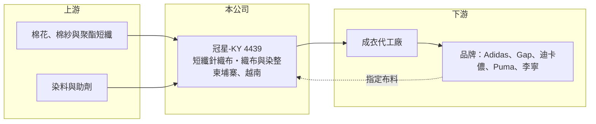

# 4439 冠星-KY

> 上市｜[[產業索引-紡織纖維|紡織纖維]]｜上市（櫃）日期 2019/12/05

# 第一章：企業模式與商業藍圖

> [!info] 撰寫說明
> 精簡版，由 Claude 依公開資料整理，架構比照 [[2330台積電]]，資料截至 2026-10-08。來源：Goodinfo 經營績效年表（2019 至 2025 年）；優分析報導（客戶結構、廠區與擴產）；證交所開放資料快照（基本資料、2026 年第二季資產負債與上半年損益、股利）。產品別與地區別營收比重未查得。#待校對

冠星-KY（以下簡稱冠星）是註冊於開曼群島、2019 年 12 月在台上市的布料廠，董事長由興茂集團控股（代表人林錦茂）擔任，總經理為林經偉。它專做運動休閒品牌使用的短纖針織布，年營收約 50 至 75 億元，是台股中少數以 Adidas 為最大客戶的布廠。

- **核心業務：** 冠星是[[短纖]]布料製造商，同時擁有織布與[[染整]]產能，主力產品是[[棉混紡]]針織布，用在運動休閒外套、帽T與內衣。短纖布手感柔軟、透氣，偏向休閒與生活風格服飾，和以聚酯長纖為主的機能布市場有所區隔。
- **營收結構：** 依優分析報導，最大客戶是 Adidas，其次為 Gap、迪卡儂、Puma、李寧，近年再開發 American Eagle、Carhartt 等新品牌，非主要品牌的營收占比由 16% 提高到 26%。客戶分散度提升代表公司降低對單一品牌庫存週期的依賴，是近年經營上最重要的改變。產品別比重未查得。
- **營運模式：** 冠星採[[品牌指定供應商]]模式：先向品牌商提案布料或依需求打樣，品牌確認後再指定成衣廠向冠星下單。因此真正的「客戶」是品牌，成衣廠只是付款與裁製的一方，布料一旦被選入品牌的季度產品線，就有一段時間的穩定訂單。
- **營運據點與產能：** 自有產能在柬埔寨，2024 年起新增越南廠，中國則以外包產能為主（另有子公司台巨紡織(上海)）。依報導，越南廠在 2025 年達到規模經濟、產能利用率約九成，公司計畫 2026 年再擴增每月 100 萬磅產能（待校對）。東南亞產能比重提高，有助於符合品牌對「中國以外」供應鏈與關稅的要求。
- **長期方向：** 冠星的長期方向是以東南亞產能擴充承接品牌轉單，並在 Adidas 之外擴大第二梯隊品牌。若新客戶能持續放量，營收規模有機會回到並超越 2021 至 2022 年約 74 億元的高點。

# 第二章：護城河深度與競爭優勢

冠星的護城河來自品牌認證、打樣開發能力與東南亞垂直產能，屬於窄護城河，議價能力仍受大品牌牽制。

- **競爭優勢：** 布料要進入國際品牌的指定名單，需要通過品質、環保與社會責任稽核，並長期配合每季的開發打樣，換供應商對品牌有成本與風險。冠星同時有織布與染整，可以控制交期與色差，再加上柬埔寨、越南的產能，符合品牌分散產地的需求。
- **主要對手：** 台灣同業中以針織布與運動品牌為主的有 [[1476儒鴻]]（布料與成衣一條龍）、[[4438廣越]]（成衣）、[[1464得力]]、[[1434福懋]]；國際上則有中國申洲國際、香港聯業製衣等大型垂直整合廠。冠星規模小於這些龍頭，主要以棉混紡短纖的專業定位競爭。
- **觀察重點：** 2024 年營業利益率僅 3.19%、EPS 1.73 元，2025 年回升到 6.01% 與 7.73 元，顯示獲利對越南新廠的利用率與 Adidas 訂單非常敏感。長期觀察新品牌占比能否持續提高，以及新產能開出後毛利率能否站穩 18% 以上。

# 第三章：財務體質與盈利規模

資料日期：2026-10-08，表格是撰寫當時的快照；最新月營收、毛利率、累計 EPS 由自動排程寫在本筆記的屬性欄位（月營收、毛利率、累計EPS 等）。#待校對

冠星的財務特色是營收隨品牌庫存週期大幅波動，但多數年份能維持兩位數 ROE，配息也相當積極。

| 年度 | 營收（億元） | [[毛利率]] | [[營業利益率]] | EPS（元） | [[ROE]] |
|---|---|---|---|---|---|
| 2019 | 73.6 | 17.3% | 7.5% | 13.92 | 23.7% |
| 2020 | 53.9 | 21.7% | 10.3% | 13.25 | 17.5% |
| 2021 | 74.2 | 14.6% | 5.5% | 10.72 | 13.7% |
| 2022 | 74.3 | 17.0% | 7.29% | 11.74 | 16.0% |
| 2023 | 51.9 | 23.9% | 9.62% | 10.82 | 13.2% |
| 2024 | 54.2 | 16.3% | 3.19% | 1.73 | 2.05% |
| 2025 | 70.0 | 17.9% | 6.01% | 7.73 | 8.9% |
| 2026 上半年 | 41.47 | 18.63% | 7.01% | 5.53 | 未查得 |

註：2019 至 2025 年取自 Goodinfo，2026 年上半年取自證交所開放資料。

- **長期指標：** 2020 至 2025 年營收年複合成長率約 5.4%（推算），2021 至 2025 年平均 ROE 約 10.8%（推算）。2025 年度配發現金股利 4 元，配息率約 52%（推算）；Goodinfo 統計其歷年現金股利平均約 4.5 元，屬於願意把盈餘回饋股東的公司。
- **[[ROIC]] 與 [[WACC]]：** 2025 年營業利益約 4.2 億元（70.0 億 × 6.01%），稅後約 3.4 億元。2026 年第二季權益 34.4 億元，總負債 38.7 億元中有息負債未查得，假設約一半（19 億元），投入資本約 53 億元，ROIC 約 6.3%（推算）；以 2026 年上半年營業利益 2.9 億元年化計算約 8.7%（推算）。WACC 以無風險利率 1.75%、市場風險溢酬 6%、β 0.9（紡織同業常見值）、稅前負債成本 3%、稅率 20%、權益比重約 64% 計算約 5.4%（推算）。ROIC 略高於 WACC，代表本業仍在創造價值，但利差不大，要靠新產能利用率提升才能拉開。
- **財務特色：** 2026 年第二季資產 73.1 億元、負債比率約 53%，其中流動負債 31.3 億元占大部分，主要支應原料與應收帳款等營運資金。布料業應收帳款與存貨占用資金多，營收快速成長的年份自由現金流可能轉弱（推估）。

# 第四章：總體風險與地緣政治

冠星的風險集中在大客戶依賴、紡織景氣循環，以及東南亞生產的關稅與匯率變化。

- **產業週期：** 運動休閒服飾有明顯的庫存週期：2022 年下半年起品牌去庫存，冠星 2023 年營收從 74 億元掉到 52 億元，2024 年獲利更跌到近年低點。這類週期大約 2 至 3 年一輪，投資時應以完整週期的平均獲利評估。
- **營運風險：** Adidas 仍是最大客戶，若其產品策略改變或轉向其他布料供應商，對營收影響很大。越南與新擴產能如果遇到訂單不足，折舊與人力成本會直接壓縮利潤，2024 年就是例子。
- **其他風險：** 棉花與化纖原料價格波動會影響毛利；柬埔寨與越南出口美國受[[對等關稅]]稅率影響；美元計價營收受匯率變動；KY 公司的資訊揭露與跨國治理也需要投資人額外留意。

# 專有名詞解析

## 金融

- **[[ROIC]]**：投入資本報酬率，稅後營業利益除以股東權益加有息負債，衡量本業運用資本的效率。
- **[[WACC]]**：加權平均資金成本，股東與債權人要求報酬率的加權平均，是 ROIC 要超越的門檻。

## 產業

- **[[短纖]]**：把纖維切成數公分長再紡成紗，例如棉紗與棉混紡紗，布料手感蓬鬆柔軟，與連續長絲的長纖相對。
- **[[棉混紡]]**：以棉與聚酯、彈性纖維等混合紡紗，兼具棉的舒適與化纖的耐用、彈性，常見於休閒與運動服。
- **[[染整]]**：對布料進行染色、印花與後整理（如防水、抗菌、定型）的工序，耗水耗能高，也是決定布料手感與功能的關鍵。
- **[[品牌指定供應商]]**：國際品牌先選定布料供應商，再要求成衣廠向其採購的模式，布料廠的訂單取決於品牌的選用。
- **[[對等關稅]]**：美國自 2025 年起依各國貿易條件訂定的進口關稅，稅率依國家而異，影響企業的生產地選擇。

# 核心供應鏈

- 上游：棉紗與化纖原料供應商未查得，台灣化纖業者如 [[1402遠東新]]、[[1409新纖]]（是否供貨給冠星未查得）。
- 下游／客戶：品牌 Adidas、Gap、迪卡儂、Puma、李寧、American Eagle、Carhartt；成衣廠名單未查得。
- 同業：[[1476儒鴻]]、[[1464得力]]、[[1434福懋]]、[[4438廣越]]。

## 最新新聞
<!-- news:start -->
<!-- news:end -->

## 相關連結
- [公開資訊觀測站](https://mopsov.twse.com.tw/mops/web/t05st03?step=1&firstin=1&co_id=4439)
- [Goodinfo](https://goodinfo.tw/tw/StockDetail.asp?STOCK_ID=4439)
- [Yahoo 股市](https://tw.stock.yahoo.com/quote/4439)
- [鉅亨網新聞](https://www.cnyes.com/twstock/4439/news)
