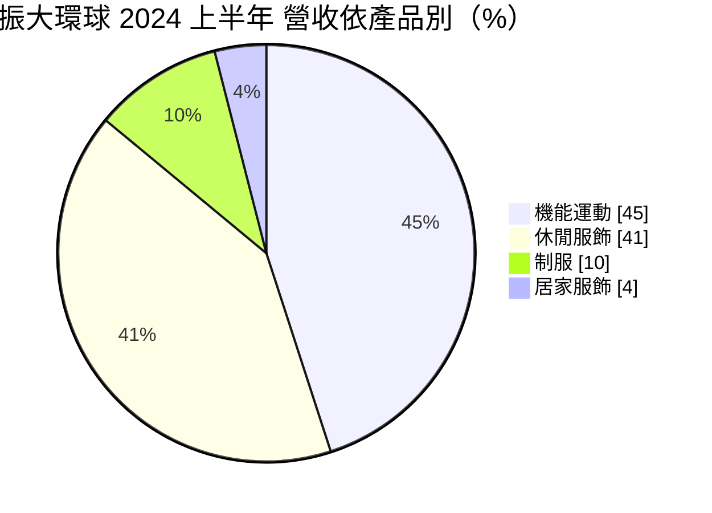
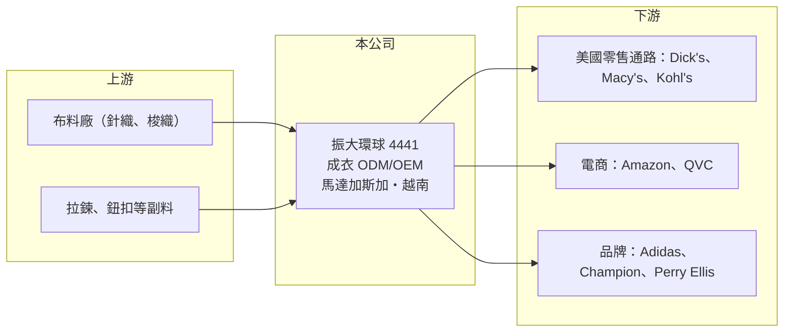

# 4441 振大環球

> 上市｜[[產業索引-紡織纖維|紡織纖維]]｜上市（櫃）日期 2025/09/09

# 第一章：企業模式與商業藍圖

> [!info] 撰寫說明
> 精簡版，由 Claude 依公開資料整理，架構比照 [[2330台積電]]，資料截至 2026-10-08。來源：Goodinfo 經營績效年表（2019 至 2025 年）；優分析報導（產品與通路比重、客戶、馬達加斯加與越南廠）；證交所開放資料快照（基本資料、2026 年第二季資產負債與上半年損益、股利）。營收比重為 2024 年上半年數字。#待校對

振大環球（以下簡稱振大）成立於 1991 年 2 月、2025 年 9 月在證交所上市，總公司在台北市松山區，董事長為許公任，總經理為李炤賢。它是替歐美零售通路與品牌設計並代工成衣的廠商，2025 年營收約 75 億元，特色是生產基地放在非洲馬達加斯加與越南。

- **核心業務：** 振大提供成衣的 [[ODM]] 與 [[OEM]] 服務，產品涵蓋機能運動服、休閒服、制服與居家服。和只依客戶圖樣生產的代工廠不同，振大會協助客戶做款式設計與打樣，再負責布料採購、裁製與出貨的一站式服務。
- **營收結構：** 依優分析整理的 2024 年上半年資料，產品別以機能運動 45%、休閒服飾 41% 為主，制服 10%、居家服飾 4%。通路別方面，實體零售通路占 66%，電商平台 19%，品牌客戶 15%（2023 年僅約 5%），主要市場是美國。
- **主要客戶：** 實體通路包括 Dick's Sporting Goods、Macy's、Kohl's，電商平台有 Amazon、QVC，品牌客戶有 Adidas、Champion、Perry Ellis。以美國百貨與運動用品零售商的自有品牌為主，是振大與多數台灣成衣廠（以國際運動品牌為主）最大的差異。
- **營運據點與產能：** 主要產能在馬達加斯加與越南。馬達加斯加的優勢是勞工成本低，且過去可適用美國 [[AGOA]] 的免關稅待遇；越南廠增設符合 ESG 標準的設備並搭配協力廠，服務日系與歐系客戶。依報導，公司決定擴建馬達加斯加廠，預計 2026 年第一季啟動新產線（待校對）。
- **長期方向：** 長期策略是提高品牌客戶占比、擴充非洲產能，用「低關稅產地」爭取美國客戶轉單。這讓振大在中國以外的成衣供應鏈中有獨特位置，但也讓它高度依賴美國的貿易政策。

# 第二章：護城河深度與競爭優勢

振大的護城河來自非洲與越南的產地布局、設計開發能力，以及與美國大型零售通路的長期關係。

- **競爭優勢：** 美國百貨與運動用品零售商的自有品牌需要大量、多款、價格敏感的成衣，供應商要能快速打樣並準時交貨。振大在馬達加斯加建立的產能在台灣同業中很少見，加上過去的關稅優勢，使它在價格與交期上有差異化。2022 至 2025 年營業利益率維持在 14% 至 16%，明顯高於一般成衣代工廠，代表這個定位確實有獲利能力。
- **主要對手：** 台灣成衣同業包括 [[1477聚陽]]、[[1476儒鴻]]、[[4438廣越]]、[[1451年興]]、[[1449佳和]]，國際上有香港利豐、聯業製衣，以及大量孟加拉、越南代工廠。聚陽與儒鴻以國際品牌為主，振大以美國零售通路為主，客戶重疊度相對有限。
- **觀察重點：** 品牌客戶占比能否持續提升、馬達加斯加新產線的投產效益，以及 AGOA 等美國貿易優惠的延續狀況。這三點決定振大能否維持高於同業的利潤率。

# 第三章：財務體質與盈利規模

資料日期：2026-10-08，表格是撰寫當時的快照；最新月營收、毛利率、累計 EPS 由自動排程寫在本筆記的屬性欄位（月營收、毛利率、累計EPS 等）。#待校對

振大的財務在成衣股中屬於高獲利、高 ROE、高配息的一群，2023 年去庫存期間仍維持 15% 以上的營業利益率。

| 年度 | 營收（億元） | [[毛利率]] | [[營業利益率]] | EPS（元） | [[ROE]] |
|---|---|---|---|---|---|
| 2019 | 53.2 | 16.1% | 8.55% | 7.04 | 26.4% |
| 2020 | 45.6 | 18.5% | 7.91% | 5.51 | 21.5% |
| 2021 | 67.9 | 18.2% | 10.5% | 10.49 | 23.5% |
| 2022 | 77.1 | 23.0% | 14.8% | 18.75 | 31.4% |
| 2023 | 52.5 | 24.3% | 15.5% | 12.33 | 17.4% |
| 2024 | 58.3 | 24.8% | 16.1% | 15.41 | 19.7% |
| 2025 | 74.8 | 23.1% | 14.3% | 14.79 | 15.6% |
| 2026 上半年 | 37.90 | 26.16% | 17.62% | 9.08 | 未查得 |

註：2019 至 2025 年取自 Goodinfo，2026 年上半年取自證交所開放資料。上市前後股本有變動，各年 EPS 基礎不完全相同。

- **長期指標：** 2020 至 2025 年營收年複合成長率約 10.4%（推算），2021 至 2025 年平均 ROE 約 21.5%（推算）。2025 年度擬配現金股利 10.8 元，配息率約 73%（推算），屬於高配息政策。2025 年 ROE 降到 15.6%，部分原因是上市募資讓股東權益增加，而非本業轉弱。
- **[[ROIC]] 與 [[WACC]]：** 2025 年營業利益約 10.7 億元（74.8 億 × 14.3%），稅後約 8.6 億元。2026 年第二季權益 68.8 億元，總負債 30.2 億元幾乎都是流動負債，有息負債未查得，假設約 10 億元，投入資本約 79 億元，ROIC 約 10.9%（推算）；以 2026 年上半年營業利益 6.7 億元年化計算約 13.6%（推算）。WACC 以無風險利率 1.75%、市場風險溢酬 6%、β 0.9（成衣同業常見值）、稅前負債成本 2.5%、稅率 20%、權益比重約 87% 計算約 6.5%（推算）。ROIC 明顯高於 WACC，代表振大長期在創造超額價值。
- **財務特色：** 2026 年第二季資產 99.0 億元、負債比率約 31%，非流動負債只有 0.5 億元，幾乎沒有長期借款，每股淨值 100.79 元。成衣代工以營運資金為主、資本支出相對輕，這是它能維持高配息的原因。

# 第四章：總體風險與地緣政治

振大的最大風險是美國貿易政策與零售通路景氣，其次是非洲產地的營運與政治穩定度。

- **產業週期：** 美國百貨與零售商的庫存週期直接決定下單量，2023 年營收從 77 億元降到 52 億元就是零售去庫存的結果。實體通路占營收約三分之二，美國實體零售若持續萎縮，對振大的影響大於以品牌為主的同業。
- **營運風險：** 客戶集中於美國少數大型零售商，單一客戶策略改變影響明顯。馬達加斯加擴產需要招募與訓練大量工人，交通、電力與港口等基礎設施也不如亞洲產地，可能影響交期與成本。
- **其他風險：** AGOA 的延續與美國[[對等關稅]]稅率變化，會直接改變馬達加斯加廠的成本優勢（AGOA 於 2025 年 9 月到期後的延續狀況待校對）；美元計價營收受匯率影響；非洲國家的政治與社會穩定度也是長期風險。

# 專有名詞解析

## 金融

- **[[ROIC]]**：投入資本報酬率，稅後營業利益除以股東權益加有息負債，衡量本業運用資本的效率。
- **[[WACC]]**：加權平均資金成本，股東與債權人要求報酬率的加權平均，是 ROIC 要超越的門檻。

## 產業

- **[[ODM]]**：原廠委託設計製造，代工廠負責設計與生產，客戶貼牌銷售。
- **[[OEM]]**：原廠委託製造，代工廠依客戶提供的設計生產，不負責設計。
- **[[AGOA]]**：美國《非洲成長與機會法案》，讓符合資格的非洲國家產品免關稅輸美，成衣是主要受惠產業。
- **[[對等關稅]]**：美國自 2025 年起依各國貿易條件訂定的進口關稅，稅率依國家而異，影響企業的生產地選擇。

# 核心供應鏈

- 上游：布料供應商名單未查得，台灣布廠如 [[1434福懋]]、[[1460宏遠]]（是否供貨給振大未查得）。
- 下游／客戶：Dick's Sporting Goods、Macy's、Kohl's、Amazon、QVC、Adidas、Champion、Perry Ellis。Amazon 可參考 [[AMZN亞馬遜]]。
- 同業：[[1477聚陽]]、[[1476儒鴻]]、[[4438廣越]]、[[1451年興]]、[[1449佳和]]。

## 最新新聞
<!-- news:start -->
<!-- news:end -->

## 相關連結
- [公開資訊觀測站](https://mopsov.twse.com.tw/mops/web/t05st03?step=1&firstin=1&co_id=4441)
- [Goodinfo](https://goodinfo.tw/tw/StockDetail.asp?STOCK_ID=4441)
- [Yahoo 股市](https://tw.stock.yahoo.com/quote/4441)
- [鉅亨網新聞](https://www.cnyes.com/twstock/4441/news)
