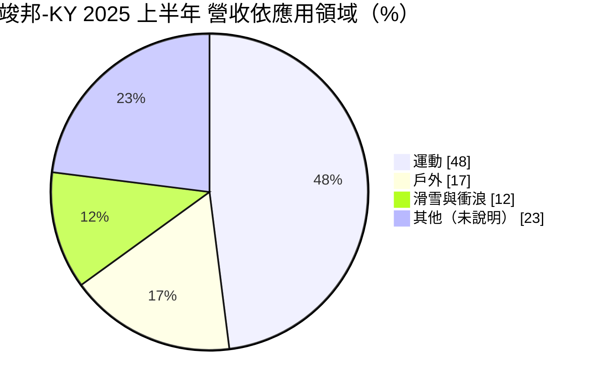
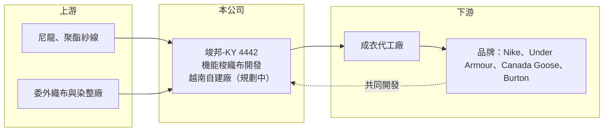

# 4442 竣邦-KY

> 上櫃｜[[產業索引-紡織纖維|紡織纖維]]｜上市（櫃）日期 2023/11/29

# 第一章：企業模式與商業藍圖

> [!info] 撰寫說明
> 精簡版，由 Claude 依公開資料整理，架構比照 [[2330台積電]]，資料截至 2026-10-08。來源：Goodinfo 經營績效年表（2022 至 2025 年）；富果 2025 年 8 月 27 日法說會備忘錄（產品、客戶、營收比重、越南建廠計畫）；櫃買中心開放資料快照（基本資料、2026 年第二季資產負債與上半年損益）。股利資料未查得。#待校對

竣邦-KY（以下簡稱竣邦）是註冊於開曼群島、2023 年 11 月在櫃買中心掛牌的機能布料公司，台灣據點在新北市中和區，董事長為高振芳，總經理為蕭志偉。控股公司登記成立於 2021 年 7 月，年營收約 11 至 17 億元，專做運動、戶外與滑雪衝浪品牌使用的高單價[[機能布]]。

- **核心業務：** 竣邦專注於運動休閒與戶外機能性布料的設計、研發與供應鏈管理，和品牌客戶共同開發布料，掌握紗線、織布、[[染整]]到後加工的技術規格。產品以[[梭織]]（平織）為主、占比超過九成，例如彈性布、薄布與 Taslon 尼龍布，多數單價在每碼 3 至 5 美元以上，屬於中高階布料。
- **營收結構：** 依 2025 年上半年法說資料，運動領域占 48%（Nike、Under Armour、Alo Yoga、Vuori），戶外領域占 17%（主要為 Canada Goose），滑雪與衝浪領域占 12%（Burton、Roxy、Quiksilver）。客戶以歐美高階品牌為主，並透過日本伊藤忠拓展日本市場。
- **營運模式：** 竣邦過去以「研發加委外生產」的輕資產模式經營，生產主要交由合作供應鏈執行，自己掌握開發與品質；集團另有越南子公司 J&B Textile Vietnam。輕資產讓它能以較少資本服務多個品牌，但也代表毛利的一部分要分給代工夥伴。
- **長期方向：** 依 2025 年法說會，公司已在越南購地建自有織染廠，目標 2026 年底完工、2027 年初試營運，第一期年產能 2,400 萬碼、未來可擴充到 7,000 萬碼；同時組建團隊發展針織產品線（待校對）。這代表竣邦正從輕資產開發商轉向擁有自有產能的垂直整合布廠，是公司長期結構的重大改變。

# 第二章：護城河深度與競爭優勢

竣邦的護城河來自和高階品牌的共同開發關係，以及利基型機能梭織布的技術；自建產能後，成本與交期控制能力將是新的考驗。

- **競爭優勢：** 戶外、滑雪與高階運動服對布料的防水、透氣、彈性與輕薄要求高，品牌開發一款布料往往要經過多季測試，一旦被採用就有黏著度。竣邦能同時服務 Nike、Canada Goose、Burton 等不同領域的品牌，代表它的開發能力被多個高階客戶認可。2025 年毛利率 28.0%，在台灣布料股中屬於偏高水準。
- **主要對手：** 台灣機能布同業包括 [[1460宏遠]]、[[1434福懋]]、[[1476儒鴻]]、[[1464得力]]、[[4439冠星-KY]]，以及日本東麗等國際布料大廠。竣邦規模小，但在梭織戶外與滑雪布料的利基市場上與大廠區隔。
- **觀察重點：** 越南自有廠能否如期投產並把產能利用率拉上來、針織產品線能否形成新營收來源，以及新品牌（如 Alo Yoga、Vuori 等新興運動品牌）的成長能否延續。

# 第三章：財務體質與盈利規模

資料日期：2026-10-08，表格是撰寫當時的快照；最新月營收、毛利率、累計 EPS 由自動排程寫在本筆記的屬性欄位（月營收、毛利率、累計EPS 等）。#待校對

竣邦近三年營收、毛利率與 ROE 同步上升，2025 年是掛牌後表現最好的一年。

| 年度 | 營收（億元） | [[毛利率]] | [[營業利益率]] | EPS（元） | [[ROE]] |
|---|---|---|---|---|---|
| 2021 | 未查得 | 未查得 | 未查得 | 未查得 | 未查得 |
| 2022 | 11.6 | 24.7% | 4.74% | 2.31 | 12.6% |
| 2023 | 11.3 | 22.7% | 3.77% | 1.30 | 6.67% |
| 2024 | 12.9 | 26.1% | 7.16% | 3.19 | 15.8% |
| 2025 | 16.7 | 28.0% | 11.1% | 5.23 | 21.1% |
| 2026 上半年 | 10.10 | 27.47% | 11.35% | 2.80 | 未查得 |

註：2022 至 2025 年取自 Goodinfo，2026 年上半年取自櫃買中心開放資料。

- **長期指標：** 2022 至 2025 年營收年複合成長率約 12.9%（推算），同期平均 ROE 約 14.0%（推算）。營業利益率從 2023 年的 3.77% 升到 2025 年的 11.1%，顯示營收放大後費用攤提效果明顯。現金股利紀錄這次未查得。
- **[[ROIC]] 與 [[WACC]]：** 2025 年營業利益約 1.85 億元（16.7 億 × 11.1%），稅後約 1.48 億元。2026 年第二季權益 9.06 億元，總負債 5.51 億元中有息負債未查得，假設約 2.5 億元，投入資本約 11.6 億元，ROIC 約 12.8%（推算）；以 2026 年上半年營業利益 1.15 億元年化計算約 15.8%（推算）。WACC 以無風險利率 1.75%、市場風險溢酬 6%、β 0.9（紡織同業常見值）、稅前負債成本 2.6%、稅率 20%、權益比重約 78% 計算約 6.0%（推算）。ROIC 明顯高於 WACC，代表輕資產模式下資本效率很好；越南建廠後投入資本將大增，ROIC 短期可能下滑。
- **財務特色：** 2026 年第二季資產 14.6 億元、負債比率約 38%，每股淨值 26.85 元，非流動負債僅 0.77 億元。越南自建廠的資本支出會改變目前的輕資產結構，未來幾年自由現金流可能轉弱（推估）。

# 第四章：總體風險與地緣政治

竣邦的風險在於從輕資產轉向重資產的執行，以及高階運動與戶外品牌的景氣起伏。

- **產業週期：** 2023 年品牌去庫存期間，竣邦營收持平但營業利益率降到 3.77%、EPS 僅 1.30 元，顯示利潤對訂單量很敏感。戶外與滑雪布料有明顯季節性，暖冬或消費轉弱會影響訂單。
- **營運風險：** 越南新廠若延後投產或利用率不足，折舊與人力成本會壓縮毛利；從委外轉為自製也需要建立染整管理與環保能力。客戶集中在少數歐美品牌，單一品牌的策略變化影響大。
- **其他風險：** 尼龍、聚酯原料價格波動；越南出口美國受[[對等關稅]]影響；美元計價營收受匯率影響；KY 公司的跨國治理與資訊揭露需要額外留意。

# 專有名詞解析

## 金融

- **[[ROIC]]**：投入資本報酬率，稅後營業利益除以股東權益加有息負債，衡量本業運用資本的效率。
- **[[WACC]]**：加權平均資金成本，股東與債權人要求報酬率的加權平均，是 ROIC 要超越的門檻。

## 產業

- **[[機能布]]**：具備吸濕排汗、防水透氣、彈性、抗紫外線等功能的布料，主要用於運動與戶外服飾。
- **[[梭織]]**：以經紗與緯紗垂直交織的織布方式，布面挺、結構穩定，常用於外套、褲子與戶外服。
- **[[染整]]**：對布料進行染色、印花與後整理（如防水、抗菌、定型）的工序，耗水耗能高，也是決定布料手感與功能的關鍵。
- **[[對等關稅]]**：美國自 2025 年起依各國貿易條件訂定的進口關稅，稅率依國家而異，影響企業的生產地選擇。

# 核心供應鏈

- 上游：紗線與委外代工夥伴名單未查得。
- 下游／客戶：Nike、Under Armour、Alo Yoga、Vuori、Carhartt、Canada Goose、Burton、Roxy、Quiksilver；日本市場經伊藤忠拓展。
- 同業：[[1460宏遠]]、[[1434福懋]]、[[1476儒鴻]]、[[4439冠星-KY]]。

## 最新新聞
<!-- news:start -->
<!-- news:end -->

## 相關連結
- [公開資訊觀測站](https://mopsov.twse.com.tw/mops/web/t05st03?step=1&firstin=1&co_id=4442)
- [Goodinfo](https://goodinfo.tw/tw/StockDetail.asp?STOCK_ID=4442)
- [Yahoo 股市](https://tw.stock.yahoo.com/quote/4442)
- [鉅亨網新聞](https://www.cnyes.com/twstock/4442/news)
