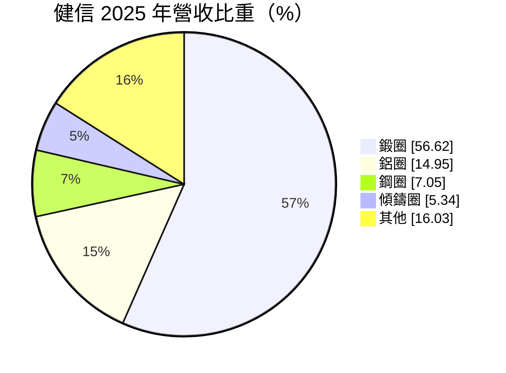
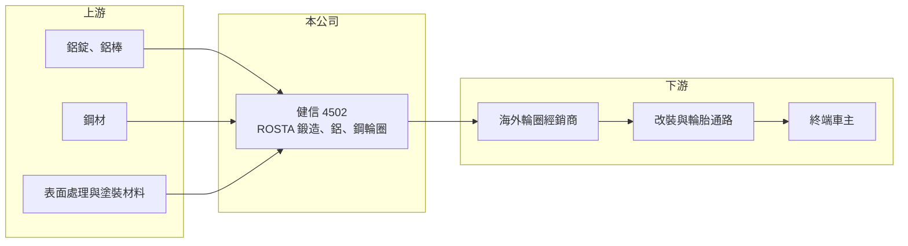

# 4502 健信

> 上櫃｜[[產業索引-電機機械|電機機械]]｜上市（櫃）日期 1995/12/12

# 第一章：企業模式與商業藍圖

> [!info] 撰寫說明
> 精簡版，由 Claude 依公開資料整理，架構比照 [[2330台積電]] 的四章研究，資料截至 2026-10-08。來源：櫃買中心開放資料（基本資料、2026 年第二季資產負債與損益、每月營收及備註）、MoneyDJ／富邦 e 點通 年度財務比率與基本資料（營收比重、歷年股利）。公開資料有限，客戶與市場描述為推估，標示待校對。#待校對

健信科技（品牌 ROSTA，以下簡稱健信）是彰化的汽車輪圈製造商，本章說明它的產品組合與經營處境。

- **核心業務：** 健信成立於 1978 年，總部與工廠在彰化線西，1995 年掛牌上櫃，以 ROSTA 品牌生產汽車輪圈。2025 年[[鍛造輪圈]]占營收 56.62%，其餘為一般鋁圈、鋼圈與傾斜鑄造輪圈。鍛造輪圈強度高、重量輕，單價也比鑄造輪圈高，是公司近年的主力產品。
- **營收結構：** 輪圈主要銷往汽車[[售後市場]]，也就是車主改裝、換胎時另外購買的輪圈，而非新車原廠配備（推估）。售後市場重視款式、尺寸齊全與交貨速度，訂單規模小但款式多。
- **營運據點：** 生產基地在台灣彰化，產品以外銷為主，美國是重要市場（推估）。櫃買中心月營收備註寫明 2025 年「受關稅影響致營收下降」，2025 年營收年減約 33%，顯示公司對美國市場的依賴與關稅的衝擊。
- **長期方向：** 鍛造輪圈占比提高，代表公司往高單價、客製化產品移動。2026 年 1 至 8 月營收較前一年同期成長約 36%，顯示關稅衝擊後訂單有所回補，但能否長期維持仍待觀察。

# 第二章：護城河深度與競爭優勢

汽車輪圈是競爭激烈的產業，本章說明健信的優勢與限制。

- **競爭優勢：** 健信擁有近五十年的輪圈製造經驗與自有品牌，鍛造產品能接小量、多樣的客製訂單，這是大型 OEM 輪圈廠不願意承接的市場。售後市場的經銷通路關係也是長期累積的資產。
- **主要對手：** 國內同業包括以鍛造輪圈供應高階車廠的 [[1563巧新]]，以及其他售後市場輪圈廠；國際上面對中國大量低價鑄造輪圈廠的競爭（待校對）。中國廠商在一般鋁圈的成本優勢明顯，迫使台灣業者往鍛造與高階市場移動。
- **觀察重點：** 公司本業長期接近損益兩平，2020、2021 與 2025 年都出現大幅虧損，顯示護城河很窄。長期要觀察鍛造產品能否穩定提高毛利率、對美國關稅的因應（例如調整售價或出貨地），以及財務結構能否改善。

# 第三章：財務體質與盈利規模

資料日期：2026-10-08，表格是撰寫當時的快照；最新月營收、毛利率、累計 EPS 由自動排程寫在本筆記的屬性欄位（月營收、毛利率、累計EPS 等）。#待校對

健信的財務體質偏弱，本章用多年度數據說明獲利不穩定與高負債的問題。

| 年度 | 營收年增率 | [[毛利率]] | [[營業利益率]] | EPS（元） | [[ROE]] |
|---|---|---|---|---|---|
| 2021 | -1.84% | 6.27% | -8.58% | -2.87 | -23.90% |
| 2022 | 3.71% | 14.78% | 0.05% | -0.39 | -3.63% |
| 2023 | -0.03% | 17.41% | 0.80% | 0.15 | 0.99% |
| 2024 | -5.60% | 17.09% | 0.12% | 0.21 | 1.32% |
| 2025 | -32.92% | 11.69% | -8.21% | -1.51 | -14.30% |
| 2026 上半年 | 營收 5.74 億元 | 18.04% | -0.63% | 0.20 | 未查得 |

註：2021 至 2025 年取自 MoneyDJ 年度財務比率（合併），年度營收金額未查得；2026 上半年取自櫃買中心開放資料。

- **營收規模：** 2026 年上半年營收 5.74 億元，1 至 8 月累計 8.27 億元，較前一年同期成長約 36%。從 2018 年起營收多數年度衰退，2019 年更大減約 39%，公司規模長期萎縮。
- **獲利：** 毛利率在 6% 至 18% 之間，營業利益率最好的年度也只有 1% 左右，屬於微利或虧損的經營狀態。2026 年上半年本業小虧，靠業外收入轉為每股 0.20 元的小幅獲利。近 5 年平均 ROE 約 -7.9%。
- **財務特色：** 2026 年第二季負債比率約 78%，股東權益只有 5.32 億元，保留盈餘為 -2.35 億元，每股淨值 9.60 元，低於面額 10 元。2019 年度以後（2020 至 2025 年度）沒有發放現金股利。公司另有約 736 萬股私募股份，代表曾以私募補充資金。
- **[[ROIC]] 與 [[WACC]]：** 以 2026 年上半年營業損失 0.04 億元年化、扣 20% 稅，稅後營業利益約 -0.06 億元，以股東權益 5.3 億元至加計全部負債的 23.7 億元計，ROIC 約 -1% 至 0%（推算）；2025 年營業利益率 -8.21%，當年 ROIC 更明顯為負（推算）。WACC 以無風險利率 1.75%、市場風險溢酬 6%、β 取 1.0（汽車零組件同業常見值，假設）得股權成本 7.75%，假設有息負債占投入資本 50%、稅前借款利率 3%、稅後 2.4%，WACC 約 5.1%（推算）。ROIC 長期低於 WACC，代表公司長期沒有創造經濟價值，高負債也讓營運缺乏緩衝。

# 第四章：總體風險與地緣政治

健信的風險集中在貿易政策、財務槓桿與中國競爭，本章逐項說明。

- **產業週期：** 售後市場輪圈需求受消費景氣、車主改裝意願與通路庫存影響，美國經濟轉弱時訂單會明顯減少。經銷商在景氣不確定時傾向降低庫存，讓上游製造商的訂單波動更大。
- **營運風險：** 負債比率接近八成、股東權益薄，若再出現連續虧損，可能面臨淨值進一步下滑與融資條件收緊。營收規模小，固定成本分攤不易，產能利用率下降時虧損會放大。
- **其他風險：** 美國對進口汽車零件與鋁製品的關稅，已在 2025 年造成營收大幅下滑，政策變化仍是最大的外部變數。鋁價波動直接影響原料成本，新台幣升值也會壓縮外銷毛利。

# 專有名詞解析

## 金融

- **[[負債比率]]**：總負債占總資產的比例，比例越高代表財務槓桿越大、抗風險能力越弱。

## 產業

- **[[鍛造輪圈]]**：以高壓把整塊鋁材鍛壓成形的輪圈，強度高、重量輕，單價高於一般鑄造輪圈。
- **[[售後市場]]**：車輛出廠後的維修、改裝與替換零件市場，與新車原廠配套（OEM）市場相對。
- **[[鍛造]]**：用壓力讓金屬在固態下變形成形的加工方式，可細化金屬組織、提高強度。

# 核心供應鏈

- 上游：鋁錠與鋁棒、鋼材（例如 [[2002中鋼]]）、塗裝與表面處理材料。
- 下游／客戶：海外（以美國為主，推估）輪圈經銷商、改裝店與輪胎通路，最終是一般車主。
- 同業：[[1563巧新]]，以及中國售後市場輪圈廠。

## 最新新聞
<!-- news:start -->
<!-- news:end -->

## 相關連結
- [公開資訊觀測站](https://mopsov.twse.com.tw/mops/web/t05st03?step=1&firstin=1&co_id=4502)
- [Goodinfo](https://goodinfo.tw/tw/StockDetail.asp?STOCK_ID=4502)
- [Yahoo 股市](https://tw.stock.yahoo.com/quote/4502)
- [鉅亨網新聞](https://www.cnyes.com/twstock/4502/news)
