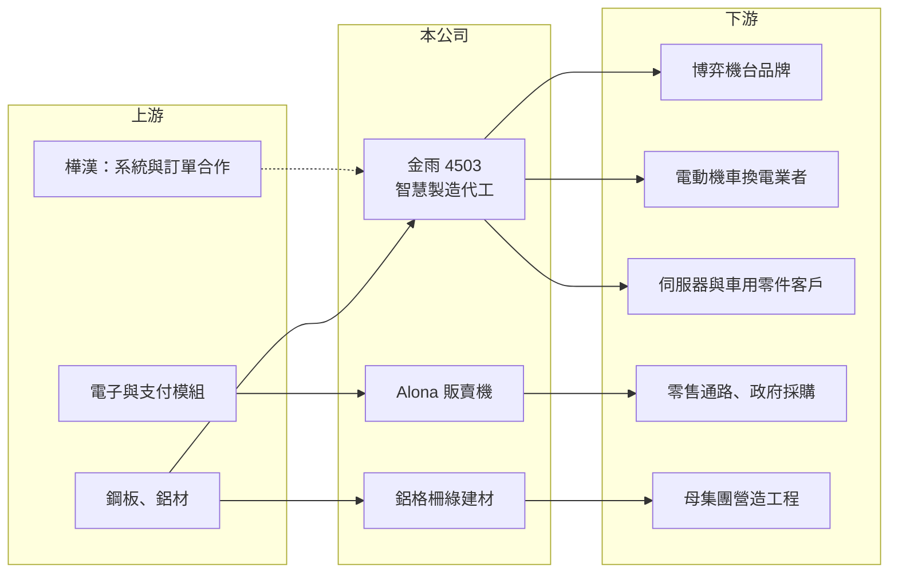

# 4503 金雨

> 上櫃｜[[產業索引-電機機械|電機機械]]｜上市（櫃）日期 1996/12/19

# 第一章：企業模式與商業藍圖

> [!info] 撰寫說明
> 精簡版，由 Claude 依公開資料整理，架構比照 [[2330台積電]] 的四章研究，資料截至 2026-10-08。來源：櫃買中心開放資料（基本資料、2026 年第二季資產負債與損益、每月營收及備註）、MoneyDJ／富邦 e 點通 年度財務比率、富果研究 2025 年 5 月法說會整理、經濟日報與 uptogo 新聞標題。法說會整理為二手摘要，客戶名稱等細節標示待校對；公開資料有限。#待校對

金雨企業（品牌 Alona，以下簡稱金雨）原本是傳統的金屬加工廠，近年轉型為以鈑金與組裝代工為主的「智慧製造」公司，本章說明它的三大事業與轉型邏輯。

- **核心業務：** 金雨成立於 1980 年，總部在彰化和美，1996 年掛牌上櫃。依富果整理的 2025 年 5 月法說會內容，公司分為三個事業：智慧製造（OEM/ODM 代工）、智慧零售（自有品牌 Alona [[自動販賣機]]）與智慧建築（鋁格柵、欄杆等綠建材）。智慧製造提供雷射切割、沖壓、焊接、粉體塗裝到組裝測試的[[一站式鈑金]]服務。
- **營收結構：** 智慧製造在 2025 年第一季約占營收七成，產品包括博弈遊戲機機台、電動機車換電與充電櫃、汽車零件與 AI 伺服器機殼（依法說會整理，待校對）。MoneyDJ 列出的 2025 年營收比重最大一項為 67.78%，與此一致。智慧建築主要供應母集團的營造工程，智慧零售則以販賣機銷售與汰換需求為主。
- **營運據點：** 主要生產在台灣彰化，並在彰濱工業區租用新廠擴充組裝線；越南另有一座約 3,900 平方公尺的廠房，法說會時尚未投入使用（待校對）。依法說會整理，[[6414樺漢]] 是重要股東與策略夥伴，會協助導入訂單與生產系統。
- **長期方向：** 公司的方向是從單純鈑金加工升級為高附加價值的組裝代工，並利用販賣機法規更新帶來的汰換需求擴大零售設備銷售。轉型成效反映在 2025 年營收成長約 92%、本業由虧轉盈，但 2026 年主要客戶採購合約到期未續約，營收轉為衰退，客戶集中的問題浮現。

# 第二章：護城河深度與競爭優勢

金雨規模小、轉型時間短，本章說明它的競爭優勢與脆弱之處。

- **競爭優勢：** 一站式鈑金到組裝測試的能力，讓客戶可以把機殼、結構件與整機組裝交給同一家廠商，減少協調成本。與樺漢的股權合作提供訂單來源與管理系統，自有販賣機品牌則讓公司不完全依賴代工。
- **主要對手：** 鈑金與機殼代工的同業眾多，包括伺服器機殼廠 [[8210勤誠]]、[[3013晟銘電]] 等，以及大量中小型鈑金廠；販賣機市場則與日系品牌及國內其他販賣機業者競爭（待校對）。金雨的規模遠小於主要機殼廠，議價力有限。
- **觀察重點：** 2026 年營收受主要客戶合約到期影響而下滑，代表客戶集中度高、訂單能見度不穩。長期要觀察新客戶與新產品（換電櫃、伺服器機殼、販賣機）能否分散營收，以及毛利率能否維持在 20% 以上。

# 第三章：財務體質與盈利規模

資料日期：2026-10-08，表格是撰寫當時的快照；最新月營收、毛利率、累計 EPS 由自動排程寫在本筆記的屬性欄位（月營收、毛利率、累計EPS 等）。#待校對

金雨過去多年虧損，2025 年才轉虧為盈，本章用多年度數據說明轉型前後的變化。

| 年度 | 營收年增率 | [[毛利率]] | [[營業利益率]] | EPS（元） | [[ROE]] |
|---|---|---|---|---|---|
| 2021 | -33.12% | 1.98% | -26.88% | -0.85 | -7.17% |
| 2022 | 30.52% | -11.44% | -34.91% | -0.84 | -7.22% |
| 2023 | 56.69% | -12.48% | -30.26% | -1.27 | -10.38% |
| 2024 | 25.99% | -5.30% | -29.36% | -1.27 | -6.60% |
| 2025 | 92.01% | 21.75% | 10.36% | 1.37 | 6.87% |
| 2026 上半年 | 營收 3.43 億元 | 38.62% | 23.96% | 2.28 | 未查得 |

註：2021 至 2025 年取自 MoneyDJ 年度財務比率（合併），年度營收金額未查得；2026 上半年取自櫃買中心開放資料。

- **營收規模：** 2026 年上半年營收 3.43 億元，1 至 8 月累計 3.86 億元，較前一年同期減少約 14%；7、8 月營收明顯下滑，櫃買中心月營收備註說明是主要客戶採購合約到期不續約。營收規模小，單一客戶的變動就會造成大幅波動。
- **獲利：** 2021 至 2024 年毛利率為負或接近零，代表產能閒置、固定成本無法分攤。2025 年營收倍增後毛利率回升到 21.75%，2026 年上半年更達 38.62%。不過 2026 年上半年稅前淨利 2.00 億元中，業外收入就有 1.18 億元，EPS 2.28 元有相當比例不是本業貢獻（業外性質未查得）。近 5 年平均 ROE 約 -4.9%。
- **財務特色：** 2026 年第二季負債比率約 26%，流動資產 20.4 億元占總資產八成以上，股東權益 18.7 億元，其中資本公積 9.7 億元，推估曾透過增資或私募引進資金（推估）。2019 至 2025 年度沒有發放現金股利。非流動負債 4.9 億元，可能與發行[[可轉換公司債]]有關（新聞標題提及發行可轉債，年份待校對）。
- **[[ROIC]] 與 [[WACC]]：** 以 2026 年上半年營業利益 0.82 億元年化、扣 20% 稅，稅後營業利益約 1.32 億元；以股東權益 18.7 億元計算 ROIC 約 7%，若加計全部負債 6.5 億元，約 5.2%（推算）。由於資產中現金與流動資產比例高，若扣除閒置現金，實際營運資本報酬會更高（推估）。WACC 以無風險利率 1.75%、市場風險溢酬 6%、β 取 1.1（小型代工廠常見值，假設）得股權成本約 8.4%，假設有息負債占投入資本 20%、稅後負債成本 1.6%，WACC 約 7%（推算）。ROIC 與 WACC 大致相當，且 2026 年下半年營收下滑，能否持續高於資金成本仍不確定。

# 第四章：總體風險與地緣政治

金雨處在轉型初期，風險主要來自客戶集中與執行面，本章逐項說明。

- **產業週期：** 博弈機台、換電設備與伺服器機殼分屬不同產業，各有自己的投資週期，客戶在景氣不佳時會延後拉貨。販賣機汰換需求則取決於法規時程，屬於一次性的換機潮，換完後需求會回落。
- **營運風險：** 營收高度依賴少數大客戶，2026 年主要客戶合約到期不續約，已直接造成營收下滑。新廠擴產與人力擴編會增加固定成本，若訂單接不上，毛利率可能回到過去的虧損水準。
- **其他風險：** 鋼材、鋁材價格波動影響成本；海外客戶（如美國博弈業者，待校對）的訂單會受關稅與匯率影響。博弈產業本身受各國法規監管，需求也可能因法規改變而波動。

# 專有名詞解析

## 應用

- **[[自動販賣機]]**：無人販售商品的設備，新機型整合多元支付與雲端管理，屬於智慧零售的一環。

## 金融

- **[[可轉換公司債]]**：持有人可在一定條件下把債券轉換成公司股票的公司債，是中小企業常用的籌資工具。

## 產業

- **[[OEM ODM]]**：OEM 是依客戶設計代工生產，ODM 是由代工廠負責設計並生產，兩者都以客戶品牌出貨。
- **[[一站式鈑金]]**：從切割、沖壓、折彎、焊接、塗裝到組裝都在同一家廠商完成的金屬件製造服務。

# 核心供應鏈

- 上游：鋼板與鋁材（例如 [[2002中鋼]]）、電子與支付模組；策略股東 [[6414樺漢]] 提供系統與訂單合作。
- 下游／客戶：博弈機台品牌（法說會整理提及 IGT，待校對）、電動機車換電業者（光陽 Ionex，待校對）、汽車與伺服器零件客戶、販賣機通路，以及母集團營造工程。
- 同業：[[8210勤誠]]、[[3013晟銘電]] 等鈑金機殼廠，以及國內販賣機業者。

## 最新新聞
<!-- news:start -->
<!-- news:end -->

## 相關連結
- [公開資訊觀測站](https://mopsov.twse.com.tw/mops/web/t05st03?step=1&firstin=1&co_id=4503)
- [Goodinfo](https://goodinfo.tw/tw/StockDetail.asp?STOCK_ID=4503)
- [Yahoo 股市](https://tw.stock.yahoo.com/quote/4503)
- [鉅亨網新聞](https://www.cnyes.com/twstock/4503/news)
