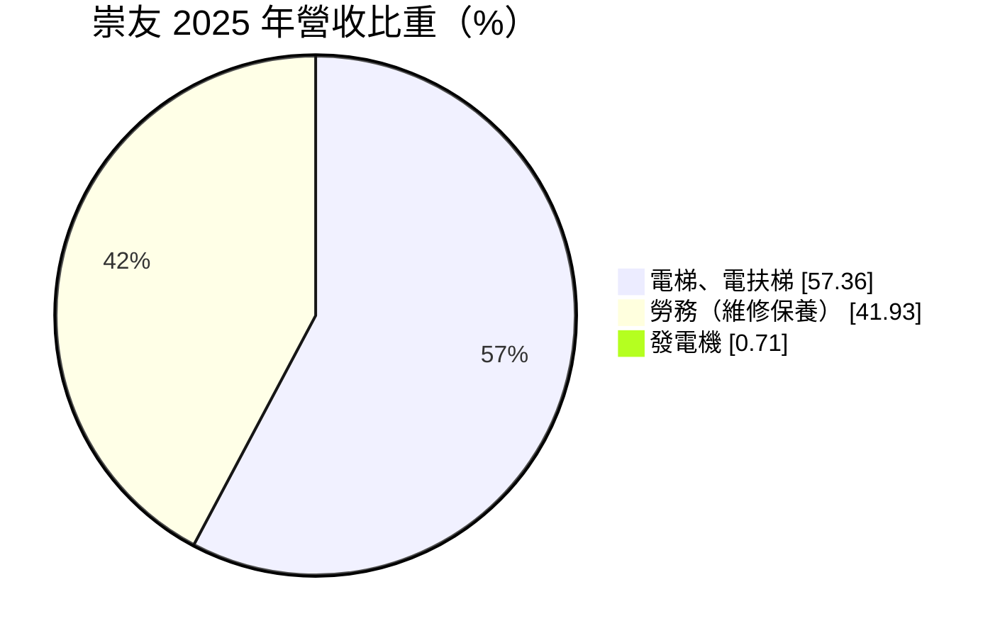
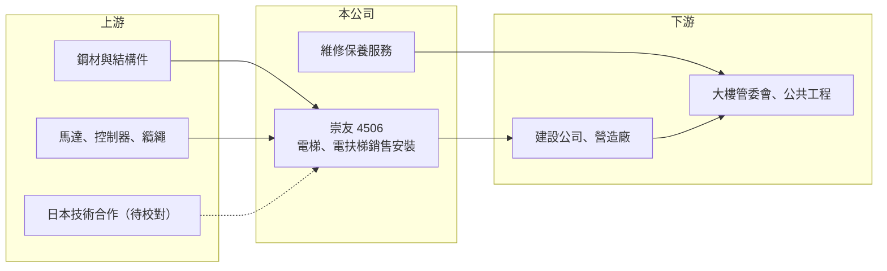

# 4506 崇友

> 上櫃｜[[產業索引-電機機械|電機機械]]｜上市（櫃）日期 1997/12/06

# 第一章：企業模式與商業藍圖

> [!info] 撰寫說明
> 精簡版，由 Claude 依公開資料整理，架構比照 [[2330台積電]] 的四章研究，資料截至 2026-10-08。來源：櫃買中心開放資料（基本資料、2026 年第二季資產負債與損益、每月營收、本益比殖利率）、MoneyDJ／富邦 e 點通 年度財務比率與基本資料（營收比重、股利）、富果與經濟日報新聞標題。技術合作對象等背景描述憑整理性知識撰寫，標示待校對。#待校對

崇友實業（以下簡稱崇友）是台灣本土規模最大的電梯品牌之一，本章說明它如何把一次性的設備銷售，轉成長達數十年的維修保養收入。

- **核心業務：** 崇友成立於 1974 年，1997 年掛牌上櫃，主要銷售、安裝電梯與電扶梯，並提供後續的[[維保服務]]。2025 年設備銷售占營收 57.36%、勞務收入占 41.93%，另有不到 1% 的發電機業務。這種「設備加服務」的組合，讓公司同時參與新建案景氣與既有大樓的長期保養需求。
- **營收結構：** 設備收入跟著新建住宅、商辦與公共工程的完工進度認列，時間點受營建週期影響。勞務收入則來自每月的保養合約與老舊電梯的修理、汰換，每部裝好的電梯都可能帶來二、三十年的服務收入，因此裝機量越大，經常性收入的基礎就越厚。
- **營運據點：** 公司總部在台北，業務以台灣市場為主，服務網遍布各縣市，因為保養工作需要技師在短時間內到場，在地據點密度本身就是營運能力。電梯的技術來源與日本大廠有長期合作關係（待校對），台灣本地負責銷售、安裝與保養。
- **長期方向：** 台灣有大量 1990 年代以前興建的老舊大樓，政府推動都市更新與危老重建，加上高齡化帶來的老公寓加裝電梯需求，是設備端的長期動能。服務端則靠裝機量累積，維保合約占比提高後，公司獲利會越來越像收租型事業。

# 第二章：護城河深度與競爭優勢

崇友的護城河不在技術專利，而在於龐大的裝機基礎與維保網路，本章說明這種優勢的來源與限制。

- **競爭優勢：** 電梯屬於攸關人身安全、需要定期檢查的設備，大樓管委會換保養廠商的意願通常不高，原廠保養的轉換成本與信任成本都很明顯。崇友長期累積的裝機量，讓它能把維保收入維持在營收四成左右，這部分毛利穩定、受景氣影響小，是公司毛利率能穩定在 30% 上下的主要原因。
- **主要對手：** 台灣電梯市場的主要競爭者包括永大機電（日立體系）、台灣三菱電梯，以及奧的斯（Otis）、迅達（Schindler）、通力（KONE）、東芝電梯等外商。高階商辦與大型公共工程常由國際品牌主導，崇友的強項在住宅大樓與中型建案，兩者的客群部分重疊。
- **觀察重點：** 長期要觀察維保收入占比能否持續提高、危老與都更案能否帶動汰換需求，以及原物料與人工成本上升時能否順利轉嫁到報價。由於安裝與保養都高度依賴技師，人力的招募與留任也會影響服務品質與擴張速度。

# 第三章：財務體質與盈利規模

資料日期：2026-10-08，表格是撰寫當時的快照；最新月營收、毛利率、累計 EPS 由自動排程寫在本筆記的屬性欄位（月營收、毛利率、累計EPS 等）。#待校對

崇友是本組電機機械公司中財務品質最穩定的一家，本章用多年度數據說明它的獲利穩定度與資本報酬。

| 年度 | 營收年增率 | [[毛利率]] | [[營業利益率]] | EPS（元） | [[ROE]] |
|---|---|---|---|---|---|
| 2021 | 4.82% | 30.79% | 19.29% | 4.39 | 16.93% |
| 2022 | 2.92% | 29.65% | 18.09% | 4.79 | 17.52% |
| 2023 | 11.16% | 29.05% | 18.38% | 5.06 | 17.61% |
| 2024 | 4.14% | 31.43% | 20.17% | 5.58 | 18.41% |
| 2025 | 9.74% | 32.52% | 21.60% | 6.52 | 20.32% |
| 2026 上半年 | 營收 33.96 億元 | 33.82% | 23.56% | 4.45 | 未查得 |

註：2021 至 2025 年取自 MoneyDJ 年度財務比率（合併），年度營收金額未查得；2026 上半年取自櫃買中心開放資料。

- **營收規模：** 2026 年上半年營收 33.96 億元，2026 年 1 至 8 月累計營收 43.63 億元，較前一年同期成長約 3.6%。2018 至 2025 年營收每年幾乎都正成長，只是年增率多在 3% 至 11% 之間，屬於穩健但不爆發的成長型態。
- **獲利：** 毛利率長期維持在 29% 至 33%，營業利益率由 2021 年的 19.29% 逐步提升到 2025 年的 21.60%，EPS 從 2018 年的 3.63 元一路成長到 2025 年的 6.52 元，八年沒有衰退。近 5 年（2021 至 2025）平均 ROE 約 18.2%，而且逐年走高。
- **財務特色：** 負債比率約 45% 至 52%，但 2026 年第二季非流動負債只有約 0.58 億元，負債主要是流動負債，推估多為工程預收款與應付帳款，而非銀行借款（推估）。現金股利從 2019 年的 2.7 元逐年提高到 2025 年度的 5.3 元，2023 至 2025 年配息率約八成，是典型的穩定配息股。
- **[[ROIC]] 與 [[WACC]]：** 以 2026 年上半年營業利益 8.00 億元年化、扣 20% 稅，稅後營業利益約 12.8 億元；崇友的有息負債推估很少，以股東權益 57.0 億元為投入資本，ROIC 約 22%（推算）；若把全部負債 60.6 億元都算進去，下限也有約 11%（推算）。WACC 以台灣 10 年期公債 1.75%、市場風險溢酬 6%、β 取 0.7（維保型公用事業性質的同業常見值，假設）計算，股權成本約 6.0%，由於幾乎沒有借款，WACC 約 6%（推算）。ROIC 明顯高於 WACC，代表崇友長期在創造股東價值。

# 第四章：總體風險與地緣政治

崇友的風險主要來自營建景氣與人力成本，本章說明哪些因素可能削弱它的穩定性。

- **產業週期：** 設備收入約占六成，與新建案完工量高度相關，房市降溫或建商延後推案時，設備出貨會隨之放緩。不過維保收入可以緩衝景氣下行，因此崇友的獲利波動遠小於一般機械設備業。
- **營運風險：** 電梯安裝與保養需要持證技師，人力短缺與薪資上漲會壓縮服務毛利。重大安全事故會直接損害品牌信任，並可能帶來賠償與法規責任。
- **其他風險：** 鋼材、馬達、控制器等成本上漲時，若已簽約的工程無法調價，毛利率會短期受壓。關鍵零組件與技術若依賴日本合作夥伴（待校對），日圓匯率與合作關係變化也會影響成本。

# 專有名詞解析

## 金融

- **[[配息率]]**：現金股利占當年度每股盈餘的比例，反映公司把獲利分給股東的程度。

## 產業

- **[[維保服務]]**：設備售出後提供的定期保養、檢修與零件更換服務，通常以長期合約收費，收入穩定、毛利較高。
- **[[裝機基礎]]**：一家公司過去累積安裝、仍在使用中的設備總量，是後續維修、汰換與升級收入的來源。
- **[[危老重建]]**：台灣針對老舊、有安全疑慮建築提供容積獎勵的重建制度，會帶動新電梯與建材需求。

# 核心供應鏈

- 上游：鋼材（例如 [[2002中鋼]]）、馬達與控制系統、電梯技術合作夥伴（待校對）。
- 下游／客戶：住宅與商辦建設公司、營造廠、公共工程單位，以及完工後的大樓管委會（維保合約）。
- 同業：永大機電、台灣三菱電梯、奧的斯、迅達、通力、東芝電梯。

## 最新新聞
<!-- news:start -->
<!-- news:end -->

## 相關連結
- [公開資訊觀測站](https://mopsov.twse.com.tw/mops/web/t05st03?step=1&firstin=1&co_id=4506)
- [Goodinfo](https://goodinfo.tw/tw/StockDetail.asp?STOCK_ID=4506)
- [Yahoo 股市](https://tw.stock.yahoo.com/quote/4506)
- [鉅亨網新聞](https://www.cnyes.com/twstock/4506/news)
