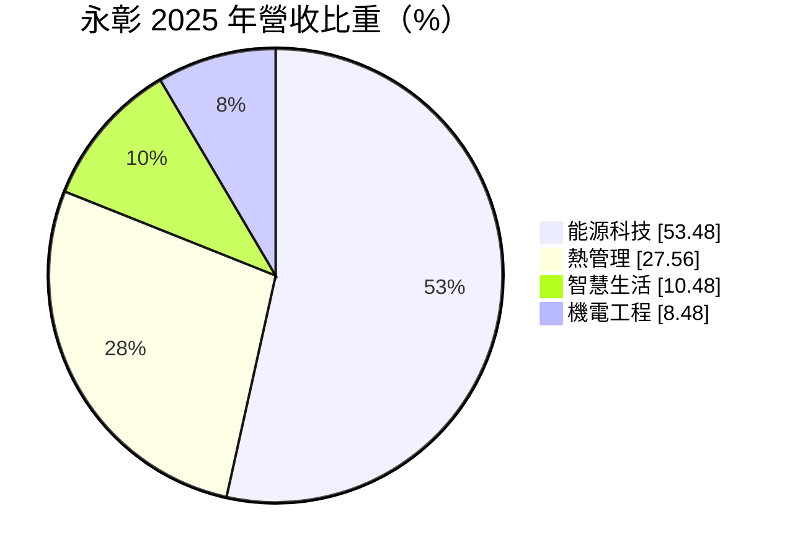
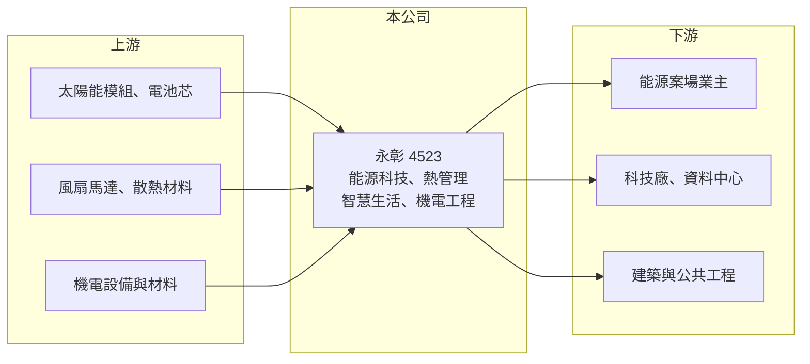

# 4523 永彰

> 上櫃｜[[產業索引-電機機械|電機機械]]｜上市（櫃）日期 1999/11/22

# 第一章：企業模式與商業藍圖

> [!info] 撰寫說明
> 精簡版，由 Claude 依公開資料整理，架構比照 [[2330台積電]] 的四章研究，資料截至 2026-10-08。來源：櫃買中心開放資料（基本資料、2026 年第二季資產負債與損益、每月營收及備註、本益比殖利率）、MoneyDJ／富邦 e 點通 年度財務比率與基本資料（營收比重、歷年股利）、自由時報與富果新聞標題。公開資料有限，各事業的具體產品為推估，標示待校對。#待校對

永彰科技（以下簡稱永彰）原本以車用散熱風扇等機電產品為主，近年停止車用業務、處分工廠土地，轉向能源科技與熱管理，本章說明這次轉型。

- **核心業務：** 永彰成立於 1987 年，1999 年掛牌上櫃，總部目前位於桃園中壢青埔。依 MoneyDJ 的 2025 年營收比重，能源科技占 53.48%、熱管理占 27.56%、智慧生活占 10.48%、機電工程占 8.48%。能源科技推估包括太陽能或儲能等能源系統工程，熱管理則延續公司過去在風扇與散熱模組的技術（推估，待校對）。
- **營收結構：** 能源與機電工程類收入以專案認列，常在工程結案時一次入帳，因此月營收波動很大。櫃買中心 2026 年 8 月月營收備註寫明營收成長「主係本年專案結案及工程收入認列所致」，2026 年 1 至 8 月營收較前一年同期成長約 92%。
- **營運據點：** 新聞標題指出公司停止車用業務並處分觀音廠土地，處分利益估約 19 億元；MoneyDJ 資料顯示 2025 年 EPS 為 22.26 元，推估就是認列這筆處分利益（年份與金額待校對）。處分後公司的製造據點規模縮小，營運重心轉向工程與系統整合。
- **長期方向：** 轉型後的長期方向是承接台灣能源轉型（再生能源、儲能、節能）與資料中心散熱相關的需求。這些市場成長性高，但永彰在其中的規模與技術地位仍需時間驗證。

# 第二章：護城河深度與競爭優勢

永彰正處於事業重組階段，本章說明轉型後的競爭位置與不確定性。

- **競爭優勢：** 公司在風扇、馬達與散熱方面有數十年的機電經驗，可延伸到熱管理與機電工程。處分土地後手上資金充裕，有能力投入新事業或支撐專案的營運資金需求，這是許多同規模工程公司沒有的條件。
- **主要對手：** 熱管理與散熱領域有 [[3017奇鋐]]、[[3324雙鴻]] 等大型散熱廠，以及許多風扇與散熱模組廠；能源工程則面對眾多太陽能與儲能系統整合商（待校對）。永彰在這兩個市場的規模都遠小於主要對手。
- **觀察重點：** 2026 年上半年本業仍虧損，毛利率約 20%、營業利益率約 -10%，顯示新事業尚未形成規模經濟。長期要觀察能源與熱管理的接單是否穩定、毛利率能否提高，以及處分土地取得的資金如何運用（再投資、還債或配息）。

# 第三章：財務體質與盈利規模

資料日期：2026-10-08，表格是撰寫當時的快照；最新月營收、毛利率、累計 EPS 由自動排程寫在本筆記的屬性欄位（月營收、毛利率、累計EPS 等）。#待校對

永彰的財報在轉型期間受一次性項目扭曲，本章用多年度數據把本業與一次性收益分開看。

| 年度 | 營收年增率 | [[毛利率]] | [[營業利益率]] | EPS（元） | [[ROE]] |
|---|---|---|---|---|---|
| 2021 | 7.21% | 21.04% | -9.92% | -0.22 | -1.50% |
| 2022 | -23.05% | 24.86% | -14.89% | -1.44 | -10.02% |
| 2023 | 4.55% | 23.96% | -20.78% | -0.25 | -5.93% |
| 2024 | 6.08% | 19.67% | -29.43% | -1.53 | -15.72% |
| 2025 | -7.15% | -71.27% | -145.80% | 22.26 | 58.57% |
| 2026 上半年 | 營收 5.81 億元 | 20.24% | -9.59% | -0.92 | 未查得 |

註：2021 至 2025 年取自 MoneyDJ 年度財務比率（合併），年度營收金額未查得；2025 年毛利率與營業利益率大幅為負，推估與停止車用業務的存貨與資產減損有關（推估），EPS 則含土地處分利益。2026 上半年取自櫃買中心開放資料。

- **營收規模：** 2026 年上半年營收 5.81 億元，1 至 8 月累計 7.82 億元，較前一年同期成長約 92%，主要來自專案結案認列。專案型收入的特性是年度間差異大，不能用單月或單季推估全年。
- **獲利：** 2021 至 2024 年本業每年都虧損，營業利益率從 -10% 惡化到 -29%，這是公司決定停止車用業務的背景。2025 年 EPS 22.26 元幾乎全部來自一次性處分利益，本業反而因結束業務而大幅虧損。近 5 年平均 ROE 約 5%，但扣除 2025 年一次性收益後為明顯負值。
- **財務特色：** 2026 年第二季負債比率約 40%，股東權益 18.9 億元，每股淨值 28.07 元。2025 年度配發每股約 2.64 元現金股利，而 2020 至 2024 年度都沒有配息，這次配息是分配處分利益，不代表未來有穩定配息能力。
- **[[ROIC]] 與 [[WACC]]：** 以 2026 年上半年營業損失 0.56 億元年化、扣 20% 稅，稅後營業利益約 -0.89 億元；以股東權益 18.9 億元至加計全部負債的 31.4 億元計，ROIC 約 -5% 至 -3%（推算）。WACC 以無風險利率 1.75%、市場風險溢酬 6%、β 取 1.0（中小型機電工程同業常見值，假設）得股權成本 7.75%，假設有息負債占投入資本 20%、稅後負債成本 1.6%，WACC 約 6.5%（推算）。本業 ROIC 為負、低於 WACC，2025 年的高 ROE 來自資產處分而非經營，轉型能否創造價值仍待新事業證明。

# 第四章：總體風險與地緣政治

轉型中的公司風險較高，本章說明永彰需要注意的面向。

- **產業週期：** 能源工程受政府再生能源政策、電價與補助制度影響，政策調整會改變案場投資意願。散熱與機電工程則跟著科技廠與資料中心的資本支出週期走。
- **營運風險：** 專案型收入集中在少數案件，工程延誤、成本超支或驗收爭議都會直接影響當年度損益。新事業規模尚小，費用率高，若營收無法持續放大，本業虧損可能延續。
- **其他風險：** 處分土地取得的現金若投入新事業失利，會侵蝕股東權益。電池、太陽能模組等關鍵零組件多從國外進口，價格與匯率波動會影響工程毛利。

# 專有名詞解析

## 金融

- **[[一次性收益]]**：處分土地、廠房或投資等非經常發生的利益，會墊高當年 EPS，但不代表本業獲利能力。
- **[[專案認列]]**：工程收入依完工進度或結案時點入帳，造成營收在不同月份或年度間大幅波動。

## 產業

- **[[熱管理]]**：控制設備溫度的技術與產品，包括風扇、散熱模組與液冷系統，AI 伺服器使其重要性大增。
- **[[儲能系統]]**：以電池儲存電力、在需要時釋放的系統，用於平衡再生能源發電與電網負載。

# 核心供應鏈

- 上游：太陽能模組與電池芯、風扇馬達與散熱材料、機電設備與工程材料（具體供應商未查得）。
- 下游／客戶：能源案場業主、科技廠與資料中心、建築與公共工程業主（推估）。
- 同業：散熱領域的 [[3017奇鋐]]、[[3324雙鴻]]，以及國內能源系統整合商。

## 最新新聞
<!-- news:start（自動產生，請勿手動編輯此範圍） -->
- 2026-10-09 📰 媒體 08:51｜營收速報 - 永彰(4523)9月營收1.16億元年增率高達122.59％｜[鉅亨網](https://news.cnyes.com/news/id/6626639)

完整紀錄：[[4523永彰 新聞]]
<!-- news:end -->

## 相關連結
- [公開資訊觀測站](https://mopsov.twse.com.tw/mops/web/t05st03?step=1&firstin=1&co_id=4523)
- [Goodinfo](https://goodinfo.tw/tw/StockDetail.asp?STOCK_ID=4523)
- [Yahoo 股市](https://tw.stock.yahoo.com/quote/4523)
- [鉅亨網新聞](https://www.cnyes.com/twstock/4523/news)
